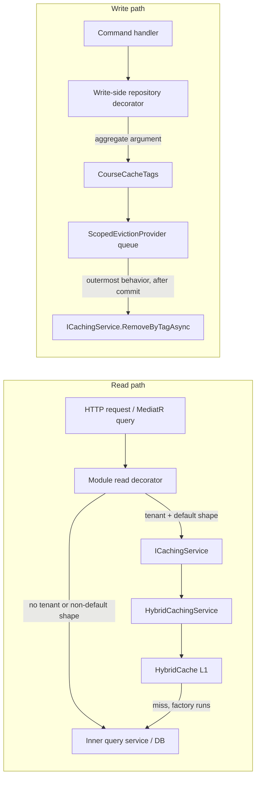

# Caching architecture and file reference (#33)

This document explains the caching seam introduced for issue #33, how the read and write paths
work end to end, and what every new file is responsible for.

Related documents:

- [`spec-33/code-review-plan.md`](../../spec-33/code-review-plan.md) — the authoritative design
  record and decision log (D1–D7).
- [`docs/CachingArchitecture.md`](../CachingArchitecture.md) — shorter platform overview.
- [`Modules/Courses/CACHING.md`](../../src/alphazero-api/Modules/Courses/CACHING.md) — Courses
  surface/TTL/tag matrix and tolerances.
- [`TODOS.md`](../../TODOS.md) — follow-ups, including distributed invalidation.

---

## 1. Shape of the solution

The platform targets a **single API server**, so caching is an in-process **L1-only**
`HybridCache`. No `IDistributedCache`/Redis is registered. Consequences:

- Eviction is per process. With more than one instance, another instance's entries stay stale
  until their TTL expires. This is tracked in `TODOS.md` and is not hidden by the design.
- `HybridCache` serialises values **even for L1**. Cached payloads must therefore be JSON-shaped
  (DTOs/records, or a serialised string). Domain aggregates with private constructors and
  read-only collections cannot be cached directly; Identity projects and rehydrates them.
- Single-flight for concurrent cold loads is provided by `HybridCache`; no separate stampede
  code exists.

The code is split into two responsibilities:



Reads are **decorators** around existing query services: the module keeps its uncached
implementation and layers caching on top. Writes are also **decorators**, around the write
repositories: each write method derives the tags from the aggregate it is handed, so eviction
needs no change-tracker scan and no parent lookup.

### Module boundary rule

Only `AlphaZero.Shared/Infrastructure/Caching` references
`Microsoft.Extensions.Caching.Hybrid`. Module projects depend on `ICachingService`,
`CacheKey`, `CacheTag`, `CachePolicy` and `CacheScope`. This keeps the serializer, tag formats
and any future L2 behind one boundary.

### Non-negotiable invariants

| Invariant | Enforced by |
|---|---|
| Module code never references `HybridCache` | Only the shared abstraction project references the package |
| Every tenant-scoped key/tag carries the tenant segment | `CacheScope.Key/Tag`; they throw without a tenant |
| A request with no tenant bypasses the cache instead of writing `none` | Read decorators check `CacheScope.IsEnabled` |
| Caller paging/search/sort never enters a key | `CourseCacheKeys.IsDefaultPage` / `IsDefaultCatalogSort`; non-default requests bypass |
| Commands and handlers contain no cache logic | Tags are emitted by module write-repository decorators, not from command types |
| Every write to a cache-feeding entity goes through a decorator | Scrutor `Decorate` registrations; `CoursesEvictionCoverageInterceptor` warns on misses |
| Eviction runs only after the outermost commit | `EvictionFlushScope` depth + outermost `CacheEvictionFlushBehavior` |
| Error results and exceptions do not evict | The flush behavior discards the queue in both cases |
| Eviction failure after a successful commit is non-fatal | `ScopedEvictionProvider` logs and swallows, except cancellation |
| `OperationCanceledException` always propagates | Provider and consumers rethrow it explicitly |
| Over-eviction is acceptable; under-eviction is a bug | Tag builders deliberately queue broad families |

---

## 2. Shared abstraction (`AlphaZero.Shared/Infrastructure/Caching`)

### 2.1 `CacheKey.cs` — typed identifiers

`CacheKey` and `CacheTag` are readonly record structs with a single `Value`. They are built as:

```csharp
CacheKey.Create("courses:view", tenantId.ToString("N"), courseId.ToString("N"));
// => courses:view:{tenantN}:{courseN}
```

Rules:

- The **family** is developer-authored, non-empty, and may contain `:` to group related keys.
- **Parts** must be non-empty and must not contain `:`; values are therefore safe to join.
- With no parts the value is the family alone.

`CacheKey.Create` is used directly only for deliberately **global** entries (Identity device
keys/assignments/conditions, Tenants branding, the video SSM key). Tenant-scoped keys are always
built through `CacheScope`.

### 2.2 `CacheScope.cs` — tenant binding

```csharp
public readonly record struct CacheScope
{
    public Guid? TenantId { get; }
    public bool IsEnabled => TenantId.HasValue;

    public static CacheScope ForTenant(Guid? tenantId);
    public CacheKey Key(string family, params string[] parts);
    public CacheTag Tag(string family, params string[] parts);
}
```

`Key`/`Tag` prepend `TenantId.ToString("N")` as the first part, producing
`{family}:{tenantN}:{parts...}`. Calling them with no tenant throws — a placeholder tenant can
never be written. Callers must check `IsEnabled` and fall through to the database instead.

### 2.3 `CachePolicy.cs` — TTL

A small value object holding a positive `TimeToLive`; the constructor rejects zero/negative
values. `HybridCachingService` applies it to both `Expiration` and `LocalCacheExpiration`, so a
future distributed L2 would inherit the same TTLs.

### 2.4 `ICachingService.cs` and `HybridCachingService.cs` — read/write API

```csharp
Task<T> GetOrCreateAsync<T>(
    CacheKey key,
    CachePolicy policy,
    IReadOnlyCollection<CacheTag> tags,
    Func<CancellationToken, Task<T>> factory,
    CancellationToken cancellationToken = default);

Task RemoveAsync(CacheKey key, CancellationToken cancellationToken = default);

Task SetAsync<T>(
    CacheKey key, T value, CachePolicy policy,
    IReadOnlyCollection<CacheTag> tags, CancellationToken cancellationToken = default);

Task RemoveByTagAsync(CacheTag tag, CancellationToken cancellationToken = default);
```

`HybridCachingService` is the only class that touches `HybridCache`. It forwards the factory as
the factory state and maps `CacheTag` values to HybridCache tag strings.

### 2.5 Eviction contracts

| File | Contract | Role |
|---|---|---|
| `IEvictionProvider.cs` | `Begin`, `Evict(tag)`, `Evict(tags)`, `FlushAsync`, `Discard`, `IsActive`, `HasPendingTags` | Flow-local queue of tags |
| `ScopedEvictionProvider.cs` | shared `IEvictionProvider` | `AsyncLocal<HashSet<CacheTag>?>` queue; flushes per tag and applies failure semantics |

Eviction tags are produced by **write-side repository decorators**, not by inspecting the EF
change tracker. A decorator receives the aggregate on every `Add`/`Update`/`Remove`, so it can
derive the tag set directly from `TenantId` and the aggregate's ids. There is no dispatch table,
no parent lookup, and no module implementation of a policy interface; the decorator is the
module's policy.

`UnitOfWork` drains domain events and saves. It has no caching dependency:
`FlushAsync` runs later, from the outermost behavior, after the transaction commits. A
`SaveChangesInterceptor` in Courses (`CoursesEvictionCoverageInterceptor`) only **observes**: if a
cache-feeding entity is persisted while the eviction scope is active and the queue is empty, it
logs a warning that a write path bypassed the decorators. It never throws and never queries.

### 2.6 `EvictionFlushScope.cs` — nesting depth

`EvictionFlushScope` holds a static `AsyncLocal<int>` depth. `Enter()` increments and returns a
dispose-once handle; `IsOutermost` is true when the depth is 1.

A scoped counter would reset on every `AppModule.Send`, because each module dispatch creates a
new child Autofac scope. `AsyncLocal` is what makes the "flush only after the outermost commit"
rule hold across nested dispatches.

### 2.7 `CacheEvictionFlushBehavior.cs` — the only flusher

Registered as the **outermost** MediatR behavior in the Courses module (before validation):

```
CacheEvictionFlushBehavior → Validation → PreRequest → Transactional → UnitOfWork decorator → handler
```

Behavior:

1. Enter the scope (`using var _ = scope.Enter();`) and capture `isOutermost`. The outer
   dispatch sees depth 1; nested dispatches see 2 or more.
2. Outermost: `provider.Begin()`.
3. Execute the rest of the pipeline.
4. Exception: outermost discards the queue and rethrows.
5. Nested dispatch: return without flushing.
6. `IErrorOr { IsError: true }`: outermost discards the queue.
7. Otherwise: outermost `FlushAsync` after the commit.

Only Courses registers this behavior today, because only Courses uses the repository-decorator
eviction queue. Identity, Tenants and VideoUploading invalidate explicitly at their write sites.

### 2.8 Composition (`AlphaZero.Shared/Infrastructure/DependencyInjection.cs`)

`AddSharedInfrastructure` registers:

- `ICachingService` → `HybridCachingService` (scoped)
- `IEvictionProvider` → `ScopedEvictionProvider` (scoped)
- `EvictionFlushScope` (singleton)
- `IAmbientTenantContext` → `AmbientTenantContext` (singleton)
- `TenantConsumeFilter<>` / `TenantPublishFilter<>` (open generic)
- `AddHttpContextAccessor()` for the HTTP tenant provider
- `AddHybridCache` with defensive defaults of 10 minutes absolute / 5 minutes local

The defaults only guard a call site that forgets a `CachePolicy`; every current call site passes
an explicit policy.

---

## 3. Write path: eviction end to end

```mermaid
sequenceDiagram
    participant M as MediatR
    participant B as CacheEvictionFlushBehavior
    participant H as Handler
    participant R as Write repository decorator
    participant U as UnitOfWork
    participant Q as ScopedEvictionProvider
    participant C as ICachingService

    M->>B: Send(command)
    B->>B: Enter(); capture outermost; Begin()
    B->>H: next()
    H->>R: Update(course)
    R->>R: CourseCacheTags.ForCourse(course.TenantId, course.Id)
    R->>Q: Evict(tags)
    R->>R: inner.Update(course)
    H->>U: SaveChangesAsync()
    U->>U: drain domain events (nested dispatch may occur)
    U->>U: SaveChanges (commit)
    B->>Q: FlushAsync() (outermost only)
    Q->>C: RemoveByTagAsync(tag) per tag
```

Exact order inside `UnitOfWork.SaveChangesAsync`:

1. Drain domain events in a loop. Publishing them may run handlers that add or modify tracked
   entities, so the loop repeats until no events remain. This may dispatch nested commands.
2. `_context.SaveChangesAsync(cancellationToken)` commits the whole transaction.

Tags were queued earlier, when the handler called a write repository method. `FlushAsync` then
runs when control returns to the outermost behavior, so it never precedes the commit.

Because tags are queued at the repository call, a handler that mutates a loaded aggregate
**without** calling `Update` would bypass eviction. All Courses handlers that rely on implicit
change tracking were fixed to call `_courseRepository.Update(course)`; the coverage interceptor
turns any future omission into a logged warning instead of silent staleness.

### Failure semantics

| Situation | Queue | Cache call | Caller observes |
|---|---|---|---|
| Success, flush succeeds | Snapshot taken, cleared in place | `RemoveByTagAsync` per tag | Normal result |
| Success, cache throws | Cleared before calls; failures logged | Best-effort | Normal result; entries age out by TTL |
| Success, cache call cancels | Cleared | `OperationCanceledException` rethrown | Cancellation propagates (write already committed) |
| `ErrorOr` error result | Discarded | None | The error result |
| Exception anywhere in the pipeline | Discarded | None | The exception rethrown |
| Nested dispatch returns successfully | Kept | None | Inner result; outer flush applies the tags |
| Save outside the behavior | Tag kept by the provider guard | None until a flush | No early eviction; documented guard path |

The queue is **cleared in place** (`pending.Clear()`) instead of reassigning
`AsyncLocal.Value`: an assignment inside an async method would not flow back to the caller's
execution context, so stale tags would be evicted again by the next dispatch.

---

## 4. Tenant identity outside HTTP requests

Consumers and background work have no `HttpContext`. Without an ambient tenant, every
tenant-filtered EF query silently returns nothing and cache keys would be built without a
tenant.

### 4.1 `AmbientTenantContext.cs`

`IAmbientTenantContext` is a singleton backed by a **static** `AsyncLocal<TenantHolder?>`.
`Push(tenantId)` returns a dispose-once handle that restores the previous value. `Guid.Empty` is
normalised to `null`.

### 4.2 `TenantConsumeFilter.cs`

`IFilter<ConsumeContext<T>>` that resolves the tenant in this order:

1. The message's public `TenantId` property (reflection, non-empty `Guid`).
2. The `"TenantId"` envelope header (always stamped as a string).
3. No tenant.

It pushes the value for the duration of `next.Send(context)` and restores it afterwards.

### 4.3 `TenantPublishFilter.cs`

`IFilter<PublishContext<T>>` that stamps the ambient tenant into the `"TenantId"` header when one
exists, so consumers whose contract lacks a `TenantId` property can still restore it.

### 4.4 Registration (`AlphaZero.API/Program.cs`)

Both filters are attached to both buses:

- the in-memory module bus (`UsingInMemory`), used for same-process module integration events;
- the external SQS bus (`UsingAmazonSqs`), used for cross-process events.

### 4.5 `HttpTenantProvider` precedence (`ITenantProvider.cs`)

The HTTP provider now resolves, in order:

1. `tid` claim
2. `X-TenantId` header
3. ambient tenant context

and caches the result per scoped instance. HTTP precedence is unchanged; the ambient value only
fills the gap where no request exists.

### 4.6 Video lifecycle events

The following contracts now carry `TenantId`, populated from the `Video` aggregate, so asset and
transcode updates initiated by consumers can evict the correct tenant's entries:

- `VideoPublishedIntegrationEvent`
- `VideoProcessingFailedEvent`
- `VideoMetadataChangedIntegrationEvent`
- `VideoMetadataUpdatedDomainEvent`

---

## 5. Module usage

### 5.1 Courses

Read decorators: `CachedCourseQueryService`, `CachedSubjectQueryService`.
Key and tag registry: `CourseCacheKeys`. Write decorators:
`CachingCourseRepositoryDecorator`, `CachingCourseOverviewRepositoryDecorator`,
`CachingCourseAssetRepositoryDecorator`, `CachingSubjectRepositoryDecorator`.

| Surface | TTL | Full key shape | Tags |
|---|---|---|---|
| Staff catalog `GET /courses` | 2 min | `courses:catalog:{tenant}:class=staff` | `courses:catalog:{tenant}` |
| Student catalog `GET /courses/catalog` | 2 min | `courses:catalog:{tenant}:class=student` | `courses:catalog:{tenant}` |
| Course tree view `GET /courses/{id}` | 10 min | `courses:view:{tenant}:{courseId}:class=staff` | `courses:course:{tenant}:{courseId}`, `courses:views:{tenant}` |
| Public/student view `GET /courses/{id}/view` | 10 min | `courses:view:{tenant}:{courseId}:class=public` | `courses:course:{tenant}:{courseId}`, `courses:views:{tenant}` |
| Course overview `GET /courses/{id}/overview` | 10 min | `courses:overview:{tenant}:{courseId}` | `courses:course:{tenant}:{courseId}` |
| Readiness companion `GET /courses/{id}/readiness` | 3 min | `courses:readiness:{tenant}:{courseId}` | `courses:course:{tenant}:{courseId}`, `courses:assets:{tenant}` |
| Subject listing `GET /courses/subjects` | 15 min | `courses:subjects:{tenant}` | `courses:subjects:{tenant}` |

Cached only for the default request shape:

- paging must be `page=1, perPage=10`;
- the student catalog also requires no `search`, no `subjectId` filter and the default sort
  (`null`/empty or `newest`);
- the staff catalog bypasses when `subjectId` is supplied.

Any non-default request reads the database directly, so caller-controlled values never enter a
key.

Entity-to-tag mapping in `CourseCacheTags`, emitted by the write decorators:

| Decorated write | Tags queued |
|---|---|
| `ICourseRepository` `Add`/`Update`/`Remove(course)` | per-course + catalog |
| `ICourseOverviewRepository` `Add`/`Update`/`Remove(overview)` | per-course only |
| `IRepository<CourseAsset>` `Add`/`Update`/`Remove(asset)` | per-course if `CourseId` is set, otherwise tenant-wide `courses:assets` |
| `ISubjectRepository` `Add`/`Update`/`Remove(subject)` | subjects + catalog + views |

Sections, plans, curriculum items and resources have no decorator of their own: every write to
them loads the `Course` aggregate and calls `ICourseRepository.Update(course)`, so they inherit
the per-course and catalog tags. An empty `TenantId` or (where required) an empty `CourseId`
queues nothing.

`CourseAsset` is TPH: a catalog/readiness write resolves the concrete asset subtype but the
decorator only needs the base `CourseId`/`TenantId`, so no type dispatch is involved.

Deliberately uncached: `GetCourseStatusAsync` (visibility masking), pool/admin listing,
student dashboard, enrollment checks and state, analytics, playback. Subject-by-id reads are
pass-through. See [`Modules/Courses/CACHING.md`](../../src/alphazero-api/Modules/Courses/CACHING.md)
for the rationale and the per-surface visibility classes.

`UpsertCourseOverviewCommand` now implements `ICommand<Success>`. Previously it did not persist
through the UnitOfWork decorator, so overview edits never committed and could not be evicted.

### 5.2 Identity

Identity keys are intentionally **global** — a device id and a tenant-user id are globally unique
primary keys, and condition definitions are platform-wide rows with no tenant column.

| Entry | Key | TTL | Notes |
|---|---|---|---|
| Device public key | `device_pubkey:{deviceId:N}` | 24 h | Write normalises the id to `N` so it matches reads |
| User principal assignments | `user_assignments:{tenantUserId}` | 30 min | Cached projection is rehydrated on every read |
| Condition definition | `conditions:definition:{name}` | 10 min | Converter-produced JSON string |

`CachedAssignmentModels.cs` defines JSON-safe records mirroring
`TenantUserPrincipalAssignment` and its `Principal` (managed/inline policies, statements and
conditions). `IdentityCacheJson.Options` is the shared serializer configuration.
`CachedAssignmentMapper` projects to the cache and rehydrates via `TenantUser.Hydrate`,
`Principal.Create`, `ManagedPolicy`, `InlinePolicy` and `TenantUserPrincipalAssignment.Hydrate`.

Invalidation points:

- `CachingTenantUserPrincipalAssignmentRepository.Add/Remove` evict
  `user_assignments:{tenantUserId}` synchronously, so a read later in the same request does not
  see the old list.
- `CachePublicKeyProvider.SetNewDevicePublicKey` writes the device key and evicts the user's
  assignment view, because `MainDeviceId` is part of that view.

`ConditionRepository` caches the converter JSON because `IConditionNode` is polymorphic and only
round-trips through `ConditionNodeJsonConverter`; the `Reference` case was added to that
converter for this path.

### 5.3 Tenants

`TenantBrandingUpdatedConsumer` handles both the MediatR notification (same process) and the bus
message (cross process). It invalidates:

- key `tenant:subdomain:{normalizedSubdomain}`
- tag `tenant-branding:{normalizedSubdomain}`

The cache dependency is optional so older test compositions still work. Cache failures are
logged and swallowed; `OperationCanceledException` is rethrown.

### 5.4 VideoUploading

`DefaultVideoEncryptionService` caches the SSM master ClearKey:

- key `ssm:master-clear-key` (global — one master key for the platform)
- TTL 10 minutes

This removes a Systems Manager call from every encryption/playback-ticket path while bounding
key-rotation delay to the TTL.

---

## 6. New files

Twenty-six files were added on this branch. Every path is relative to the repository root.

| File | Kind | Responsibility |
|---|---|---|
| `spec-33/code-review-plan.md` | design | Decision log (D1–D7), constraints, verification plan |
| `src/alphazero-api/AlphaZero.Shared/Infrastructure/Caching/CacheKey.cs` | code | `CacheKey`, `CacheTag`, segment validation |
| `src/alphazero-api/AlphaZero.Shared/Infrastructure/Caching/CacheScope.cs` | code | Tenant-bound key/tag builder; throws without a tenant |
| `src/alphazero-api/AlphaZero.Shared/Infrastructure/Caching/CachePolicy.cs` | code | Positive-TTL value object |
| `src/alphazero-api/AlphaZero.Shared/Infrastructure/Caching/ICachingService.cs` | code | Get/set/remove/remove-by-tag contract |
| `src/alphazero-api/AlphaZero.Shared/Infrastructure/Caching/HybridCachingService.cs` | code | Only adapter to `HybridCache` |
| `src/alphazero-api/AlphaZero.Shared/Infrastructure/Caching/IEvictionProvider.cs` | code | Flow-local queue contract |
| `src/alphazero-api/AlphaZero.Shared/Infrastructure/Caching/ScopedEvictionProvider.cs` | code | AsyncLocal queue, dedupe, flush/discard, failure semantics |
| `src/alphazero-api/AlphaZero.Shared/Infrastructure/Caching/EvictionFlushScope.cs` | code | AsyncLocal nesting depth |
| `src/alphazero-api/AlphaZero.Shared/Infrastructure/Caching/CacheEvictionFlushBehavior.cs` | code | Outermost MediatR behavior that flushes after commit |
| `src/alphazero-api/AlphaZero.Shared/Infrastructure/Messaging/TenantConsumeFilter.cs` | code | Restores ambient tenant for consumed messages |
| `src/alphazero-api/AlphaZero.Shared/Infrastructure/Messaging/TenantPublishFilter.cs` | code | Stamps ambient tenant onto published messages |
| `src/alphazero-api/AlphaZero.Shared/Infrastructure/Tenats/AmbientTenantContext.cs` | code | AsyncLocal tenant for non-HTTP flows |
| `src/alphazero-api/Modules/Courses/Infrastructure/Caching/CourseCacheTags.cs` | code | Pure entity-to-tag builders shared by every write decorator |
| `src/alphazero-api/Modules/Courses/Infrastructure/Caching/CachingCourseRepositoryDecorator.cs` | code | `ICourseRepository` write methods queue course + catalog tags; reads delegate |
| `src/alphazero-api/Modules/Courses/Infrastructure/Caching/CachingCourseOverviewRepositoryDecorator.cs` | code | `ICourseOverviewRepository` writes queue the per-course tag |
| `src/alphazero-api/Modules/Courses/Infrastructure/Caching/CachingCourseAssetRepositoryDecorator.cs` | code | `IRepository<CourseAsset>` writes queue per-course or tenant-wide asset tags |
| `src/alphazero-api/Modules/Courses/Infrastructure/Caching/CachingSubjectRepositoryDecorator.cs` | code | `ISubjectRepository` writes queue subjects + catalog + views |
| `src/alphazero-api/Modules/Courses/Infrastructure/Caching/CoursesEvictionCoverageInterceptor.cs` | code | Save-time warning when a cache-feeding entity is persisted with no queued tag |
| `src/alphazero-api/Modules/Identity/Infrastructure/Repositories/IdentityCacheKeys.cs` | code | Three global Identity key builders |
| `src/alphazero-api/Modules/Identity/Infrastructure/Serialization/CachedAssignmentModels.cs` | code | JSON-safe projection, serializer options, cache mapper |
| `tests/Modules/Courses/Courses.UnitTests/Infrastructure/Caching/CoursesRepositoryDecoratorTests.cs` | test | Each write decorator emits its exact tag set; reads never enqueue |
| `tests/Modules/Courses/Courses.UnitTests/Infrastructure/Caching/CoursesEvictionCoverageInterceptorTests.cs` | test | The guard warns only for active, empty-queue, cache-feeding saves |
| `tests/Modules/Courses/Courses.UnitTests/Infrastructure/Caching/EvictionPipelineTests.cs` | test | Nesting, dedupe, discard, failure and cancellation semantics |
| `tests/Modules/Courses/Courses.UnitTests/Infrastructure/Caching/SharedCachingRegistrationTests.cs` | test | HybridCache entry defaults are actually configured |
| `tests/Modules/Tenants/Tenants.UnitTests/Infrastructure/Messaging/TenantConsumeFilterTests.cs` | test | Message-first, header-fallback, empty and restore behavior |

---

## 7. Modified and deleted files

| Area | Files | Change |
|---|---|---|
| Composition | `AlphaZero.API/Program.cs` | Tenant consume/publish filters on both buses |
| Shared DI | `AlphaZero.Shared/Infrastructure/DependencyInjection.cs` | Cache, eviction, ambient tenant registrations; working `AddHybridCache` defaults |
| Tenant resolution | `AlphaZero.Shared/Infrastructure/Tenats/ITenantProvider.cs` | Ambient fallback after claim/header; per-scope caching |
| Persistence | `AlphaZero.Shared/Infrastructure/UnitOfWork.cs` | Drains domain events, then saves; no caching dependency |
| Deleted | `AlphaZero.Shared/Infrastructure/Repositores/CachingRepository.cs` | Replaced by the shared seam |
| Deleted | `AlphaZero.Shared/Infrastructure/Caching/{IEvictionStrategy,IEntityEvictionPolicy,ChangeTrackerEvictionStrategy}.cs` | Change-tracker eviction replaced by write-repository decorators |
| Deleted | `Modules/Courses/Infrastructure/Caching/{CourseEvictionPolicy,CourseCacheEvictionBehavior}.cs` | Replaced by `CourseCacheTags`, the decorators and the coverage interceptor |
| Courses | `CachedCourseQueryService.cs`, `CachedSubjectQueryService.cs`, `CourseCacheKeys.cs`, `Infrastructure/DependencyInjection.cs` | Read decorators, key registry, write decorators, behavior and interceptor registration |
| Courses handlers | `AddSection.cs`, `Plans/UpdatePlan.cs`, `Plans/RemovePlan.cs`, `Reorder/ReorderCommands.cs` | Now call `Update(course)` so the repository decorator sees the write and queues tags |
| Courses | `Application/Courses/Commands/UpsertOverview/UpsertCourseOverview.cs` | Now `ICommand<Success>` so the write reaches the UnitOfWork |
| Identity | `CachingTenantUserPrincipalAssignmentRepository.cs` | Projection caching, rehydration, eager load, synchronous eviction |
| Identity | `PublicKeyProvider.cs` | `CachePublicKeyProvider` with `N`-normalised device key and assignment eviction |
| Identity | `ConditionDefinition.cs`, `Serialization/Converters.cs` | Condition JSON caching; `Reference` deserialization |
| Identity | `TenantUser.cs`, `TenantPrincipalAssignment.cs` | Public `Hydrate` factories used by the mapper |
| Identity | `Infrastructure/DependencyInjection.cs` | Caching repository and public-key decorators; `AddMemoryCache` removed |
| Identity | Application command/evaluator files | Removed unused `Microsoft.Extensions.Caching.Hybrid` imports |
| Tenants | `TenantBrandingUpdatedConsumer.cs` | Key/tag invalidation with cancellation-safe error handling |
| VideoUploading | `Video.cs`, `VideoEvents.cs`, `IntegrationEvents/Events.cs` | `TenantId` on the aggregate's events and lifecycle contracts |
| VideoUploading | `CompleteVideoPublishingCommand.cs`, `FailVideoProcessingCommand.cs`, `VideoDomainEventHandlers.cs` | Populate the new tenant argument when raising/publishing |
| VideoUploading | `DefaultVideoEncryptionService.cs` | SSM master key cached for 10 minutes |
| Tests | `CoursesCacheTests.cs`, `ApiFactory.cs`, `CourseOverviewTests.cs`, `SyncResourceMetadataIntegrationTests.cs`, `MetadataConsumerTests.cs`, `HttpTenantProviderTests.cs`, `TenantBrandingUpdatedConsumerTests.cs` | Coverage for the new pipeline, tenant propagation and refreshed behavior |
| Docs | `docs/CachingArchitecture.md`, `Modules/Courses/CACHING.md`, `TODOS.md`, `docs/agents/per-issue-runbook.md` | Overview, Courses matrix, distributed-invalidation follow-up, runbook pointer |

---

## 8. Tests and what they prove

### Unit tests

`CoursesRepositoryDecoratorTests`

- Each decorator's `Add`/`Update`/`Remove` queues exactly the tag set for the aggregate it is
  handed, and delegates to the inner repository.
- Read methods never enqueue.
- `CourseOverview` queues the per-course tag only; `CourseAsset` falls back to the tenant-wide
  asset tag when it has no course; `Subject` queues subjects + catalog + views.

`CoursesEvictionCoverageInterceptorTests`

- An active eviction scope with an empty queue warns when a cache-feeding entity is persisted.
- A queued tag suppresses the warning; an inactive scope (direct seeding) is ignored; uncached
  entities never warn.

`EvictionPipelineTests`

- A nested dispatch does not flush before the outer dispatch completes.
- An `ErrorOr` error discards queued tags and never flushes.
- An exception discards the queue and propagates.
- `FlushAsync` evicts each queued tag once and clears the queue.
- A cache failure is logged and swallowed (the write already committed).
- Cancellation propagates.
- `Discard` drops the queue without evicting.

`SharedCachingRegistrationTests`

- `AddSharedInfrastructure` configures the documented 10-minute/5-minute defaults.

`TenantConsumeFilterTests`

- A message `TenantId` wins over the envelope header.
- The header is used when the message has no property.
- No tenant leaves the ambient context empty.
- The previous ambient value is restored after dispatch.

### Integration tests (`CoursesCacheTests`)

The tests distinguish a cache hit from a database read by performing direct EF "ghost writes"
(bypassing the command pipeline and therefore eviction) and asserting the response still shows
the previously cached value; a subsequent command write must then refresh it.

- Catalog: cold fill, cached second read, mutation refresh.
- Course tree view: cold warm, item mutation refresh.
- Overview: public-shape warm, course-family eviction refresh (asserted through `ETag`).
- Readiness: plan mutation refresh.
- Subject listing: create and delete refresh.
- Non-default paging bypasses the cache and shows DB state immediately.
- Student catalog search bypasses the cache; a subject rename refreshes catalog and view.
- Reordering sections evicts the tree view, and the cold refill shows the new order.
- Asset availability from a tenant-less bus scope updates the asset and refreshes readiness.
- All seven cached surfaces are tenant-isolated.
- The student dashboard remains uncached.

Identity integration tests exercise the authorization path twice; the second read is a cache hit
and still evaluates correctly, proving the projection/rehydration round-trip.

Verification note: unrelated, pre-existing compile errors in
`tests/Modules/VideoUploading/VideoUploading.Tests.Integration/CreatePlaybackSessionHandlerUnitTests.cs`
exist on the base commit and are untouched by this branch (empty diff for that file).

---

## 9. Known limitations and follow-ups

1. **Single-instance invalidation only.** L1 entries on other API instances remain stale until
   TTL expiry after a mutation. Redis L2/backplane is tracked in `TODOS.md`; the Identity
   assignment cache has a dedicated entry there because its 30-minute TTL makes the window
   user-visible.
2. **TTL is the staleness bound.** If eviction is missed or fails, correctness is restored by
   expiry, not immediately. Courses catalogs are intentionally short-lived (2 minutes) while
   per-course reads are 10 minutes.
3. **Cached payloads must be serialisable.** Domain aggregates with private constructors cannot
   be cached directly. Identity is the example: a projection is cached and rehydrated on every
   read. Any new cached type must round-trip through `System.Text.Json`, including `null` and
   polymorphic members.
4. **Global Identity/Video keys rely on uniqueness.** Device ids and tenant-user ids are globally
   unique primary keys; the SSM key is a single platform key. If either assumption changes, the
   key must gain a scope segment.
5. **Courses overview projection defect (pre-existing).** `GET /courses/{id}/overview` returns
   `descriptionContent: null` because the value-converted `RichText` projection does not
   materialise. Caching wraps the surface and inherits the defect; eviction is therefore asserted
   through `ETag`.
6. **Identity eviction is synchronous in `Add`/`Remove`.** This guarantees the next read in the
   same request is fresh, at the cost of blocking on the cache call. It is deliberate but worth
   revisiting if those methods ever move to an async contract.
7. **Flush behavior is registered per module.** A module that adds write-side repository
   decorators must also register `CacheEvictionFlushBehavior<,>` as its outermost MediatR
   behavior; otherwise tags are queued but never flushed.
8. **Eviction is opt-in per write method.** A handler that mutates a tracked aggregate without
   calling the decorated `Update` bypasses eviction. `CoursesEvictionCoverageInterceptor` makes
   the omission visible as a warning, but it cannot repair it. New write paths must go through a
   decorated repository.

---

## 10. Adding a new cached surface

1. Add key/tag builders and a `CachePolicy` in the module's key registry. Build them through
   `CacheScope` if the data is tenant-owned.
2. Add a read decorator over the existing query service:
   - bypass when `!scope.IsEnabled`;
   - bypass for non-default request shapes (never put caller paging/search/sort in a key);
   - pass the tags that represent every entity family that feeds the projection.
3. If the projection can change as a result of a write, make sure every write path goes through
   a repository decorator that queues the projection's tags, and register the flush behavior as
   the outermost MediatR behavior. Add a coverage guard if the module has several write
   repositories.
4. Ensure cached payloads are JSON-safe. Cache projections rather than aggregates if the
   aggregate cannot be reconstructed by the serializer.
5. Add a behavioral test that proves a ghost write is served stale (cache hit) and a command
   write refreshes the surface (eviction), plus a tenant-isolation case.
6. Extend the module's coverage interceptor type list when you add a cache-feeding entity, so a
   write path that bypasses the decorators warns at save time.
