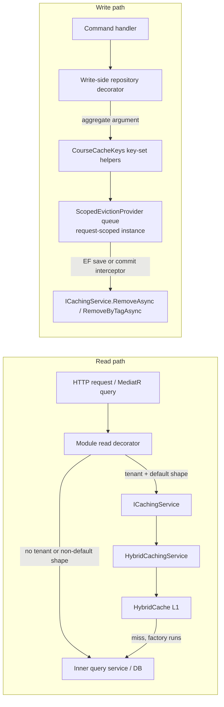

# Caching architecture and file reference (#33)

This document explains the caching seam introduced for issue #33, how the read and write paths
work end to end, and what every new file is responsible for.

Related documents:

- [`spec-33/code-review-plan.md`](../../spec-33/code-review-plan.md) — the authoritative design
  record and decision log (D1–D24, filled G1–G12 ledger in §11).
- [`docs/caching/CACHE-TREE.md`](CACHE-TREE.md) — every key, tag and family with who reads and
  who evicts it (live inventory).
- [`docs/CachingArchitecture.md`](../CachingArchitecture.md) — shorter platform overview.
- [`Modules/Courses/CACHING.md`](../../src/alphazero-api/Modules/Courses/CACHING.md) — Courses
  surface/TTL/eviction matrix and tolerances.
- [`TODOS.md`](../../TODOS.md) — follow-ups, including distributed invalidation.

---

## 1. Shape of the solution

The platform targets a **single API server**, so caching is an in-process **L1-only**
`HybridCache`. No `IDistributedCache`/Redis is registered. Consequences:

- Eviction is per process. With more than one instance, another instance's entries stay stale
  until their TTL expires. This is tracked in `TODOS.md` and is not hidden by the design.
- `HybridCache` serialises values **even for L1**. Cached payloads must therefore be JSON-shaped
  (DTOs/records, or a serialised string). Domain aggregates with private constructors and
  read-only collections cannot be cached directly; Identity projects and rehydrates them.
- Single-flight for concurrent cold loads is provided by `HybridCache`; no separate stampede
  code exists.

The code is split into two responsibilities:



Reads are **decorators** around existing query services: the module keeps its uncached
implementation and layers caching on top. Writes are also **decorators**, around the write
repositories: each write method derives the exact **key set** from the aggregate it is handed,
so eviction needs no change-tracker scan and no parent lookup. Exactly one tag family exists
(Courses `courses:views`, tenant-wide fan-out), queued only by the subject decorator and carried
only by the public-view read entry.

### Module boundary rule

Only `AlphaZero.Shared/Infrastructure/Caching` references
`Microsoft.Extensions.Caching.Hybrid`. Module projects depend on `ICachingService`,
`CacheKey`, `CacheTag`, `CachePolicy` and `CacheScope`. This keeps the serializer, tag formats
and any future L2 behind one boundary.

### Non-negotiable invariants

| Invariant | Enforced by |
|---|---|
| Module code never references `HybridCache` | Only the shared abstraction project references the package |
| Every tenant-scoped key/tag carries the tenant segment | `CacheScope.Key/Tag`; they throw without a tenant |
| A request with no tenant bypasses the cache instead of writing `none` | Read decorators check `CacheScope.IsEnabled` |
| Caller paging/search/sort never enters a key | `CourseCacheKeys.IsDefaultPage` / `IsDefaultCatalogSort`; non-default requests bypass |
| Commands and handlers contain no cache logic | Key sets are emitted by module write-repository decorators, not from command types |
| Every write to a cache-feeding entity goes through a decorator | Scrutor `Decorate` registrations; the handler audit (plan §4.7) plus decorator and integration tests |
| Eviction flushes at the DB commit points | `EvictionSaveChangesInterceptor` (standalone saves) + `EvictionTransactionInterceptor` (explicit EF transactions), both in `UnitOfWork.cs`; no MediatR behavior |
| Standalone-save failure discards its own keys; rollback discards; ambiguous commit-path failure flushes | The two interceptors (plan §4.8 failure table) |
| An ambient `System.Transactions` transaction fails fast | `EvictionSaveChangesInterceptor.SavedChangesAsync` guard + `Enlist=false` appended by `DatabaseSettings` |
| Eviction failure after a successful commit is non-fatal | `ScopedEvictionProvider` logs and swallows, except cancellation |
| `OperationCanceledException` always propagates | Provider and consumers rethrow it explicitly |
| Over-eviction is acceptable; under-eviction is a bug | Key sets deliberately queue every surface a write can affect |

---

## 2. Shared abstraction (`AlphaZero.Shared/Infrastructure/Caching`)

### 2.1 `CacheKey.cs` — typed identifiers

`CacheKey` and `CacheTag` are readonly record structs with a single `Value`. They are built as:

```csharp
CacheKey.Create("courses:view", tenantId.ToString("N"), courseId.ToString("N"));
// => courses:view:{tenantN}:{courseN}
```

Rules:

- The **family** is developer-authored, non-empty, and may contain `:` to group related keys.
- **Parts** must be non-empty and must not contain `:`; values are therefore safe to join.
- With no parts the value is the family alone.

`CacheKey.Create` is used directly only for deliberately **global** entries (Identity device
keys/assignments/conditions, Tenants branding, the video SSM key). Tenant-scoped keys are always
built through `CacheScope`.

### 2.2 `CacheScope.cs` — tenant binding

```csharp
public readonly record struct CacheScope
{
    public Guid? TenantId { get; }
    public bool IsEnabled => TenantId.HasValue;

    public static CacheScope ForTenant(Guid? tenantId);
    public CacheKey Key(string family, params string[] parts);
    public CacheTag Tag(string family, params string[] parts);
}
```

`Key`/`Tag` prepend `TenantId.ToString("N")` as the first part, producing
`{family}:{tenantN}:{parts...}`. Calling them with no tenant throws — a placeholder tenant can
never be written. Callers must check `IsEnabled` and fall through to the database instead.

### 2.3 `CachePolicy.cs` — TTL

A small value object holding a positive `TimeToLive`; the constructor rejects zero/negative
values. `HybridCachingService` applies it to both `Expiration` and `LocalCacheExpiration`, so a
future distributed L2 would inherit the same TTLs.

### 2.4 `ICachingService.cs` and `HybridCachingService.cs` — read/write API

```csharp
Task<T> GetOrCreateAsync<T>(
    CacheKey key,
    CachePolicy policy,
    IReadOnlyCollection<CacheTag> tags,
    Func<CancellationToken, Task<T>> factory,
    CancellationToken cancellationToken = default);

Task RemoveAsync(CacheKey key, CancellationToken cancellationToken = default);

Task SetAsync<T>(
    CacheKey key, T value, CachePolicy policy,
    IReadOnlyCollection<CacheTag> tags, CancellationToken cancellationToken = default);

Task RemoveByTagAsync(CacheTag tag, CancellationToken cancellationToken = default);
```

`HybridCachingService` is the only class that touches `HybridCache`. It forwards the factory as
the factory state and maps `CacheTag` values to HybridCache tag strings.

### 2.5 Eviction contracts

| File | Contract | Role |
|---|---|---|
| `IEvictionProvider.cs` | `Begin`, `Evict(key)`, `Evict(keys)`, `EvictTag(tag)`, `FlushAsync`, `Discard`, `IsActive`, `HasPendingKeys` | Dual queue (keys + tags); keys are the eviction currency, tags fan-out only |
| `ScopedEvictionProvider.cs` | scoped `IEvictionProvider` | Two instance `HashSet` lanes under a private lock; flushes `RemoveAsync` per key and `RemoveByTagAsync` per tag; failure semantics |

Eviction keys (and the single fan-out tag) are produced by **write-side repository decorators**,
not by inspecting the EF change tracker. A decorator receives the aggregate on every
`Add`/`Update`/`Remove`, so it can derive the affected key set directly from the aggregate's own
`TenantId` and ids. There is no dispatch table, no parent lookup, and no module implementation of
a policy interface; the decorator is the module's policy.

The lanes are **request-scoped instance state, not `AsyncLocal`**: the flush fires from the EF
pipeline level that called `SaveChangesAsync` — an ancestor context of the command handler that
queued — and AsyncLocal writes never flow back up to an ancestor (this was proven live when the
original AsyncLocal design logged `keys=0 tags=0` on every flush). `FlushAsync` snapshots and
clears both queues in place under the lock; the cache I/O awaits run outside it, so the cache is
never called holding the lock. `HybridCachingService` resolves the provider lazily through
`IServiceProvider` at call time to avoid a strict constructor cycle.

`UnitOfWork` drains domain events and saves. Flush-at-commit semantics live in **two EF Core
interceptors registered on every `AppDbContext`** (in `AlphaZero.Shared/Infrastructure/UnitOfWork.cs`,
registered in `DependencyInjection.cs:59-60`):

- `EvictionSaveChangesInterceptor` — a standalone save (no open EF transaction) flushes at its
  own `SavedChangesAsync`; a failed standalone save burns exactly its queued keys
  (`SaveChangesFailedAsync` → `Discard`). A save inside an ambient `System.Transactions`
  transaction throws: an ambient commit has no EF hook, so its queue could never be flushed
  (`DatabaseSettings` appends `Enlist=false` to every connection string as belt-and-braces).
- `EvictionTransactionInterceptor` — inside an explicit EF transaction nothing flushes at
  intermediate saves; **commit** flushes once for the whole transaction, **rollback** discards,
  and an ambiguous **commit-path failure** flushes defensively (over-eviction is safe; a delayed
  eviction is not).

### 2.6 Composition (`AlphaZero.Shared/Infrastructure/DependencyInjection.cs`)

`AddSharedInfrastructure` registers:

- `ICachingService` → `HybridCachingService` (scoped)
- `IEvictionProvider` → `ScopedEvictionProvider` (scoped — **required**, the queue is instance state)
- `EvictionSaveChangesInterceptor` / `EvictionTransactionInterceptor` (scoped), added to every
  `AppDbContext` via `opts.AddInterceptors(...)`
- `IAmbientTenantContext` → `AmbientTenantContext` (singleton)
- `TenantConsumeFilter<>` / `TenantPublishFilter<>` (open generic)
- `AddHttpContextAccessor()` for the HTTP tenant provider
- `AddHybridCache` with defensive defaults of 10 minutes absolute / 5 minutes local

The defaults only guard a call site that forgets a `CachePolicy`; every current call site passes
an explicit policy.

---

## 3. Write path: eviction end to end

```mermaid
sequenceDiagram
    participant M as MediatR
    participant H as Handler
    participant R as Write repository decorator
    participant U as UnitOfWork / AppDbContext
    participant I as EF interceptors (UnitOfWork.cs)
    participant Q as ScopedEvictionProvider
    participant C as ICachingService

    M->>H: Send(command)
    H->>R: Update(course)
    R->>R: CourseCacheKeys.EvictCourse(tenant, courseId)
    R->>Q: Evict(keys) (request-scoped instance)
    R->>R: inner.Update(course)
    H->>U: SaveChangesAsync()
    U->>U: drain domain events (nested dispatch may occur)
    U->>I: SaveChanges
    alt standalone save
        I->>Q: FlushAsync() (or Discard on save failure)
    else explicit EF transaction
        U->>I: commit
        I->>Q: FlushAsync() at commit (Discard on rollback)
    end
    Q->>C: RemoveAsync(key) per key; RemoveByTagAsync(tag) per tag
```

Exact order inside `UnitOfWork.SaveChangesAsync`:

1. Drain domain events in a loop. Publishing them may run handlers that add or modify tracked
   entities, so the loop repeats until no events remain. This may dispatch nested commands.
2. `_context.SaveChangesAsync(cancellationToken)` commits the whole transaction; the registered
   interceptors flush or discard at the exact save/commit boundary (§2.5, plan §4.8 for the full
   failure table).

Keys were queued earlier, when the handler called a write repository method. The flush therefore
never precedes the commit that made the cache stale.

Because keys are queued at the repository call, a handler that mutates a loaded aggregate
**without** calling `Update` would bypass eviction. All Courses handlers that rely on implicit
change tracking were converted to call `_courseRepository.Update(course)` — the last gap,
`AddSection`, was fixed and verified in Phase 3. The enforcement is now the handler audit
(plan §4.7) plus the decorator and integration tests; a future omission is caught by tests and
review, not at runtime.

### Failure semantics

| Situation | Queue | Cache call | Caller observes |
|---|---|---|---|
| Standalone save succeeds | Snapshot taken, cleared in place | `RemoveAsync` per key + `RemoveByTagAsync` per tag | Normal result |
| Success, cache throws | Cleared before calls; failures logged | Best-effort | Normal result; entries age out by TTL |
| Success, cache call cancels | Cleared | `OperationCanceledException` rethrown | Cancellation propagates (write already committed) |
| Standalone save fails | `SaveChangesFailedAsync` → `Discard()` | None | The failure; nothing evicted |
| Saves inside an explicit EF transaction | Kept through intermediate saves | None | Commit interceptor decides |
| EF transaction commits | ONE flush for the whole transaction | `RemoveAsync`/`RemoveByTagAsync` | Normal result |
| EF transaction rolls back | `Discard()` | None | Rollback; nothing evicted |
| `TransactionFailed` on the commit path | Flushed defensively | `RemoveAsync`/`RemoveByTagAsync` | Ambiguous commit → over-eviction only |
| `TransactionFailed` otherwise | `Discard()` | None | The failure |
| Save inside an ambient `System.Transactions.Transaction` | Guard throws in `SavedChangesAsync` | None | `InvalidOperationException` — fail fast (write is cache-unsafe) |
| Handler error result before any save | Keys remain queued; dropped with the request scope | None | Nothing evicted (safe no-op) |

There is no depth gating: a transaction ends with exactly one flush; a standalone save flushes at
its own save point. The queue is **snaphsotted and cleared in place under a lock** — an
assignment-free snapshot keeps the cache I/O outside the lock while a queuer landing after the
snapshot belongs to the next save.

---

## 4. Tenant identity outside HTTP requests

Consumers and background work have no `HttpContext`. Without an ambient tenant, every
tenant-filtered EF query silently returns nothing and cache keys would be built without a
tenant.

### 4.1 `AmbientTenantContext.cs`

`IAmbientTenantContext` is a singleton backed by a **static** `AsyncLocal<TenantHolder?>`.
`Push(tenantId)` returns a dispose-once handle that restores the previous value. `Guid.Empty` is
normalised to `null`.

### 4.2 `TenantConsumeFilter.cs`

`IFilter<ConsumeContext<T>>` that resolves the tenant in this order:

1. The message's public `TenantId` property (reflection, non-empty `Guid`).
2. The `"TenantId"` envelope header (always stamped as a string).
3. No tenant.

It pushes the value for the duration of `next.Send(context)` and restores it afterwards.

### 4.3 `TenantPublishFilter.cs`

`IFilter<PublishContext<T>>` that stamps the ambient tenant into the `"TenantId"` header when one
exists, so consumers whose contract lacks a `TenantId` property can still restore it.

### 4.4 Registration (`AlphaZero.API/Program.cs`)

Both filters are attached to both buses:

- the in-memory module bus (`UsingInMemory`), used for same-process module integration events;
- the external SQS bus (`UsingAmazonSqs`), used for cross-process events.

### 4.5 `HttpTenantProvider` precedence (`ITenantProvider.cs`)

The HTTP provider now resolves, in order:

1. `tid` claim
2. `X-TenantId` header
3. ambient tenant context

and caches the result per scoped instance. HTTP precedence is unchanged; the ambient value only
fills the gap where no request exists.

### 4.6 Video lifecycle events

The following contracts now carry `TenantId`, populated from the `Video` aggregate, so asset and
transcode updates initiated by consumers can evict the correct tenant's entries:

- `VideoPublishedIntegrationEvent`
- `VideoProcessingFailedEvent`
- `VideoMetadataChangedIntegrationEvent`
- `VideoMetadataUpdatedDomainEvent`

---

## 5. Module usage

### 5.1 Courses

Read decorators: `CachedCourseQueryService`, `CachedSubjectQueryService`.
Key and tag registry: `CourseCacheKeys`. Write decorators:
`CachingCourseRepositoryDecorator`, `CachingCourseOverviewRepositoryDecorator`,
`CachingCourseAssetRepositoryDecorator`, `CachingSubjectRepositoryDecorator`.

| Surface | TTL | Full key shape | Tags carried |
|---|---|---|---|
| Staff catalog `GET /courses` | 2 min | `courses:catalog:{tenant}:class=staff` | none |
| Student catalog `GET /courses/catalog` | 2 min | `courses:catalog:{tenant}:class=student` | none |
| Course tree view `GET /courses/{id}` | 10 min | `courses:view:{tenant}:{courseId}:class=staff` | none |
| Public/student view `GET /courses/{id}/view` | 10 min | `courses:view:{tenant}:{courseId}:class=public` | **`courses:views:{tenant}`** (the one fan-out tag) |
| Course overview `GET /courses/{id}/overview` | 10 min | `courses:overview:{tenant}:{courseId}` | none |
| Readiness companion `GET /courses/{id}/readiness` | 3 min | `courses:readiness:{tenant}:{courseId}` | none |
| Subject listing `GET /courses/subjects` | 15 min | `courses:subjects:{tenant}` | none |

Exactly one tag family exists (G4.1): the tenant-wide `courses:views`
(`CourseCacheTags.CoursePublicViews`), carried by exactly one read entry — the public view — and
queued by exactly one write decorator — the subject decorator. A subject rename flushes public
views immediately; worst-case staleness equals the view TTL (10 min). The 2-minute catalogs are
deliberately NOT tagged: they are evicted by key on course writes, and the accepted
rename/remove staleness window is their 2-minute TTL (G4.2). Never add a second tag family.

Cached only for the default request shape:

- paging must be `page=1, perPage=10`;
- the student catalog also requires no `search`, no `subjectId` filter and the default sort
  (`null`/empty or `newest`);
- the staff catalog bypasses when `subjectId` is supplied.

Any non-default request reads the database directly, so caller-controlled values never enter a
key.

Repository read-through (G11/G12): exactly ONE repository read is cached —
`ICourseOverviewRepository.GetByCourseIdAsync` (a flat JSON-safe DTO) under the `entity:overview`
key (`entity:overview:{tenantN}:{courseIdN}`), 5-minute TTL, ambient tenant. Every aggregate
`GetById`-shaped read and every collection/filtered read delegates UNCACHED (tracked-identity
bridges; caller-shaped reads would explode the key space).

Eviction key-set mapping in `CourseCacheKeys`, emitted by the write decorators:

| Decorated write | Keys queued |
|---|---|
| `ICourseRepository` `Add`/`Update`/`Remove(course)` | `catalog:staff`, `catalog:student`, `view:staff`, `view:public`, `overview`, `readiness`, `status`, `entity:course` (8) |
| `ICourseOverviewRepository` `Add`/`Update`/`Remove(overview)` | `overview`, `readiness`, `view:public`, `catalog:staff`, `catalog:student`, `entity:overview` (6) |
| `IRepository<CourseAsset>` `Add`/`Update`/`Remove(asset)` | `readiness`, `view:public`, `catalog:staff`, `catalog:student`, `entity:asset` (by asset id) — no tree key (the staff tree reads only `r.CourseAssetId`); an unassigned pool asset (`CourseId == Guid.Empty`) queues **nothing** (5) |
| `ISubjectRepository` `Add`/`Update`/`Remove(subject)` | `subjects`, `entity:subject` + the fan-out tag `courses:views` (2 keys + 1 tag) |

Sections, plans, curriculum items and resources have no decorator of their own: every write to
them loads the `Course` aggregate and calls `ICourseRepository.Update(course)`, so they inherit
the 8-key course row — including `AddSection` (fixed in Phase 3). A `TenantId == Guid.Empty`
aggregate queues nothing (the tenant comes from the entity itself, never `ITenantProvider`, on
the write side).

`CourseAsset` is TPH: a catalog/readiness write resolves the concrete asset subtype but the
decorator only needs the base `CourseId`/`TenantId`, so no type dispatch is involved.

Deliberately uncached: `GetCourseStatusAsync` (visibility masking; its key still exists as an
eviction-only entry in the course row — a defensive no-op), pool/admin listing, student
dashboard, enrollment checks and state, analytics, playback. Subject-by-id reads are
pass-through. See
[`Modules/Courses/CACHING.md`](../../src/alphazero-api/Modules/Courses/CACHING.md)
for the rationale and the per-surface visibility classes.

`UpsertCourseOverviewCommand` now implements `ICommand<Success>`. Previously it did not persist
through the UnitOfWork decorator, so overview edits never committed and could not be evicted.

### 5.2 Identity

Identity keys are intentionally **global** — a device id and a tenant-user id are globally unique
primary keys, and condition definitions are platform-wide rows with no tenant column.

| Entry | Key | TTL | Notes |
|---|---|---|---|
| Device public key | `device_pubkey:{deviceId:N}` | 24 h | Write normalises the id to `N` so it matches reads |
| User principal assignments | `user_assignments:{tenantUserId}` | 30 min | Cached projection is rehydrated on every read |
| Condition definition | `conditions:definition:{name}` | 10 min | Converter-produced JSON string |

`CachedAssignmentModels.cs` defines JSON-safe records mirroring
`TenantUserPrincipalAssignment` and its `Principal` (managed/inline policies, statements and
conditions). `IdentityCacheJson.Options` is the shared serializer configuration.
`CachedAssignmentMapper` projects to the cache and rehydrates via `TenantUser.Hydrate`,
`Principal.Create`, `ManagedPolicy`, `InlinePolicy` and `TenantUserPrincipalAssignment.Hydrate`.

Invalidation points:

- `CachingTenantUserPrincipalAssignmentRepository.Add/Remove` evict
  `user_assignments:{tenantUserId}` synchronously, so a read later in the same request does not
  see the old list.
- `CachePublicKeyProvider.SetNewDevicePublicKey` writes the device key and evicts the user's
  assignment view, because `MainDeviceId` is part of that view.

`ConditionRepository` caches the converter JSON because `IConditionNode` is polymorphic and only
round-trips through `ConditionNodeJsonConverter`; the `Reference` case was added to that
converter for this path.

### 5.3 Tenants

`TenantBrandingUpdatedConsumer` handles both the MediatR notification (same process) and the bus
message (cross process). It invalidates:

- key `tenant:subdomain:{normalizedSubdomain}`
- tag `tenant-branding:{normalizedSubdomain}`

The cache dependency is optional so older test compositions still work. Cache failures are
logged and swallowed; `OperationCanceledException` is rethrown.

### 5.4 VideoUploading

`DefaultVideoEncryptionService` caches the SSM master ClearKey:

- key `ssm:master-clear-key` (global — one master key for the platform)
- TTL 10 minutes

This removes a Systems Manager call from every encryption/playback-ticket path while bounding
key-rotation delay to the TTL.

---

## 6. New files

Twenty-six files were added on this branch; three of them were later **deleted during the
flush-at-commit pivot** (marked ✂ below, see §7). Every path is relative to the repository root.
File responsibilities are as they stand today.

| File | Kind | Responsibility |
|---|---|---|
| `spec-33/code-review-plan.md` | design | Decision log (D1–D24), verified §5 key-set cells, filled §11 G1–G12 ledger, verification plan |
| `src/alphazero-api/AlphaZero.Shared/Infrastructure/Caching/CacheKey.cs` | code | `CacheKey`, `CacheTag`, segment validation |
| `src/alphazero-api/AlphaZero.Shared/Infrastructure/Caching/CacheScope.cs` | code | Tenant-bound key/tag builder; throws without a tenant |
| `src/alphazero-api/AlphaZero.Shared/Infrastructure/Caching/CachePolicy.cs` | code | Positive-TTL value object |
| `src/alphazero-api/AlphaZero.Shared/Infrastructure/Caching/ICachingService.cs` | code | Get/set/remove/remove-by-tag contract |
| `src/alphazero-api/AlphaZero.Shared/Infrastructure/Caching/HybridCachingService.cs` | code | Only adapter to `HybridCache`; resolves the eviction provider lazily via `IServiceProvider` (di-cycle fix) |
| `src/alphazero-api/AlphaZero.Shared/Infrastructure/Caching/IEvictionProvider.cs` | code | Dual key+tag queue contract; `HasPendingKeys`, no `HasPendingTags` |
| `src/alphazero-api/AlphaZero.Shared/Infrastructure/Caching/ScopedEvictionProvider.cs` | code | Request-scoped instance lanes (two `HashSet`s) under a lock; flush/discard; failure semantics |
| ✂ ~~`.../Caching/EvictionFlushScope.cs`~~ | — | Deleted in Phase 1 (no depth gating under the interceptor design) |
| ✂ ~~`.../Caching/CacheEvictionFlushBehavior.cs`~~ | — | Deleted in Phase 1 (flush moved into the EF interceptors) |
| `src/alphazero-api/AlphaZero.Shared/Infrastructure/UnitOfWork.cs` | code | Domain-event drain, the `SaveChanges`/transaction flush points, and both eviction interceptors |
| `src/alphazero-api/AlphaZero.Shared/Infrastructure/Messaging/TenantConsumeFilter.cs` | code | Restores ambient tenant for consumed messages |
| `src/alphazero-api/AlphaZero.Shared/Infrastructure/Messaging/TenantPublishFilter.cs` | code | Stamps ambient tenant onto published messages |
| `src/alphazero-api/AlphaZero.Shared/Infrastructure/Tenats/AmbientTenantContext.cs` | code | AsyncLocal tenant for non-HTTP flows |
| `src/alphazero-api/AlphaZero.Shared/Infrastructure/DatabaseSettings.cs` | code change | Appends `Enlist=false` so an ambient `TransactionScope` can never silently enlist |
| `src/alphazero-api/Modules/Courses/Infrastructure/Caching/CourseCacheKeys.cs` | code | Single registry: surfaces, per-family TTLs, `*Entity` keys and the four key-set helpers (`EvictCourse` 8 / `EvictCourseOverview` 6 / `EvictCourseAsset` 5 / `EvictSubject` 2) |
| `src/alphazero-api/Modules/Courses/Infrastructure/Caching/CourseCacheTags.cs` | code | THE one fan-out tag builder: tenant-wide `courses:views` (G4.1) |
| `src/alphazero-api/Modules/Courses/Infrastructure/Caching/CachingCourseRepositoryDecorator.cs` | code | `ICourseRepository` writes queue the 8-key course row; reads delegate uncached (G12) |
| `src/alphazero-api/Modules/Courses/Infrastructure/Caching/CachingCourseOverviewRepositoryDecorator.cs` | code | `ICourseOverviewRepository` writes queue the 6-key row; `GetByCourseIdAsync` is the ONE read-through (G11) |
| `src/alphazero-api/Modules/Courses/Infrastructure/Caching/CachingCourseAssetRepositoryDecorator.cs` | code | `IRepository<CourseAsset>` writes queue the 5-key row; empty `CourseId`/tenant queues nothing (G2) |
| `src/alphazero-api/Modules/Courses/Infrastructure/Caching/CachingSubjectRepositoryDecorator.cs` | code | `ISubjectRepository` writes queue 2 keys + the fan-out tag (the only `EvictTag` call site) |
| ✂ ~~`.../Caching/CoursesEvictionCoverageInterceptor.cs`~~ | — | Deleted in Phase 2 (change-tracker read; replaced by the handler audit + tests) |
| `src/alphazero-api/Modules/Identity/Infrastructure/Repositories/IdentityCacheKeys.cs` | code | Three global Identity key builders |
| `src/alphazero-api/Modules/Identity/Infrastructure/Serialization/CachedAssignmentModels.cs` | code | JSON-safe projection, serializer options, cache mapper |
| `tests/Modules/Courses/Courses.UnitTests/Infrastructure/Caching/CoursesRepositoryDecoratorTests.cs` | test | Each write decorator queues its exact key set; reads never enqueue; disabled scope queues nothing |
| `tests/Modules/Courses/Courses.UnitTests/Infrastructure/Caching/EvictionInterceptorTests.cs` | test | Interceptor matrix on a SQLite stub context: standalone success/failure, tx commit/rollback/failed-commit, ambient guard throws, empty saves are no-ops |
| `tests/Modules/Courses/Courses.UnitTests/Infrastructure/Caching/ScopedEvictionProviderTests.cs` | test | Dual lanes, dedupe, snapshot-and-clear, discard, failure-swallow, cancellation, thread-safety |
| `tests/Modules/Courses/Courses.UnitTests/Infrastructure/Caching/SharedCachingRegistrationTests.cs` | test | HybridCache entry defaults are actually configured |
| `tests/Modules/Tenants/Tenants.UnitTests/Infrastructure/Messaging/TenantConsumeFilterTests.cs` | test | Message-first, header-fallback, empty and restore behavior |

---

## 7. Modified and deleted files

| Area | Files | Change |
|---|---|---|
| Composition | `AlphaZero.API/Program.cs` | Tenant consume/publish filters on both buses |
| Shared DI | `AlphaZero.Shared/Infrastructure/DependencyInjection.cs` | Cache, eviction, and interceptor registrations (`DependencyInjection.cs:59-60`); scoped `ScopedEvictionProvider` (**required** — the queue is instance state); working `AddHybridCache` defaults |
| Tenant resolution | `AlphaZero.Shared/Infrastructure/Tenats/ITenantProvider.cs` | Ambient fallback after claim/header; per-scope caching |
| Persistence | `AlphaZero.Shared/Infrastructure/UnitOfWork.cs` | Drains domain events, then saves; hosts both eviction interceptors and the flush points (no MediatR behavior) |
| Connection strings | `AlphaZero.Shared/Infrastructure/DatabaseSettings.cs` | Appends `Enlist=false` when absent (ambient-transaction belt-and-braces, D24) |
| Deleted | `AlphaZero.Shared/Infrastructure/Repositores/CachingRepository.cs` | Replaced by the shared seam |
| Deleted | `AlphaZero.Shared/Infrastructure/Caching/{IEvictionStrategy,IEntityEvictionPolicy,ChangeTrackerEvictionStrategy}.cs` | Change-tracker eviction replaced by write-repository decorators |
| Deleted | `Modules/Courses/Infrastructure/Caching/{CourseEvictionPolicy,CourseCacheEvictionBehavior}.cs` | Replaced by `CourseCacheTags`, the decorators and the coverage interceptor |
| Courses | `CachedCourseQueryService.cs`, `CachedSubjectQueryService.cs`, `CourseCacheKeys.cs`, `Infrastructure/DependencyInjection.cs` | Read decorators, key registry, write decorators; the flush behavior and coverage interceptor were later removed |
| Courses handlers | `AddSection.cs`, `Plans/UpdatePlan.cs`, `Plans/RemovePlan.cs`, `Reorder/ReorderCommands.cs` | Now call `Update(course)` so the repository decorator sees the write and queues key sets (`AddSection` was re-verified—and its regression test added—in Phase 3) |
| Courses handlers | `EventHandlers/CourseActiveItemsDomainEventHandler.cs` | Phase 3: all three mask-mutation paths re-commit with explicit `Update` |
| Courses | `Application/Courses/Commands/UpsertOverview/UpsertCourseOverview.cs` | Now `ICommand<Success>` so the write reaches the UnitOfWork |
| Identity | `CachingTenantUserPrincipalAssignmentRepository.cs` | Projection caching, rehydration, eager load, synchronous eviction |
| Identity | `PublicKeyProvider.cs` | `CachePublicKeyProvider` with `N`-normalised device key and assignment eviction |
| Identity | `ConditionDefinition.cs`, `Serialization/Converters.cs` | Condition JSON caching; `Reference` deserialization |
| Identity | `TenantUser.cs`, `TenantPrincipalAssignment.cs` | Public `Hydrate` factories used by the mapper |
| Identity | `Infrastructure/DependencyInjection.cs` | Caching repository and public-key decorators; `AddMemoryCache` removed |
| Identity | Application command/evaluator files | Removed unused `Microsoft.Extensions.Caching.Hybrid` imports |
| Tenants | `TenantBrandingUpdatedConsumer.cs` | Key/tag invalidation with cancellation-safe error handling |
| VideoUploading | `Video.cs`, `VideoEvents.cs`, `IntegrationEvents/Events.cs` | `TenantId` on the aggregate's events and lifecycle contracts |
| VideoUploading | `CompleteVideoPublishingCommand.cs`, `FailVideoProcessingCommand.cs`, `VideoDomainEventHandlers.cs` | Populate the new tenant argument when raising/publishing |
| VideoUploading | `DefaultVideoEncryptionService.cs` | SSM master key cached for 10 minutes |
| Tests | `CoursesCacheTests.cs`, `ApiFactory.cs`, `CourseOverviewTests.cs`, `SyncResourceMetadataIntegrationTests.cs`, `MetadataConsumerTests.cs`, `HttpTenantProviderTests.cs`, `TenantBrandingUpdatedConsumerTests.cs` | Coverage for the new pipeline, tenant propagation and refreshed behavior (31 cache tests after Phases 1–3) |
| Docs | `docs/CachingArchitecture.md`, `Modules/Courses/CACHING.md`, `TODOS.md`, `docs/agents/per-issue-runbook.md` | Overview, Courses matrix, distributed-invalidation follow-up, runbook pointer |

Flush-at-commit pivot (Phases 1–3, on top of the rows above):

- **Added:** `EvictionSaveChangesInterceptor` / `EvictionTransactionInterceptor` in
  `UnitOfWork.cs`; key-set helpers + `*Entity` keys in `CourseCacheKeys`; the thread-safe
  request-scoped lanes in `ScopedEvictionProvider`; `EvictionInterceptorTests`,
  `ScopedEvictionProviderTests`; 4 Phase-3 integration tests + response shims.
- **Deleted:** `EvictionFlushScope`, `CacheEvictionFlushBehavior`,
  `CoursesEvictionCoverageInterceptor` (+ its unit tests).
- **Changed:** `HybridCachingService` lazy provider resolution; `IEvictionProvider` dual queue
  with `HasPendingKeys`; `CourseCacheKeys` revoked tag builders (tag authorship moved to the
  narrowed `CourseCacheTags`).

---

## 8. Tests and what they prove

### Unit tests

`CoursesRepositoryDecoratorTests`

- Each decorator's `Add`/`Update`/`Remove` queues exactly the as-built key set for the aggregate
  it is handed (8 / 6 / 5 / 2+1-tag rows of §5.1) and delegates to the inner repository.
- Read methods never enqueue; every queued key equals the value the matching `CourseCacheKeys`
  function returns; `TenantId == Guid.Empty` queues nothing and does not throw.
- The read-through call (`GetByCourseIdAsync`) caches under the `entity:overview` key and calls
  the inner repository only on a miss (G11); aggregate `GetById` reads delegate uncached (G12).

`ScopedEvictionProviderTests`

- Dual lanes; dedupe; `FlushAsync` evicts each queued key/tag once and clears both queues.
- A cache failure is logged and swallowed (the write already committed); cancellation propagates.
- `Discard` drops both queues without evicting; an empty flush is a no-op.
- Queuing from another thread while a flush is in flight is safe (the lock test).

`EvictionInterceptorTests` (SQLite stub context with a kept-open connection)

- Standalone save success flushes; standalone save FAILURE discards exactly the failed save's keys.
- Two saves inside an explicit EF transaction + commit → ONE flush; rollback → discard.
- `TransactionFailed` on the commit path → flush; other failures → discard.
- An ambient `System.Transactions` transaction makes `SavedChangesAsync` throw and nothing is flushed.
- Saves with nothing queued make no cache calls.

`SharedCachingRegistrationTests`

- `AddSharedInfrastructure` configures the documented 10-minute/5-minute defaults.

`TenantConsumeFilterTests`

- A message `TenantId` wins over the envelope header.
- The header is used when the message has no property.
- No tenant leaves the ambient context empty.
- The previous ambient value is restored after dispatch.

### Integration tests (`CoursesCacheTests`)

The tests distinguish a cache hit from a database read by performing direct EF "ghost writes"
(bypassing the command pipeline and therefore eviction) and asserting the response still shows
the previously cached value; a subsequent command write must then refresh it.

- Catalog: cold fill, cached second read, mutation refresh.
- Course tree view: cold warm, item mutation refresh.
- Overview: public-shape warm, course-family eviction refresh (asserted through `ETag`).
- Readiness: plan mutation refresh.
- Subject listing: create and delete refresh.
- Non-default paging bypasses the cache and shows DB state immediately.
- Student catalog search bypasses the cache; a subject rename refreshes catalog and view
  (G4.1 fan-out + G4.2 accepted catalog window).
- Reordering sections evicts the tree view, and the cold refill shows the new order.
- Asset availability from a tenant-less bus scope updates the asset and refreshes readiness.
- All seven cached surfaces are tenant-isolated.
- The student dashboard remains uncached.
- Phase 3 additions: cover-image upsert (ghost cover/draft rows + `PUT /courses/{id}/overview`)
  refreshes catalogs, views, overview and readiness; course update/direct-publish/soft-delete
  evict the command-cached lists; asset duration sync through the real
  `SyncResourceMetadataCommand` refreshes public-view timings; the read-through decorator serves
  a stale overview copy until the next command write evicts the entity key.

Identity integration tests exercise the authorization path twice; the second read is a cache hit
and still evaluates correctly, proving the projection/rehydration round-trip.

Verification note: unrelated, pre-existing compile errors in
`tests/Modules/VideoUploading/VideoUploading.Tests.Integration/CreatePlaybackSessionHandlerUnitTests.cs`
exist on the base commit and are untouched by this branch (empty diff for that file).

---

## 9. Known limitations and follow-ups

1. **Single-instance invalidation only.** L1 entries on other API instances remain stale until
   TTL expiry after a mutation. Redis L2/backplane is tracked in `TODOS.md`; the Identity
   assignment cache has a dedicated entry there because its 30-minute TTL makes the window
   user-visible.
2. **TTL is the staleness bound.** If eviction is missed or fails, correctness is restored by
   expiry, not immediately. Courses catalogs are intentionally short-lived (2 minutes) while
   per-course reads are 10 minutes.
3. **Cached payloads must be serialisable.** Domain aggregates with private constructors cannot
   be cached directly. Identity is the example: a projection is cached and rehydrated on every
   read. Any new cached type must round-trip through `System.Text.Json`, including `null` and
   polymorphic members.
4. **Global Identity/Video keys rely on uniqueness.** Device ids and tenant-user ids are globally
   unique primary keys; the SSM key is a single platform key. If either assumption changes, the
   key must gain a scope segment.
5. **Courses overview projection defect (pre-existing).** `GET /courses/{id}/overview` returns
   `descriptionContent: null` because the value-converted `RichText` projection does not
   materialise. Caching wraps the surface and inherits the defect; eviction is therefore asserted
   through `ETag`.
6. **Identity eviction is synchronous in `Add`/`Remove`.** This guarantees the next read in the
   same request is fresh, at the cost of blocking on the cache call. It is deliberate but worth
   revisiting if those methods ever move to an async contract.
7. **Flush points live inside the EF pipeline.** A module that adds write-side repository
   decorators must register `EvictionSaveChangesInterceptor` and `EvictionTransactionInterceptor`
   on its `DbContext` (the shared `AddSharedInfrastructure` wiring already does this for
   `AppDbContext`); otherwise keys are queued but never flushed.
8. **Eviction is opt-in per write method.** A handler that mutates a tracked aggregate without
   calling the decorated `Update` bypasses eviction. The enforcement is the handler audit (plan
   §4.7) plus the decorator unit tests and the mutation-family integration tests; a future
   omission is caught by tests and review, not at runtime. New write paths must go through a
   decorated repository.

---

## 10. Adding a new cached surface

1. Add key/tag builders and a `CachePolicy` in the module's key registry. Build them through
   `CacheScope` if the data is tenant-owned.
2. Add a read decorator over the existing query service:
   - bypass when `!scope.IsEnabled`;
   - bypass for non-default request shapes (never put caller paging/search/sort in a key);
   - pass `[]` tags; add a tag only for a genuine non-enumerable fan-out (Courses has exactly one),
     and carry it on the one read entry the tag is meant to invalidate.
3. If the projection can change as a result of a write, make sure every write path goes through
   a repository decorator that queues the projection's key; the flush points are already wired
   into the EF pipeline (the two interceptors in `UnitOfWork.cs`). If the projection is fed by an
   aggregate whose read cannot be cached safely (G12), cache a flat write-coupled DTO instead and
   queue its `*Entity` key from every write family that feeds it.
4. Ensure cached payloads are JSON-safe. Cache projections rather than aggregates if the
   aggregate cannot be reconstructed by the serializer.
5. Add a behavioral test that proves a ghost write is served stale (cache hit) and a command
   write refreshes the surface (eviction), plus a tenant-isolation case.
6. Extend the handler audit (plan §4.7) when you add a cache-feeding write, and cover it with a
   decorator unit test asserting the exact queued key set.
