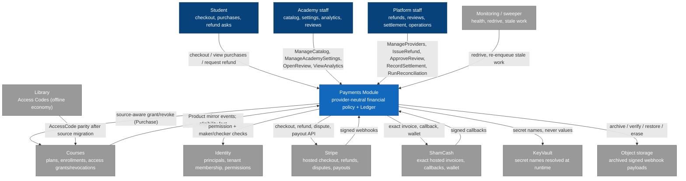
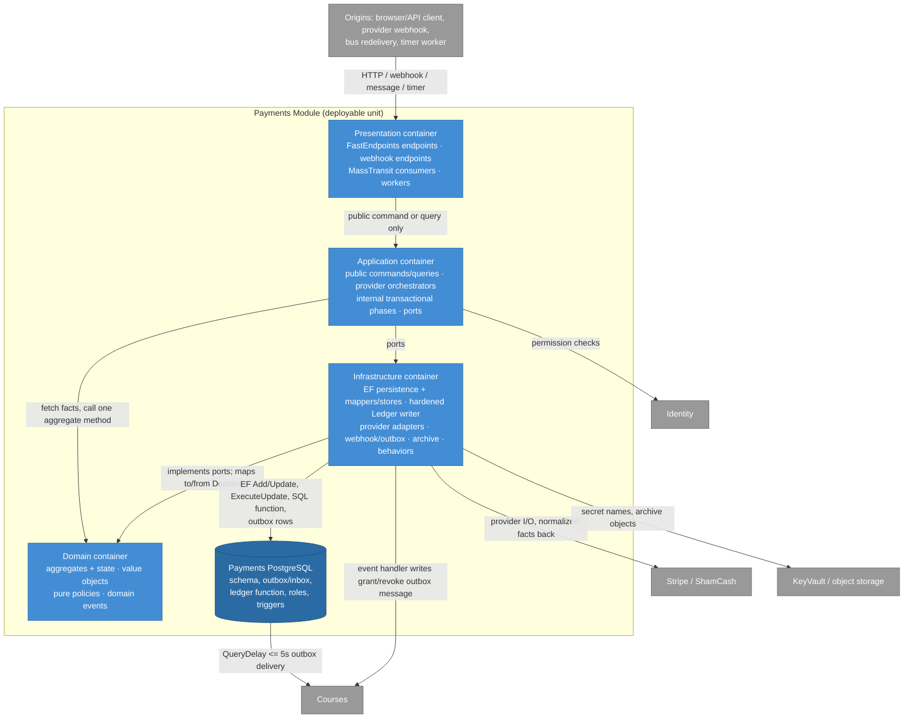
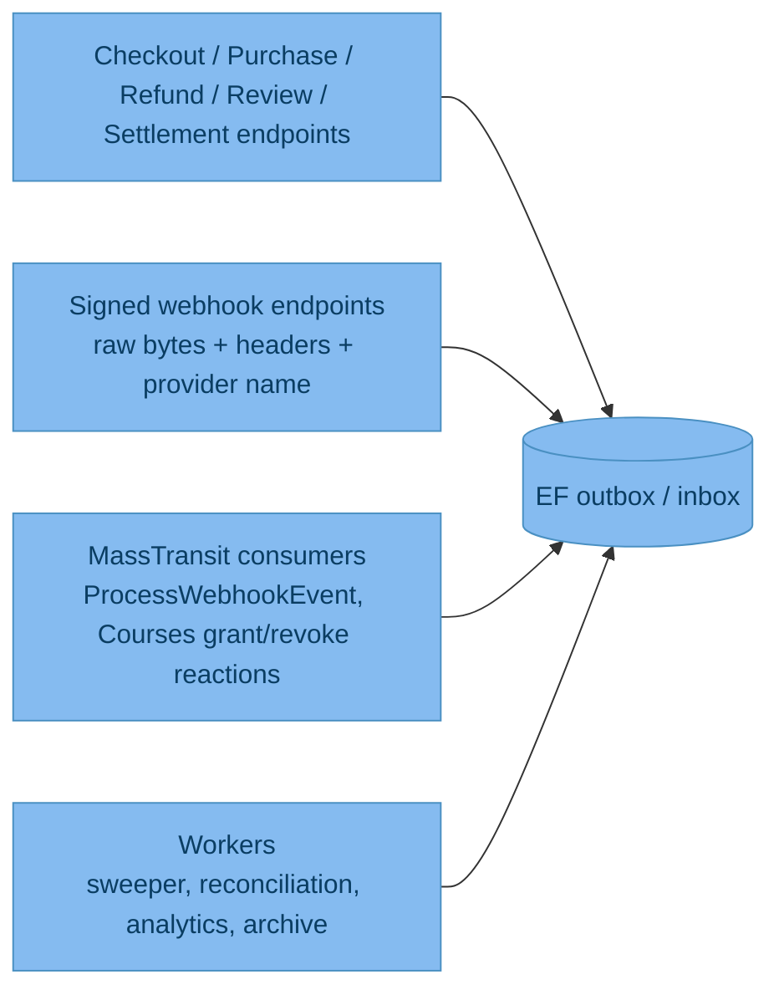
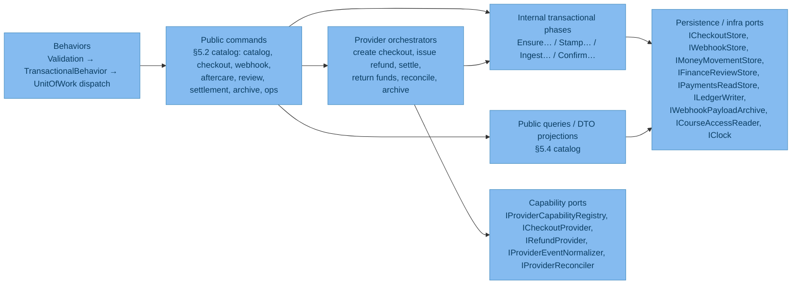
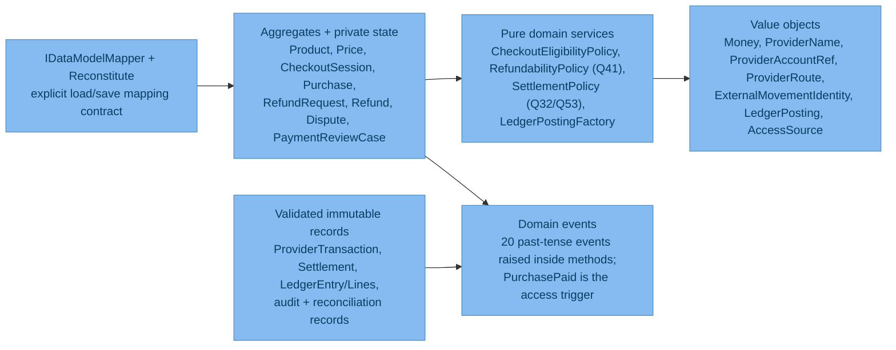
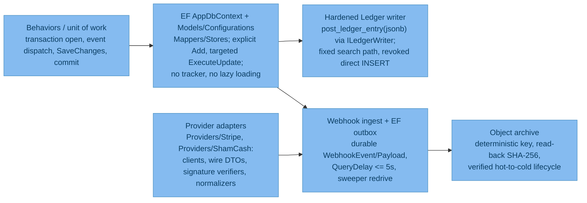
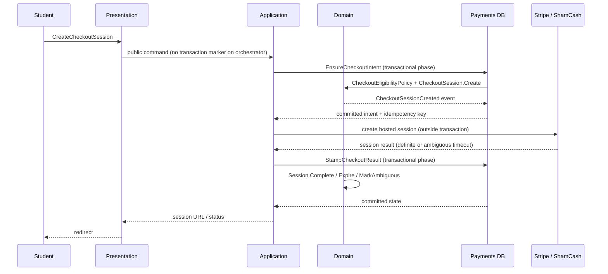
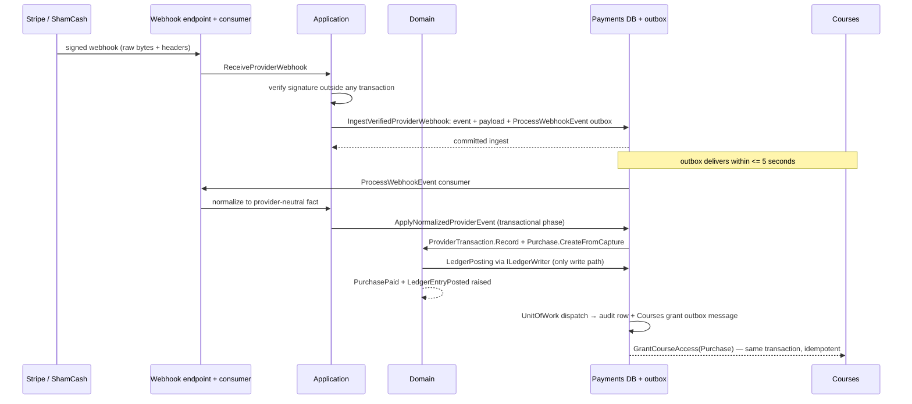
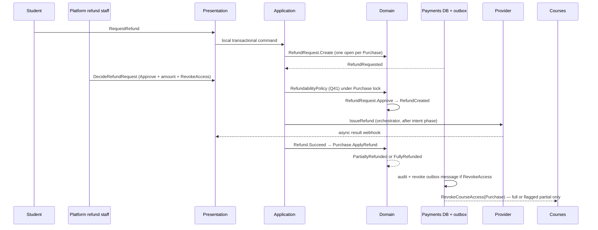
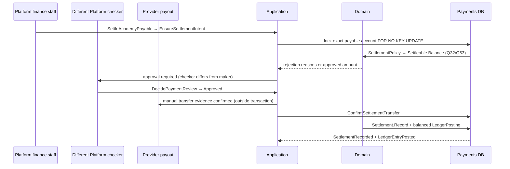

# Payments — C4 Model

**Derived from:** [`design.md`](design.md) §§2–8 (layers, ports, infrastructure, cross-module access) and [`requirement.md`](requirement.md) (actors and scope).
**Notation:** C4 levels expressed as Mermaid diagrams so they render in the repository. Colour key: blue = a Payments element, grey = external system, darker blue = person, light blue = component, cylinder-style label = data store. `design.md` remains the authority on implementation decisions.

---

## Level 1 — System context

### Purpose

Payments is the online economy: Students pay through enabled providers, receive course access through Courses, Academies accrue their share, and every movement is recorded in an append-only double-entry Ledger. It owns money truth; it does not own course access, identity, or provider-side money.

### Key external relationships

| External | Direction | Contract |
|---|---|---|
| Courses | out | `GrantCourseAccess` / `RevokeCourseAccess`, `(SourceType=Purchase, SourceId)` via EF outbox |
| Courses | in | Product mirror events; `ICourseAccessReader` eligibility fact only — no direct access mutation |
| Stripe / ShamCash | both | capability-specific ports; signed events normalized to provider-neutral facts |
| Identity | in | permissions from `docs/Permissions.md`, tenant context, maker/checker identity |
| Library | indirect | same Courses capability with `SourceType=AccessCode`; regression parity, no Payments coupling |
| KeyVault / storage / monitoring | out | secret names, deterministic archive keys, redrive and health signals |

---

## Level 2 — Containers

### Container responsibilities and hard rules

| Container | Responsibility | Rule |
|---|---|---|
| Presentation | input/output mapping only | no direct Domain service, port, DbContext or internal phase call |
| Application | use-case sequencing, authorization, locking, provider I/O boundaries | no financial rule re-implemented; orchestrators never carry `ITransactionalCommand` across provider I/O |
| Domain | aggregates, VOs, events, four policies, posting construction | no EF, MediatR, MassTransit, provider SDK, HTTP, object storage |
| Infrastructure | EF models/config/mappers/stores, Ledger function writer, adapters, outbox, archive, transaction behavior | no business decisions; row-count mismatch is a conflict, never success |
| Payments DB | append-only money rows, balance triggers, deny-mutation triggers, outbox/inbox, posting function | one runtime Ledger write path; no soft deletes, no direct inserts |

---

## Level 3 — Components

### 3a. Presentation

### 3b. Application

### 3c. Domain

### 3d. Infrastructure

---

## Level 4 — Dynamic views

### 4a. Checkout creation (provider orchestrator)

### 4b. Capture webhook → Purchase → access grant

### 4c. Refund request → issuance → revocation

### 4d. Settlement (maker/checker + risk policy)

---

## Constraints mapped to views

| Constraint | View / enforcement |
|---|---|
| Compile direction Presentation → Application → Domain; Infrastructure implements ports | L2, L3b–L3d; architecture tests |
| Transaction order: Validation → TransactionalBehavior (open) → UnitOfWork (dispatch + SaveChanges) → Commit | L3b, L4b; integration test |
| No provider I/O inside a transaction; orchestrators carry no `ITransactionalCommand` | L4a, L4c |
| Outbox `QueryDelay ≤ 5 seconds`; no external call in an event handler | L3d, L4b |
| Append-only money; no `ISoftDeletable`, no `SoftDeleteInterceptor`, direct Ledger INSERT revoked | L2 Payments DB, L3d |
| Tenant / provider / currency / environment / capability scope on every money read and command | L1 actors, L3b, §5.5 of `design.md` |
| Source-aware access is Courses-owned; identical UUIDs across AccessCode and Purchase must not collide | L1, L4b–L4c, [`ConceptualModel.md`](ConceptualModel.md) §6 |
| One reporting currency per provider account; no cross-currency totals | L1/L2 read models |

---

## Traceability to `design.md`

| C4 view | `design.md` source |
|---|---|
| L1 context | §1 goals 1–4, §8 cross-module access, `requirement.md` §1–3 |
| L2 containers | §2 dependency/runtime shape, §7 infrastructure design |
| L3a presentation | §5.2–§5.3 command/phase catalogs |
| L3b application | §5.1–§5.5, §6 ports |
| L3c domain | §4.1–§4.6 |
| L3d infrastructure | §7.1–§7.5 |
| L4 dynamics | §5.3 phase catalog, §7.3 outbox, §9 failure modes |
