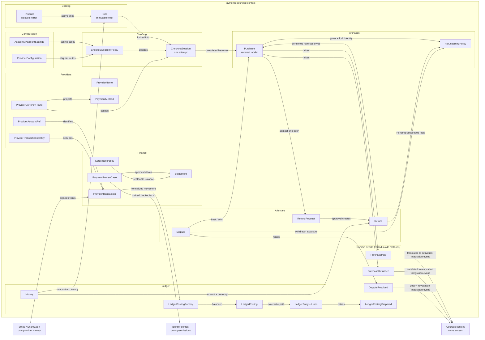

# Payments — Conceptual Domain Model

**Derived from:** [`design.md`](design.md) §§2–8, using canonical terms from repository-root [`GLOSSARY.md`](../../GLOSSARY.md) and scope from [`requirement.md`](requirement.md).
**Authority:** `design.md` owns implementation decisions. If these two disagree, `design.md` wins. This document is a shared thinking artifact — aggregates, meaning, and invariants — not a second implementation contract or a restatement of the SQL schema.

---

## 1. Bounded contexts

| Context | Owns the truth of | Does **not** own | Contract with Payments |
|---|---|---|---|
| **Payments** (core) | Product mirror, Price, Checkout Session, Purchase and reversal decisions, Refund Request, Refund, Dispute, Payment Review Case, Provider Transactions, Ledger, Settlements, webhook state, finance analytics | Course plans, enrollments, who may access a course | Publishes `PurchaseActivatedIntegrationEvent` / `PurchaseAccessRevocationRequestedIntegrationEvent` through its outbox |
| **Courses** | Plans, enrollments, access grants and revocations | Money, purchases, refund decisions | Exposes `GrantCourseAccess` / `RevokeCourseAccess` keyed by `(SourceType, SourceId)`; `SourceType = Purchase` is the Payments origin |
| **Identity** | Principals, tenant membership, permissions, authorization facts | Financial state | Supplies permission checks (`docs/Permissions.md`) and maker/checker identity facts; tenant context is ambient |
| **Library** | Access Codes (the offline economy) | Online money | Existing grants are migrated to the shared command with `SourceType = AccessCode`; Library consumers stay thin mappings and act as regression parity |
| **Stripe / ShamCash** (external) | Provider-side money movement, signed events, payouts, disputes | Application state or Ledger truth | Adapted behind capability-specific ports; only normalized, provider-neutral facts enter Payments |
| **Infrastructure services** | Durable state: PostgreSQL (Ledger, outbox, invariants), KeyVault (secret *names* resolved at runtime), object storage (archived raw payloads), MassTransit (outbox transport) | Business decisions | Implement Application ports; never interpret a financial rule |

**Context map rule:** Payments never sends Courses commands directly. `ICourseAccessReader` supplies the access fact needed for checkout eligibility; Payments publishes integration facts, and Courses consumers translate them into Courses-owned source-aware commands.

---

## 2. Ubiquitous language

Repository-root [`GLOSSARY.md`](../../GLOSSARY.md) is the sole authority for definitions and avoided synonyms. This model relies on four distinctions that are easy to lose in implementation:

| Distinction | Boundary |
|---|---|
| Checkout Session vs Purchase | hosted provider creation leaves an attempt Pending; only confirmed movement creates a Purchase |
| Refund Request vs Refund | a request is an ask/decision; a Pending Refund reserves Q41; a Succeeded Refund confirms movement |
| Dispute vs Dispute Exposure | opening is paperwork; only withdrawn and not-reinstated money contributes exposure |
| Provider Currency Route vs Payment Method | route is operational configuration; method is the Student-facing eligible choice derived from it |

---

## 3. Concept map



---

## 4. Aggregate boundaries and core invariants

Domain Models are independent from persistence DataModels. A mapper may assemble a root or immutable policy snapshot from multiple rows; stores persist the result with explicit Add/targeted Update operations. Separate roots may participate in one approved short transaction when a cross-aggregate invariant requires it.

| Aggregate | Ladder / identity | Invariant the root enforces |
|---|---|---|
| Product | mirror `SourceVersion` | only strictly newer source state applies |
| Price | immutable Product/currency identity | archive, never edit; active uniqueness is a Domain precondition plus DB guard |
| Academy Payment Settings | Academy policy lifecycle | absent means selling disabled; commission/refund-window validity |
| Provider Configuration | account/route/environment lifecycle | capability and currency coherence; projects Payment Methods |
| Checkout Session | Pending → Completed / Expired; Expired → Completed | one locked Price + Provider Currency Route; ambiguous creation stays Pending and valid late money may complete |
| Purchase | Paid → PartiallyRefunded → Refunded | confirmed reversal facts drive status; it does not reserve Q41 during confirmation |
| Refund Request | one open per Purchase | approval creates Refund; decider ≠ requester; no money moves |
| Refund | Pending → Succeeded / Failed | partial/full, source-aware; revoke decision immutable after confirmation |
| Dispute | Open → Won / Lost plus separate withdrawal/reinstatement facts | Open does not imply funds moved; cash truth is a Provider Transaction |
| Payment Review Case | Open → Approved/Rejected → Resolved | evidence required; checker ≠ maker; approval alone moves no money |

**Cross-cutting invariants:** money rows are append-only (no soft delete); every Ledger write goes through one hardened database function; all lines in a posting share one currency and balance in minor units; no cross-currency total is ever computed; tenant / provider / currency / environment scope is explicit on unfiltered money reads.

**Q41 boundary:** RefundRequest, Refund, Dispute, and Purchase are separate roots with independent provider-driven lifecycles. Application locks Purchase, loads immutable Refund/Dispute facts, and asks `RefundabilityPolicy` for the reservation decision. Pending Refund creation and request approval commit atomically. Confirmation consumes that reservation and cannot apply the cap a second time.

---

## 5. Canonical decision formulas (Domain services)

Financial policies are I/O-free Domain services fed by facts fetched under lock by an Application phase.

```text
Remaining Refundable (Q41) =
    Purchase.SettlementAmount
  - Σ(refunds where status in {Pending, Succeeded})
  - Σ(dispute amounts currently withdrawn and not reinstated, including final Lost exposure)
  // A dispute resolved Won drops out: funds_reinstated restored the money.
```

```text
Settleable Balance (Q32/Q53) =
    Σ(credits - debits) on the exact payable LedgerAccount
  - Σ(Pending Refund amounts that will debit the payable)
  - 100% of capture legs inside the short hold        // Stripe: 14 days
  - ReserveRate × capture legs in the rolling window  // Stripe: 10% through day 120
  - remaining Academy-payable leg of every open RefundRequest:
        Remaining Refundable - ROUND(Remaining × CommissionShare, minor unit)
  // ShamCash: 0 reserve after one successful daily reconciliation.
  // Unapplied Funds never enter Academy Payable and are never settleable.
```

`CheckoutEligibilityPolicy` returns eligible methods or an explicit reason. `LedgerPostingFactory` builds the balanced `LedgerPosting` (one computed leg, one derived leg) rejected on imbalance or mixed currency.

---

## 6. Cross-context access contract

Access is **Courses state**, not a Payments field. Payments owns the money fact; Courses owns the entitlement. Payments publishes:

```text
PurchaseActivatedIntegrationEvent(..., AuditReference)
PurchaseAccessRevocationRequestedIntegrationEvent(..., CauseType, CauseId, AuditReference)
```

Courses consumers map those facts to its capability:

```text
GrantCourseAccess(SourceType, SourceId, UserId, TenantId, TargetResourceArn, Metadata)
RevokeCourseAccess(SourceType, SourceId, UserId, TenantId, TargetResourceArn, Cause)
```

`SourceType` is `AccessCode` (Library) or `Purchase` (Payments); the identical UUID in both origins must not collide. The integration event is written through the EF outbox in the same transaction as the Purchase, Ledger entry, and audit, so a paid Purchase cannot exist without durable activation intent.

---

## 7. Conceptual non-goals

- No DomainModel-to-table assumption; DataModels and composite mappings may differ from aggregate shape.
- No second Payments-specific enrollment pipeline; Courses' source-aware capability is generalized once.
- No typed-ID wrappers for every UUID (Q2 chose primitive `Guid`); value objects exist only for real multi-field invariants.
- No generic repository per table; stores align with workflow boundaries.
- No provider SDK type in Domain or Application; no broad provider interface with unsupported operations.
- No process-local webhook handoff, direct Ledger insert, or EF fallback.
- No subscriptions, discounts, tax, Connect payouts, or cross-currency totals without a separate approved decision.
