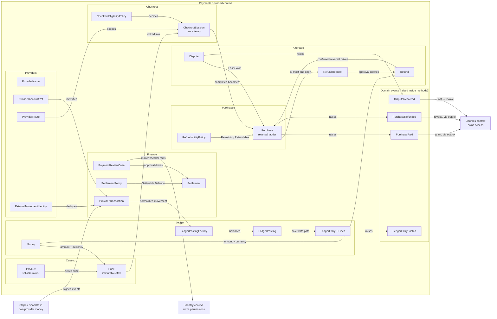

# Payments — Conceptual Domain Model

**Derived from:** [`design.md`](design.md) §§2–8, with canonical terms from [`database.md`](database.md) §11 and scope from [`requirement.md`](requirement.md).
**Authority:** `design.md` owns implementation decisions. If these two disagree, `design.md` wins. This document is a shared thinking artifact — aggregates, meaning, and invariants — not a second implementation contract or a restatement of the SQL schema.

---

## 1. Bounded contexts

| Context | Owns the truth of | Does **not** own | Contract with Payments |
|---|---|---|---|
| **Payments** (core) | Product mirror, Price, Checkout Session, Purchase and its reversal ladder, Refund Request, Refund, Dispute, Payment Review Case, Provider Transactions, Ledger, Settlements, webhook state, finance analytics | Course plans, enrollments, who may access a course | Publishes `PurchasePaidDomainEvent` / revocation events; calls Courses' source-aware grant/revoke commands |
| **Courses** | Plans, enrollments, access grants and revocations | Money, purchases, refund decisions | Exposes `GrantCourseAccess` / `RevokeCourseAccess` keyed by `(SourceType, SourceId)`; `SourceType = Purchase` is the Payments origin |
| **Identity** | Principals, tenant membership, permissions, authorization facts | Financial state | Supplies permission checks (`docs/Permissions.md`) and maker/checker identity facts; tenant context is ambient |
| **Library** | Access Codes (the offline economy) | Online money | Existing grants are migrated to the shared command with `SourceType = AccessCode`; Library consumers stay thin mappings and act as regression parity |
| **Stripe / ShamCash** (external) | Provider-side money movement, signed events, payouts, disputes | Application state or Ledger truth | Adapted behind capability-specific ports; only normalized, provider-neutral facts enter Payments |
| **Infrastructure services** | Durable state: PostgreSQL (Ledger, outbox, invariants), KeyVault (secret *names* resolved at runtime), object storage (archived raw payloads), MassTransit (outbox transport) | Business decisions | Implement Application ports; never interpret a financial rule |

**Context map rule:** Payments never reaches into Courses to decide eligibility or access. `ICourseAccessReader` answers checkout eligibility; access *mutation* is asynchronous through the shared Courses contract.

---

## 2. Ubiquitous language

| Term | Meaning | Avoid |
|---|---|---|
| Sellable | Product with an active Price, sold only while the Academy opted in | item, SKU, offering |
| Product | Payments' mirror of a sellable thing (today: a Course Plan); changes flow in as events | catalog item, course |
| Price | Immutable money offer; changing it archives it and creates a new one | pricing plan, cost |
| Checkout Session | The attempt shell a Student drives through hosted PSP checkout; only completion creates a Purchase | order, cart, payment |
| Capture | PSP collects the charge; Purchase, Ledger allocation and activation event are written together | charge, sale |
| Reversal | Ledger counterpart of a capture, for refunds and lost disputes | rollback, negative entry |
| Presentment Currency | Currency the Student was actually charged in | local currency |
| Settlement Currency | Currency the PSP deposits into the Platform account; fixed when the account opens | payout currency |
| Provider | Integration with an immutable machine name (`stripe`, `sham-cash`); a DB row does not install adapter code | gateway (for the domain identity) |
| Provider Account | One Platform-owned external account in one provider/environment | Academy account, LedgerAccount |
| Provider Currency Route | Enabled integration/settlement currencies + presentment mode for one account; decides capability, not amount | Price |
| Unapplied Funds | Provider-scoped liability when real money arrived but cannot yet become a Purchase | failed payment |
| Payment Review Case | Evidence-backed maker/checker workflow for Unapplied Funds or exceptional reversals | direct status override |
| Refund Request | Student's ask; a decision and amount, never money itself | refund, chargeback |
| Refund | A reserved/confirmed reversal; partial or full, source-aware, with its own revoke decision | request, adjustment |
| Purchase | Confirmed acquisition and reversal ladder; the single source for Remaining Refundable | order, invoice |
| Remaining Refundable | What a Purchase can still return: gross − pending/succeeded refunds − currently withdrawn/lost disputes | unrefunded amount, refundable balance |
| Settleable Balance | What may be paid out of an exact payable account after exposure and risk holds | available balance |
| Reporting Currency | Settlement currency of one analytics partition; no cross-provider/currency total exists | global base currency |
| Eligibility | The rule deciding whether a Student may start checkout (active enrollment ⇒ reject) | uniqueness, duplication guard |

---

## 3. Concept map



---

## 4. Aggregate boundaries and core invariants

Each aggregate is a behavioral root: private state, methods that enforce the transition, an `ExpectedPreviousStatus` tripwire for persistence, and an event raised from inside the method. Children are exposed as `IReadOnlyCollection<T>` and changed only through the root.

| Aggregate | Ladder / identity | Invariant the root enforces |
|---|---|---|
| Product | mirror `SourceVersion` | only strictly newer source state applies |
| Price | active per Product + currency | archive, never edit |
| Checkout Session | Pending → Completed / Expired | one locked Price + route; ambiguous stays Pending |
| Purchase | Paid → PartiallyRefunded → Refunded | Σ reversals vs `SettlementAmount`; no refund beyond Remaining Refundable (Q41) |
| Refund Request | one open per Purchase | approval creates Refund; decider ≠ requester; no money moves |
| Refund | Pending → Succeeded / Failed | partial/full, source-aware; revoke decision immutable after confirmation |
| Dispute | Open → Won / Lost | cash truth is a separate Provider Transaction; `Won` leaves the Q41 sum |
| Payment Review Case | Open → Approved/Rejected → Resolved | evidence required; checker ≠ maker; approval alone moves no money |

**Cross-cutting invariants:** money rows are append-only (no soft delete); every Ledger write goes through one hardened database function; all lines in a posting share one currency and balance in minor units; no cross-currency total is ever computed; tenant / provider / currency / environment scope is explicit on unfiltered money reads.

---

## 5. Canonical decision formulas (Domain services)

Financial policies are I/O-free Domain services fed by facts fetched under lock by an Application phase.

```text
Remaining Refundable (Q41) =
    Purchase.SettlementAmount
  - Σ(refunds where status in {Pending, Succeeded})
  - Σ(disputes currently Open (funds withdrawn) or Lost)
  // A dispute resolved Won drops out: funds_reinstated restored the money.
```

```text
Settleable Balance (Q32/Q53) =
    Σ(credits - debits) on the exact payable LedgerAccount
  - 100% of capture legs inside the short hold        // Stripe: 14 days
  - ReserveRate × capture legs in the rolling window  // Stripe: 10% through day 120
  - remaining Academy-payable leg of every open RefundRequest:
        Remaining Refundable - ROUND(Remaining × CommissionShare, minor unit)
  // ShamCash: 0 reserve after one successful daily reconciliation.
  // Unapplied Funds never enter Academy Payable and are never settleable.
```

`CheckoutEligibilityPolicy` returns eligible methods or an explicit reason. `LedgerPostingFactory` builds the balanced `LedgerPosting` (one computed leg, one derived leg) rejected on imbalance or mixed currency.

---

## 6. Cross-context access contract

Access is **Courses state**, not a Payments field. Payments owns the money decision; Courses owns the entitlement. Both origins use the same capability:

```text
GrantCourseAccess(SourceType, SourceId, UserId, TenantId, TargetResourceArn, Metadata)
RevokeCourseAccess(SourceType, SourceId, UserId, TenantId, TargetResourceArn, Cause)
```

`SourceType` is `AccessCode` (Library) or `Purchase` (Payments); the identical UUID in both origins must not collide. Messages are written through the EF outbox in the same transaction as the aggregate transition, so a paid Purchase cannot exist without its grant intent being durable.

---

## 7. Conceptual non-goals

- No second Payments-specific enrollment pipeline; Courses' source-aware capability is generalized once.
- No typed-ID wrappers for every UUID (Q2 chose primitive `Guid`); value objects exist only for real multi-field invariants.
- No generic repository per table; stores align with workflow boundaries.
- No provider SDK type in Domain or Application; no broad provider interface with unsupported operations.
- No process-local webhook handoff, direct Ledger insert, or EF fallback.
- No subscriptions, discounts, tax, Connect payouts, or cross-currency totals without a separate approved decision.
