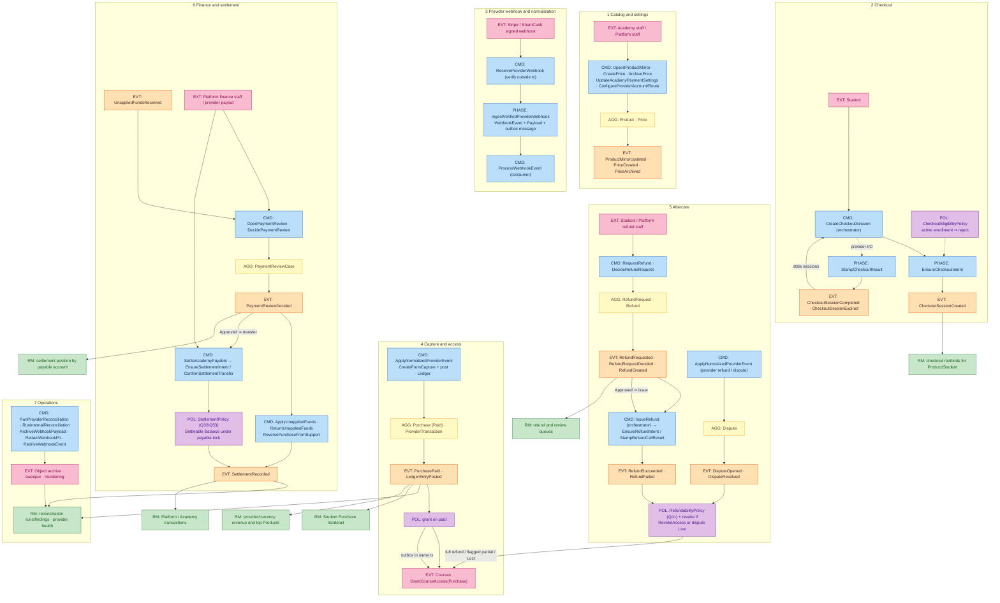

# Payments — Event Storming

**Derived from:** [`design.md`](design.md) §§4–10 (event taxonomy, command/phase catalogs, policies, failure modes, tests), with workflow sequencing from [`transaction_flows.md`](transaction_flows.md).
**Purpose:** the big-picture storm — what happened, who caused it, who reacts. For class/invariant detail see [`ConceptualModel.md`](ConceptualModel.md); for structural views see [`C4Model.md`](C4Model.md). `design.md` remains the authority.

---

## 0. Sticky legend

| Colour | Sticky | In this document |
|---|---|---|
| Orange | Domain event | `EVT:` — past tense, raised inside an aggregate or validated record factory |
| Blue | Command | `CMD:` — public command or internal transactional phase |
| Yellow | Aggregate | `AGG:` — the consistency boundary handling the command |
| Purple | Policy / reaction | `POL:` — `WHEN … THEN …`, I/O-free decision or in-process reactor |
| Pink | External system / person | `EXT:` — provider, Courses, KeyVault, storage, staff, Student |
| Green | Read model | `RM:` — projection returned by a public query |

---

## 1. Big-picture storm

---

## 2. Event catalog

| Event | Raised by | Meaning / reaction |
|---|---|---|
| `ProductMirrorUpdatedDomainEvent` | `Product.UpsertMirror` | newer Courses source state accepted; no direct Courses call |
| `PriceCreatedDomainEvent` | `Price.Create` | new immutable offer for one Product/currency |
| `PriceArchivedDomainEvent` | `Price.Archive` | offer closed, never edited |
| `CheckoutSessionCreatedDomainEvent` | `CheckoutSession.Create` | pending intent with locked Price + route; drives stale-session recovery |
| `CheckoutSessionCompletedDomainEvent` | `CheckoutSession.Complete` | provider attempt succeeded; the normalized capture creates the Purchase |
| `CheckoutSessionExpiredDomainEvent` | `CheckoutSession.Expire` | attempt shell closed without money |
| **`PurchasePaidDomainEvent`** | `Purchase.CreateFromCapture` | **grants access** via outbox; Purchase born Paid with Ledger allocation |
| `PurchasePartiallyRefundedDomainEvent` | `Purchase.ApplyRefund` | Σ reversals < SettlementAmount; unflagged partial leaves access active |
| **`PurchaseFullyRefundedDomainEvent`** | `Purchase.ApplyRefund` | **revokes access**; Σ reversals ≥ SettlementAmount |
| `RefundRequestedDomainEvent` | `RefundRequest.Create` | Student ask queued for Platform decision |
| `RefundRequestDecidedDomainEvent` | `RefundRequest.Approve/Reject` | approval creates a Refund in the same transaction; holds the Academy-payable leg |
| `RefundCreatedDomainEvent` | `Refund.CreateFromApproval` | pending reversal reserved; no Ledger movement yet |
| `RefundSucceededDomainEvent` | `Refund.Succeed` | confirmed money out; **revokes access when `RevokeAccess` is set** |
| `RefundFailedDomainEvent` | `Refund.Fail` | attempt ended without movement; access unchanged |
| `DisputeOpenedDomainEvent` | `Dispute.CreateFromProvider` | funds withdrawn; increases exposure in Q41/Q32; no immediate revoke |
| `DisputeResolvedDomainEvent` | `Dispute.ResolveWon/Lost` | `Won` restores money and leaves the Q41 sum; **`Lost` revokes access** |
| `LedgerEntryPostedDomainEvent` | validated posting path | one append-only double-entry fact; feeds analytics and reconciliation |
| `SettlementRecordedDomainEvent` | `Settlement.Record` | confirmed manual transfer from the exact payable account |
| `UnappliedFundsReceivedDomainEvent` | validated receipt factory | real money arrived but is unmatched; opens a review finding |
| `PaymentReviewDecidedDomainEvent` | `PaymentReviewCase.Approve/Reject` | maker/checker outcome that authorizes apply/return/reversal/settlement |

---

## 3. Commands → aggregate → events

| Command (public or phase) | Transaction shape | Handling aggregate | Event(s) |
|---|---|---|---|
| `UpsertProductMirror`, `CreatePrice`, `ArchivePrice` | local | Product, Price | mirror/price events |
| `UpdateAcademyPaymentSettings`, `ConfigureProviderAccount`, `ConfigureProviderRoute` | local | settings/route facts | — |
| `CreateCheckoutSession` | orchestrator | CheckoutSession | `…Created`, then `…Completed`/`…Expired` |
| `RecoverStaleCheckoutSession` | orchestrator | CheckoutSession | `…Expired` |
| `ReceiveProviderWebhook` → `IngestVerifiedProviderWebhook` | verify outside tx, then local | WebhookEvent + outbox | — (durable `ProcessWebhookEvent`) |
| `ProcessWebhookEvent` → `ApplyNormalizedProviderEvent` | local after normalization | Purchase / Refund / Dispute / ProviderTransaction | capture, refund, dispute, ledger events |
| `RequestRefund`, `DecideRefundRequest` | local | RefundRequest, Refund | `…Requested`, `…Decided`, `…Created` on approval |
| `IssueRefund` | orchestrator | Refund | `…Created`, `…Succeeded`/`…Failed` |
| `OpenPaymentReview`, `DecidePaymentReview` | local | PaymentReviewCase | `…Decided` |
| `ApplyUnappliedFunds`, `ReturnUnappliedFunds`, `ReversePurchaseFromSupport` | local or orchestrator | review outcome + Ledger | ledger/reversal events |
| `SettleAcademyPayable` | orchestrator | Settlement + Ledger | `SettlementRecorded`, `LedgerEntryPosted` |
| `RecordProviderPayout` | local | ProviderTransaction | ledger/reconciliation facts |
| `RunProviderReconciliation`, `RunInternalReconciliation` | read then local | run/finding records | findings |
| `ArchiveWebhookPayload`, `RedactWebhookPii`, `RedriveWebhookEvent` | object I/O around local transition | webhook manifest | archival lifecycle events |

---

## 4. Policies (reactions)

| When | Then | Effect / boundary |
|---|---|---|
| `CheckoutSessionCreated` and no provider result | `RecoverStaleCheckoutSession` (sweeper) | retrieve the same key; never a second charge |
| signed webhook received | verify signature, then `IngestVerifiedProviderWebhook` | raw bytes + outbox message in one transaction; `QueryDelay ≤ 5s` |
| normalized capture | `ApplyNormalizedProviderEvent` → `Purchase.CreateFromCapture` + `LedgerPostingFactory` | Purchase, Ledger allocation and `PurchasePaid` commit together |
| **`PurchasePaid`** | Courses `GrantCourseAccess(Purchase)` | outbox write in the same transaction; audit row in-process |
| `RefundRequestDecided` = Approved | `IssueRefund` orchestrator | amount ≤ Remaining Refundable (Q41) under Purchase lock |
| `RefundSucceeded` with `RevokeAccess` | Courses `RevokeCourseAccess(Purchase)` | full/flagged refund revokes exactly once |
| `PurchasePartiallyRefunded` unflagged | no revoke | access stays active |
| `DisputeResolved` = Lost | Courses `RevokeCourseAccess(Purchase)` | money already withdrawn; access revoked once |
| `DisputeOpened` or Won | recompute exposure only | Won drops out of Q41; no revoke |
| `UnappliedFundsReceived` | open review finding / `OpenPaymentReview` | no access granted; support-visible liability |
| `PaymentReviewDecided` = Approved | `ApplyUnappliedFunds` / `ReturnUnappliedFunds` / settlement / adjustment | hardened Ledger function only; maker ≠ checker |
| `LedgerEntryPosted` | analytics, daily sales, settlement position | no cross-currency totals |

---

## 5. External systems and read models

**External / pink stickies:** Student, Academy staff, Platform refund/finance staff (`docs/Permissions.md`), Stripe, ShamCash, Courses, Identity, Library (AccessCode parity), KeyVault (secret names only), object archive, MassTransit outbox and sweeper, monitoring.

**Read models / green stickies** (queries return DTOs, no tracked aggregates, explicit tenant/provider/currency scope):

| Read model | Query |
|---|---|
| Checkout methods for Product/Student | `CheckoutEligibilityPolicy` result + route capabilities |
| Student Purchase list/detail | ownership + tenant checks |
| Platform / Academy transaction list/detail | provider-account/currency partition |
| Refund request and review queues | Permission-gated (`payments:IssueRefund`, `…OpenReview`) |
| Payment Review Case detail | evidence + decision history |
| Provider/currency revenue and top Products | one reporting currency = one provider account's settlement currency |
| Settlement position by payable account | Settleable Balance |
| Reconciliation runs/findings and provider health | persisted run/finding watermark |

---

## 6. Hot spots and open questions

| Hot spot | Status | Note |
|---|---|---|
| Financial rules in Application handlers (anemic domain) | **Resolved in design v2** | §4 makes aggregates behavioral; policies live in Domain; architecture tests fail on anemic aggregates |
| Zero domain events / no cross-module trigger | **Resolved in design v2** | 20-event taxonomy; `PurchasePaid` is the access trigger |
| Soft-delete interceptor on append-only money tables | Rule set; **code fix in Slice 1** | no `ISoftDeletable`, no interceptor registration |
| Outbox `QueryDelay` 5 minutes vs ≤5 seconds | Rule set; **code fix in Slice 1** | student waits for access otherwise |
| `Persistance` typo in scaffold | Rule set; **code fix in Slice 1** | namespace, folder, `using`s |
| MediatR leaking into Domain via Shared `IDomainEvent` | Tolerated | pre-existing Shared debt; no direct imports in Payments Domain, enforced by test |
| Events dispatched before `SaveChangesAsync` | Accepted | outbox write is a DB write inside the transaction; handlers do no external I/O; atomicity test required |
| `DateTime.UtcNow` / `OccuredOn` in Shared base event | Tolerated | new events take an explicit `IClock`-supplied timestamp |
| Ambiguous provider timeout vs definitive rejection | Resolved | distinct typed results; ambiguous stays Pending |
| Courses source-aware migration (backfill, unique index, saga identity) | **Open dependency** | Slice 2; Library regression and Purchase parity are its gate |
| Legal go-live gate (holding/settling Academy funds) | **Open** | `TODOS.md`; release gate, not an implementation detail |
| Provider sandbox credentials unavailable | **Open** | emits a visible **BLOCKED** release gate; no inferred compatibility |

**Questions to carry into the next review:** who owns access when a partial refund is flagged but only partly settled; whether a `Won` dispute must also emit a Ledger reversal event for reconciliation evidence; and whether the audit row written by the `PurchasePaid` handler needs the presentment currency as well as the settlement currency.
