# Payments — Event Storming

**Derived from:** [`design.md`](design.md) §4 and [`transaction_flows.md`](transaction_flows.md).
**Purpose:** business intent, facts, policies, and context boundaries. Internal transactional phases such as `Ensure…`, `Stamp…`, and `Confirm…` belong in C4 dynamic views, not in the Domain storm.

---

## Legend

| Colour | Sticky | Meaning |
|---|---|---|
| Orange | `EVT:` Domain event | Private Payments fact raised by a Domain Model |
| Blue | `CMD:` Command | Business intent expressed by a person, policy, or external fact |
| Yellow | `AGG:` Aggregate | Independent lifecycle and consistency boundary |
| Cyan | Immutable record | Validated movement/result fact without mutable aggregate lifecycle |
| Purple | `POL:` Policy | Deterministic decision or reaction |
| Pink | `EXT:` External actor/system | Person, provider, or another bounded context |
| Green | `RM:` Read model | Query projection |

Integration events are shown explicitly at the Payments → Courses boundary; they are not Domain events.

---

## 1. Big-picture storm

```mermaid
flowchart TD
  classDef event fill:#ffe0b2,stroke:#e65100,color:#3e2723;
  classDef command fill:#bbdefb,stroke:#1565c0,color:#0d3555;
  classDef aggregate fill:#fff9c4,stroke:#f9a825,color:#5d4037;
  classDef record fill:#b2ebf2,stroke:#00838f,color:#004d40;
  classDef policy fill:#e1bee7,stroke:#6a1b9a,color:#4a148c;
  classDef external fill:#f8bbd0,stroke:#ad1457,color:#880e4f;
  classDef readmodel fill:#c8e6c9,stroke:#2e7d32,color:#1b5e20;

  subgraph Catalog["Catalog and configuration"]
    Staff["EXT: Academy / Platform staff"]:::external
    Mirror["CMD: Apply Product Mirror Update"]:::command
    PriceCmd["CMD: Create / Archive Price"]:::command
    ConfigCmd["CMD: Update Payment Configuration"]:::command
    Product["AGG: Product"]:::aggregate
    Price["AGG: Price"]:::aggregate
    Config["AGG: AcademyPaymentSettings<br/>ProviderConfiguration"]:::aggregate
    ProductEvt["EVT: Product Mirror Updated"]:::event
    PriceEvt["EVT: Price Created / Archived"]:::event
    Staff --> PriceCmd --> Price --> PriceEvt
    Staff --> ConfigCmd --> Config
    Mirror --> Product --> ProductEvt
  end

  subgraph Checkout["Checkout"]
    Student["EXT: Student"]:::external
    Start["CMD: Start Checkout"]:::command
    Eligibility["POL: Checkout Eligibility"]:::policy
    Session["AGG: Checkout Session"]:::aggregate
    Started["EVT: Checkout Session Started"]:::event
    Expire["CMD: Expire Checkout Session"]:::command
    Expired["EVT: Checkout Session Expired"]:::event
    Student --> Start --> Eligibility --> Session --> Started
    Expire --> Session --> Expired
  end

  subgraph Capture["Payment capture"]
    Provider["EXT: Stripe / ShamCash"]:::external
    RecordPayment["CMD: Record Confirmed Payment"]:::command
    Movement["Provider Transaction<br/>immutable movement fact"]:::record
    Complete["CMD: Complete Checkout From Movement"]:::command
    Purchase["AGG: Purchase"]:::aggregate
    Paid["EVT: Purchase Paid"]:::event
    Posting["POL: Build Capture Posting"]:::policy
    Posted["Ledger entry posted<br/>after writer succeeds"]:::event
    Activation["Integration: Purchase Activated"]:::event
    Courses["EXT: Courses"]:::external
    Provider --> RecordPayment --> Movement --> Complete --> Session
    Session --> Purchase --> Paid --> Posting --> Posted --> Activation --> Courses
  end

  subgraph Refunds["Refund aftercare"]
    Ask["CMD: Request Refund"]:::command
    Request["AGG: Refund Request"]:::aggregate
    Requested["EVT: Refund Requested"]:::event
    Decide["CMD: Approve / Reject Refund Request"]:::command
    RefPolicy["POL: Refundability (Q41)"]:::policy
    Refund["AGG: Refund"]:::aggregate
    Reserved["EVT: Refund Reserved (Pending)"]:::event
    ConfirmRefund["CMD: Confirm Refund Movement"]:::command
    RefundDone["EVT: Refund Succeeded / Failed"]:::event
    PurchaseStatus["EVT: Purchase Partially / Fully Refunded"]:::event
    Revoke["Integration: Purchase Access Revocation Requested"]:::event
    Student --> Ask --> Request --> Requested --> Decide --> RefPolicy --> Refund --> Reserved
    Provider --> ConfirmRefund --> Refund --> RefundDone --> Purchase --> PurchaseStatus
    PurchaseStatus --> Revoke --> Courses
  end

  subgraph Disputes["Disputes"]
    Open["CMD: Open Dispute"]:::command
    Dispute["AGG: Dispute"]:::aggregate
    Opened["EVT: Dispute Opened"]:::event
    Withdraw["CMD: Record Dispute Funds Withdrawn"]:::command
    Withdrawn["EVT: Dispute Funds Withdrawn"]:::event
    Reinstate["CMD: Record Dispute Funds Reinstated"]:::command
    Reinstated["EVT: Dispute Funds Reinstated"]:::event
    Resolve["CMD: Resolve Dispute Won / Lost"]:::command
    Resolved["EVT: Dispute Resolved"]:::event
    Provider --> Open --> Dispute --> Opened
    Provider --> Withdraw --> Dispute --> Withdrawn
    Provider --> Reinstate --> Dispute --> Reinstated
    Provider --> Resolve --> Dispute --> Resolved
    Resolved -->|"Lost"| Revoke
  end

  subgraph Finance["Unapplied Funds and settlement"]
    Unapplied["EVT: Unapplied Funds Received"]:::event
    OpenReview["CMD: Open Payment Review"]:::command
    Review["AGG: Payment Review Case"]:::aggregate
    ReviewDecision["CMD: Approve / Reject Review"]:::command
    Decided["EVT: Payment Review Decided"]:::event
    Settle["CMD: Record Confirmed Settlement"]:::command
    SetPolicy["POL: Settleable Balance"]:::policy
    Settlement["Settlement<br/>immutable result"]:::record
    Settled["EVT: Settlement Recorded"]:::event
    Unapplied --> OpenReview --> Review --> ReviewDecision --> Decided
    Staff --> Settle --> SetPolicy --> Settlement --> Settled
  end

  RM["RM: checkout methods, purchases, transactions,<br/>review queues, revenue, settlement, reconciliation"]:::readmodel
  ProductEvt --> RM
  Paid --> RM
  RefundDone --> RM
  Settled --> RM
```



---

## 2. Cross-aggregate policies

### Refund reservation (Q41)

```text
Platform approves Refund Request
  → lock Purchase (Infrastructure)
  → load Purchase + Pending/Succeeded Refund facts + withdrawn dispute exposure
  → RefundabilityPolicy decides
  → approve RefundRequest and create Pending Refund atomically
```

The Pending Refund reserves the cap. Confirmation transitions that Refund and updates Purchase from confirmed-reversal facts; it does not evaluate its amount against Remaining Refundable again.

### Dispute exposure

```text
Dispute Opened             → paperwork only, zero exposure
Dispute Funds Withdrawn    → provider movement + Ledger reversal + Q41 exposure
Dispute Funds Reinstated   → provider movement + Ledger restoration, exposure removed
Dispute Resolved Lost      → revocation; no cash movement at close
Dispute Resolved Won       → paperwork close; no cash movement at close
```

### Settlement

Approval authorizes a transfer intent but does not move money. After transfer evidence exists, the result transaction locks the exact payable, recomputes Settleable Balance including Pending Refunds and open-request exposure, and only then records Settlement + Ledger posting.

---

## 3. Domain → integration translation

| Private Payments fact | Additional committed fact | Public outbox contract | Courses reaction |
|---|---|---|---|
| `PurchasePaidDomainEvent` | capture LedgerEntry ID | `PurchaseActivatedIntegrationEvent` | `GrantCourseAccess(SourceType=Purchase, …)` |
| Purchase fully refunded | reversal LedgerEntry ID | `PurchaseAccessRevocationRequestedIntegrationEvent` | `RevokeCourseAccess(SourceType=Purchase, …)` |
| Succeeded Refund with `RevokeAccess` | Refund + reversal IDs | same revocation event | same idempotent command |
| Dispute resolved Lost | Dispute + backing reversal ID | same revocation event | same idempotent command |

No Domain event or Payments handler invokes a Courses command directly.

---

## 4. Aggregate catalogue

| Root | Why it is independent | Cross-aggregate participation |
|---|---|---|
| Product | versioned Courses mirror lifecycle | Price/Settings/Route facts derive Sellable |
| Price | immutable historical offer referenced by Checkout | Product/currency active uniqueness has Domain precondition + DB unique guard |
| AcademyPaymentSettings | Academy policy lifecycle | checkout and settlement inputs |
| ProviderConfiguration | account/route/environment lifecycle | projects eligible Payment Methods |
| CheckoutSession | provider-attempt idempotency and late completion | exact movement creates Purchase |
| Purchase | confirmed acquisition and confirmed-reversal status | lock serializes Q41 snapshot decisions |
| RefundRequest | Student ask and Platform decision | approval creates Pending Refund atomically |
| Refund | provider/support reversal lifecycle | Pending amount participates in Q41 |
| Dispute | formal provider paperwork lifecycle | movement exposure participates in Q41 |
| PaymentReviewCase | maker/checker evidence lifecycle | authorizes apply/return/reversal/settlement |

Provider Transactions, Settlement, Ledger entries/lines, and audit/reconciliation records are immutable validated records, not mutable aggregate roots.

---

## 5. Remaining hot spots

| Hot spot | Resolution / owner |
|---|---|
| DomainModel vs DataModel | Separate by rule; composite mapper/store may use several rows |
| Q41 across separate roots | Domain policy from immutable facts, serialized by Purchase lock |
| Domain vs integration events | Explicit translation table above; public contracts owned by Payments |
| Technical phases | Removed from Domain storm; retained in `design.md` and C4 dynamic views |
| Outbox delay / soft delete / `Persistance` typo | Slice 1 scaffold corrections |
| Courses source-aware migration | Slice 2 dependency; Library regression + Purchase parity gate |
| Legal settlement gate | Slice 5 release gate; still open |
| Provider sandbox credentials | Missing credentials report **BLOCKED** |
