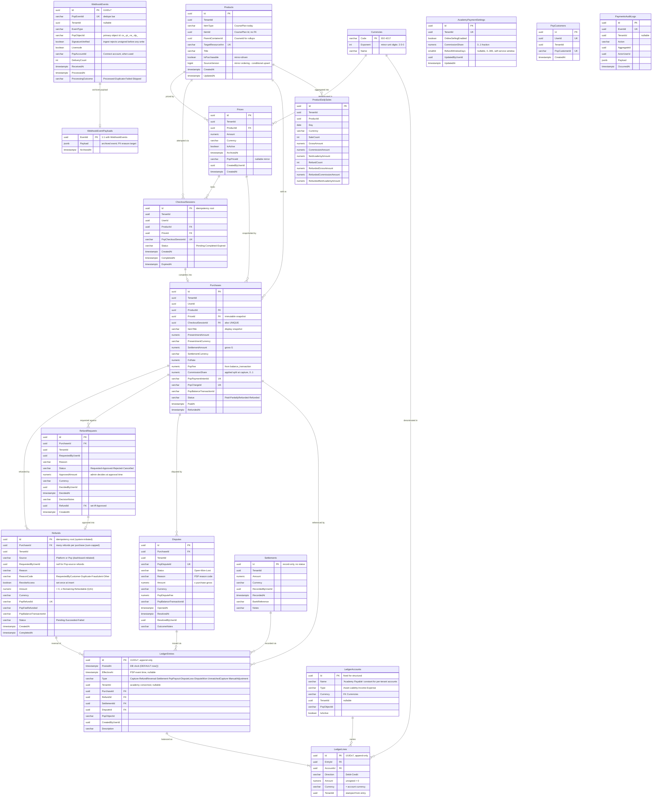

# Payments Module — Database Design

**Status:** Ratified 2026-11-14 (Q1–Q27 settled). External adversarial review applied 2026-11-14 — verdict **SHIP WITH FIXES**: 13 findings (2×P0, 4×P1, 4×P2, 3×P3), all incorporated (§13). Second adversarial review, same day — verdict **CONDITIONAL PASS**: 14 findings (4×P0, 4×P1, 4×P2, 2×P3), all incorporated (§14). Third review — senior DBA adversarial review, 2026-11-15 — verdict **MAJOR REVISIONS REQUIRED**: 34 findings (5×Critical, 10×High, 9×Medium, 10×Low/hygiene), all incorporated (§15); decisions Q28–Q38 added to the ledger. Manual partial-refunds amendment, 2026-11-17 — decisions Q39–Q41 added (§17).
**Source of truth** for the Payments module's data model. Companion: `requirement.md` (currently at the plan-mode path; move to `plans/payments/requirement.md` when landing), `GLOSSARY.md` (repo root), queued ADRs 0002–0004 in requirement.md Appendix A. **D1–D17**, cited throughout, are the ratified design decisions defined in `requirement.md`'s decision ledger (third review, Low).
**This is a design document — zero implementation.** No migrations, no code.

---

## 0. Design principles applied

1. **Stripe-compatibility principle** — the DB stores what *our domain owns and needs* (audit, reconciliation, analytics, settlements). Everything PSP-side is a referenced object ID (`Psp*` columns). We never mirror Stripe session lifecycle, never model Stripe's internal ledger, never run a dispute workflow engine, never store card data.
2. **PSP-agnostic naming** — columns and concepts are named `Psp*`, never `stripe_*` (§6.3 of requirement.md). The Stripe adapter is configuration (API key + webhook secret in KeyVault per env) and code, not schema.
3. **Money representation** — amounts `numeric(18,4)`, FX rates `numeric(18,8)`, currency `varchar(3)` ISO 4217 per row. The DB speaks decimal major units; the **only** integer-minor-unit conversion happens inside the PSP adapter at the API boundary. Scale 4 covers every ISO 4217 exponent (KWD/BHD/OMR are 3-decimal). **Ledger splits round to the entry currency's minor-unit exponent, one leg computed and the other derived** (§3.10, §5 row 2 — second review P0-C). A `Currencies` reference table (code → minor-unit exponent, §3.16) turns the rounding convention into a DB-enforced check: currency columns FK to it, and the balance trigger verifies line amounts are minor-unit granular (third review, currency-integrity findings).
4. **Append-only money** — Ledger and audit tables have no UPDATE/DELETE path, enforced by deny-mutation triggers + REVOKE (the `LibraryAuditLogs` precedent, verbatim). All money tables (Purchases, Refunds, Disputes, Settlements, CheckoutSessions) carry transition-only triggers: money columns immutable, only status transitions and PSP-id stamps writable (third review finding 6). Schema ownership is separated from runtime access: a migration/owner role runs DDL; the runtime role holds only SELECT/INSERT/UPDATE-where-legitimate and cannot own, alter, or truncate guarded tables (§9, §16 — third review finding 6).
5. **Three-currency model** — Presentment (what the student was charged), Settlement (what the PSP deposits into the Platform's bank), Reporting (analytics normalization). MVP: Reporting ≡ Settlement ≡ one PSP account's currency — a **per-deployment configuration constant** (USD initially), not runtime configuration; the structural-account seed reads the same constant so every environment is self-consistent (third review, currency-integrity finding). Every amount column carries its currency code; conversion logic's single future home is the analytics projection worker.
6. **Capture-time truth** — the webhook expands `balance_transaction` at capture: fee, net, FX are recorded once, from PSP reports, never recomputed. Commission splits are recorded per Purchase in the Ledger at capture time (later settings changes never rewrite history).
7. **Every money movement lands in the ledger** (third review, Critical 1–3) — the PSP can move money the system didn't initiate: orphan captures after ambiguous timeouts, dashboard refunds, disputes on refunded purchases. Each has a designed path: ambiguous outcomes are treated as ambiguous (rows stay `Pending`); unmatched captures are booked to a **PSP Suspense** structural account and alerted; PSP-initiated refunds are ingested like any other refund; dispute cash movement is booked at the PSP's actual withdrawal/reinstatement events, not at dispute close. "Fail-closed when unresolvable" means *booked to suspense and alerted*, never *skipped silently*.
8. **PII minimization** (third review finding 15) — webhook payloads are the main accidental PII store (customer email, billing details, card brand/last4). Payloads live in a dedicated `WebhookEventPayloads` table, isolated from the hot dedupe table, with a documented erasure procedure; audit payloads never carry customer PII.

---

## 1. Decision ledger (Q1–Q41, settled)

| Q | Decision |
|---|---|
| Q1 | decimal(18,4) amounts / numeric(18,8) FX / varchar(3) currency; minor-units only at PSP boundary |
| Q2 | UUIDv7 PKs on append-heavy tables (`LedgerEntries`, `LedgerLines`, `WebhookEvents`); `Guid.NewGuid()` elsewhere; plain primitive Guid storage, no typed-ID wrappers |
| Q3/Q10 | Mixed tenancy: marker + global filter on tenant-scoped aggregates; plain `TenantId` + explicit indexes elsewhere; Ledger/Accounts/Webhook nullable-TenantId unfiltered; Platform-overview reads via named `IgnoreQueryFilters` (ADR-0001 discipline) |
| Q4/Q5/Q11 | Decoupled from Courses: plan-level `Products` mirror + immutable `Prices` + `PspCustomers`; polymorphic `ItemType`/`ItemId`, no cross-schema FKs; mirror fed by Courses lifecycle events |
| Q6 | `AcademyPaymentSettings`: one row per tenant, `CommissionShare decimal(5,4)` fraction, lazy-created, absent row = selling disabled |
| Q7 | Two-table ledger (entries + lines), Direction + unsigned Amount, **deferred constraint trigger** balance check, deny-mutation trigger + REVOKE append-only |
| Q8 | Typed nullable FK columns on LedgerEntries (PurchaseId / RefundId / SettlementId / DisputeId) + `PspObjectId` |
| Q9 | Five structural accounts seeded in initial migration (fixed Guids): PSP Clearing, Platform Revenue, PSP Fees, Bank Account, **PSP Suspense** (third review Critical 1); per-Academy payable accounts created on demand with the constant name `Academy Payable` (no embedded tenant ID — third review Low) |
| Q12 | **Separate `CheckoutSessions` table**; Purchase born only on payment |
| Q13/Q22 | **Immutable price rows**; one active per (Product, Currency) via partial unique; change = archive + insert |
| Q14 | Reporting currency ≡ settlement currency (config constant); conversion slots into projection worker later |
| Q15 | Balances derived-on-read (indexed SUMs) + analytics projection for dashboards; no materialized balance column |
| Q16 | WebhookEvents: unique `PspEventId`, jsonb payload, outcome column; keep forever; **no partitioning** |
| Q17 | Refunds two-phase (`Pending → Succeeded | Failed`), `RefundId` = PSP idempotency root, Ledger reversal on `refund.succeeded` — **amended by Q31** (refund family events, async failures, partial/multiple/external refunds) |
| Q18 | Disputes: separate table, coarse statuses `Open → Won | Lost`, Purchase stays `Paid` while disputed |
| Q19 | Settlements: record-only, **no status column**; partial settlements = multiple rows |
| Q20 | **No idempotency-key table** — deterministic keys (`CheckoutSessionId`, `RefundId`) |
| Q21 | `PaymentsAuditLog` adopted (LibraryAuditLog pattern) + transition timestamp columns on Purchase |
| Q23 | State split: sessions carry attempt lifecycle (`Pending → Completed | Expired`); Purchase carries money lifecycle (`Paid → Refunded`) — **amended by Q28** (late payments: `Expired → Completed` allowed) and **Q31** (Purchase gains `PartiallyRefunded`) |
| Q24 | Shapes of CheckoutSessions / Purchases / PspCustomers ratified |
| Q25 | Analytics projection `ProductDailySales` grain (TenantId, ProductId, Day); settlement position derived live |
| Q26 | Payments-owned integration events; Courses saga gains additive second correlation; saga-state `AccessCodeId` holds PurchaseId (documented overload) |
| Q27 | Single initial migration: all tables + structural seed + triggers; additive-only evolution; no prod seed; go-live flag absent from schema |
| Q28 | **Ambiguity is money-safe** (third review Critical 1): PSP-call timeouts are ambiguous (session stays `Pending`, like refunds staying `Pending`); only definitive PSP rejections expire a session; late payments may complete an `Expired` session; captures that match no local session are booked to **PSP Suspense** via an `UnmatchedCapture` entry and alerted — cash is never silently skipped |
| Q29 | **Metadata-first webhook resolution** (third review Critical 1 + High 12): PSP session create stamps `client_reference_id = CheckoutSessionId` + metadata (`TenantId`, `UserId`, `ProductId`, `PriceId`, `CheckoutSessionId`); refund create stamps metadata (`RefundId`, `PurchaseId`). Webhook handlers resolve by PSP metadata first, `Psp*` columns second — fast webhooks and 24 h idempotency-window re-creates cannot orphan an event |
| Q30 | **Tax is out of scope with a hard guarantee** (third review Critical 4): tax-exclusive pricing, PSP Tax off, no tax columns or invoice numbering in MVP; the G-split therefore never divides a tax liability. Retrofitting tax onto the append-only ledger is explicitly deferred behind an ADR flag (§10) |
| Q31 | **Refunds model v2** (third review Critical 2): multiple partial refunds per Purchase; `Refunds.Source` ∈ `Platform` \| `Psp` (dashboard/PSP-initiated rows ingested from webhooks); async refund failures handled (`Pending → Succeeded \| Failed` via the refund event family); `Purchases.Status` gains `PartiallyRefunded`; Σ reversals (refunds + lost disputes) ≥ gross ⇒ `Refunded`. Full refunds revoke access; partial refunds do not |
| Q32 | **Settlement risk controls** (third review Critical 5, refined to a two-tier formula): only the *Settleable Balance* may be settled = Ledger balance − live (not-yet-succeeded) refunds − 100% of Academy-payable legs of captures inside the short hold window (`ShortHoldDays`, default 14) − `ReserveRate` (default 10%) of legs inside the rolling dispute window (~120 days); open disputes already reduce the balance because withdrawal is booked at `funds_withdrawn`; documented offboarding path for non-zero payables |
| Q33 | **Duplicate purchases are an eligibility concern, not a ledger concern** (third review High 14): no DB uniqueness on paid (UserId, ProductId) — Purchases are financial history; access rights live in enrollment. Session creation runs an explicit eligibility check (active enrollment ⇒ reject) via the access/enrollment service |
| Q34 | **Payload PII isolation** (third review High 15): `WebhookEvents.Payload` moves to `WebhookEventPayloads` (one row per event, hot dedupe table stays lean, payloads archive to cold storage); documented reviewed-migration erasure procedure; audit payloads carry no customer PII |
| Q35 | **Role separation** (third review High 6): migration/owner role runs DDL and seeds; the runtime role owns nothing, cannot `ALTER`/`TRUNCATE`/disable triggers, and holds only table-scoped SELECT/INSERT (+UPDATE where transitions are legitimate). Deny triggers remain the primary control; grants are the second |
| Q36 | **Dispute cash movement booked at the PSP's movement time** (third review Critical 3): `charge.dispute.funds_withdrawn` books the withdrawal (disputed amount + fee) immediately — even on an already-refunded Purchase; `charge.dispute.funds_reinstated` books the return on Won; `charge.dispute.closed` only flips status. No money event depends on a 0-row tripwire |
| Q37 | **`Currencies` reference table** (third review Medium): code → ISO 4217 exponent; FK target for every currency column; the balance trigger and price triggers enforce minor-unit scale in the DB (closes the "trigger can't check scale without a map" gap of second review P0-C) |
| Q38 | **Reconciliation is a first-class citizen** (third review Medium): `ReconciliationRuns` + `ReconciliationFindings` tables record every run (ledger-vs-PSP balance transactions, ledger internal consistency, mirror drift, unmatched captures, stale sessions); ops dashboards read outputs, not ad-hoc queries |
| Q39 | **Refund requests are a first-class workflow** (manual partial refunds amendment): a student opens a `RefundRequest` against a Purchase (one open request per Purchase, inside `RefundWindowDays` when configured — app policy, admins may override); a platform admin decides at review time, setting the actual `ApprovedAmount`; approval creates the `Refunds` row (`Source = 'Platform'`, `Pending`) **in the same transaction** and hands off to the §5 row 4 path. Requests and decisions write audit rows only — never ledger entries |
| Q40 | **Revocation is a per-refund decision, not only an amount rule**: `Refunds.ReasonCode` (`RequestedByCustomer \| Duplicate \| Fraudulent \| Other`) + `Refunds.RevokeAccess` (set-once at insert, default FALSE). Access revokes when the Purchase reaches `Refunded` (any cause), on **any** lost dispute (unchanged), or when a `Succeeded` refund carries `RevokeAccess = TRUE`; an unflagged partial refund never revokes. `PurchaseRefundedIntegrationEvent` keeps its exactly-one-cause invariant |
| Q41 | **One Remaining Refundable formula everywhere**: `SettlementAmount − Σ(Pending + Succeeded refunds) − Σ(disputes withdrawn (Open) or Lost)` — drives the refund sum cap (§3.11), the request-approval check, and the settlement hold (§3.13: an open request withholds the remaining Academy-payable leg). A dispute resolved `Won` drops out of the sum because `funds_reinstated` restores the money (Q36) |

---

## 2. Schema overview (ERD)



Standalone (no relationships drawn): `AcademyPaymentSettings` (one row per tenant), `PspCustomers`, `PaymentsAuditLogs`, `ReconciliationRuns` + `ReconciliationFindings` (§3.18). MassTransit scaffolding tables (`InboxState`, `OutboxMessage`, `OutboxState`) live in the Payments schema via the existing `AppDbContext` config; migration history is `__PaymentsMigrationHistory` (already wired).

**Conventions** (repo-wide): quoted PascalCase identifiers; enums as `varchar(32)` strings (keep literals in sync with `HasConversion<string>()`); `timestamptz` everywhere; PKs `ValueGeneratedNever()` domain-generated; **Postgres does not auto-index FK columns — every FK below carries an explicit index**; no cross-module/cross-schema FKs (TenantId, UserId, ItemId, ParentContainerId are event-driven references).

**Naming:** all tables use plural names, matching the repo convention.

---

## 3. Per-table specs

### 3.1 Products — plan-level mirror of sellables
*Written only by the mirror consumer (Courses lifecycle events → Payments). Academy admins never write here; they write Prices.*

| Column | Type | Null | Notes |
|---|---|---|---|
| Id | uuid | no | PK, `Guid.NewGuid()` |
| TenantId | uuid | no | owning Academy |
| ItemType | varchar(32) | no | default `'CoursePlan'`; extensible `'Document'`/`'Blog'`/`'Assessment'` later |
| ItemId | uuid | no | CoursePlan.Id — plain reference, **no FK** |
| ParentContainerId | uuid | yes | CourseId (rollups); NOT NULL when ItemType='CoursePlan' |
| TargetResourceArn | varchar(512) | no | ARN the PurchaseActivated event carries |
| Title | varchar(255) | no | mirrored display name |
| IsPurchasable | boolean | no | default FALSE; driven by mirror events (course published → true) |
| SourceVersion | bigint | no | Courses-side event sequence/version stamp, carried by the mirror event; drives the conditional upsert below |
| CreatedAt / UpdatedAt | timestamptz | no / yes | |

**Constraints:** `UNIQUE (TenantId, TargetResourceArn)`; `UNIQUE (TenantId, ItemType, ItemId)`; `CHECK (ItemType <> 'CoursePlan' OR ParentContainerId IS NOT NULL)`.
**Indexes:** `(TenantId, ParentContainerId)`.
**Tenancy:** plain column, **no global filter** (mirror-managed, read broadly).
**Retention:** rows never deleted — plan removal / unpublish sets `IsPurchasable = false` (purchase history FKs must survive); title changes arrive as mirror updates.
**Out-of-order mirror events (third review Medium):** "last-write-wins, benign races" was wrong for `IsPurchasable` — unpublish and publish delivered in reverse would resurrect a sellable row. The mirror upsert is **version-conditional**: `INSERT … ON CONFLICT (… ) DO UPDATE SET … WHERE "Products"."SourceVersion" < EXCLUDED."SourceVersion"` — an older event arriving after a newer one is a no-op, and `Processed` is stamped either way (the row already reflects a later truth). A one-off **initial backfill** (snapshot from Courses at first deploy) plus **periodic mirror reconciliation** (a `ReconciliationFindings` entry whenever `Products` drifts from Courses' current state, §3.18) close the gap for events lost before the mirror existed.
**Sellable check (app-enforced):** `IsPurchasable` ∧ active Price ∧ Academy opt-in.

### 3.2 Prices — immutable offers
*Academy admins manage (permission `payments:ManageCatalog`); one active price per (Product, Currency).*

| Column | Type | Null | Notes |
|---|---|---|---|
| Id | uuid | no | PK |
| TenantId | uuid | no | |
| ProductId | uuid | no | FK → Products `ON DELETE RESTRICT` |
| Amount | numeric(18,4) | no | list price, major units |
| Currency | varchar(3) | no | no default — explicit on every row |
| IsActive | boolean | no | |
| ArchivedAt | timestamptz | yes | set exactly when deactivated |
| PspPriceId | varchar(255) | yes | mirrored PSP price object; null when the adapter uses inline price_data |
| CreatedByUserId | uuid | no | academy admin |
| CreatedAt | timestamptz | no | |

**Constraints:** partial `UNIQUE (ProductId, Currency) WHERE IsActive = TRUE` (your `UQ_Prices_Product_Currency`, preserved in spirit); `CHECK (Amount > 0)`; `CHECK (IsActive = (ArchivedAt IS NULL))`; `CHECK (char_length(Currency) = 3)` + FK → `Currencies(Code)`.
**Minor-unit scale (DB-enforced, third review Medium):** a `BEFORE INSERT OR UPDATE` trigger verifies `Amount × 10^exponent` is an integer, using the `Currencies` row for the row's currency — `numeric(18,4)` alone would accept `19.9999` and the adapter would round silently. This DB check replaces the app-only half of the second review's P0-C rounding rule.
**Immutability (DB-enforced):** trigger `deny_price_amend` — UPDATE allowed **only** for two paths: the archive transition (`IsActive` TRUE → FALSE with `ArchivedAt` set) and the one-time `PspPriceId` NULL→value stamp (third review Medium: the PSP price id can only be known after the row exists; the second review's NULL-comparison fix made it settable *never* — corrected to settable **once**). All other immutable columns compared as a row tuple with `IS DISTINCT FROM` (a plain `<>` comparison silently passes on NULL→value changes — second review P2-C); DELETE denied; TRUNCATE denied (statement-level `BEFORE TRUNCATE` trigger — row triggers don't fire on TRUNCATE); REVOKE UPDATE, DELETE from PUBLIC. App side: no edit path exists.
**Archive + insert is one transaction (third review Medium):** price change = archive the active row and insert its successor inside a **single** transaction (§5 row 13) — an intermediate state with no active price, or two active prices, never exists; the partial unique is the backstop either way.
**Sellable currency (MVP guarantee, third review Medium):** sellable prices must be denominated in the settlement currency — app-enforced at creation + architecture test; cross-currency pricing is Phase-2 (with FX).
**Indexes:** `(TenantId, ProductId)`, FK index on `ProductId`.
**Checkout rule:** session creation locks the *active base-currency* price; `Purchase.PriceId` references that exact immutable row — the checkout snapshot, by reference. **Presentment mismatch detection (third review Medium):** the capture handler compares the event's charged amount with the locked `Price.Amount`; a mismatch (PSP-side promo, currency presentment drift, manual PSP edit) never blocks the capture (the PSP is truth for money moved) but writes a `PaymentsAuditLogs` warning + `ReconciliationFindings` entry so drift is visible.
**History:** price changes are fully reconstructible from archived rows + `PaymentsAuditLogs`.

### 3.3 AcademyPaymentSettings — opt-in + Commission Share
| Column | Type | Null | Notes |
|---|---|---|---|
| Id | uuid | no | PK |
| TenantId | uuid | no | **UNIQUE** — one row per Academy |
| OnlineSellingEnabled | boolean | no | default FALSE |
| CommissionShare | numeric(5,4) | no | fraction: 0.25 = 25%; `CHECK (CommissionShare BETWEEN 0 AND 1)`; **no default** — the creating platform admin states the share explicitly at opt-in (third review Medium: a silent code default is a pricing decision nobody made) |
| ReserveRate | numeric(5,4) | no | default `0.1000` (10%); fraction of net Academy share held during the rolling dispute window; `CHECK (ReserveRate BETWEEN 0 AND 1)` |
| ShortHoldDays | smallint | no | default `14`; 100% hold window for initial refund exposure; `CHECK (ShortHoldDays BETWEEN 0 AND 120)` |
| RefundWindowDays | smallint | yes | NULL (default) = self-service refund **requests** disabled for this Academy (fail-closed, same posture as "absent row = selling disabled"); when set, students may open a `RefundRequest` within `PaidAt + RefundWindowDays`; `CHECK (RefundWindowDays BETWEEN 0 AND 365)`; **app policy only** — the DB never enforces the window and admins may approve outside it (Q39) |
| UpdatedByUserId | uuid | yes | platform admin (`payments:ManageAcademySettings`) |
| UpdatedAt | timestamptz | yes | |
| CreatedAt | timestamptz | no | |

**Tenancy:** marker + global filter (tenant-owned). **Lazy-created** on first management action; **absent row = selling disabled** (fail-closed). Every change → `PaymentsAuditLogs`.

### 3.4 CheckoutSessions — attempt lifecycle
| Column | Type | Null | Notes |
|---|---|---|---|
| Id | uuid | no | PK, `Guid.NewGuid()` — **the PSP idempotency key for session creation** (durable before the PSP call) |
| TenantId | uuid | no | always stamped at creation (authenticated student context); **NOT NULL** — `IDomainTenantOwned` demands a non-nullable Guid, and "fail-safe nullable inserts" was the wrong posture (fail-closed is correct; review P2-4) |
| UserId | uuid | no | platform user reference (no FK — Identity owns users) |
| ProductId | uuid | no | FK → Products |
| PriceId | uuid | no | FK → Prices (the active price locked at creation) |
| PspCheckoutSessionId | varchar(255) | yes | **UNIQUE**; best-effort mirror of the PSP session id — webhook resolution is **metadata-first** (Q29); re-stamped when a re-create mints a fresh `cs_` id after the PSP's 24 h idempotency window |
| Status | varchar(32) | no | `Pending` \| `Completed` \| `Expired`; `CHECK (Status IN ('Pending','Completed','Expired'))` |
| CreatedAt | timestamptz | no | |
| CompletedAt | timestamptz | yes | |
| ExpiredAt | timestamptz | yes | |

**Constraints:** partial `UNIQUE (UserId, ProductId) WHERE Status = 'Pending'` — **idempotency bar #3** (one active session per (student, sellable), declarative, race-free); `CHECK (Status <> 'Completed' OR CompletedAt IS NOT NULL)`; `CHECK (Status <> 'Expired' OR ExpiredAt IS NOT NULL)`; `CHECK (Status <> 'Pending' OR (CompletedAt IS NULL AND ExpiredAt IS NULL))`. A late payment flips `Expired → Completed` (Q28): `CompletedAt` is stamped, `ExpiredAt` stays (history), `Status` ends `Completed` — the CHECKs above hold for that transition.
**Webhook resolution is metadata-first (Q29, third review High 12):** the PSP session-create call stamps `client_reference_id = CheckoutSessionId` plus `metadata: {TenantId, UserId, ProductId, PriceId, CheckoutSessionId}`. Handlers resolve sessions by metadata first, by `PspCheckoutSessionId` second — a webhook that beats the PSP-id stamp, or a re-created session with a new `cs_` id, still resolves. `PspCheckoutSessionId` is a mirror, not the join key.
**Eligibility gate (Q33, third review High 14):** session creation runs an explicit business-eligibility check (active enrollment for this product ⇒ reject) before invoking the PSP. Purchases are financial history, not access rights — no DB uniqueness prevents re-purchase; the eligibility service owns that decision (per-item policy; subscriptions will define their own).
**Transition-only trigger (third review High 6):** a deny trigger allows only `Status` transitions (`Pending → Completed | Expired`, `Expired → Completed`) with their timestamp columns, and `PspCheckoutSessionId` NULL→value / value→value re-stamps; `TenantId`, `UserId`, `ProductId`, `PriceId`, `CreatedAt` immutable. DELETE/TRUNCATE denied.
**Indexes:** `(TenantId, UserId, CreatedAt)`; FK indexes on ProductId, PriceId; unique on PspCheckoutSessionId.
**Tenancy:** marker + global filter — sessions joined the marker bucket at Q12(b) (same tenant-scoped read paths as Purchases); confirmed non-nullable by review P2-4. **Handler locking (reviews P1-2/P0-A):** money-event webhook handlers `SELECT … FOR NO KEY UPDATE` the CheckoutSession row before mutating state (repo lock-ordering discipline; `Purchases.CheckoutSessionId` FK means concurrent captures hold `FOR KEY SHARE` on this row — plain `FOR UPDATE` would stall them); a second delivery for the same session observes `Completed` and marks its event `Duplicate`, returning 200 to the PSP. No URLs, no amounts — the PSP owns session state (Stripe-compat principle).
**Expiry & recovery (second review P1-C, amended by third review Critical 1):** PSP-driven expiry (`checkout.session.expired` webhook); missed webhooks leave a stale Pending row — reconciliation-visible; optional sweeper Phase 2, schema supports it. Three app rules close the reuse traps: (1) a **definitive** pre-PSP-call failure (`PspCheckoutSessionId IS NULL` and the PSP create-call returned an explicit terminal rejection) → session `Expired` immediately — no PSP webhook will ever arrive; a **timeout or 5xx is ambiguous and stays `Pending`** exactly like ambiguous refunds stay `Pending` (Q28) — the PSP may have created the session and the student may still pay; rule (2) below is the recovery path, and `checkout.session.completed` for an `Expired` session is a legal late-payment transition; (2) **reuse of a Pending row = re-invoke the PSP session-create with the same `CheckoutSessionId` idempotency key** — the PSP replays the live session (or creates a fresh one after its idempotency window; Stripe: both 24 h, re-stamping `PspCheckoutSessionId`) and the adapter hands back the redirect URL — never stored, never stale; (3) if the locked `PriceId` is no longer active (archived since creation), expire the Pending row and create a fresh session on the current active price — the page advertises one price and checkout charges that price.

### 3.5 Purchases — the money row (SaleRecord pattern)
*Born `Paid` at `checkout.session.completed`; the immutable commercial record.*

| Column | Type | Null | Notes |
|---|---|---|---|
| Id | uuid | no | PK; ledger entries reference it |
| TenantId | uuid | no | owning Academy |
| UserId | uuid | no | student (no FK — Identity owns users) |
| ProductId | uuid | no | FK → Products |
| PriceId | uuid | no | FK → Prices — **snapshot by reference to an immutable row** |
| CheckoutSessionId | uuid | no | **UNIQUE** FK → CheckoutSessions |
| ItemTitle | varchar(255) | no | display snapshot (mirror titles can change later) |
| PresentmentAmount | numeric(18,4) | no | what the student was charged |
| PresentmentCurrency | varchar(3) | no | |
| SettlementAmount | numeric(18,4) | no | gross **G** in settlement currency |
| SettlementCurrency | varchar(3) | no | |
| FxRate | numeric(18,8) | yes | presentment→settlement rate; NULL when currencies equal (CHECK) |
| PspFee | numeric(18,4) | no | **F**, from expanded `balance_transaction` at capture; zero-fee captures are legal (waived/test payments) — unlike ledger lines, fee columns allow 0 (second review P0-B); NOT NULL is safe under the card-only MVP guarantee (§5 row 2: the PSP call that expands the balance transaction happens *before* the domain transaction, and its failure fails the event) |
| CommissionShare | numeric(5,4) | no | the split **applied at capture** — stored, not derived (third review Medium: `commission ÷ G` is lossy after rounding, e.g. G = 0.99); historical settings changes never rewrite it |
| PspPaymentIntentId | varchar(255) | no | **UNIQUE** — one PaymentIntent per Purchase; two Purchases sharing a PI is a bug the index makes impossible (third review High 13) |
| PspChargeId | varchar(255) | yes | **UNIQUE** — refund/dispute webhooks arrive keyed by charge or PI; this + the PI unique index are their lookup path (third review High 13) |
| PspBalanceTransactionId | varchar(255) | yes | PSP reconciliation reference |
| Status | varchar(32) | no | `Paid` \| `PartiallyRefunded` \| `Refunded` (Q31); `CHECK (Status IN ('Paid','PartiallyRefunded','Refunded'))` |
| PaidAt | timestamptz | no | |
| RefundedAt | timestamptz | yes | set only when the Purchase becomes **fully** refunded (Σ reversals ≥ gross) — the last reversal's completion time |

**Constraints:** `CHECK ((Status = 'Refunded') = (RefundedAt IS NOT NULL))` (`PartiallyRefunded` keeps `RefundedAt` NULL); `CHECK ((PresentmentCurrency = SettlementCurrency) = (FxRate IS NULL))` (review P3-1: biconditional — same currency ⇒ no rate stored; different currencies ⇒ rate required); `CHECK (PspFee >= 0)` (second review P0-B).
**Reversal accounting (Q31, third review Critical 2):** the Purchase's refund state is derived from **Σ reversals** — succeeded `Refunds.Amount` plus lost-dispute amounts: `0` ⇒ `Paid`, `< G` ⇒ `PartiallyRefunded`, `≥ G` ⇒ `Refunded` (+ `RefundedAt`). Multiple partial refunds, dashboard refunds, and lost disputes all feed the same total; the transition is guarded by the tripwire pattern (conditional `UPDATE … WHERE Status = expected`) executed under the Purchase row's `FOR NO KEY UPDATE` lock so concurrent refunds cannot double-count past the cap.
**Transition-only trigger (third review High 6):** `deny_money_amend` on `Purchases` — money columns (`PresentmentAmount`, `SettlementAmount`, `FxRate`, `PspFee`, `CommissionShare`, `ItemTitle`, `PriceId`, `CheckoutSessionId`, tenant/user/product refs) immutable; writable: the status ladder (`Paid → PartiallyRefunded → Refunded`) with `RefundedAt`, and PSP-id columns NULL→value (set-once). DELETE/TRUNCATE denied. This is what makes "an `UPDATE Purchases SET SettlementAmount` silently diverging from the ledger" impossible rather than merely unlikely.
**Allocation truth:** the capture-time split (commission, academy share) lives in the Ledger, not here — `LedgerEntries.PurchaseId` joins it; the applied share is **stored on the row** (`CommissionShare`) so reversals stay well-defined even after settings change.
**Indexes:** `(TenantId, PaidAt DESC)`, `(TenantId, Status, PaidAt DESC)`, `(TenantId, ProductId, PaidAt)`, `(TenantId, UserId, PaidAt)`; FK indexes on ProductId, PriceId, CheckoutSessionId (unique); unique on PspPaymentIntentId, PspChargeId (webhook lookup path, third review High 13).
**Tenancy:** marker + global filter. **Retention:** forever; no soft delete (money rows are never deleted — matches SaleRecord precedent, no `ISoftDeletable`).

### 3.6 PspCustomers — user ↔ PSP customer map
| Column | Type | Null | Notes |
|---|---|---|---|
| Id | uuid | no | PK |
| UserId | uuid | no | **UNIQUE** — one PSP customer per user (single PSP in MVP) |
| TenantId | uuid | yes | convenience for ops queries |
| PspCustomerId | varchar(255) | no | **UNIQUE** |
| CreatedAt | timestamptz | no | |

**Tenancy:** plain column, no filter. Cross-tenant by design — one PSP customer per user regardless of Academy; `TenantId` is best-effort ops metadata, and NULL rows are simply not tenant-filterable (review P3-3). Lazily created at first checkout (inside the capture transaction is fine).

### 3.7 WebhookEvents — exactly-once ingestion archive
| Column | Type | Null | Notes |
|---|---|---|---|
| Id | uuid | no | PK, **UUIDv7** |
| PspEventId | varchar(255) | no | **UNIQUE** — **idempotency bar #2** (dedupe on insert) |
| TenantId | uuid | yes | resolved from event metadata; fail-closed when unresolvable |
| EventType | varchar(64) | no | e.g. `checkout.session.completed`, `checkout.session.expired`, `refund.created`, `refund.updated`, `refund.failed`, `charge.dispute.created`, `charge.dispute.funds_withdrawn`, `charge.dispute.funds_reinstated`, `charge.dispute.closed` (modern Stripe event names — third review Critical 2; legacy API versions deliver `charge.refunded`/`charge.refund.updated` with identical semantics, mapped by the adapter) |
| PspObjectId | varchar(255) | yes | the event's primary object id (`cs_…`, `pi_…`, `re_…`, `dp_…`), extracted at ingest — lets unmatched events be joined to later-arriving context and gives the reconciliation sweeper a lookup key |
| SignatureVerified | boolean | no | see ingestion below — unsigned deliveries are rejected **before any DB write**, so no row is ever inserted with FALSE from the webhook path (Q35 hygiene; replay tooling may insert marked rows) |
| Livemode | boolean | no | PSP environment flag — test events can never mutate production money state (third review Low) |
| PspAccountId | varchar(255) | yes | PSP Connect account the event belongs to, when one is used |
| DeliveryCount | int | no | default 1; incremented on dedupe-hit redeliveries (observability: "PSP keeps retrying") |
| ReceivedAt | timestamptz | no | |
| ProcessedAt | timestamptz | yes | |
| ProcessingOutcome | varchar(32) | yes | `Processed` \| `Duplicate` \| `Failed` \| `Skipped`; `CHECK (ProcessingOutcome IN ('Processed','Duplicate','Failed','Skipped'))` |

**Payload PII isolation (Q34, third review High 15):** the archived event body lives in **`WebhookEventPayloads`** (§3.17), one row per event. The hot dedupe table stays narrow (small rows, index-friendly); payloads can be archived to cold storage and — critically — rewritten by the erasure procedure without touching the money-flow table. Written in the same ingest transaction.

**Indexes:** `(EventType, ReceivedAt)`; partial `(PspObjectId) WHERE PspObjectId IS NOT NULL` (lookup by session/payment-intent/refund/dispute id — third review High 13); `(ProcessingOutcome) WHERE ProcessingOutcome IS NULL` partial for the sweeper's stuck-event scan. **Tenancy:** plain column, no filter. **Retention:** keep forever (MVP); **no partitioning** — payloads now have their own table with an archival path (§16), which also retires the "can't partition" objection's hot-table concern; revisit only with go-live telemetry.
**Two-phase ingestion with async handoff (second review P0-D, amended by third review High 10):** *verify → ingest → enqueue* — the signature is verified against the PSP webhook secret **before any DB write**; an unsigned delivery gets 400 and leaves no row, so an attacker cannot pre-poison a `PspEventId` and make the genuine event dedupe into a silent 200. **Phase 1 (HTTP request thread):** the event row (plus payload in `WebhookEventPayloads`) is written in its own short, autonomous transaction — an atomic upsert (`INSERT … ON CONFLICT ("PspEventId") DO UPDATE SET "DeliveryCount" = "DeliveryCount" + 1 RETURNING "Id", "ProcessingOutcome"`, raw SQL via Npgsql), committed immediately. If the returned outcome is terminal (`Processed` / `Duplicate` / `Skipped`), the endpoint returns 200 at once. Otherwise, the endpoint publishes the `WebhookEvents.Id` to an in-memory bounded channel / background queue and returns 200 immediately (sub-15ms response; zero outbound PSP HTTP calls on the incoming webhook request thread). **Phase 2 (background processor / sweeper):** picks up the queued `WebhookEvents.Id`, performs any required outbound PSP API calls (such as `balance_transaction` expansion at capture) outside of any DB transaction, and then opens the domain transaction (§5 rows 2–9) which locks the `WebhookEvents` row `FOR NO KEY UPDATE`, **re-reads `ProcessingOutcome` after taking the lock** (a concurrent worker or redelivery may have completed processing in between), runs the state/ledger/outbox writes, and stamps `Processed`; on failure, a clean transaction stamps `Failed` for retry by the sweeper worker.
**Stuck-event sweeper (third review High 10):** the PSP only retries for ~3 days; rows can stall non-terminal after a crash between ingest and process, or sit `Failed`. A background sweeper re-drives every row where `ProcessingOutcome IS NULL AND ReceivedAt < now() − threshold` and exposes a ops-triggered re-drive for `Failed` rows; a **documented replay-from-archive** procedure re-processes events from `WebhookEventPayloads` into a fresh environment (idempotency bars make replays safe). Sweeper activity and un-driven failures surface in `ReconciliationRuns`/alerting (§16).

### 3.8 LedgerAccounts — chart of accounts
| Column | Type | Null | Notes |
|---|---|---|---|
| Id | uuid | no | PK; **structural accounts carry fixed, deterministic Guids** (uuid5-derived constants, identical in every environment) |
| Name | varchar(64) | no | structural: `PSP Clearing`, `Platform Revenue`, `PSP Fees`, `Bank Account`, `PSP Suspense`; per-Academy: the **constant** `'Academy Payable'` — the tenant is identified by `TenantId`, not embedded in the name (third review Low; embedded IDs duplicate the column and break name-based queries) |
| Type | varchar(16) | no | `Asset` \| `Liability` \| `Income` \| `Expense`; `CHECK (Type IN ('Asset','Liability','Income','Expense'))` |
| Currency | varchar(3) | no | the platform settlement currency; FK → `Currencies(Code)` |
| TenantId | uuid | yes | set only for per-Academy payable accounts |
| PspObjectId | varchar(255) | yes | PSP-side account ref when known |
| IsActive | boolean | no | |
| CreatedAt | timestamptz | no | |

**Constraints:** partial `UNIQUE (Name) WHERE TenantId IS NULL` (platform accounts); partial `UNIQUE (TenantId, Name) WHERE TenantId IS NOT NULL` (one payable per Academy — Postgres treats NULLs as distinct, hence two partials).
**Seeding:** the **five** structural accounts are seeded by the initial migration (Q9a — structural rows are schema, not demo data), each with the deployment's configured settlement currency (the same configuration constant the adapter uses — every environment is internally consistent; a settlement-currency change is a new platform setup, not a runtime toggle — third review Medium). `Academy Payable` rows are created deterministically when the Academy's settings row is upserted (§5 row 14) — no Academy can sell without a settings row, so the capture hot path never creates accounts; the lazy ensure kept as backup is a raw `INSERT … ON CONFLICT ("TenantId", "Name") WHERE "TenantId" IS NOT NULL DO NOTHING` (a plain re-insert 23505s on two concurrent first-captures — second review P2-B). A Payments-internal concern, no cross-module coupling. `PSP Suspense` exists precisely so unmatched PSP captures have somewhere to land without blocking anything (Q28).
**Tenancy:** nullable TenantId, **no filter**. Lines reach tenancy through the account (plus the denormalized stamp below). The balance trigger verifies line-to-account tenancy (§3.9 check 6 — third review High 8).

### 3.9 LedgerEntries — append-only header
| Column | Type | Null | Notes |
|---|---|---|---|
| Id | uuid | no | PK, **UUIDv7** |
| PostedAt | timestamptz | no | **DB clock**, set by `DEFAULT now()` — the app never supplies its own clock (third review Medium: time semantics) |
| EffectiveAt | timestamptz | yes | the PSP event's own timestamp (from the webhook payload) — "balance as of date X" queries use this so reprocessed events cannot shift history; NULL for platform-recorded rows |
| Type | varchar(32) | no | `Capture` \| `RefundReversal` \| `Settlement` \| `PspPayout` \| `DisputeLoss` \| `DisputeWon` \| `UnmatchedCapture` \| `ManualAdjustment`; `CHECK (Type IN (…))` |
| TenantId | uuid | yes | the Academy the entry **concerns**; NULL = platform-level (e.g. PSP payout to bank) |
| PurchaseId | uuid | yes | FK → Purchases (typed audit linkage, Q8a) |
| RefundId | uuid | yes | FK → Refunds |
| SettlementId | uuid | yes | FK → Settlements |
| DisputeId | uuid | yes | FK → Disputes |
| PspObjectId | varchar(255) | yes | PSP object behind the entry (payment_intent, refund, dispute, payout, unknown session) |
| CreatedByUserId | uuid | yes | for manual adjustments / recorded actions |
| Description | varchar(256) | yes | required for `ManualAdjustment` and `UnmatchedCapture` (CHECK) |

**Constraints (exact reference sets — presence *and* absence, third review High 7):** each type permits exactly one business reference, no more:
`CHECK (Type <> 'Capture' OR (PurchaseId IS NOT NULL AND RefundId IS NULL AND SettlementId IS NULL AND DisputeId IS NULL))` ·
`CHECK (Type <> 'RefundReversal' OR (RefundId IS NOT NULL AND PurchaseId IS NOT NULL AND SettlementId IS NULL AND DisputeId IS NULL))` ·
`CHECK (Type <> 'Settlement' OR (SettlementId IS NOT NULL AND PurchaseId IS NULL AND RefundId IS NULL AND DisputeId IS NULL))` ·
`CHECK (Type <> 'PspPayout' OR (PspObjectId IS NOT NULL AND PurchaseId IS NULL AND RefundId IS NULL AND SettlementId IS NULL AND DisputeId IS NULL))` ·
`CHECK (Type <> 'DisputeLoss' OR (DisputeId IS NOT NULL AND PurchaseId IS NOT NULL AND RefundId IS NULL AND SettlementId IS NULL))` ·
`CHECK (Type <> 'DisputeWon' OR (DisputeId IS NOT NULL AND RefundId IS NULL AND SettlementId IS NULL))` ·
`CHECK (Type <> 'UnmatchedCapture' OR (PspObjectId IS NOT NULL AND Description IS NOT NULL AND PurchaseId IS NULL AND RefundId IS NULL AND SettlementId IS NULL AND DisputeId IS NULL))` ·
`CHECK (Type <> 'ManualAdjustment' OR (CreatedByUserId IS NOT NULL AND Description IS NOT NULL))`.
**Business-event uniqueness (DB-enforced, third review High 7):** the tripwires are app-level; the DB now makes double-recording impossible:
partial `UNIQUE (PurchaseId) WHERE Type = 'Capture'` ·
partial `UNIQUE (RefundId) WHERE Type = 'RefundReversal'` ·
partial `UNIQUE (DisputeId, Type) WHERE DisputeId IS NOT NULL` (one `DisputeLoss` + one `DisputeWon` per dispute) ·
partial `UNIQUE (SettlementId) WHERE SettlementId IS NOT NULL` ·
partial `UNIQUE (PspObjectId) WHERE Type = 'PspPayout'` (a PSP payout can never be recorded twice).
**Indexes:** `(PurchaseId)`, `(Type, PostedAt)`, partial `(TenantId) WHERE TenantId IS NOT NULL`; FK indexes on RefundId, SettlementId, DisputeId.
**Derived-balance scale (third review Medium):** every capture touches PSP Clearing, PSP Fees and Platform Revenue, so those SUMs grow unbounded. The MVP accepts derived-on-read (Q15) behind the covering index; the pre-designed Phase-2 evolution is an append-only `LedgerBalanceCheckpoints` (AccountId, EffectiveAt, Balance) written by the reconciliation worker, so "balance as of" reads stop scanning all lines — additive-only, no rewrite of anything here. Volume assumptions backing this and the other scaling decisions are in §16.
**Append-only (DB-enforced):** the deny-mutation trigger is the PRIMARY enforcement — it fires for every role, including the schema owner (Q35 separates migration-owner from runtime user; the runtime role additionally holds no UPDATE/DELETE grant at all — §9). `REVOKE UPDATE, DELETE … FROM PUBLIC` is defense-in-depth for non-owner roles (reporting/replica users) and does not constrain the owner (review P2-1; `LibraryAuditLogs` migration pattern). EF side: no update path exists. Deny triggers are `BEFORE UPDATE OR DELETE` row-level **plus** a statement-level `BEFORE TRUNCATE` arm on every guarded table (row triggers don't fire on TRUNCATE; the owner isn't stopped by REVOKE — second review P2-C). Data repair on append-only tables happens only via an explicit `ALTER TABLE … DISABLE TRIGGER` inside a reviewed migration — never an ad-hoc UPDATE.

**Balance-invariant trigger — on the ENTRY, not the lines (second review P1-A).** The deferred constraint trigger fires `AFTER INSERT` on `LedgerEntries`, once per entry, at commit:

```sql
CREATE CONSTRAINT TRIGGER trg_ledger_entry_balance
AFTER INSERT ON "Payments"."LedgerEntries"
DEFERRABLE INITIALLY DEFERRED
FOR EACH ROW
EXECUTE FUNCTION "Payments".check_entry_balance();
```

At commit, for `NEW."Id"` (lines inserted in the same transaction are visible to the trigger):
1. `COUNT(lines) ≥ 2` — a zero-line header is impossible (a lines-only trigger would let one slip through permanently, and deny-mutation would make it unremovable);
2. Σ Debit = Σ Credit for the entry — per-entry balance; entries balance independently, never a transaction-level delta;
3. every line shares one currency, equal to each referenced account's currency;
4. every line's TenantId equals the entry's TenantId;
5. every Direction is `Debit` or `Credit`;
6. **line-to-account tenancy** — for every line whose account has `TenantId` set, `account.TenantId = entry.TenantId` (third review High 8: a capture for tenant A must not credit tenant B's payable; the previous checks only compared line↔entry and line↔account currency);
7. **minor-unit granularity in the DB** — each line's `Amount × 10^exponent` (from `Currencies`, §3.16) is an integer, so the rounding convention of second review P0-C is now trigger-enforced, not merely app-enforced.

Fires once per entry — a 4-line capture validates once, not four times (the lines-level variant re-ran the SUM per line). A violation raises at commit → the whole transaction (webhook row + Purchase + entry + lines + outbox) rolls back atomically inside `TransactionalBehavior`. Header + lines commit atomically, so no partial entry is ever visible outside a transaction.

### 3.10 LedgerLines — append-only balanced lines
| Column | Type | Null | Notes |
|---|---|---|---|
| Id | uuid | no | PK, **UUIDv7** |
| EntryId | uuid | no | FK → LedgerEntries `ON DELETE RESTRICT` |
| AccountId | uuid | no | FK → LedgerAccounts |
| Direction | varchar(8) | no | `Debit` \| `Credit`; `CHECK (Direction IN ('Debit','Credit'))` |
| Amount | numeric(18,4) | no | **unsigned**; `CHECK (Amount > 0)` |
| Currency | varchar(3) | no | must equal the account's currency; FK → `Currencies(Code)` |
| TenantId | uuid | yes | **stamped from the entry** (denormalized for indexed balance queries) |

**Indexes:** `(AccountId, Direction) INCLUDE (Amount)` (covering — balance SUMs become index-only scans, second review P2-A), `(EntryId)`, partial `(TenantId, AccountId) WHERE TenantId IS NOT NULL` (tenant-scoped line queries; justifies the denormalized stamp).
**Tenancy:** nullable TenantId, no filter.

**Same-transaction append guard (second review P1-A, redesigned by third review High 9, patched for multi-statement safety).** The balance trigger (on `LedgerEntries`, §3.9) cannot stop a later transaction from appending balanced lines to a historical entry — the entry stays balanced and no deny trigger fires on a plain INSERT. An immediate `BEFORE INSERT` trigger on `LedgerLines` makes historical appends physically impossible:

```sql
CREATE TRIGGER trg_ledger_lines_same_tx
BEFORE INSERT ON "Payments"."LedgerLines"
FOR EACH ROW EXECUTE FUNCTION "Payments".check_line_same_tx();
-- check_line_same_tx(): RAISE unless the parent entry was created in this exact transaction:
--   (SELECT "PostedAt" FROM "Payments"."LedgerEntries" WHERE "Id" = NEW."EntryId") = transaction_timestamp()
```

**Why `PostedAt = transaction_timestamp()` instead of `xmin` or `count(*) = 0`:**

1. The original `xmin = pg_current_xact_id()` comparison breaks under savepoints (third review High 9): a row inserted inside a subtransaction carries the subtransaction's xid while `pg_current_xact_id()` returns the top-level xid.
2. A naive `count(*) = 0` check inside a `BEFORE INSERT FOR EACH ROW` trigger breaks whenever EF Core or Npgsql splits `LedgerLines` inserts across multiple `INSERT` statements within the same transaction — the second statement sees the first statement's uncommitted lines (`count > 0`) and falsely aborts.
3. Because `LedgerEntries.PostedAt` is set by `DEFAULT now()` (which is an alias for `transaction_timestamp()` in PostgreSQL) and is immutable, its value is frozen for the entire duration of the top-level transaction across all savepoints and all statements. Every line inserted in the creating transaction sees `PostedAt = transaction_timestamp()`; any subsequent transaction has a strictly later `transaction_timestamp()` (and cannot see an uncommitted entry due to FK visibility rules) and is rejected.

**Minor-unit rounding rule (second review P0-C).** Split amounts round to the entry currency's ISO 4217 minor-unit exponent (2 for USD/EUR, 3 for KWD/BHD/OMR, 0 for JPY) even though columns are numeric(18,4). Two independent multiplications can fail the balance trigger at commit — 19.99 @ 33.33 % rounds to legs summing 20.00 — and even when they do sum, un-rounded splits leave un-wireable dust ($14.9925 can never be settled). One leg is computed, the other derived (formula in §5 row 2). **DB-enforced as of the third review**: the `Currencies` table supplies the exponent map the trigger previously lacked, so the balance trigger's check 7 rejects sub-minor-unit lines outright; app rules + architecture tests remain as belt-and-suspenders.

### 3.11 Refunds — multiple, partial, external, async
| Column | Type | Null | Notes |
|---|---|---|---|
| Id | uuid | no | PK — **the PSP idempotency key for the refund call** when `Source = 'Platform'` (durable before the call); `Source = 'Psp'` rows get a domain-generated id (the PSP initiated, not us) |
| PurchaseId | uuid | no | FK → Purchases; **many refunds per Purchase** (Q31) — no uniqueness on this column; the sum cap (below) replaces the old full-only rule |
| TenantId | uuid | no | |
| Source | varchar(16) | no | `Platform` (initiated here, `payments:IssueRefund`) \| `Psp` (dashboard/PSP-initiated, ingested from `refund.created` webhooks); `CHECK (Source IN ('Platform','Psp'))` |
| RequestedByUserId | uuid | yes | platform admin for `Source = 'Platform'`; **NULL for PSP-initiated refunds** (nobody here asked for it) |
| Reason | varchar(512) | yes | |
| ReasonCode | varchar(32) | no | default `'Other'`; `CHECK (ReasonCode IN ('RequestedByCustomer','Duplicate','Fraudulent','Other'))` (Q40) |
| RevokeAccess | boolean | no | default FALSE — **set-once at insert**, immutable thereafter; a `Succeeded` refund with TRUE revokes access even though the Purchase stays `PartiallyRefunded` (Q40) |
| Amount | numeric(18,4) | no | `CHECK (Amount > 0)`; any amount up to the remaining unrefunded gross — partial refunds are first-class (Q31) |
| Currency | varchar(3) | no | = purchase settlement currency; FK → `Currencies(Code)` |
| PspRefundId | varchar(255) | yes | **UNIQUE**; NULL while a `Platform` row is still `Pending` pre-call; required once `Succeeded` |
| PspFeeRefunded | numeric(18,4) | no | default 0 — fee portion the PSP returned with the refund, from the refund's own `balance_transaction` (0 for Stripe card refunds) |
| PspBalanceTransactionId | varchar(255) | yes | the refund's PSP balance transaction — capture-time truth applies to reversals too |
| Status | varchar(32) | no | `Pending` \| `Succeeded` \| `Failed`; `CHECK (Status IN ('Pending','Succeeded','Failed'))` — **async failures are a real path** (third review Critical 2): a PSP-initiated or async-method refund can sit `Pending` (Stripe `refund.status = pending`) and later fail |
| CreatedAt | timestamptz | no | |
| CompletedAt | timestamptz | yes | terminal transition time |

**Constraints:** `CHECK (Status <> 'Succeeded' OR (CompletedAt IS NOT NULL AND PspRefundId IS NOT NULL))`; `CHECK (Status = 'Pending' OR CompletedAt IS NOT NULL)`; `CHECK (Source <> 'Psp' OR PspRefundId IS NOT NULL)` (a PSP row arrives carrying its refund id).
**Minor-unit scale (DB-enforced, amendment Q41):** a `BEFORE INSERT` trigger on `Refunds` verifies `Amount × 10^exponent` is an integer using the `Currencies` row — the same mechanism as the `Prices` trigger (§3.2); a sub-minor-unit refund amount can never reach the ledger pipeline. `RefundRequests.ApprovedAmount` carries the identical trigger (§3.19).
**Remaining Refundable & sum cap (Q31, Q41; third review Critical 2):** every refund-creation and request-approval transaction computes, under the Purchase row's `FOR NO KEY UPDATE` lock:

> **Remaining Refundable** = `Purchase.SettlementAmount` − Σ(`Pending` + `Succeeded` refund amounts) − Σ(dispute amounts currently withdrawn — disputes `Open` (funds already taken by `funds_withdrawn`) or `Lost`)

A new refund (or an approved request's refund) must satisfy `Amount ≤ Remaining`. The lock serializes concurrent creations, so the sum is race-free. A dispute resolved `Won` drops out of the dispute term because `funds_reinstated` restores the money (Q36), and refunds are blocked outright while any dispute is `Open` (§4 row 31), so the conservatism never blocks a legitimate refund. The DB backstops are the `PspRefundId` unique plus the ledger's `RefundReversal` partial unique (§3.9).
**Event family (third review Critical 2):** refunds are now processed from the modern Stripe refund events — `refund.created` (system rows: confirm `PspRefundId`, transition `Pending → Succeeded` when the payload's status is `succeeded`; **PSP-initiated rows: created here**, `Source = 'Psp'`, `RequestedByUserId NULL`, amount from the payload), `refund.updated` (status transitions), `refund.failed` (async failure → `Failed` + alert, no ledger write). The legacy `charge.refunded` / `charge.refund.updated` names are accepted by the adapter for older API versions (same semantics). The old `refund.succeeded` event name did not exist in Stripe — corrected.
**Status semantics:** `Failed` means the PSP definitively will not refund (explicit rejection or async failure event). An ambiguous outcome — timeout, 5xx, dropped connection — leaves the row `Pending`: the PSP may still be processing, and re-issuing under a new idempotency key would double-refund. Ops resolves ambiguous rows from PSP reports + reconciliation; the sum cap blocks over-refunding meanwhile.
**Guard:** refund creation checks `NOT EXISTS (Disputes WHERE PurchaseId = @id AND Status = 'Open')` before the PSP call (Stripe rejects such refunds with `charge_disputed`; failing early avoids a stuck `Pending` row — §5 row 4).
**FX (Phase 2; D10 unchanged):** when multi-currency prices land, Stripe converts refunds/disputes back at *refund-time* FX, not capture-time. The reversal then books the **actual settlement delta from the refund's `balance_transaction`**, with any drift vs the capture allocations posted to an FX Gain/Loss account added then. MVP (presentment = settlement) books the plain reversal below.
**Reversal booking — proportional per refund (§5 row 5, second review P0-B + third review Q31):** with partial refunds the capture allocations reverse *pro rata*: `CommissionLeg = ROUND(refund.Amount × Purchase.CommissionShare, minor-unit)` (the stored applied share, not a re-derived one), `AcademyLeg = refund.Amount − CommissionLeg`. Entry: Dr Academy Payable `AcademyLeg` + Dr Platform Revenue `CommissionLeg` / Cr PSP Clearing (`refund.Amount − PspFeeRefunded`) / Cr PSP Fees `PspFeeRefunded` (omitted when 0). PSP-retained capture fees are **not** touched — they were expensed at capture and the PSP keeps them on refund.
**Revocation policy (Q31):** only **full** refunds (Purchase → `Refunded`) fire the revocation mirror; partial refunds leave course access intact (the student still paid most of the price). Lost disputes always revoke (§3.12).
**Tenancy:** marker + global filter. Transitions guarded EF-side with the repo's tripwire pattern (conditional `UPDATE … WHERE Status = expected`, AccessCode precedent).
**Transition-only trigger (third review High 6):** `deny_money_amend` — `Amount`, `Currency`, `PurchaseId`, `TenantId`, `Source`, `ReasonCode`, `RevokeAccess` immutable; writable: status ladder (`Pending → Succeeded | Failed`) with `CompletedAt`, and PSP-id/fee columns NULL→value (set-once). DELETE/TRUNCATE denied.

### 3.12 Disputes
| Column | Type | Null | Notes |
|---|---|---|---|
| Id | uuid | no | PK |
| PurchaseId | uuid | no | FK → Purchases |
| TenantId | uuid | no | |
| PspDisputeId | varchar(255) | no | **UNIQUE** |
| Status | varchar(32) | no | `Open` \| `Won` \| `Lost` — deliberately coarse, our vocabulary, not Stripe's lifecycle |
| Reason | varchar(64) | no | PSP reason code (full detail in the archived webhook payload) |
| Amount | numeric(18,4) | no | disputed amount; **≤ `Purchase.SettlementAmount`** (app-checked at ingest — partial disputes are legal and make "reverse the capture allocations" a *pro rata* computation, third review Critical 3) |
| Currency | varchar(3) | no | FK → `Currencies(Code)` |
| PspDisputeFee | numeric(18,4) | no | default 0 — the PSP's chargeback fee, deducted from the settlement balance (e.g. Stripe $15) |
| PspBalanceTransactionId | varchar(255) | yes | the dispute's PSP balance transaction |
| OpenedAt | timestamptz | no | |
| ResolvedAt | timestamptz | yes | |
| ResolvedByUserId | uuid | yes | who recorded the outcome |
| OutcomeNotes | varchar(1024) | yes | |

**Constraint:** `CHECK ((Status = 'Open') = (ResolvedAt IS NULL))`. **Indexes:** `(TenantId, Status)`, `(PurchaseId)`.
**Tenancy:** marker + global filter. Purchase **stays `Paid` (or `PartiallyRefunded`)** while disputed; `Lost` counts the disputed amount into the Purchase's Σ reversals (→ `Refunded` when it completes the gross) and fires the revocation mirror — no Refunds row (a lost dispute is not a refund).
**Ledger booking at the PSP's cash-movement time (Q36, third review Critical 3):** the previous design booked at `charge.dispute.closed`, which is why a lost dispute on an already-refunded Purchase dropped real money (the tripwire's 0 rows became "no reversal" while the PSP had still withdrawn the disputed amount + fee). Corrected — the money events, not the paperwork, drive the ledger:
- `charge.dispute.created` → `Disputes` insert (`Open`). **No ledger write.**
- `charge.dispute.funds_withdrawn` → **`DisputeLoss` entry booked immediately, unconditionally** — Dr Academy Payable (pro rata academy leg: `Amount − ROUND(Amount × CommissionShare)`) + Dr Platform Revenue (`ROUND(Amount × Purchase.CommissionShare)`) + Dr PSP Fees (`PspDisputeFee`) / Cr PSP Clearing (`Amount + PspDisputeFee`). Runs even when the Purchase is already `Refunded` (the payable legitimately goes negative — documented clawback, §4 row 30) and even while the dispute is still being argued: the PSP took the cash *now*. This also makes the open-dispute risk reserve automatic — the balance already reflects open disputes (§3.13).
- `charge.dispute.funds_reinstated` (Won) → **`DisputeWon` entry** — Dr PSP Clearing (`Amount`) / Cr Academy Payable + Cr Platform Revenue (capture allocations restored pro rata); the fee stays expensed (the PSP keeps it) and the sale stands. Idempotent with the `DisputeLoss` entry via the `(DisputeId, Type)` partial unique (§3.9).
- `charge.dispute.closed` → status flip (`Won` \| `Lost`) + `ResolvedAt`/`ResolvedByUserId`/`OutcomeNotes` + revocation mirror when `Lost`. **No money movement here.**
**Transition-only trigger (third review High 6):** `Amount`, `Currency`, `PurchaseId`, `TenantId`, `PspDisputeId` immutable; `PspDisputeFee`/`PspBalanceTransactionId` set-once (NULL→value); writable: status ladder (`Open → Won | Lost`) with `ResolvedAt`, `ResolvedByUserId`, `OutcomeNotes`. DELETE/TRUNCATE denied.

### 3.13 Settlements — record-only
| Column | Type | Null | Notes |
|---|---|---|---|
| Id | uuid | no | PK |
| TenantId | uuid | no | |
| Amount | numeric(18,4) | no | `CHECK (Amount > 0)`; ≤ **Settleable Balance** (app-enforced under lock, Q32) |
| Currency | varchar(3) | no | platform settlement currency; FK → `Currencies(Code)` |
| RecordedByUserId | uuid | no | platform admin (`payments:RecordSettlement`) |
| RecordedAt | timestamptz | no | |
| BankReference | varchar(128) | yes | bank transfer reference |
| Notes | varchar(512) | yes | |

**No status column** — the transfer happens outside the system; the record *is* the confirmation (Q19). Partial settlements = multiple rows. **Immutability (third review High 6):** `deny_money_amend` denies UPDATE/DELETE/TRUNCATE outright — a settlement record, once written, is as immutable as its ledger entry. **Balance-mutation locking (reviews P0-1/P0-A/P2-D):** before any ledger write, the transaction takes `SELECT … FOR NO KEY UPDATE` on the Academy's payable `LedgerAccounts` row (repo lock-ordering discipline, `AccessCodeRepository` precedent) — never plain `FOR UPDATE`: that mode conflicts with the `FOR KEY SHARE` locks Postgres takes on the account row for every concurrent FK-checked line insert, so captures for the Academy would stall behind settlements and concurrent reversal handlers could deadlock on the `FOR KEY SHARE → FOR UPDATE` upgrade. `FOR NO KEY UPDATE` still serializes Settlement/RefundReversal/DisputeLoss against each other while captures pass freely. **Only Settlement enforces `amount ≤ Settleable Balance`** (Q32, third review Critical 5, refined to eliminate the 120-day payout cliff) — computed after taking `SELECT … FOR NO KEY UPDATE` on the Academy's payable `LedgerAccounts` row, from indexed line SUMs:

> **Settleable Balance** = Ledger balance (Σ credits − Σ debits on the payable)
> − Σ live refunds (`Status = 'Pending'`, which will debit when they succeed)
> − Σ 100% of Academy-payable legs of captures inside the short refund hold window (`PaidAt ≥ now() − ShortHoldDays`, default 14 days)
> − Σ (`ReserveRate` × Academy-payable legs of captures inside the rolling dispute window: `now() − DisputeHoldDays ≤ PaidAt < now() − ShortHoldDays`, where `DisputeHoldDays` defaults to 120 days and `ReserveRate` defaults to 10%).
> − Σ (the **remaining Academy-payable leg** of every Purchase with an open `RefundRequest`: `Remaining Refundable − ROUND(Remaining × CommissionShare, minor-unit)` — the money that would leave the payable if the pending request is approved in full; Q41)
>
> **Why two-tier instead of a flat 120-day cliff:** holding 100% of captures for 120 days freezes an Academy's payouts at $0 for their first four months on the platform. The two-tier formula holds 100% during the high-velocity 14-day refund window, releases 90% (`1 − ReserveRate`) for settlement after day 14, and holds a 10% rolling reserve through day 120 to absorb late chargebacks (with high-risk Academies configurable up to `ReserveRate = 1.0000` via `AcademyPaymentSettings`). Open disputes still need no separate reserve: with Q36 booking the withdrawal at `funds_withdrawn`, the disputed amount + fee have already debited the payable. RefundReversal and DisputeLoss never check the balance and may legitimately drive it negative — a clawback owed by the Academy to the Platform, netted against future sales. Settled amounts are minor-unit granular (no $14.9925 wires — P0-C rule). Written in one transaction with its `Settlement` LedgerEntry (`Dr Academy Payable / Cr Bank Account`), `LedgerEntries.SettlementId` linking them. The open-request hold is released automatically when the request leaves `Requested`: an approval converts the exposure into the existing live-refund term (a `Pending` refund already withholds the full refund amount, which is conservative), and a rejection/cancellation removes it. Nothing new to unwind; no ledger write changes.
**Offboarding (Q32):** when an Academy's selling is disabled (settings row off or tenant suspended), the documented path is: settle out the remaining positive Settleable Balance (if any) → the account ends at zero (or negative, from clawbacks) → the payable account is deactivated (`IsActive = false`, additive column update) only at exactly zero; an offboarded Academy with a non-zero payable is a `ReconciliationFindings` entry requiring an explicit manual resolution (final clawback invoice or write-off adjustment — never silently abandoned). An Academy that stops selling mid-window is held by the same Settleable rule; nothing auto-settles. **Indexes:** `(TenantId, RecordedAt) INCLUDE (Amount)` (settled-to-date is an index-only SUM, §7 metric 5 — second review P2-A). **Tenancy:** marker + global filter.

### 3.14 ProductDailySales — analytics projection
| Column | Type | Null | Notes |
|---|---|---|---|
| Id | uuid | no | PK |
| TenantId | uuid | no | |
| ProductId | uuid | no | plain reference (projection derives from the ledger; no FK) |
| Day | date | no | bucketed in **UTC**: `("PaidAt" AT TIME ZONE 'UTC')::date` — a bare `timestamptz::date` cast follows the session's `TimeZone` and shifts days on a differently-configured worker (second review P3-B) |
| Currency | varchar(3) | no | |
| SaleCount / RefundCount | int | no | `RefundCount` includes lost disputes (documented cash-view conflation — second review P1-D) |
| GrossAmount / CommissionAmount / NetAcademyAmount | numeric(18,4) | no | capture-time split, from Ledger joins |
| RefundedGrossAmount / RefundedCommissionAmount / RefundedNetAcademyAmount | numeric(18,4) | no | refunded split sourced from the reversal entry's **own lines** — `CommissionShare` may have changed since the purchase day, so it cannot be derived from the gross alone (second review P1-D); partial refunds sum here proportionally (Q31) |
| RefreshedAt | timestamptz | no | per-row watermark stamped by the refresh worker (third review Low) — freshness is queryable, staleness alertable |

**Constraints:** `UNIQUE (TenantId, ProductId, Day, Currency)` — Currency is part of the key (third review Low: the column exists but was omitted, letting two currencies collide on one grain). **Indexes:** `(TenantId, Day)`.
**Refresh:** worker copying the `LibraryAnalyticsRefreshWorker` pattern; rebuilt from `LedgerEntries`+`Purchases` (capture-time commission — later settings changes never rewrite it). Refunds and lost disputes attributed to their completion day (cash view); refund-rate windows use the same rows. Rebuild runs **delete + insert for one (TenantId, Day) slice inside a single transaction** — readers only ever see committed, complete slices (MVCC), never a half-built day (third review Low); a full-rebuild fallback (schema change) runs per tenant with the same property. **Tenancy:** marker + global filter. Retention n/a (cache).

### 3.15 PaymentsAuditLogs — append-only action stream
| Column | Type | Null | Notes |
|---|---|---|---|
| Id | uuid | no | PK |
| EventId | uuid | no | **UNIQUE** (idempotent projection writes) |
| TenantId | uuid | yes | nullable — platform-level actions exist |
| Action | varchar(64) | no | e.g. `Purchase.Paid`, `Price.Created`, `Price.Archived`, `Settings.Updated`, `Settlement.Recorded`, `Purchase.Refunded`, `Refund.Requested`, `Refund.Approved`, `Refund.Rejected`, `Refund.Issued` |
| AggregateId | uuid | yes | PurchaseId / ProductId / SettlementId / Settings row id |
| ActorUserId | uuid | yes | |
| Payload | jsonb | yes | old/new values for config changes; event context for transitions |
| OccurredAt | timestamptz | no | |

**Append-only (DB-enforced):** deny-mutation trigger + REVOKE. **Indexes:** `(TenantId, Action, OccurredAt)`, `(AggregateId)`. **Tenancy:** nullable TenantId, no filter (cross-cutting stream; academy scoping explicit per query). **Retention:** forever. **PII discipline (third review High 15):** audit payloads carry configuration and transition context only — never customer email, billing details, or card data; the erasure procedure (§16) therefore never needs to touch this table.

---

### 3.16 Currencies — ISO 4217 reference (Q37, third review Medium)
| Column | Type | Null | Notes |
|---|---|---|---|
| Code | varchar(3) | no | PK; ISO 4217 alphabetic code, uppercase |
| Exponent | smallint | no | minor-unit digits: `2` (USD/EUR/GBP), `3` (KWD/BHD/OMR), `0` (JPY/ISK); `CHECK (Exponent IN (0,2,3))` covers every ISO 4217 value |
| Name | varchar(64) | no | display name |

**Purpose:** the exponent map the second review's P0-C rounding rule said the trigger lacked. Every currency column in the schema (`Prices.Currency`, `LedgerAccounts.Currency`, `LedgerLines.Currency`, `Purchases.*Currency`, `Refunds.Currency`, `Disputes.Currency`, `Settlements.Currency`, `ProductDailySales.Currency`) carries an FK → `Currencies(Code)`, making an unknown or malformed code impossible at insert (the format CHECK on individual tables becomes redundant but stays as documentation).
**Seeding:** the initial migration seeds the currencies the platform uses — at minimum the configured settlement currency — from a static ISO 4217 list in the migration (identical in every environment). Adding a currency is an additive forward migration.
**Enforcement:** the balance trigger (§3.9 check 7) and the price-scale trigger (§3.2) read `Exponent` to enforce minor-unit granularity in the DB — `19.9999` prices and sub-cent ledger dust are now rejected by Postgres, not by convention.

### 3.17 WebhookEventPayloads — archived event bodies (Q34, third review High 15)
| Column | Type | Null | Notes |
|---|---|---|---|
| EventId | uuid | no | PK **and** FK → `WebhookEvents` (1:1); written in the same ingest transaction |
| Payload | jsonb | no | the archived PSP event — audit trail + replay forensics |
| ArchivedAt | timestamptz | no | ingest time |

**Why separate:** `WebhookEvents` is the hot dedupe/lookup table — narrow rows, indexed scans on every webhook. Payloads are wide, append-once, read almost never (forensics/replay). Splitting them keeps the hot table lean, gives payloads a dedicated archival path (§16), and — the real driver — gives **GDPR-style erasure** a single, surgical target: Stripe payloads retain customer email, billing details, and card brand/last4 forever. The documented erasure procedure (§16) redacts payloads for an erased user via the `SECURITY DEFINER` `redact_webhook_pii` procedure — no `ACCESS EXCLUSIVE` DDL locks on the hot ingest path; the money-flow tables never contain that PII, so nothing else needs rewriting.
**Append-only:** `deny_webhook_payload_amend` trigger + REVOKE. Unlike money tables (which require a reviewed migration to repair), `WebhookEventPayloads` permits surgical in-place PII redaction exclusively via the `payments_migration`-owned `SECURITY DEFINER` stored procedure `"Payments".redact_webhook_pii(p_user_id uuid, p_actor_id uuid)` (§16.3), which sets a transaction-local session variable (`SET LOCAL payments.allow_pii_redaction = 'true'`) checked by the trigger — avoiding `ACCESS EXCLUSIVE` DDL locks on the hot webhook ingest path.

### 3.18 ReconciliationRuns / ReconciliationFindings — reconciliation with an output (Q38, third review Medium)
`ReconciliationRuns`
| Column | Type | Null | Notes |
|---|---|---|---|
| Id | uuid | no | PK |
| Kind | varchar(64) | no | `LedgerInternal` \| `LedgerVsPsp` \| `MirrorVsCourses` \| `StaleSessions` \| `UnmatchedCaptures` \| `NegativePayables` \| `PiiErasure`; `CHECK (Kind IN (…))` |
| StartedAt / FinishedAt | timestamptz | no / yes | |
| Status | varchar(32) | no | `Running` \| `Completed` \| `Failed`; `CHECK (Status IN (…))` |
| Counts | jsonb | yes | scanned / matched / flagged counters |
| TriggeredBy | varchar(64) | no | worker schedule or user id |

`ReconciliationFindings`
| Column | Type | Null | Notes |
|---|---|---|---|
| Id | uuid | no | PK |
| RunId | uuid | no | FK → `ReconciliationRuns` |
| Severity | varchar(16) | no | `Info` \| `Warning` \| `Critical`; `CHECK (Severity IN (…))` |
| Kind | varchar(64) | no | same vocabulary as above + per-check detail codes |
| AggregateId | uuid | yes | PurchaseId / TenantId / LedgerEntry Id / session id — the thing to look at |
| Detail | varchar(1024) | no | human-readable description |
| ResolvedAt / ResolvedByUserId | timestamptz / uuid | yes / yes | findings are worked, not just emitted |

**Scope (third review Medium + Critical 1/2):** (a) **ledger internal** — every entry balanced, every business-event unique holds, payable balances match `Settlements` sums; (b) **ledger vs PSP** — capture/refund/dispute/payout `balance_transaction` amounts and fees compared against PSP report exports (the DBA's "ledger-vs-PSP balance transaction comparison"); (c) **mirror** — `Products` vs Courses' current state (drift, missing backfill); (d) **stale sessions** — `Pending` rows older than the PSP expiry window; (e) **unmatched captures** — `UnmatchedCapture` entries awaiting resolution; (f) **negative payables** — clawbacks awaiting netting or offboarding resolution (§3.13). Runs are scheduled (worker) and manually triggerable; every run persists a row, so "prove reconciliation ran" is a query, not a memory. Append-once (runs) / mutable-resolution (findings) — no deny trigger on `ReconciliationFindings` (resolution updates are the point), deny on `ReconciliationRuns`.

### 3.19 RefundRequests — student-initiated, admin-decided (Q39, manual partial refunds amendment)
*The request is not the money movement. No PSP columns, no ledger linkage — the financial act is the `Refunds` row created at approval (§5 row 19).*

| Column | Type | Null | Notes |
|---|---|---|---|
| Id | uuid | no | PK |
| PurchaseId | uuid | no | FK → Purchases `ON DELETE RESTRICT` (money rows never delete; RESTRICT is belt-and-suspenders) |
| TenantId | uuid | no | = Purchase.TenantId, stamped at insert |
| RequestedByUserId | uuid | no | the student (no FK — Identity owns users) |
| Reason | varchar(512) | yes | student's free-text statement; carries no amount commitment |
| Status | varchar(32) | no | `Requested` \| `Approved` \| `Rejected` \| `Cancelled`; `CHECK (Status IN ('Requested','Approved','Rejected','Cancelled'))` |
| ApprovedAmount | numeric(18,4) | yes | the admin's decision — the actual refund amount, fixed at approval time (may be any value ≤ Remaining Refundable); **NOT NULL iff `Approved`** |
| Currency | varchar(3) | no | = purchase settlement currency; FK → `Currencies(Code)` |
| DecidedByUserId | uuid | yes | platform admin; NOT NULL for `Approved`/`Rejected` |
| DecidedAt | timestamptz | yes | NOT NULL for `Approved`/`Rejected` |
| DecisionNotes | varchar(1024) | yes | reviewer's note; optional for any terminal state |
| RefundId | uuid | yes | **UNIQUE** FK → Refunds; set exactly when `Approved` (the same-transaction refund row) |
| CreatedAt | timestamptz | no | |

**Constraints (status/field coherence, exact sets):**
- `CHECK (Status <> 'Approved' OR (ApprovedAmount IS NOT NULL AND DecidedByUserId IS NOT NULL AND DecidedAt IS NOT NULL AND RefundId IS NOT NULL))`
- `CHECK (Status <> 'Requested' OR (ApprovedAmount IS NULL AND DecidedByUserId IS NULL AND DecidedAt IS NULL AND RefundId IS NULL))`
- `CHECK (Status <> 'Rejected' OR (DecidedByUserId IS NOT NULL AND DecidedAt IS NOT NULL AND ApprovedAmount IS NULL AND RefundId IS NULL))`
- `CHECK (Status <> 'Cancelled' OR (ApprovedAmount IS NULL AND RefundId IS NULL))` — cancellation is the requester's act (`RequestedByUserId`), no separate actor column
- `CHECK (ApprovedAmount IS NULL OR ApprovedAmount > 0)`
- `CHECK ((Status = 'Approved') = (RefundId IS NOT NULL))` — stated as the headline invariant

**One open request per Purchase (DB-enforced):** partial `UNIQUE (PurchaseId) WHERE Status = 'Requested'` — a second request is impossible while one awaits decision; after a decision, a new request may be opened (e.g. re-request after rejection).

**Transition-only trigger `deny_request_amend` (third-review High 6 pattern):** UPDATE allowed only from `OLD.Status = 'Requested'` to `Approved | Rejected | Cancelled`, writing exactly the coherent fields the CHECKs shape (`Status`, `ApprovedAmount`, `DecidedByUserId`, `DecidedAt`, `DecisionNotes`, `RefundId`). `PurchaseId`, `TenantId`, `RequestedByUserId`, `Reason`, `Currency`, `CreatedAt` immutable. Terminal states reject any further UPDATE — an approved-then-`Failed` refund is re-issued via §5 row 4 (a fresh `Refunds` row), never by reopening the request. DELETE/TRUNCATE denied.

**Approval is one transaction (Q39):** approve = `Refunds` insert (`Source = 'Platform'`, `Pending`, `ReasonCode`, `RevokeAccess` per the admin's decision, `RequestedByUserId` = deciding admin) + request → `Approved` with `ApprovedAmount`/`DecidedByUserId`/`DecidedAt`/`RefundId`, under the Purchase row's `FOR NO KEY UPDATE` lock with the `Amount ≤ Remaining Refundable` cap (Q41) and the open-dispute guard (§4 row 31). **No ledger entries at request or decision time** — money moves only when the refund succeeds (§5 row 5). The request's `Currency` must equal the Purchase's settlement currency (app-checked; the FK only proves ISO validity).

**Minor-unit scale (DB-enforced):** a `BEFORE INSERT` trigger verifies `ApprovedAmount × 10^exponent` is an integer via `Currencies` — identical to the `Refunds.Amount` trigger.

**Indexes:** `(TenantId, Status, CreatedAt)` (the admin's decision queue reads open requests first); FK indexes on `PurchaseId`, `RefundId` (the unique index on `RefundId` doubles as its FK index).

**Tenancy:** marker + global filter (student/academy-facing aggregate, `Purchases` bucket).

**Retention:** forever — the request trail is part of the financial record (append-only discipline; no soft delete).

---

## 4. Invariants & enforcement matrix

| # | Invariant | Enforcement | Mechanism |
|---|---|---|---|
| 1 | Σ debits = Σ credits per LedgerEntry, with ≥ 2 lines — never a zero-line header, never a transaction-level delta | **DB** | deferred constraint trigger on LedgerEntries, once per entry at commit (spec §3.9; review P0-2 + second review P1-A) — header-then-lines inserts stay atomic |
| 2 | Ledger entries/lines are append-only | **DB** + EF | deny-mutation trigger (primary — fires for every role incl. the owner); REVOKE = defense-in-depth for non-owner roles (review P2-1); no EF update path; repairs only via reviewed DISABLE-TRIGGER migration |
| 3 | Line currency = account currency; one currency per entry | **DB** | entry-level deferred trigger (§3.9) |
| 4 | Line.TenantId = Entry.TenantId (stamp consistency) | **DB** | entry-level deferred trigger (§3.9) |
| 5 | Entry type ↔ typed refs — exactly one business reference per type, presence **and** absence (Capture→Purchase only, RefundReversal→Refund+Purchase, Settlement→Settlement, PspPayout→PspObjectId only, DisputeLoss→Dispute+Purchase, DisputeWon→Dispute, UnmatchedCapture→PspObjectId+Description, ManualAdjustment→actor+description) | **DB** | exact ref-set CHECKs (§3.9; third review High 7 — a Capture carrying a RefundId is no longer legal) |
| 6 | One active checkout session per (student, sellable) | **DB** | partial unique `(UserId, ProductId) WHERE Status='Pending'` |
| 7 | Prices immutable; only the archive transition is writable | **DB** + EF | `deny_price_amend` trigger; no EF edit path |
| 8 | One active price per (Product, Currency) | **DB** | partial unique `WHERE IsActive` |
| 9 | Active price ⇔ ArchivedAt IS NULL | **DB** | CHECK |
| 10 | Webhook exactly-once; the audit row survives processing failure; unsigned deliveries never reach the DB | **DB** + EF | verify-before-write + unique `PspEventId` + two-phase ingest (autonomous upsert w/ `DeliveryCount`; §3.7, §5 preamble — second review P0-D + third review High 10); state-machine guards make replays no-ops |
| 11 | Purchase status ladder (`Paid → PartiallyRefunded → Refunded`) transitions happen exactly once, guarded | **EF** + DB | tripwire conditional UPDATE (`WHERE Status = expected`) under the purchase row lock; CHECK on RefundedAt coherence |
| 12 | Refund sum cap via **Remaining Refundable**: `SettlementAmount − Σ(Pending + Succeeded refunds) − Σ(disputes Open (withdrawn) or Lost)`; a new refund or an approved request must satisfy `Amount ≤ Remaining`; multiple partial refunds are legal (Q31, Q41) | **EF** + DB | computed under the Purchase row's `FOR NO KEY UPDATE` lock (race-free, §3.11); `PspRefundId` unique + ledger `RefundReversal` partial unique as DB backstops; minor-unit scale trigger on `Refunds.Amount` |
| 13 | Purchases.Status derives from Σ reversals: 0 ⇒ `Paid`, < G ⇒ `PartiallyRefunded`, ≥ G ⇒ `Refunded` + `RefundedAt` | **EF** + DB | tripwire ladder under the purchase lock; transition-only trigger constrains the ladder (§3.5) |
| 14 | Refund/session status coherence with timestamps | **DB** | CHECK constraints |
| 15 | CommissionShare ∈ [0,1] | **DB** | CHECK |
| 16 | Ledger line Amount > 0; PSP fee / refund-fee / dispute-fee columns ≥ 0 | **DB** | CHECKs; zero-fee captures omit the fee line pair (second review P0-B) |
| 17 | One settings row per tenant | **DB** | unique TenantId |
| 18 | One Product mirror row per (tenant, item) / per (tenant, ARN) | **DB** | two unique constraints |
| 19 | One payable account per Academy; unique platform accounts | **DB** | two partial uniques |
| 20 | Structural accounts exist | **DB** | migration seed (fixed Guids) |
| 21 | Checkout requires: eligibility (no active enrollment for the product, Q33) ∧ purchasable ∧ active price ∧ opt-in | **EF** | app checks at session creation (absent settings row = disabled; eligibility via the access/enrollment service — §3.4) |
| 22 | No session without a locked immutable Price | **EF** | FK + active-price selection rule |
| 23 | Balance Owed / settled-to-date / last settlement figures reconcile with Ledger sums, and the ledger reconciles against PSP reports | **ops** + **DB** | derived-on-read by definition (Q15a) + scheduled **`ReconciliationRuns`/`ReconciliationFindings`** (Q38, §3.18) — every run persisted, findings worked to resolution |
| 24 | Dispute resolution coherence (Open ⇔ ResolvedAt null) | **DB** | CHECK |
| 25 | Analytics projections are caches, never truth | **design** | rebuildable from Ledger + Purchases; no FK, no reads in decision paths |
| 26 | Balance mutations of an Academy payable are serialized; captures never block | **DB** | `SELECT … FOR NO KEY UPDATE` on the payable account row, acquired BEFORE any ledger write, in Settlement / RefundReversal / DisputeLoss transactions — compatible with the `FOR KEY SHARE` FK locks of concurrent capture inserts, unlike `FOR UPDATE` (reviews P0-1/P0-A/P2-D) |
| 27 | Reads on unfiltered tables (Ledger*, WebhookEvents, PaymentsAuditLogs, PspCustomers) are explicitly tenant-scoped wherever tenant meaning exists | **EF** + tests | enumerated read paths (§7/§13); NetArchTest rule: no unscoped tenant reads on unfiltered tables (review P2-3) |
| 28 | Ledger splits are minor-unit granular per entry currency; one leg computed, the other derived | **DB** + EF | rounding rule (§3.10, §5 row 2) — **now trigger-enforced** via the `Currencies` exponent map (§3.9 check 7, §3.16; closes the second review P0-C gap); app rules + arch tests remain as backstop |
| 29 | A ledger entry's lines are written only in the entry's own transaction; entries always carry ≥ 2 lines | DB | entry-level deferred balance trigger (≥ 2 lines + balance, §3.9) + `BEFORE INSERT` timestamp-equality same-tx append guard on LedgerLines (`PostedAt = transaction_timestamp()`, §3.10; savepoint-proof and multi-statement-safe) |
| 30 | Only Settlement enforces amount ≤ **Settleable Balance**; reversals may drive the payable negative | **EF** | clawback semantics (§3.13, §5 rows 5/7; second review P2-D) + risk reserves (Q32) + open-`RefundRequest` hold (Q41: the remaining Academy-payable leg of any Purchase with a `Requested` request is withheld from settleable) |
| 31 | No refund on a Purchase with an Open dispute | **EF** | guard before the PSP call (§5 row 4; second review P1-B) |
| 32 | One ledger entry per business event — one Capture per Purchase, one RefundReversal per Refund, one DisputeLoss/DisputeWon per Dispute, one Settlement entry per Settlement, one PspPayout per PSP payout id | **DB** | partial unique indexes on LedgerEntries (§3.9; third review High 7) |
| 33 | ManualAdjustment entries carry an explicit actor and description; two-person rule (maker/checker) enforced app-side | **DB** + EF | CHECK (§3.9) + `payments:AdjustLedger` permission + PaymentsAuditLogs trail (third review High 7) |
| 34 | A per-Academy account can only carry that Academy's lines | **DB** | balance-trigger check 6: account.TenantId = entry.TenantId (§3.9; third review High 8) |
| 35 | Every currency code is a valid ISO 4217 code; all amounts are minor-unit granular | **DB** | FK → `Currencies(Code)` on every currency column + exponent-based scale checks (§3.16; third review Medium) |
| 36 | Money tables are transition-only: Purchases/Refunds/Disputes/Settlements/CheckoutSessions money columns are immutable; only status ladders, timestamps and set-once PSP ids are writable | **DB** | `deny_money_amend` triggers per table (§3.4, §3.5, §3.11, §3.12, §3.13; third review High 6) |
| 37 | The runtime DB role cannot mutate schema, truncate, disable triggers, or write append-only tables | **DB** | role separation: migration/owner role vs runtime role with scoped GRANTs (Q35, §9/§16; third review High 6) |
| 38 | Every PSP-initiated refund is ingested (Source = `Psp`) and counts toward the Purchase's reversal total — no refund source is invisible | **app** | `refund.created` ingestion path (§5 row 5; third review Critical 2) |
| 39 | Dispute cash movement is booked at the PSP's movement time — `funds_withdrawn` unconditionally, `funds_reinstated` on Won; dispute close is paperwork only | **app** + DB | Q36 boundary-map rows (third review Critical 3); `(DisputeId, Type)` partial unique makes each booking idempotent |
| 40 | Unmatched captures are booked to PSP Suspense and alerted — money is never silently skipped | **app** + DB | `UnmatchedCapture` entry type + PSP Suspense structural account + reconciliation/alerting (Q28; third review Critical 1) |
| 41 | Purchases are financial history, not access rights; re-purchase eligibility is an explicit app rule | **EF** | eligibility check (active enrollment ⇒ reject) at session creation (Q33; third review High 14) |
| 42 | Unsigned webhook deliveries never reach the database; stuck (non-terminal / `Failed`) events are re-driven | **app** | verify-before-write + sweeper worker (§3.7; third review High 10) |
| 43 | Customer PII lives only in `WebhookEventPayloads`, with a documented erasure procedure; audit payloads carry none | **design** + ops | payload-table split (Q34, §3.17) + §16 erasure procedure (third review High 15) |
| 44 | `PostedAt` is the DB clock; PSP event time is preserved separately in `EffectiveAt` | **DB** + app | `DEFAULT now()` + EffectiveAt column (§3.9; third review Medium) |
| 45 | Mirror updates apply only in `SourceVersion` order; mirror drift is reconciled periodically | **app** | conditional upsert + backfill + reconciliation (§3.1; third review Medium) |
| 46 | Every enum-like column admits only its documented vocabulary | **DB** | CHECK `IN` lists on Status/Type/Source/Kind/Severity columns (third review Medium — `Status = 'Garbage'` satisfies nothing anymore) |
| 47 | At most one open (`Requested`) RefundRequest per Purchase; decision fields are exactly coherent with status; approval produces the `Refunds` row in the same transaction (`RefundId` set iff `Approved`) | **DB** + EF | partial unique `WHERE Status='Requested'` + status/field coherence CHECKs + transition-only trigger (§3.19); approval atomicity is the TransactionalBehavior transaction |
| 48 | Revocation fires exactly when: the Purchase reaches `Refunded` (any cause), any dispute is `Lost`, or a `Succeeded` refund carries `RevokeAccess = TRUE`; an unflagged partial refund never revokes | **EF** | tripwired transitions under the Purchase/refund row locks; `RevokeAccess` is set-once at insert so the flag check is race-free (Q40; §6) |
| 49 | `Refunds.Amount` and `RefundRequests.ApprovedAmount` are minor-unit granular per the `Currencies` exponent | **DB** | `BEFORE INSERT` scale triggers matching the `Prices` trigger (§3.11, §3.19; Q41 amendment) |

---

## 5. Transactional boundary map

Every transaction below runs through the module scaffold's `TransactionalBehavior` (one DB transaction on Payments' `AppDbContext`); the MassTransit EF outbox lives in the same DbContext, so **outbox messages are atomic with every write they accompany** (idempotency bar #4).

**Webhook rows (2, 3, 5–9) are two-phase and decoupled from the HTTP thread (second review P0-D, amended by third review High 10/11):** *verify* — the signature is checked against the PSP secret **before any DB write** (unsigned ⇒ 400, no row — no pre-poisoned `PspEventId`s); *ingest (Phase 1, HTTP thread)* — a short autonomous transaction upserts the `WebhookEvents` row + payload (`ON CONFLICT ("PspEventId") DO UPDATE SET "DeliveryCount" = "DeliveryCount" + 1`), commits, enqueues the event ID for background processing if non-terminal, and returns 200 to the PSP immediately; *process (Phase 2, background worker)* — performs any required PSP API read (e.g., expanded `payment_intent.balance_transaction`) outside any DB transaction or lock, then opens the domain transaction listed below, locks the webhook row `FOR NO KEY UPDATE`, **re-reads `ProcessingOutcome` after taking the lock** (a concurrent worker or redelivery may have completed processing in between), executes the domain writes + outbox, and stamps `Processed` (or stamps `Failed` in a clean transaction on error, picked up by the §3.7 sweeper). "ingest row" below denotes the ingest phase; "webhook insert" the same thing.
**PSP API calls never happen inside a transaction or while holding a row lock (third review High 11):** wherever a boundary row needs PSP data (e.g. the expanded `balance_transaction` at capture), the call happens **after ingest commits and before the domain transaction opens** — plain data handed to the transaction, never network I/O under locks. A failed call fails the event (`Failed`, retryable by PSP redelivery or the sweeper).
**Capture-time PSP call (third review High 11):** the capture handler retrieves the session with `payment_intent.balance_transaction` expanded in one PSP call — fee, net and FX come from PSP reports, outside the transaction, before the domain tx. **Card-only guarantee (MVP):** checkout is created with instant-capture payment methods only (card), so the balance transaction always exists by `checkout.session.completed` and `PspFee`/`SettlementAmount` NOT NULL have no "unknown" state; delayed-settlement methods are a Phase-2 model change (unknown-fee state). Defensive guard: `checkout.session.completed` with `payment_status = 'unpaid'` (config drift) stamps the event `Skipped` + alert, never a Purchase.
**Global lock order (third review Low — now written down):** 1. `WebhookEvents` row → 2. the aggregate the event names (`CheckoutSessions` row for captures, `Refunds`/`Disputes` rows for their events) → 3. the `Purchases` row (when mutated) → 4. the Academy's payable `LedgerAccounts` row (before any ledger write, §3.13) → 5. `LedgerEntries`/`LedgerLines` inserts. All locks `FOR NO KEY UPDATE`; every handler acquires in this order, so no cross-handler deadlock exists (captures hold only 1–2, never blocking on 3–4).

| # | Trigger | One transaction contains | Idempotency |
|---|---|---|---|
| 1 | Student: create checkout session | eligibility check (active enrollment ⇒ reject, Q33) → `CheckoutSessions` insert (or reuse: re-invoke PSP create with the same idempotency key; refresh if the locked price was archived — §3.4) | partial unique + `CheckoutSessionId` as PSP idempotency key; definitive PSP rejection → `Expired`; timeout stays `Pending` (Q28) |
| 2 | Webhook: `checkout.session.completed` | ingest row → *(PSP call outside tx: retrieve session with expanded `payment_intent.balance_transaction`)* → lock `CheckoutSessions` row `FOR NO KEY UPDATE` — **metadata-first resolution (Q29):** by `client_reference_id`/metadata, else `PspCheckoutSessionId`; a missing session here ⇒ `UnmatchedCapture` booking to PSP Suspense + alert, **never Skipped** (Q28); a session in `Expired` ⇒ late payment, legal transition to `Completed` (racing second event observes `Completed` → marks its event `Duplicate`, 200 — review P1-2) → `PspCustomers` ensure → **`Purchases` insert (Paid)** — presentment vs `Price.Amount` mismatch ⇒ audit warning + finding, capture proceeds (§3.2) → **`Capture` entry + lines** — Dr PSP Clearing G / Cr Academy Payable / Cr Platform Revenue with `PlatformRevenue = ROUND(G×c, minor-unit)`, `AcademyPayable = G − PlatformRevenue` (one leg computed, one derived — review P0-C; `c` stored on the Purchase), fee pair Dr PSP Fees F / Cr PSP Clearing F omitted when F = 0 → outbox `PurchaseActivatedIntegrationEvent` → session → Completed → audit row | unique PspEventId; session-row lock; state guards; `Capture` partial unique (PurchaseId); PurchaseId known only here |
| 3 | Webhook: `checkout.session.expired` | ingest row + session → Expired + audit row (late payments may still complete later — Q28) | unique PspEventId |
| 4 | Platform admin: issue refund | lock `Purchases` row `FOR NO KEY UPDATE` → open-dispute guard + `Amount ≤ Remaining Refundable` (`SettlementAmount − Σ(Pending+Succeeded) − Σ(disputes Open or Lost)`; Q41 unified formula, race-free under the lock) → `Refunds` insert (`Source = 'Platform'`, `Pending`, `ReasonCode`, `RevokeAccess`) + audit row `Refund.Issued` → *then* PSP call outside tx, keyed by `RefundId`, metadata `{RefundId, PurchaseId}` stamped (Q29) | RefundId durable before the call; `Failed` only on definitive PSP rejection or `refund.failed` (ambiguous outcomes stay `Pending` — §3.11) |
| 5 | Webhook: refund family — `refund.created` / `refund.updated` / `refund.failed` | ingest row → resolve Purchase via refund metadata or `PspRefundId`→Refunds row; **`refund.created` for an unknown refund ⇒ PSP-initiated (dashboard) refund: `Refunds` insert (`Source = 'Psp'`, `RequestedByUserId NULL`, payload amount)** then normal path — `Pending → Succeeded` (tripwire) + Purchase status ladder recomputed from Σ reversals (tripwire, §3.5) + **`RefundReversal` entry + lines** written only after the guarded transition wins — Dr Academy Payable (`Amount − ROUND(Amount×CommissionShare)`) + Dr Platform Revenue (`ROUND(Amount×CommissionShare)`) / Cr PSP Clearing (`Amount − PspFeeRefunded`) / Cr PSP Fees `PspFeeRefunded` (omitted when 0; PSP-retained capture fees untouched — review P0-B); payable row locked `FOR NO KEY UPDATE` first, balance never checked; **`refund.failed`** ⇒ Refund → `Failed` + alert, no ledger write; revocation outbox only when the Purchase became fully `Refunded` (Q31) + audit row | unique PspEventId + tripwires; PSP-initiated rows keyed by `PspRefundId` unique |
| 6 | Webhook: `charge.dispute.created` | ingest row → resolve Purchase via charge/PI (unique indexes, §3.5) → `Disputes` insert (Open) + audit row — **no ledger write**: the withdrawal has its own event (Q36) | unique PspEventId |
| 7 | Webhook: `charge.dispute.funds_withdrawn` | ingest row → **`DisputeLoss` entry booked immediately and unconditionally** (the PSP took the cash now, regardless of dispute status or Purchase state — Q36): Dr Academy Payable (`Amount − ROUND(Amount×CommissionShare)`) + Dr Platform Revenue (`ROUND(Amount×CommissionShare)`) + Dr PSP Fees (`PspDisputeFee`) / Cr PSP Clearing (`Amount + PspDisputeFee`); payable locked `FOR NO KEY UPDATE` first; Purchase already `Refunded` ⇒ payable goes negative (documented clawback, §4 row 30) + audit row | unique PspEventId + `(DisputeId, Type)` partial unique |
| 8 | Webhook: `charge.dispute.funds_reinstated` (Won) | ingest row → **`DisputeWon` entry** — Dr PSP Clearing (`Amount`) / Cr Academy Payable + Cr Platform Revenue (capture allocations restored pro rata; the fee stays expensed) + audit row — the sale stands | unique PspEventId + `(DisputeId, Type)` partial unique |
| 9 | Webhook: `charge.dispute.closed` | ingest row + Dispute → Won/Lost tripwire + `ResolvedAt`/`ResolvedByUserId`/`OutcomeNotes`; **Lost:** Purchase status ladder recomputed from Σ reversals (may complete the gross → `Refunded`) → outbox revocation mirror (**any Lost dispute revokes — a bank ruling, not an amount-driven policy**, unlike refunds) + audit row; **no money movement at close** (Q36) | unique PspEventId + tripwires |
| 10 | Platform admin: record settlement | `SELECT … FOR NO KEY UPDATE` on the Academy's payable account row (review P0-A) → **Settleable Balance** computed under lock (ledger − live refunds − 100% short-hold capture legs − `ReserveRate` × rolling-window capture legs − remaining Academy-payable legs of Purchases with an open `RefundRequest`; Q32 two-tier formula + Q41 hold) → `Settlements` insert + **`Settlement` entry + 2 lines** (Dr Academy Payable / Cr Bank Account) + audit row | amount ≤ Settleable Balance (only Settlement checks; computed under the row lock) |
| 11 | Ops: record PSP payout (manual, from PSP reports — MVP) | `PspPayout` entry + 2 lines (Dr Bank Account / Cr PSP Clearing; TenantId NULL) + audit row; `PspObjectId` = PSP payout id | reconciliation against PSP payout reports; `(PspObjectId)` partial unique stops double-recording (§3.9) |
| 12 | Courses event consumer: mirror upsert | `Products` version-conditional upsert (+ IsPurchasable/Title updates, `WHERE SourceVersion` newer — §3.1) + audit row | upsert keyed by (ItemType, ItemId); out-of-order events are no-ops |
| 13 | Academy admin: create/archive price | `Prices` insert **and** archive of the superseded row **in one transaction** (§3.2) + audit row | deny-amend trigger constrains the update; partial unique backstops |
| 14 | Platform admin: settings change | `AcademyPaymentSettings` upsert (**explicit `CommissionShare` stated at opt-in — no default**, §3.3) + **ensure `Academy Payable` account row** (constant name, deterministic creation point — second review P2-B) + audit row | unique TenantId; ensure = raw `INSERT … ON CONFLICT DO NOTHING` |
| 15 | Refresh worker | rebuild `ProductDailySales` (per-(Tenant, Day) slice in one transaction — readers never see a half-built day, §3.14) | unique (TenantId, ProductId, Day, Currency) |
| 16 | Sweeper worker: stuck webhook re-drive | rows non-terminal past threshold re-enter the process phase; `Failed` rows re-drivable by ops; `UnmatchedCapture` entries older than N days escalated (§3.7, §16) | state-machine guards make re-drives idempotent |
| 17 | Reconciliation worker | run one reconciliation kind per cycle (ledger internal / ledger-vs-PSP / mirror / stale sessions / unmatched / negative payables) → `ReconciliationRuns` + `ReconciliationFindings` rows (§3.18) | runs append-only; findings worked to resolution |
| 18 | Student: request refund | eligibility: own `Paid`/`PartiallyRefunded` Purchase, no Open dispute, `Remaining Refundable > 0`, inside `RefundWindowDays` when configured (app policy, Q39) → `RefundRequests` insert (`Requested`) + audit row `Refund.Requested` — **no locks, no money movement** | partial unique `(PurchaseId) WHERE Status='Requested'` absorbs double-submits; no ledger writes |
| 19 | Platform admin: decide request | lock `RefundRequests` row, then `Purchases` row `FOR NO KEY UPDATE` (lock order: named aggregate → Purchase) → open-dispute guard + `ApprovedAmount ≤ Remaining Refundable` (Q41) → **Approve:** `Refunds` insert (`Source = 'Platform'`, `Pending`, `ReasonCode`, `RevokeAccess`, `RequestedByUserId` = deciding admin) + request → `Approved` (`ApprovedAmount`, `DecidedByUserId`, `DecidedAt`, `DecisionNotes`, `RefundId`) in the same transaction + audit row `Refund.Approved` → the new refund then follows row 4's PSP-call path. **Reject:** request → `Rejected` + decision fields + audit row `Refund.Rejected`. **No ledger writes at decision time** | request-row + purchase-row locks; partial unique; tripwires on both rows; `RefundId` unique ties one refund to one request |

**Cross-module contract (unchanged pipeline):** the outbox events ride to Courses; provisioning stays idempotent and parks failures in `FailedProvisioningRecord` — `PurchaseId` occupies its `(TenantId, AccessCodeId)` unique slot (no Courses schema change). Revocation rides `CourseRevocationSaga` via the mirror event (§6).

---

## 6. Integration events contract (Payments → Courses)

1. **`PurchaseActivatedIntegrationEvent`** — Payments-owned, mirroring the Library event's shape:
`EventId, TenantId, PurchaseId, UserId, TargetResourceArn, Metadata { plan: <planId> }, AuditReference (= capture LedgerEntry.Id)`.
2. **`PurchaseRefundedIntegrationEvent`** — revocation mirror: `EventId`, `TenantId`, `PurchaseId`, `UserId`, `TargetResourceArn`, `RefundId` (`Guid?`, set when triggered by a refund that carries revocation — a full refund (ladder completion) or a partial refund whose `RevokeAccess = true` (Q40)), `DisputeId` (`Guid?`, set when triggered by a lost dispute — §5 row 9 creates no `Refunds` row), `AuditReference` (`= reversal LedgerEntry.Id`). Invariant: `(RefundId IS NOT NULL) <> (DisputeId IS NOT NULL)` — exactly one reversal cause is populated, and `AuditReference` always points to the backing `LedgerEntries.Id`. A revoke-flagged partial refund's event is shape-identical to a full refund's (`RefundId` set, `DisputeId` NULL) — by design: Courses treats the event purely as an access decision, never as an amount signal. The exactly-one-cause invariant is unchanged (Q40). Not Library's `AccessCodeRevokedIntegrationEvent` — that would couple Payments→Library across the boundary. `CourseRevocationSaga` gains an **additive** second correlation (`When(PurchaseRefunded …)`, same flow, correlated by `EventId`) — no Courses schema change. Documented overload: the saga state's `AccessCodeId` column holds `PurchaseId` for payment revocations.

**Overload caveat (review P1-3):** `PurchaseId` travels in `ProvisionAccessCodeCommand.AccessCodeId` and lands in `FailedProvisioningRecord.AccessCodeId` (its `(TenantId, AccessCodeId)` unique idempotency slot intact). The column name says AccessCode; the payment flow stores a PurchaseId there. A Courses-side `SourceType` discriminator column (`AccessCode` | `Purchase`) would remove the ambiguity — that is a Courses migration, deliberately out of the Payments MVP scope; this note is the contract until then.

**Saga idempotency (review P1-4, amended by third review Q31 and amendment Q40):** revocation fires when the Purchase becomes **fully** `Refunded` (Σ reversals ≥ gross), on **any** lost dispute (a bank ruling revokes regardless of amount), or when a `Succeeded` refund row carries `RevokeAccess = TRUE` (Q40 — the flag is set-once at insert, so the check is race-free); partial refunds without the flag never revoke. The transition runs under the Purchase row lock, so a refund and a lost dispute racing to complete the gross produce exactly one `Refunded` transition and one revocation outbox; the loser observes the new status and becomes a no-op. The per-`EventId` saga correlation means multiple events can still spawn multiple saga instances; Courses' enrollment revocation MUST therefore be idempotent (deactivating an already-inactive enrollment = no-op) — the same idempotency class `ProvisionAccessCode` already implements for granting. Verify during implementation.

---

## 7. Analytics — the five MVP metrics → query plan

| Metric | Source |
|---|---|
| 1. Revenue by day / Academy / product (gross, commission, net) | `ProductDailySales` direct; platform overview via the documented `IgnoreQueryFilters` path (ADR-0001 discipline) |
| 2. Transaction list + drill-down | direct indexed query on `Purchases` (status/Academy/product/date/currency filters); drill-down joins `LedgerEntries` (via PurchaseId), `WebhookEvents` (PspObjectId/PurchaseId), `PaymentsAuditLogs` (AggregateId), session + PSP refs on the row |
| 3. Refund rate | `ProductDailySales` (Σ RefundCount ÷ Σ SaleCount) by Academy and product. **Semantics note (third review Low):** Σ refunds ÷ Σ sales over a window mixes cohorts — a burst of refunds of old sales can exceed 100% in short windows; read the number next to its window definition, and remember partial refunds count once per refund row, not pro-rated |
| 4. Top products | `ProductDailySales` grouped by product (units + revenue) |
| 5. Settlement position | derived live: Balance Owed = Σ credits − Σ debits on the Academy's payable account lines (covered index-only SUM); Settleable Balance = Balance Owed − Σ live refunds − 100% short-hold capture legs (≤ `ShortHoldDays`) − `ReserveRate` × rolling-window capture legs (`ShortHoldDays`..`DisputeHoldDays`) (Q32 two-tier formula, §3.13) − Σ (remaining Academy-payable legs of Purchases with an open `RefundRequest`) (Q41, §3.13); settled-to-date = `COALESCE(SUM(Amount), 0)` and last settlement = `MAX(RecordedAt)` straight off `Settlements` — no ledger join (second review P2-A) |

Student purchase history: `Purchases` by (TenantId, UserId) — the global filter serves scoping.

---

## 8. Traceability matrix — requirement.md §7–§11 → schema

| Requirement | Schema element(s) |
|---|---|
| §7.1 Catalog per (tenant, course, plan); snapshot at checkout | `Products` (unique TenantId+ItemType+ItemId, ARN unique), `Prices` (immutable + partial unique), `Purchases.PriceId` FK to immutable row, `Purchases.ItemTitle` |
| §7.1 Academy admins price; Platform admins opt-in + commission | `Prices.CreatedByUserId` + `payments:ManageCatalog`; `AcademyPaymentSettings` + `payments:ManageAcademySettings`; both audited in `PaymentsAuditLogs` |
| §7.1 Flag OFF: catalog manageable, Buy hidden | no schema presence — config flag only (Q27, flag-agnostic) |
| §7.2 Idempotent session creation; one active per (student, sellable) | `CheckoutSessions` + partial unique; reuse = return Pending row; `PspCustomers` lazy map |
| §7.2 Webhook-driven state, never trust return URL | `CheckoutSessions.Status` mutated only by webhook handlers (boundary map rows 2–3) |
| §7.3 State machine (guarded, idempotent, out-of-order-safe) | Q23 split (amended Q28/Q31): sessions `Pending→Completed|Expired` (+ `Expired→Completed` late payments), purchase `Paid→PartiallyRefunded→Refunded`; CHECKs + EF tripwires + transition triggers; guards absorb replays |
| §7.4 Signature verification; dedupe unique index; payload archived; four event families | `WebhookEvents` (SignatureVerified = verify-before-write, unique PspEventId, outcome) + `WebhookEventPayloads` (archived body); EventType covers session/refund/dispute/payout families (+ PSP payouts recorded manually, boundary row 11) |
| §7.5 Double-entry, append-only, DB-enforced invariant; settlement-currency entries; Purchase keeps presentment + FX | `LedgerAccounts/Entries/Lines` + deferred balance trigger + deny triggers; lines single-currency; `Purchases` presentment/FX columns |
| §7.5 Settlements manual, record-only, partial allowed | `Settlements` (no status) + `Settlement` entries; Balance Owed derived (Q15a) |
| §7.6 Refunds auto-revoke via saga; disputes recorded, resolved manually | `Refunds` (multiple/partial/external per Q31; `ReasonCode`/`RevokeAccess` per Q40; revocation on full refund, lost dispute, or revoke-flagged refund) → mirror event → saga; `Disputes` coarse statuses + `OutcomeNotes`; lost disputes book at `funds_withdrawn` (Q36) and feed the same reversal ladder |
| Manual partial refunds — student requests + admin decisions (amendment Q39; requirement.md sync pending) | `RefundRequests` (§3.19: one open per Purchase, coherence CHECKs, transition trigger) + boundary rows 18–19 + audit actions `Refund.Requested/Approved/Rejected/Issued`; approval creates the `Refunds` row atomically; `RefundWindowDays` on settings (§3.3) |
| §8 Account model + capture/reversal/payout/settlement entry shapes | account seed (5 structural incl. PSP Suspense + per-tenant payable), entry Type vocabulary, typed refs, boundary-map line shapes (rows 2, 5, 7, 8, 10, 11) |
| §8 AuditReference linkage end-to-end | `LedgerEntries` typed FKs + `PspObjectId`; events carry `AuditReference = LedgerEntry.Id`; `WebhookEvents` archived payloads carry the PSP object IDs |
| §9 bar 1 (PSP-call keys) | deterministic: `CheckoutSessionId`, `RefundId`; no key table (Q20a) |
| §9 bar 2 (webhook exactly-once) | `WebhookEvents` unique index + state guards |
| §9 bar 3 (one active session) | `CheckoutSessions` partial unique |
| §9 bar 4 (state+ledger+outbox atomic) | `TransactionalBehavior` + outbox in same DbContext (boundary map) |
| §10 five metrics | §7 query plan + `ProductDailySales` + indexes |
| §11 acceptance criteria | rows above collectively; ledger balance invariant DB-tested (trigger), replay tests hit unique index + guards, reconciliation queries defined in §7/§4 row 23 |

---

## 9. Migration plan

- **One initial migration** (`make migrations-create NAME=InitialPayments -m=Payments`): all tables, `Currencies` seed, structural account seed (five accounts, fixed uuid5-derived Guids), deny-mutation triggers (LedgerEntries, LedgerLines, Prices, PaymentsAuditLogs, WebhookEventPayloads, Settlements, ReconciliationRuns) + `deny_money_amend` transition triggers (Purchases, Refunds, Disputes, CheckoutSessions) + REVOKE statements + role creation/grants, deferred balance constraint trigger, same-tx line guard, CHECKs, partial indexes — SQL via `migrationBuilder.Sql` following the `LibraryAuditLogs` migration precedent. Applied at startup by the existing dev-only runner.
- **No prod seed data** (structural accounts are schema, not seed).
- **Go-live flag**: configuration only; zero schema presence.
- **Role separation (Q35, third review High 6):** the initial migration creates two roles. `payments_migration` (or the platform's existing migration principal) **owns** the schema — it runs DDL, seeds, and is the only role that can `ALTER TABLE … DISABLE TRIGGER` inside a reviewed migration. `payments_runtime` — the app's connection user — owns **nothing**: it cannot `ALTER`, `TRUNCATE`, `DROP`, or disable triggers, and its grants are table-scoped: SELECT everywhere it reads; INSERT on everything it writes; UPDATE **only** on tables with legitimate transitions (Products mirror, Prices archive, AcademyPaymentSettings, CheckoutSessions, Purchases, Refunds, Disputes, RefundRequests, ReconciliationFindings); SELECT+INSERT only on append-only tables (LedgerEntries, LedgerLines, LedgerAccounts, Settlements, PaymentsAuditLogs, WebhookEventPayloads, ReconciliationRuns). The deny triggers remain the primary control (they fire for every role including the owner); the grants turn the old "defense in depth" REVOKE into a real boundary — the runtime role physically cannot mutate what it shouldn't. EF migrations run as the migration principal at deploy time, never as the runtime user.
- **Card-only checkout guarantee is configuration-validated (third review High 11):** the adapter's payment-method allow-list (instant-capture methods only) is asserted by a startup/config test, so `PspFee`/`SettlementAmount` NOT NULL rest on a guaranteed invariant, not hope.
- **Evolution policy: additive-only.** Money tables cannot be rewritten (deny triggers make that physical); new entry types/account types/columns are forward migrations; nothing destructive against `Ledger*`, `Purchases`, `Prices`, `Refunds`, `Disputes`, `Settlements`.
- Phase-2 slot-ins already accounted for: `Interval` column when subscriptions land (D1 keeps it out now); bridge model (academy-collects) needs only new entry types/accounts — no structural change.
- **Outbox delivery latency (review P1-1):** the Payments module MUST configure the EF-outbox poller at `o.QueryDelay ≤ TimeSpan.FromSeconds(5)` — the scaffolded 5-minute value (copied from Library) violates §11's "granted within seconds". Library's own 5-minute poll is a Library decision, out of scope here.
- **Architecture tests (review P2-2/P2-3):** NetArchTest rules — (a) no type in the Payments assembly implements `ISoftDeletable` (money rows are never soft-deleted; the scaffold's `SoftDeleteInterceptor` registration may stay — it is fail-safe, the deny triggers would catch any accident loudly; removal is an optional cleanup); (b) no query path reads unfiltered tables without explicit tenant scoping (invariant rows 26–27).
- **Second-review migration deltas:** balance constraint trigger on `LedgerEntries` (not LedgerLines); `BEFORE INSERT` same-tx append guard on `LedgerLines`; statement-level `BEFORE TRUNCATE` arms on every deny-triggered table; `deny_price_amend` compares immutable columns with `IS DISTINCT FROM`; `INCLUDE (Amount)` on the ledger/settlement indexes + partial `(TenantId, AccountId)` on LedgerLines; `CHECK (PspFee >= 0)`; `PspFeeRefunded` / `PspDisputeFee` / `PspBalanceTransactionId` columns; `DisputeWon` entry type; the webhook ingest upsert is raw SQL in its own transaction.
- **Third-review migration deltas (§15):** `Currencies` seed + FKs from every currency column; **fifth** structural account `PSP Suspense` (fixed Guid); `UnmatchedCapture` entry type + its exact-ref-set CHECKs; the full partial-unique set on `LedgerEntries` (business-event uniqueness); `EffectiveAt` on LedgerEntries with `PostedAt DEFAULT now()`; `CommissionShare` on Purchases; `Source` + nullable `RequestedByUserId` + `Pending` status on Refunds; `PartiallyRefunded` on Purchases; `SourceVersion` on Products; `Livemode`/`PspAccountId`/`PspObjectId` on WebhookEvents + `WebhookEventPayloads` split; `ReconciliationRuns`/`ReconciliationFindings`; `deny_money_amend` transition triggers on Purchases, Refunds, Disputes, Settlements, CheckoutSessions; count-based (not `xmin`) same-tx guard on LedgerLines; `deny_price_amend` gains the one-time `PspPriceId` NULL→value path + the price-scale check via `Currencies`; balance trigger gains checks 6 (account tenancy) and 7 (minor-unit scale); role creation + scoped GRANTs per the bullet above; PSP id columns widened to varchar(255).
- **Manual-refund amendment deltas (§17, 2026-11-17):** `RefundRequests` table + transition trigger `deny_request_amend` + partial unique `(PurchaseId) WHERE Status='Requested'` + coherence CHECKs + grants; `Refunds.ReasonCode` + `Refunds.RevokeAccess` (both insert-immutable — `deny_money_amend` immutable lists extended); `BEFORE INSERT` minor-unit scale triggers on `Refunds.Amount` and `RefundRequests.ApprovedAmount` via `Currencies`; `AcademyPaymentSettings.RefundWindowDays`; audit actions `Refund.Requested/Approved/Rejected/Issued`; the stale second-review partial-unique item above is removed (superseded by Q31's sum cap).

---

## 10. ADR-worthy flags (draft titles)

1. **0005 — "Payments tenancy is enforced case-by-case, not by global query filters."** Deviates from the repo-wide `IDomainTenantOwned` convention: the money engine (ledger, accounts, webhooks) is tenant-less; only student/academy-facing aggregates keep filters; Platform-overview reads use the named `IgnoreQueryFilters` discipline (extends ADR 0001). Hard to reverse (read-path discipline), surprising without context (every other module filters), genuine trade-off (DB-enforced safety net vs engine purity).
2. **0006 — "Checkout attempt lifecycle is separate from the money lifecycle."** `CheckoutSessions` carry attempts (including abandoned/failed); `Purchases` exist only for paid money. Surprising split (§7.3's single machine), hard to reverse once analytics depend on it, chosen over the single-aggregate alternative.
3. **0007 — "Ledger integrity is DB-enforced: deferred balance trigger + deny-mutation triggers."** Extends the `LibraryAuditLogs` precedent to money; records why EF-only enforcement was rejected (acceptance criterion demands DB enforcement) and why per-account non-negativity is deliberately *not* enforced.
4. *(Extends queued ADR 0003)* — "Prices are immutable rows; Products are an event-fed mirror of Courses aggregates." Records the archive-and-insert price model and the no-cross-schema-FK stance.
5. **0008 — "Tax is out of scope with a hard guarantee."** Tax-exclusive pricing, PSP Tax off, no tax columns or invoice numbering (Q30). Records the merchant-of-record question the third review raised: if a PSP amount ever includes tax, the G-split would divide a tax liability between platform revenue and academy payable — the guarantee keeps that impossible rather than merely unlikely, and documents that retrofitting tax onto the append-only ledger is a designed-for-additive change, not an afterthought.
6. **0009 — "Refunds are multiple, partial, and PSP-initiated; Purchases are financial history, enrollments are access rights."** Records the Q31/Q33 reshape: the full-only invariant and the purchase-uniqueness idea were both rejected in favor of a sum-capped reversal ladder plus an explicit eligibility rule — separating what money did from what access is.
*(Queued 0002/0004 in requirement.md stand as written; nothing here overturns them.)*

**Non-DB flag (third review, non-schema):** holding third-party funds in `Academy Payable` and paying out manually may carry **money-transmission regulatory implications** depending on jurisdiction. Requires legal sign-off, or an evaluation of PSP Connect-style destination charges/split payments that keep funds with the PSP until payout. This is a business/legal decision, not a schema one — but it gates the settlement design, so it is recorded here rather than buried in §16.

---

## 11. Proposed glossary terms (for `GLOSSARY.md` — listed, not edited)

- **Sellable**: A purchasable item — a Product with an active Price, sold only while its Academy has opted in. _Avoid: item, SKU, offering._
- **Product**: A Payments-module mirror of a thing that can be sold; today, a Course Plan. Changes in Courses flow in as events; Payments never reaches into Courses. _Avoid: catalog item, course._
- **Price**: An immutable offer of money for a Product; changing a price archives it and creates a new one. _Avoid: pricing plan (Courses uses that phrase for access tiers), cost._
- **Checkout Session**: The attempt shell a student drives through the hosted PSP checkout; it expires or completes, and only completion produces a Purchase. _Avoid: order, cart, payment._
- **Capture**: The event of the PSP collecting the charge; the moment the Purchase, its Ledger allocation, and the activation event are written together. _Avoid: charge, sale._
- **Reversal**: The Ledger counterpart of a capture, written for refunds and lost disputes. _Avoid: rollback, negative entry._
- **Presentment Currency**: The currency the student was actually charged in at the PSP. _Avoid: local currency._
- **Settlement Currency**: The currency the PSP deposits into the Platform's bank account; fixed when the PSP account opens. _Avoid: payout currency._
- **Reporting Currency**: The normalization currency for platform-wide analytics; equals the settlement currency today. _Avoid: base currency (ambiguous with list-price base)._
- **Suspense**: The PSP Suspense structural account where a capture that matches no local session is booked (`UnmatchedCapture` entry) until ops resolves it; nothing money-shaped is ever silently dropped. _Avoid: orphanage, holding pen (it is a real ledger account with real balance)._
- **Eligibility**: The explicit business rule deciding whether a student may start a checkout for a product (active enrollment ⇒ reject); distinct from the financial record of what was bought. _Avoid: uniqueness (it is not a constraint), duplication guard._
- **Refund Request**: A student-initiated ask for money back on a Purchase, decided by a platform admin at review time; the decision and its amount are recorded, and only an approval creates a Refunds row. _Avoid: refund (the request is not the money movement), chargeback._
- **Remaining Refundable**: What a Purchase can still return — gross minus succeeded and pending refunds minus dispute amounts currently withdrawn or lost. The single number behind the refund sum cap, the request-approval check, and the settlement hold. _Avoid: unrefunded amount (ambiguous about disputes), refundable balance._

---

## 12. Notes & minor additions beyond the literal ratifications (veto freely)

1. **`CheckoutSessions` in the marker bucket** — sessions were created by the Q12(b) split after the Q10 map was drawn; placed with `Purchases` (same tenant-scoped read paths). Confirmed by review P2-4: sessions' `TenantId` is now NOT NULL so the marker + global filter applies cleanly.
2. **`WebhookEvents.DeliveryCount`** — small observability column added to the ratified shape (counts PSP redeliveries hitting the dedupe index).
3. **`LedgerLines.TenantId` denormalized stamp** — stamped from the entry, consistency enforced by the entry-level deferred trigger; served by the partial `(TenantId, AccountId)` index (second review P2-A).
4. **Refund attribution** — `ProductDailySales.RefundCount` sits on the refund-completion day (cash view); stated so refund-rate windows are unambiguous.
5. **Naming friction (non-blocking)** — Courses' `hasActivePricingPlan` gate means "has ≥1 CoursePlan"; once Payments owns "price", that phrase risks confusion with `Prices`. Suggest a Courses-side rename or a doc note when implementation starts.
6. **Requirement doc home** — `requirement.md` currently lives at the plan-mode path; land it at `plans/payments/requirement.md` alongside this file's repo destination `plans/payments/database.md`.

---

## 13. External adversarial review — dispositions (2026-11-14)

Verdict **SHIP WITH FIXES** — 13 findings, all incorporated; none re-litigated D1–D17.

| Finding | Disposition | Applied in |
|---|---|---|
| P0-1 settlement overdraw race | Accepted | §3.13, §4 row 26, §5 rows 5/7/8 |
| P0-2 deferred-trigger semantics unspecified | Accepted | §3.9 (precise DDL + semantics; relocated to the entries level by second review P1-A), §4 row 1 |
| P1-1 outbox `QueryDelay` 5 min vs "within seconds" | Accepted | §9 (≤5 s directive; Library's own poll out of scope) |
| P1-2 racing webhook recovery path | Accepted | §3.4, §5 row 2 (session-row lock; loser → `Duplicate`, 200) |
| P1-3 `PurchaseId` in `AccessCodeId` slot | Accepted as contract note; `SourceType` discriminator deferred to a Courses-side migration | §6 |
| P1-4 refund + dispute-loss double revocation | Accepted | §5 rows 5/7, §6 (tripwire ordering + idempotent-revocation requirement) |
| P2-1 REVOKE vs table owner | Accepted | §3.9, §4 row 2 |
| P2-2 `SoftDeleteInterceptor` registration | Judgment call: keep registration (fail-safe) + NetArchTest rule; removal optional | §9 |
| P2-3 unfiltered read paths unenumerated | Accepted | §4 row 27, §9 arch-test bullet |
| P2-4 `CheckoutSessions.TenantId` nullable contradiction | Accepted | §3.4 (NOT NULL; fail-closed posture) |
| P3-1 inverted FxRate CHECK / leftover self-correction | Accepted | §3.5 (biconditional) |
| P3-2 erroneous singular-naming note | Accepted | §2 (removed) |
| P3-3 `PspCustomers.TenantId` semantics | Accepted | §3.6 (cross-tenant clarification) |

Rejected: none.

---

## 14. Second adversarial review — dispositions (2026-11-14)

Verdict **CONDITIONAL PASS** — 14 findings, all incorporated; none re-litigated D1–D17.

| Finding | Disposition | Applied in |
|---|---|---|
| P0-A `FOR UPDATE` conflicts with FK `FOR KEY SHARE` (capture stalls + upgrade deadlocks) | Accepted — `FOR NO KEY UPDATE` everywhere + lock acquired before any ledger write | §3.4, §3.13, §4 row 26, §5 rows 2/5/7/8 |
| P0-B fee modeling: zero-fee CHECK crash, refund fee double-count, missing dispute fee, Phase-2 FX drift | Accepted — `PspFee ≥ 0` + fee-pair omitted at 0; reversal spec corrected (capture fees untouched) + `PspFeeRefunded`/`PspBalanceTransactionId` on Refunds; `PspDisputeFee` on Disputes + `DisputeWon` entry type; FX-delta rule documented under D10 | §3.5, §3.9, §3.11, §3.12, §5 rows 2/5/7 |
| P0-C rounding drift aborts the balance trigger; un-settleable sub-cent dust | Accepted — minor-unit rounding rule + derived-leg formula (one leg computed, one derived) | §0.3, §3.10, §5 row 2, §4 row 28 |
| P0-D webhook audit row lost inside the domain transaction (no `Failed` outcome, `DeliveryCount` resets, 23505 on concurrent duplicates) | Accepted — two-phase ingestion: autonomous upsert → domain tx (row locked `FOR NO KEY UPDATE`) → clean failure-writer | §3.7, §5 preamble + rows 2/3/5/6/7, §4 row 10 |
| P1-A zero-line headers; appending lines to historical entries; N×N trigger runs | Accepted — trigger moved to `LedgerEntries` (once per entry, ≥ 2 lines) + `xmin` same-tx append guard on lines | §3.9, §3.10, §4 rows 1/3/4/29 |
| P1-B `UNIQUE (PurchaseId)` blocks retries after `Failed`; no open-dispute refund guard | Accepted — partial unique over live statuses; `Failed` = definitive rejection only (ambiguous stays `Pending`); dispute guard | §3.11, §5 row 4, §4 rows 12/31 |
| P1-C checkout reuse traps: pre-PSP failure lockout, no stored redirect URL, stale price | Accepted — three app rules in §3.4; URL still never stored (reuse = idempotent PSP re-create with the same session id) | §3.4, §5 row 1 |
| P1-D refunded commission/net not derivable; `DisputeLoss` invisible in projection | Accepted — `RefundedCommissionAmount` + `RefundedNetAcademyAmount` from reversal lines; disputes folded into refunded buckets (documented) | §3.14, ERD, §7 |
| P2-A missing `TenantId` line index; non-covering balance index; Metric-5 ledger join | Accepted — partial `(TenantId, AccountId)`; `INCLUDE (Amount)`; Metric 5 queries `Settlements` directly | §3.10, §3.13, §7 |
| P2-B payable-account lazy-creation race (23505 rolls back a capture) | Accepted — created at settings upsert (deterministic) + `ON CONFLICT DO NOTHING` ensure | §3.8, §5 row 14 (originally row 12, renumbered by the third review) |
| P2-C `deny_price_amend` NULL-comparison bypass; no TRUNCATE guard | Accepted — `IS DISTINCT FROM` row-tuple compare; statement-level `BEFORE TRUNCATE` arms | §3.2, §3.9, §9 |
| P2-D row-26 conflation (reversals must be allowed to go negative) | Accepted — rewritten: only Settlement checks; reversals produce a documented clawback | §3.13, §4 rows 26/30 |
| P3-A Mermaid `FK UK` parse error | Accepted — double-keyed attributes re-annotated (single key + comment) | §2 |
| P3-B `Day` timezone bucketing unspecified | Accepted — explicit UTC truncation | §3.14 |

Rejected: none. Noted pushback: P0-A's "blocks every concurrent capture" overstates steady-state impact (webhook transactions are short), but the `FOR KEY SHARE → FOR UPDATE` upgrade-deadlock hazard is real and the `FOR NO KEY UPDATE` fix is free — accepted in full.

---

## 15. Third adversarial review — senior DBA — dispositions (2026-11-15)

Verdict **MAJOR REVISIONS REQUIRED** — 34 findings: the ledger core was judged strong, but the edges (real PSP, real money movement, real operations) had gaps that "would cause unrecorded cash or unreviewable data in production". All incorporated. Four findings triggered product decisions ratified with the product owner as Q30–Q33 (tax scope; refunds model v2; settlement risk controls; eligibility rule); the rest — including the PSP Suspense/suspense-booking mechanism (Q28), metadata-first resolution (Q29), payload-PII isolation (Q34), role separation (Q35), dispute-booking semantics (Q36), the `Currencies` reference (Q37), and reconciliation outputs (Q38) — were engineering decisions recorded in the ledger. None re-litigate D1–D17 or Q1–Q27 except where explicitly amended above.

### Critical — "money can move without the ledger knowing"

| # | Finding | Disposition | Applied in |
|---|---|---|---|
| C1 | **Orphan captures**: rule §3.4(1) expired sessions on ambiguous timeouts; a late payment then arrives for an `Expired` session with `PspCheckoutSessionId IS NULL` — fail-closed `Skipped` leaves cash in the PSP with no ledger record | Accepted + redesigned — timeouts are ambiguous (session stays `Pending`, like refunds staying `Pending`); only definitive rejections expire; `Expired → Completed` is a legal late-payment transition; **metadata-first resolution** (`client_reference_id`, Q29) makes sessions resolvable even when the `cs_` id was never stamped; the residual (sessions we truly never created) books to the new **PSP Suspense** account via `UnmatchedCapture` + alert — "fail-closed" now means *booked + alerted*, never *skipped* | Q28, Q29; §3.4, §3.8, §3.9, §5 rows 1–2 |
| C2 | **Refunds/disputes not originating from the system**: dashboard refunds arrive with no local row, breaking invariant 13 and the full-only unique; no async-refund-failure handler; `refund.succeeded` is not a real Stripe event name (the doc itself cites `charge.refund.updated` elsewhere) | Accepted as a **model decision (Q31)** — refunds are multiple, partial, and external: `Refunds.Source` ∈ `Platform` \| `Psp`, PSP rows ingested from webhooks, full-only invariant replaced by a lock-protected sum cap, `PartiallyRefunded` on Purchases, async failures handled (`Pending → Succeeded \| Failed`); event family corrected to `refund.created` / `refund.updated` / `refund.failed` (verified against Stripe docs; legacy `charge.refunded`/`charge.refund.updated` mapped by the adapter) | Q31; §3.11, §4 rows 12–13, §5 rows 4–5, §6 |
| C3 | **Lost dispute on an already-refunded Purchase drops cash**: row 7's "0 rows ⇒ no-op, no reversal" while the PSP still withdrew disputed amount + fee; `Disputes.Amount` never checked against the gross, making partial disputes ambiguous; booking at `closed` is the root error | Accepted + redesigned (Q36) — money booked at the PSP's movement events: `charge.dispute.funds_withdrawn` books the withdrawal **unconditionally** (even on refunded Purchases → documented negative-payable clawback), `funds_reinstated` books the Won return, `closed` is paperwork only; partial disputes are pro-rata reversals via the now-stored `CommissionShare`; `Amount ≤ gross` app-checked at ingest | Q36; §3.12, §4 row 39, §5 rows 6–9 |
| C4 | **Tax/invoicing absent**: a tax-inclusive PSP amount would split a tax liability between platform revenue and academy payable; no tax columns, liability account, or invoice numbering; retrofitting on an append-only ledger is painful | Accepted as a **product decision (Q30)** — out of scope with a **hard guarantee**: tax-exclusive pricing, PSP Tax off, no tax modeling in MVP; scope boundary + retrofit plan recorded as ADR 0008; the guarantee (not absence) is what prevents the liability split | Q30; §0, §10 (ADR 0008) |
| C5 | **Settlement has no risk controls**: captures inside the dispute/refund window are settleable; open disputes don't reduce Balance Owed; reversals can go negative with no clawback record or offboarding policy | Accepted as a **product decision (Q32)** — Settleable Balance = ledger − live refunds − 100% short-hold capture legs − `ReserveRate` × rolling-window capture legs (two-tier formula; §3.13); open-dispute reserve became **automatic** once withdrawal books at `funds_withdrawn` (Q36); documented offboarding path incl. non-zero/negative payables as reconciliation findings | Q32; §3.13, §4 row 40, §5 row 10, §7 metric 5 |

### High — "integrity guarantees claimed as DB but not"

| # | Finding | Disposition | Applied in |
|---|---|---|---|
| H6 | **Owner-role hole**: the app user owns the tables, so REVOKE is not a real control; Purchases/Settlements/Refunds/Disputes money columns have no immutability trigger — an `UPDATE Purchases SET SettlementAmount` silently diverges from the ledger | Accepted — migration/owner role vs runtime role with scoped GRANTs (runtime owns nothing, cannot disable triggers, SELECT+INSERT only on append-only tables); `deny_money_amend` transition-only triggers added to all money tables | Q35; §0.4, §3.4/3.5/3.11/3.12/3.13, §9, §16 |
| H7 | **Nothing makes entries unique per business event** (app-only tripwires); type-conditional CHECKs demand presence but not absence (a Capture with a RefundId is legal); ManualAdjustment has no CHECKs | Accepted — the five partial unique indexes (Capture/RefundReversal/(DisputeId,Type)/Settlement/PspPayout); CHECKs rewritten as **exact reference sets**; ManualAdjustment requires actor + description, two-person rule app-level | §3.9, §4 rows 32–33 |
| H8 | **Balance trigger doesn't check line-to-account tenancy** — a tenant-A capture can credit tenant B's payable and pass every check | Accepted — balance-trigger check 6: per-tenant accounts require `account.TenantId = entry.TenantId` | §3.9 (check 6), §4 row 34 |
| H9 | **`xmin` same-tx guard breaks under savepoints** (subtransaction xid ≠ top-level xid → legitimate inserts rejected); needs explicit testing + PG13 note | Accepted and **redesigned** — the guard is now count-based (`parent entry has zero lines`), which is savepoint-proof and version-independent: no committed entry can have zero lines, and other transactions cannot see an uncommitted one; READ COMMITTED precondition documented; the `xmin` design is retained as a historical note | §3.10, §4 row 29 |
| H10 | **Webhook edge cases**: unsigned events can pre-poison `PspEventId`s (real event dedupes into a silent 200); no re-drive for stuck/Failed rows (PSP retries ~3 days); handler must re-read outcome after the lock; two connections risk pool starvation | Accepted — verify-before-write (unsigned ⇒ 400, no row); sweeper worker + ops re-drive + documented replay-from-archive; re-read `ProcessingOutcome` after taking the row lock; ingest/payload writes consolidated in the ingest transaction, pool sizing noted in §16 | §3.7, §5 preamble, §4 row 42, §16 |
| H11 | **Capture-time PSP calls and nullability**: the `balance_transaction` expansion needs an extra API call with no stated home; delayed methods lack an "unknown fee" state; `completed` with `payment_status = unpaid` would be treated as paid | Accepted — the PSP call is specified: after ingest commits, before the domain transaction, never under locks; MVP restricted to **instant-capture methods (card)** by config-validated guarantee, so NOT NULL fee/net has no unknown state; `payment_status = 'unpaid'` ⇒ event `Skipped` + alert, never a Purchase; delayed methods are a Phase-2 model change | §3.5, §5 preamble + row 2, §9 |
| H12 | **Correlation relies on IDs that arrive too late** (webhook can beat the `PspCheckoutSessionId` stamp; 24 h re-create mints a new `cs_` id the "set once" column can't hold) | Accepted — **metadata-first resolution** (Q29): `client_reference_id` + metadata stamped at session/refund creation; `PspCheckoutSessionId` becomes a re-stampable mirror, not the join key | Q29; §3.4, §3.11, §5 rows 2/4 |
| H13 | **Missing webhook lookup indexes**: `PspPaymentIntentId`/`PspChargeId` unindexed, no UNIQUE — two Purchases could share a PI | Accepted — `UNIQUE` on both columns (one PI/charge per Purchase) doubles as the refund/dispute webhook lookup path; `(PspObjectId)` added on WebhookEvents | §3.5, §3.7, §4 row 32 |
| H14 | **Nothing prevents buying the same Product twice** (partial unique covers only Pending) | Accepted as a **product decision (Q33)** — no DB purchase uniqueness: Purchases are financial history, access rights live in enrollment; explicit eligibility check (active enrollment ⇒ reject) at session creation; per-item policy leaves subscriptions free | Q33; §3.4, §4 row 41 |
| H15 | **PII with no erasure path**: payloads retain email/billing/card brand+last4 forever in append-only tables | Accepted as a **product decision (Q34)** — payloads split into `WebhookEventPayloads` (hot table lean, archival path, surgical erasure target); documented reviewed-migration erasure procedure (§16); audit payloads carry no customer PII | Q34; §3.7, §3.17, §4 row 43, §16 |

### Medium

| # | Finding | Disposition | Applied in |
|---|---|---|---|
| M16 | `PspPriceId` contradicts `deny_price_amend` (NULL→value now forbidden, but the PSP id is only knowable post-insert) | Accepted — the deny trigger gains a one-time `PspPriceId` NULL→value path (set-once, still never amendable) | §3.2 |
| M17 | Mirror out-of-order events: "benign races" is wrong for `IsPurchasable`; no backfill or reconciliation of the mirror | Accepted — `SourceVersion` + version-conditional upsert; initial backfill + periodic mirror reconciliation feeding `ReconciliationFindings` | §3.1, §5 row 12, §3.18 |
| M18 | Time semantics: `PostedAt` source undefined; no `EffectiveAt`; no period close; "balance as of" can shift | Accepted — `PostedAt` = DB clock (`DEFAULT now()`); `EffectiveAt` (PSP event time) added for as-of queries; period close documented as Phase-2 ops practice | §3.9, §4 row 44 |
| M19 | Derived balances at scale: hot-account SUMs grow unbounded; no volume estimates attached to the scaling decisions | Accepted — derived-on-read retained for MVP behind covering indexes; `LedgerBalanceCheckpoints` pre-designed as additive Phase-2; volume assumptions + decision reviews now in §16 | §3.9, §16 |
| M20 | Currency integrity: no reference table, no format CHECK, `numeric(18,4)` accepts `19.9999` prices, seed bakes USD while settlement currency is "config" | Accepted — `Currencies(code, exponent)` (Q37) FK'd from every currency column; exponent-based scale checks in the DB (balance trigger + price trigger); seed reads the deployment's settlement-currency constant (per-environment consistent, not runtime config) | Q37; §3.16, §3.2, §3.8 |
| M21 | No Status/Type CHECK lists — `Status = 'Garbage'` satisfies everything | Accepted — CHECK `IN` lists on every enum-like column | §3.x throughout, §4 row 46 |
| M22 | Commission rate not stored per Purchase (`commission ÷ G` lossy after rounding); silent 0.25 code default | Accepted — `CommissionShare` stored on Purchases at capture; settings require an explicit value at opt-in (no default) | §3.3, §3.5 |
| M23 | Prices: archive-then-insert transactionality ambiguous; no sellable-currency assertion; no presentment-vs-price mismatch detection at capture | Accepted — archive+insert is one transaction (§5 row 13); sellable prices in settlement currency = MVP guarantee + arch test; mismatch detection warns + records a finding without blocking the capture | §3.2, §5 row 13 |
| M24 | Reconciliation is "a scheduled query" with no output table; no ledger-vs-PSP comparison | Accepted — `ReconciliationRuns`/`ReconciliationFindings` (Q38) with six check kinds including ledger-vs-PSP balance transactions | Q38; §3.18, §5 row 17 |

### Low / hygiene

| # | Finding | Disposition | Applied in |
|---|---|---|---|
| L25 | ERD drift: Refunds/Disputes missing fee/balance-tx columns, Type list missing `DisputeWon`, stale "UNIQUE" note | Accepted — ERD regenerated to match the specs (and the new model) | §2 |
| L26 | D1–D17 cited but not defined in this document | Accepted — pointer added to the header; they live in requirement.md's decision ledger | Header |
| L27 | varchar(64) for PSP IDs; Stripe allows up to 255 | Accepted — all PSP id columns widened to varchar(255) | §3.x throughout |
| L28 | `ProductDailySales` unique key omits Currency; no refresh watermark; half-built-state reads | Accepted — key is (TenantId, ProductId, Day, Currency); per-row `RefreshedAt`; per-slice single-transaction rebuild | §3.14 |
| L29 | Embedded tenant ID in `Academy Payable:<tenantId>` duplicates `TenantId` | Accepted — constant name `'Academy Payable'`; tenant identified by the column | §3.8 |
| L30 | No `livemode`/Connect-account flags on WebhookEvents | Accepted — `Livemode` + `PspAccountId` added; test events can never mutate production money state | §3.7 |
| L31 | Refund-rate semantics can exceed 100% and mixes cohorts | Accepted — semantics note added next to metric 3 (and now also true of partial-refund counting) | §7 |
| L32 | Operations section missing: PITR/RPO/RTO, restore testing, autovacuum/fillfactor, monitoring, 7-year retention | Accepted — §16 added in full | §16 |
| L33 | Global lock order implied but never written down | Accepted — codified in the boundary-map preamble (webhook → aggregate → purchase → payable account → ledger) | §5 preamble |
| L34 | Non-DB: holding third-party funds may carry money-transmission implications | Accepted as an explicit gating flag — legal sign-off or PSP Connect evaluation required before go-live; recorded in §10 (not buried) | §10 |

Rejected: none — every finding landed either as an engineering fix, a ratified decision (Q28–Q38), or an explicit scope boundary. Two findings' *proposed fixes* were superseded by stronger ones: C2's fix became the fuller refunds-v2 model (per the product owner's ratification), and H9's "test the xmin guard" became replacing it with a guard that has no savepoint failure mode to test.

---

## 16. Operations

*Added by the third review (L32). The schema above is only half of "production"; this section is the other half — the DBA's finding was that none of it existed on paper.*

### 16.1 Backups, recovery, continuity
- **PITR**: managed Postgres with WAL archiving; point-in-time recovery to any second within the retention window (≥ 7 days, target 35). The append-only money tables make PITR the natural repair tool — never hand-edit a ledger.
- **RPO ≤ 5 minutes** (WAL shipping interval); **RTO ≤ 1 hour** (restore + application cutover). The webhook archive + PSP retry window (3 days) covers events lost inside the RPO: the sweeper re-drives from `WebhookEventPayloads` after a restore.
- **Restore testing**: automated restore-into-scratch-environment monthly, with a ledger-integrity reconciliation run (`LedgerInternal`, §3.18) executed against the restored data as the pass criterion. An untested backup is not a backup.

### 16.2 Retention & archival
- **Ledger, Purchases, Refunds, Disputes, Settlements, PaymentsAuditLogs**: keep hot ≥ 7 years (financial-record horizon), then archive to cold storage (partitioned export or table move — a future additive migration; the append-only tables never delete). The "no partitioning" decisions (Q15/Q16) are hot-path decisions and are revisited with the archival design, not before.
- **WebhookEventPayloads**: hot ≥ 90 days, then archive to cold storage (object store) with a reference row retained; erasure requests rewrite hot payloads and tombstone archived ones per the §16.3 procedure.
- **CheckoutSessions / analytics caches**: operational data; 2-year hot retention sufficient (sessions expire, caches rebuild).

### 16.3 PII erasure procedure (Q34 — non-locking, zero-DDL)
1. Erasure request names a `UserId` (the only PII-bearing linkage in money tables is via user references — the money tables themselves store none).
2. Instead of running `ALTER TABLE … DISABLE TRIGGER` (which acquires an `ACCESS EXCLUSIVE` lock that stalls live webhook ingestion and opens a table-wide mutation window), the initial migration installs a `SECURITY DEFINER` procedure owned by `payments_migration`:
   - `"Payments".redact_webhook_pii(p_user_id uuid, p_actor_id uuid)`
   - Inside its transaction, the procedure sets `SET LOCAL payments.allow_pii_redaction = 'true';` (scoped strictly to the current transaction and automatically reset on commit/rollback).
   - The `deny_webhook_payload_amend` trigger checks `COALESCE(current_setting('payments.allow_pii_redaction', true), 'false') = 'true'` ONLY on `UPDATE` (never `DELETE` or `TRUNCATE`) and ONLY when `NEW."EventId" = OLD."EventId"` and `NEW."ArchivedAt" = OLD."ArchivedAt"`.
   - The procedure redacts customer-PII keys (`email`, `name`, `billing_details`, `shipping_details`, `phone`, `card.last4`) in place across matching `WebhookEventPayloads` rows and stamps `"__redacted_at"`.
3. Archived (cold) payloads for the same user are tombstoned by key in object storage.
4. `PaymentsAuditLogs` is untouched by design (no customer PII, §3.15); `Purchases` keep `UserId` (financial-record retention lawful basis — documented in the ADR).
5. Within the same transaction, `redact_webhook_pii` inserts a completed `ReconciliationRuns` row (kind `PiiErasure`, triggered by `p_actor_id`) for immutable compliance evidence.

### 16.4 Performance hygiene for churny tables
- **Connection pool sizing (third review High 10):** webhook processing takes two short-lived sequential connections per event (ingest upsert, then the domain transaction) and a third on the failure path (the clean `Failed` stamper). Size the pool above peak webhook concurrency — rule of thumb ≥ 2× expected simultaneous webhook handlers — and keep every transaction short; pool starvation here is the failure mode of getting this wrong.
- **Autovacuum**: per-table tuning on `CheckoutSessions` (status updates churn rows), `WebhookEvents` (outcome stamping), `WebhookEventPayloads` (bulk inserts), `ReconciliationFindings` (resolution updates) — lower `autovacuum_vacuum_scale_factor` (≤ 0.05) + `autovacuum_vacuum_cost_delay` tuned for latency.
- **Fillfactor**: `CheckoutSessions` and `WebhookEvents` at 85–90 so HOT updates stay HOT (status/outcome updates don't bloat indexes).
- **Index maintenance**: the covering `(AccountId, Direction) INCLUDE (Amount)` SUM path is the hot read — monitor bloat monthly; `REINDEX CONCURRENTLY` on threshold.

### 16.5 Monitoring & alerting (every item maps to a designed state, not a guess)
- **Unrecorded-cash tripwires**: any `UnmatchedCapture` entry older than N hours (page); PSP Suspense account balance ≠ 0 at day end (page) — these two alerts are the direct answer to the third review's Critical 1.
- **Stuck webhooks**: rows non-terminal past threshold (sweeper re-drives + pages on growth); `Failed` outcome rate (page on spike).
- **Lock health**: lock-wait events on the payable-account row (`pg_stat_activity` / `pg_locks` sampling) — the `FOR NO KEY UPDATE` design should never show meaningful waits; waits mean a handler is violating the lock order.
- **Trigger failures**: any constraint-trigger violation raised to the app is logged as an event outcome AND counted — a spike means a bug, not a flake.
- **Negative payables**: any Academy payable < 0 (clawback) creates a `ReconciliationFindings` Critical — negative balances are legal but never ignorable.
- **Mirror drift**: periodic `MirrorVsCourses` findings; `IsPurchasable` mismatch on a sellable is Critical.
- **Reconciliation freshness**: `ReconciliationRuns` per kind older than its schedule ⇒ alert (a reconciliation that silently stops running is the DBA's "cannot prove it ran" failure).

### 16.6 Capacity assumptions (attached to the scaling decisions, per finding M19)
- Planning envelope: **50k purchases/day, 200k ledger lines/day, 500k webhook events/day** at steady state; 10× burst tolerance before revisiting.
- `WebhookEvents` at 500k/day ≈ 180M rows/year hot — the payload split keeps the hot table ~60 bytes/row; the archive path (§16.2) bounds it.
- Ledger line SUMs on the three hot platform accounts (PSP Clearing, PSP Fees, Platform Revenue) at 50k captures/day stay index-only-scannable for the first ~year; the `LedgerBalanceCheckpoints` design (§3.9) is pre-approved as the additive fix the day they aren't — no schema rewrite required.
- These are the numbers behind Q15/Q16's "no materialized balance / no partitioning"; when reality departs from them by 2×, the decisions get re-reviewed — that trigger is written down so the departure can't pass unnoticed.

### 16.7 Runbook summary
- Go-live requires: reconciliation worker scheduled; sweeper scheduled; monitoring items of §16.5 wired; restore test executed on the final migration set; **legal sign-off on the money-transmission flag (§10)**; card-only config test green.
- Incident ladder for money events: PSP reports are truth for what moved → `WebhookEventPayloads` is truth for what was said → the ledger is truth for what we booked. Reconcile in that order, repair only via reviewed migrations.

---

## 17. Manual partial-refunds amendment — dispositions (2026-11-17)

Not an adversarial review — a product amendment: manual partial refunds became the primary refund flow (a student asks after 4–5 days; an admin decides the amount at approval time). Built **on top of** Q31's refunds-v2 model; nothing in D1–D17 or Q1–Q38 was re-litigated. Decisions ratified as **Q39–Q41**.

| # | Task | Disposition | Applied in |
|---|---|---|---|
| 1a | Stale partial-unique + `Requested` wording | Accepted — the superseded unique removed from §9; `Requested` → `Pending` in Q17 and §14 P1-B (Q18 contained no instance) | §1 (Q17), §9, §14 |
| 1b | Unify the refundable-remaining formula | Accepted, with one interpretation: "withdrawn or lost" means disputes **currently** `Open` or `Lost`; a dispute resolved `Won` drops out because `funds_reinstated` restores the money (Q36) — a literal all-time sum would permanently freeze a Won dispute's amount | Q41; §3.11, §4 row 12, §5 row 4 |
| 1c | Minor-unit scale trigger on `Refunds.Amount` | Accepted — same `Currencies.Exponent` mechanism as the `Prices` trigger; extended to `ApprovedAmount` | §3.11, §3.19, §4 row 49, §9 |
| 2 | `RefundRequests` table | Accepted in full — coherence CHECKs, partial unique, transition trigger, tenancy marker, indexes, grants; approval creates the `Refunds` row atomically; no ledger writes | Q39; §3.19, §2, §4 row 47, §5 rows 18–19, §9 |
| 3 | `ReasonCode` + `RevokeAccess` | Accepted — set-once at insert; revocation triggers extended; event invariant unchanged | Q40; §3.11, §6, §4 row 48 |
| 4 | Open-request settlement hold | Accepted — remaining Academy-payable leg withheld; releases automatically on decision | Q41; §3.13, §4 row 30, §5 row 10, §7 metric 5 |
| 5 | `RefundWindowDays` | Accepted — nullable; **NULL = self-service disabled** (fail-closed, symmetric with absent-row semantics); app policy only | §3.3 |
| 6 | Audit actions + boundary rows | Accepted — four `Refund.*` actions; boundary rows 18–19 appended (existing rows untouched — no renumbering) | §3.15, §5 |
| 7 | Worked ledger example | Accepted — below (§17.1) | §17.1 |
| 8 | Ledger Q39–Q41, dispositions, §9/§4/§8/§11 sync | Accepted | throughout |

### 17.1 Worked ledger example — $100 capture, 25% commission, $3.20 fee, $60 partial refund

**Capture (Type `Capture`, fee pair included):**

| Account | Direction | Amount |
|---|---|---|
| PSP Clearing | Debit | 100.00 |
| PSP Clearing | Credit | 3.20 |
| Academy Payable | Credit | 75.00 |
| Platform Revenue | Credit | 25.00 |
| PSP Fees | Debit | 3.20 |

Σ Debits = 103.20 = Σ Credits ✓. `PlatformRevenue = ROUND(100 × 0.25) = 25.00` (computed), `AcademyPayable = 100 − 25 = 75.00` (derived).

**Partial refund of $60 (Type `RefundReversal`, `PspFeeRefunded = 0` — Stripe card refunds return no fee):**

| Account | Direction | Amount |
|---|---|---|
| Academy Payable | Debit | 45.00 |
| Platform Revenue | Debit | 15.00 |
| PSP Clearing | Credit | 60.00 |

`CommissionLeg = ROUND(60 × 0.25, 2) = 15.00` (computed), `AcademyLeg = 60 − 15 = 45.00` (derived). Σ Debits = 60.00 = Σ Credits ✓. All legs minor-unit granular (2 decimals).

**Position after the refund:** Academy Payable 75 − 45 = **30.00** (= 75% of the remaining 40 gross ✓); Platform Revenue 25 − 15 = **10.00** ✓; PSP Clearing net 96.80 − 60 = **36.80** (= PSP's outstanding obligation ✓); PSP Fees stays 3.20 (the PSP keeps the capture fee — second review P0-B). Purchase: Σ reversals = 60 < 100 ⇒ `PartiallyRefunded`, `Remaining Refundable = 40.00`, no revocation (Q40 default).

**Settlement-risk interplay:** if the student then opens a request for the rest, the open-request hold withholds `40 − ROUND(40 × 0.25) = 30.00` (the Academy-payable leg) from Settleable until the request is decided.

### 17.2 OPEN DECISIONS (product owner required; recommended defaults recorded)

1. **Who bears a refund — pro rata or fully?** The design (per Q31) reverses **pro rata**: each party returns the share it received (academy 75%, platform 25% in the worked example), and PSP capture fees are never returned. The alternatives — platform absorbs the full commission on refunds, or the academy returns its gross and the platform rebates commission — change every reversal booking and the analytics projections. **Recommended default: keep pro rata** (status-quo-consistent, no party subsidizes the other); ratify explicitly before implementation.
2. **Revocation default in the approval UI.** The schema default is `RevokeAccess = FALSE` (ratified in Q40). The open question is the admin UX: whether the approval dialog pre-checks revocation for partial refunds. **Recommended default: unchecked for partial refunds** (the student paid for most of the access; access follows money only when fully refunded or explicitly flagged), with the checkbox surfaced whenever the approved amount equals the full gross (where it is moot — revocation fires regardless).
