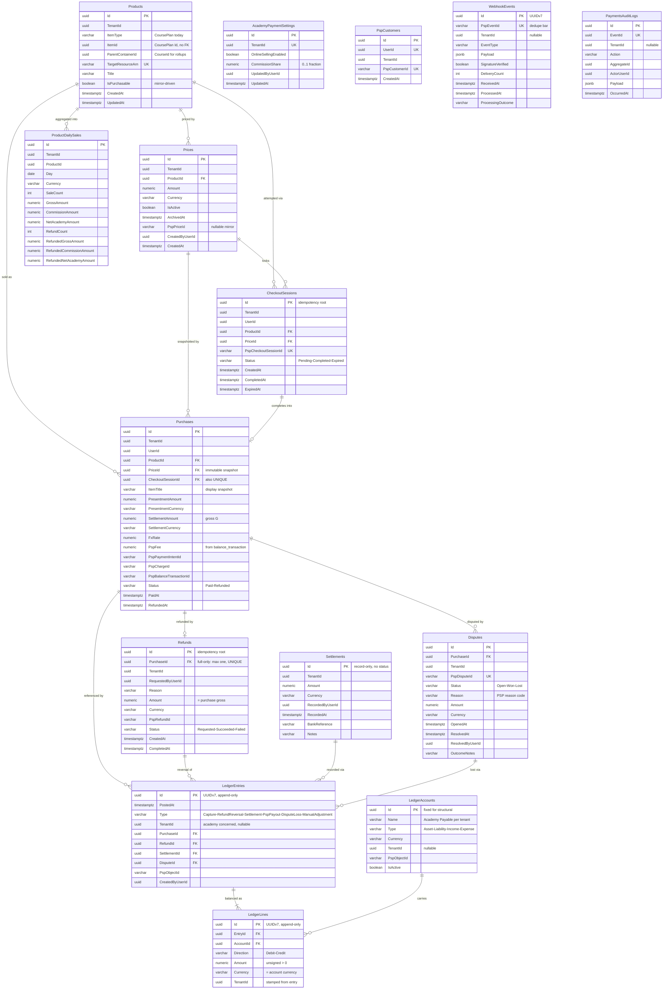

# Payments Module — Database Design

**Status:** Ratified 2026-11-14 (Q1–Q27 settled). External adversarial review applied 2026-11-14 — verdict **SHIP WITH FIXES**: 13 findings (2×P0, 4×P1, 4×P2, 3×P3), all incorporated (§13). Second adversarial review, same day — verdict **CONDITIONAL PASS**: 14 findings (4×P0, 4×P1, 4×P2, 2×P3), all incorporated (§14).
**Source of truth** for the Payments module's data model. Companion: `requirement.md` (currently at the plan-mode path; move to `plans/payments/requirement.md` when landing), `GLOSSARY.md` (repo root), queued ADRs 0002–0004 in requirement.md Appendix A.
**This is a design document — zero implementation.** No migrations, no code.

---

## 0. Design principles applied

1. **Stripe-compatibility principle** — the DB stores what *our domain owns and needs* (audit, reconciliation, analytics, settlements). Everything PSP-side is a referenced object ID (`Psp*` columns). We never mirror Stripe session lifecycle, never model Stripe's internal ledger, never run a dispute workflow engine, never store card data.
2. **PSP-agnostic naming** — columns and concepts are named `Psp*`, never `stripe_*` (§6.3 of requirement.md). The Stripe adapter is configuration (API key + webhook secret in KeyVault per env) and code, not schema.
3. **Money representation** — amounts `numeric(18,4)`, FX rates `numeric(18,8)`, currency `varchar(3)` ISO 4217 per row. The DB speaks decimal major units; the **only** integer-minor-unit conversion happens inside the PSP adapter at the API boundary. Scale 4 covers every ISO 4217 exponent (KWD/BHD/OMR are 3-decimal). **Ledger splits round to the entry currency's minor-unit exponent, one leg computed and the other derived** (§3.10, §5 row 2 — second review P0-C).
4. **Append-only money** — Ledger and audit tables have no UPDATE/DELETE path, enforced by deny-mutation triggers + REVOKE (the `LibraryAuditLogs` precedent, verbatim).
5. **Three-currency model** — Presentment (what the student was charged), Settlement (what the PSP deposits into the Platform's bank), Reporting (analytics normalization). MVP: Reporting ≡ Settlement ≡ one PSP account's currency (config constant, USD initially). Every amount column carries its currency code; conversion logic's single future home is the analytics projection worker.
6. **Capture-time truth** — the webhook expands `balance_transaction` at capture: fee, net, FX are recorded once, from PSP reports, never recomputed. Commission splits are recorded per Purchase in the Ledger at capture time (later settings changes never rewrite history).

---

## 1. Decision ledger (Q1–Q27, settled)

| Q | Decision |
|---|---|
| Q1 | decimal(18,4) amounts / numeric(18,8) FX / varchar(3) currency; minor-units only at PSP boundary |
| Q2 | UUIDv7 PKs on append-heavy tables (`LedgerEntries`, `LedgerLines`, `WebhookEvents`); `Guid.NewGuid()` elsewhere; plain primitive Guid storage, no typed-ID wrappers |
| Q3/Q10 | Mixed tenancy: marker + global filter on tenant-scoped aggregates; plain `TenantId` + explicit indexes elsewhere; Ledger/Accounts/Webhook nullable-TenantId unfiltered; Platform-overview reads via named `IgnoreQueryFilters` (ADR-0001 discipline) |
| Q4/Q5/Q11 | Decoupled from Courses: plan-level `Products` mirror + immutable `Prices` + `PspCustomers`; polymorphic `ItemType`/`ItemId`, no cross-schema FKs; mirror fed by Courses lifecycle events |
| Q6 | `AcademyPaymentSettings`: one row per tenant, `CommissionShare decimal(5,4)` fraction, lazy-created, absent row = selling disabled |
| Q7 | Two-table ledger (entries + lines), Direction + unsigned Amount, **deferred constraint trigger** balance check, deny-mutation trigger + REVOKE append-only |
| Q8 | Typed nullable FK columns on LedgerEntries (PurchaseId / RefundId / SettlementId / DisputeId) + `PspObjectId` |
| Q9 | Four structural accounts seeded in initial migration (fixed Guids); `Academy Payable:<t>` created on demand |
| Q12 | **Separate `CheckoutSessions` table**; Purchase born only on payment |
| Q13/Q22 | **Immutable price rows**; one active per (Product, Currency) via partial unique; change = archive + insert |
| Q14 | Reporting currency ≡ settlement currency (config constant); conversion slots into projection worker later |
| Q15 | Balances derived-on-read (indexed SUMs) + analytics projection for dashboards; no materialized balance column |
| Q16 | WebhookEvents: unique `PspEventId`, jsonb payload, outcome column; keep forever; **no partitioning** |
| Q17 | Refunds two-phase (`Requested → Succeeded | Failed`), `RefundId` = PSP idempotency root, Ledger reversal on `refund.succeeded` |
| Q18 | Disputes: separate table, coarse statuses `Open → Won | Lost`, Purchase stays `Paid` while disputed |
| Q19 | Settlements: record-only, **no status column**; partial settlements = multiple rows |
| Q20 | **No idempotency-key table** — deterministic keys (`CheckoutSessionId`, `RefundId`) |
| Q21 | `PaymentsAuditLog` adopted (LibraryAuditLog pattern) + transition timestamp columns on Purchase |
| Q23 | State split: sessions carry attempt lifecycle (`Pending → Completed | Expired`); Purchase carries money lifecycle (`Paid → Refunded`) |
| Q24 | Shapes of CheckoutSessions / Purchases / PspCustomers ratified |
| Q25 | Analytics projection `ProductDailySales` grain (TenantId, ProductId, Day); settlement position derived live |
| Q26 | Payments-owned integration events; Courses saga gains additive second correlation; saga-state `AccessCodeId` holds PurchaseId (documented overload) |
| Q27 | Single initial migration: all tables + structural seed + triggers; additive-only evolution; no prod seed; go-live flag absent from schema |

---

## 2. Schema overview (ERD)



Standalone (no relationships drawn): `AcademyPaymentSettings` (one row per tenant), `WebhookEvents`, `PspCustomers`, `PaymentsAuditLogs`. MassTransit scaffolding tables (`InboxState`, `OutboxMessage`, `OutboxState`) live in the Payments schema via the existing `AppDbContext` config; migration history is `__PaymentsMigrationHistory` (already wired).

**Conventions** (repo-wide): quoted PascalCase identifiers; enums as `varchar(32)` strings (keep literals in sync with `HasConversion<string>()`); `timestamptz` everywhere; PKs `ValueGeneratedNever()` domain-generated; **Postgres does not auto-index FK columns — every FK below carries an explicit index**; no cross-module/cross-schema FKs (TenantId, UserId, ItemId, ParentContainerId are event-driven references).

**Naming:** all tables use plural names, matching the repo convention.

---

## 3. Per-table specs

### 3.1 Products — plan-level mirror of sellables
*Written only by the mirror consumer (Courses lifecycle events → Payments). Academy admins never write here; they write Prices.*

| Column | Type | Null | Notes |
|---|---|---|---|
| Id | uuid | no | PK, `Guid.NewGuid()` |
| TenantId | uuid | no | owning Academy |
| ItemType | varchar(32) | no | default `'CoursePlan'`; extensible `'Document'`/`'Blog'`/`'Assessment'` later |
| ItemId | uuid | no | CoursePlan.Id — plain reference, **no FK** |
| ParentContainerId | uuid | yes | CourseId (rollups); NOT NULL when ItemType='CoursePlan' |
| TargetResourceArn | varchar(512) | no | ARN the PurchaseActivated event carries |
| Title | varchar(255) | no | mirrored display name |
| IsPurchasable | boolean | no | default FALSE; driven by mirror events (course published → true) |
| CreatedAt / UpdatedAt | timestamptz | no / yes | |

**Constraints:** `UNIQUE (TenantId, TargetResourceArn)`; `UNIQUE (TenantId, ItemType, ItemId)`; `CHECK (ItemType <> 'CoursePlan' OR ParentContainerId IS NOT NULL)`.
**Indexes:** `(TenantId, ParentContainerId)`.
**Tenancy:** plain column, **no global filter** (mirror-managed, read broadly).
**Retention:** rows never deleted — plan removal / unpublish sets `IsPurchasable = false` (purchase history FKs must survive); title changes arrive as mirror updates (last-write-wins, benign races).
**Sellable check (app-enforced):** `IsPurchasable` ∧ active Price ∧ Academy opt-in.

### 3.2 Prices — immutable offers
*Academy admins manage (permission `payments:ManageCatalog`); one active price per (Product, Currency).*

| Column | Type | Null | Notes |
|---|---|---|---|
| Id | uuid | no | PK |
| TenantId | uuid | no | |
| ProductId | uuid | no | FK → Products `ON DELETE RESTRICT` |
| Amount | numeric(18,4) | no | list price, major units |
| Currency | varchar(3) | no | no default — explicit on every row |
| IsActive | boolean | no | |
| ArchivedAt | timestamptz | yes | set exactly when deactivated |
| PspPriceId | varchar(64) | yes | mirrored PSP price object; null when the adapter uses inline price_data |
| CreatedByUserId | uuid | no | academy admin |
| CreatedAt | timestamptz | no | |

**Constraints:** partial `UNIQUE (ProductId, Currency) WHERE IsActive = TRUE` (your `UQ_Prices_Product_Currency`, preserved in spirit); `CHECK (Amount > 0)`; `CHECK (IsActive = (ArchivedAt IS NULL))`.
**Immutability (DB-enforced):** trigger `deny_price_amend` — UPDATE allowed **only** for the archive transition (`IsActive` TRUE → FALSE with `ArchivedAt` set); all immutable columns compared as a row tuple with `IS DISTINCT FROM` (a plain `<>` comparison silently passes on NULL→value changes, e.g. setting `PspPriceId` — second review P2-C); DELETE denied; TRUNCATE denied (statement-level `BEFORE TRUNCATE` trigger — row triggers don't fire on TRUNCATE); REVOKE UPDATE, DELETE from PUBLIC. App side: no edit path exists.
**Indexes:** `(TenantId, ProductId)`, FK index on `ProductId`.
**Checkout rule:** session creation locks the *active base-currency* price; `Purchase.PriceId` references that exact immutable row — the checkout snapshot, by reference.
**History:** price changes are fully reconstructible from archived rows + `PaymentsAuditLogs`.

### 3.3 AcademyPaymentSettings — opt-in + Commission Share
| Column | Type | Null | Notes |
|---|---|---|---|
| Id | uuid | no | PK |
| TenantId | uuid | no | **UNIQUE** — one row per Academy |
| OnlineSellingEnabled | boolean | no | default FALSE |
| CommissionShare | numeric(5,4) | no | fraction: 0.25 = 25%; `CHECK (CommissionShare BETWEEN 0 AND 1)`; default 0.25 applied in code at creation |
| UpdatedByUserId | uuid | yes | platform admin (`payments:ManageAcademySettings`) |
| UpdatedAt | timestamptz | yes | |
| CreatedAt | timestamptz | no | |

**Tenancy:** marker + global filter (tenant-owned). **Lazy-created** on first management action; **absent row = selling disabled** (fail-closed). Every change → `PaymentsAuditLogs`.

### 3.4 CheckoutSessions — attempt lifecycle
| Column | Type | Null | Notes |
|---|---|---|---|
| Id | uuid | no | PK, `Guid.NewGuid()` — **the PSP idempotency key for session creation** (durable before the PSP call) |
| TenantId | uuid | no | always stamped at creation (authenticated student context); **NOT NULL** — `IDomainTenantOwned` demands a non-nullable Guid, and "fail-safe nullable inserts" was the wrong posture (fail-closed is correct; review P2-4) |
| UserId | uuid | no | platform user reference (no FK — Identity owns users) |
| ProductId | uuid | no | FK → Products |
| PriceId | uuid | no | FK → Prices (the active price locked at creation) |
| PspCheckoutSessionId | varchar(64) | yes | **UNIQUE**; set once created at PSP; webhook handler resolves sessions by it |
| Status | varchar(32) | no | `Pending` \| `Completed` \| `Expired` |
| CreatedAt | timestamptz | no | |
| CompletedAt | timestamptz | yes | |
| ExpiredAt | timestamptz | yes | |

**Constraints:** partial `UNIQUE (UserId, ProductId) WHERE Status = 'Pending'` — **idempotency bar #3** (one active session per (student, sellable), declarative, race-free); `CHECK (Status <> 'Completed' OR CompletedAt IS NOT NULL)`; `CHECK (Status <> 'Expired' OR ExpiredAt IS NOT NULL)`; `CHECK (Status <> 'Pending' OR (CompletedAt IS NULL AND ExpiredAt IS NULL))`.
**Indexes:** `(TenantId, UserId, CreatedAt)`; FK indexes on ProductId, PriceId; unique on PspCheckoutSessionId.
**Tenancy:** marker + global filter — sessions joined the marker bucket at Q12(b) (same tenant-scoped read paths as Purchases); confirmed non-nullable by review P2-4. **Handler locking (reviews P1-2/P0-A):** money-event webhook handlers `SELECT … FOR NO KEY UPDATE` the CheckoutSession row before mutating state (repo lock-ordering discipline; `Purchases.CheckoutSessionId` FK means concurrent captures hold `FOR KEY SHARE` on this row — plain `FOR UPDATE` would stall them); a second delivery for the same session observes `Completed` and marks its event `Duplicate`, returning 200 to the PSP. No URLs, no amounts — the PSP owns session state (Stripe-compat principle).
**Expiry & recovery (second review P1-C):** PSP-driven expiry (`checkout.session.expired` webhook); missed webhooks leave a stale Pending row — reconciliation-visible; optional sweeper Phase 2, schema supports it. Three app rules close the reuse traps: (1) a definitive pre-PSP-call failure (`PspCheckoutSessionId IS NULL` and the PSP create-call terminally rejected/timed out) → session `Expired` immediately — no PSP webhook will ever arrive; (2) **reuse of a Pending row = re-invoke the PSP session-create with the same `CheckoutSessionId` idempotency key** — the PSP replays the live session (or creates a fresh one after its idempotency window; Stripe: both 24 h) and the adapter hands back the redirect URL — never stored, never stale; (3) if the locked `PriceId` is no longer active (archived since creation), expire the Pending row and create a fresh session on the current active price — the page advertises one price and checkout charges that price.

### 3.5 Purchases — the money row (SaleRecord pattern)
*Born `Paid` at `checkout.session.completed`; the immutable commercial record.*

| Column | Type | Null | Notes |
|---|---|---|---|
| Id | uuid | no | PK; ledger entries reference it |
| TenantId | uuid | no | owning Academy |
| UserId | uuid | no | student (no FK — Identity owns users) |
| ProductId | uuid | no | FK → Products |
| PriceId | uuid | no | FK → Prices — **snapshot by reference to an immutable row** |
| CheckoutSessionId | uuid | no | **UNIQUE** FK → CheckoutSessions |
| ItemTitle | varchar(255) | no | display snapshot (mirror titles can change later) |
| PresentmentAmount | numeric(18,4) | no | what the student was charged |
| PresentmentCurrency | varchar(3) | no | |
| SettlementAmount | numeric(18,4) | no | gross **G** in settlement currency |
| SettlementCurrency | varchar(3) | no | |
| FxRate | numeric(18,8) | yes | presentment→settlement rate; NULL when currencies equal (CHECK) |
| PspFee | numeric(18,4) | no | **F**, from expanded `balance_transaction` at capture; zero-fee captures are legal (waived/test payments) — unlike ledger lines, fee columns allow 0 (second review P0-B) |
| PspPaymentIntentId | varchar(64) | no | |
| PspChargeId | varchar(64) | yes | |
| PspBalanceTransactionId | varchar(64) | yes | PSP reconciliation reference |
| Status | varchar(32) | no | `Paid` \| `Refunded` |
| PaidAt | timestamptz | no | |
| RefundedAt | timestamptz | yes | |

**Constraints:** `CHECK ((Status = 'Refunded') = (RefundedAt IS NOT NULL))`; `CHECK ((PresentmentCurrency = SettlementCurrency) = (FxRate IS NULL))` (review P3-1: biconditional — same currency ⇒ no rate stored; different currencies ⇒ rate required); `CHECK (PspFee >= 0)` (second review P0-B).
**Indexes:** `(TenantId, PaidAt DESC)`, `(TenantId, Status, PaidAt DESC)`, `(TenantId, ProductId, PaidAt)`, `(TenantId, UserId, PaidAt)`; FK indexes on ProductId, PriceId, CheckoutSessionId (unique).
**Tenancy:** marker + global filter. **Retention:** forever; no soft delete (money rows are never deleted — matches SaleRecord precedent, no `ISoftDeletable`).
**Allocation truth:** the capture-time split (commission, academy share) lives in the Ledger, not here — `LedgerEntries.PurchaseId` joins it. The applied rate is derivable (commission ÷ G) and no rate column is stored.

### 3.6 PspCustomers — user ↔ PSP customer map
| Column | Type | Null | Notes |
|---|---|---|---|
| Id | uuid | no | PK |
| UserId | uuid | no | **UNIQUE** — one PSP customer per user (single PSP in MVP) |
| TenantId | uuid | yes | convenience for ops queries |
| PspCustomerId | varchar(64) | no | **UNIQUE** |
| CreatedAt | timestamptz | no | |

**Tenancy:** plain column, no filter. Cross-tenant by design — one PSP customer per user regardless of Academy; `TenantId` is best-effort ops metadata, and NULL rows are simply not tenant-filterable (review P3-3). Lazily created at first checkout (inside the capture transaction is fine).

### 3.7 WebhookEvents — exactly-once ingestion archive
| Column | Type | Null | Notes |
|---|---|---|---|
| Id | uuid | no | PK, **UUIDv7** |
| PspEventId | varchar(64) | no | **UNIQUE** — **idempotency bar #2** (dedupe on insert) |
| TenantId | uuid | yes | resolved from event metadata; fail-closed when unresolvable |
| EventType | varchar(64) | no | e.g. `checkout.session.completed`, `charge.refund.updated`, `charge.dispute.closed` |
| Payload | jsonb | no | full archived event (audit + replay forensics) |
| SignatureVerified | boolean | no | |
| DeliveryCount | int | no | default 1; incremented on dedupe-hit redeliveries (observability: "PSP keeps retrying") |
| ReceivedAt | timestamptz | no | |
| ProcessedAt | timestamptz | yes | |
| ProcessingOutcome | varchar(32) | yes | `Processed` \| `Duplicate` \| `Failed` \| `Skipped` |

**Indexes:** `(EventType, ReceivedAt)`. **Tenancy:** plain column, no filter. **Retention:** keep forever (MVP); **no partitioning** — there is no deletion path to exploit, and range partitions would force the partition key into every PK/unique index; revisit only with go-live telemetry.
**Two-phase ingestion (second review P0-D):** the event row is written in its own short, autonomous transaction — an atomic upsert (`INSERT … ON CONFLICT ("PspEventId") DO UPDATE SET "DeliveryCount" = "DeliveryCount" + 1 RETURNING "Id", "ProcessingOutcome"`, raw SQL via Npgsql), committed immediately, before any domain work. If the returned outcome is terminal (`Processed` / `Duplicate` / `Skipped`), the handler returns 200 at once. Otherwise the domain transaction (§5 rows 2–7) locks this row `FOR NO KEY UPDATE`, runs the state/ledger/outbox writes, and stamps `Processed`; on failure a clean connection stamps `Failed` and the handler returns 5xx. Consequences: `Failed` outcomes survive the rollback (the row is autonomous — the old single-transaction design could never persist one); concurrent duplicate deliveries serialize on the unique index — the loser increments `DeliveryCount` and returns 200 instead of crashing on 23505; the PSP retry path finds the row and re-enters processing. Out-of-order/replay events are no-ops via state-machine guards (Q23 split + status checks), not schema machinery.

### 3.8 LedgerAccounts — chart of accounts
| Column | Type | Null | Notes |
|---|---|---|---|
| Id | uuid | no | PK; **structural accounts carry fixed, deterministic Guids** (uuid5-derived constants, identical in every environment) |
| Name | varchar(64) | no | `PSP Clearing`, `Platform Revenue`, `PSP Fees`, `Bank Account`, `Academy Payable:<tenantId>` |
| Type | varchar(16) | no | `Asset` \| `Liability` \| `Income` \| `Expense` |
| Currency | varchar(3) | no | the platform settlement currency |
| TenantId | uuid | yes | set only for per-Academy payable accounts |
| PspObjectId | varchar(64) | yes | PSP-side account ref when known |
| IsActive | boolean | no | |
| CreatedAt | timestamptz | no | |

**Constraints:** partial `UNIQUE (Name) WHERE TenantId IS NULL` (platform accounts); partial `UNIQUE (TenantId, Name) WHERE TenantId IS NOT NULL` (one payable per Academy — Postgres treats NULLs as distinct, hence two partials).
**Seeding:** the four structural accounts are seeded by the initial migration (Q9a — structural rows are schema, not demo data). `Academy Payable:<t>` rows are created deterministically when the Academy's settings row is upserted (§5 row 12) — no Academy can sell without a settings row, so the capture hot path never creates accounts; the lazy ensure kept as backup is a raw `INSERT … ON CONFLICT ("TenantId", "Name") WHERE "TenantId" IS NOT NULL DO NOTHING` (a plain re-insert 23505s on two concurrent first-captures — second review P2-B). A Payments-internal concern, no cross-module coupling.
**Tenancy:** nullable TenantId, **no filter**. Lines reach tenancy through the account (plus the denormalized stamp below).

### 3.9 LedgerEntries — append-only header
| Column | Type | Null | Notes |
|---|---|---|---|
| Id | uuid | no | PK, **UUIDv7** |
| PostedAt | timestamptz | no | |
| Type | varchar(32) | no | `Capture` \| `RefundReversal` \| `Settlement` \| `PspPayout` \| `DisputeLoss` \| `DisputeWon` \| `ManualAdjustment` |
| TenantId | uuid | yes | the Academy the entry **concerns**; NULL = platform-level (e.g. PSP payout to bank) |
| PurchaseId | uuid | yes | FK → Purchases (typed audit linkage, Q8a) |
| RefundId | uuid | yes | FK → Refunds |
| SettlementId | uuid | yes | FK → Settlements |
| DisputeId | uuid | yes | FK → Disputes |
| PspObjectId | varchar(64) | yes | PSP object behind the entry (payment_intent, refund, dispute, payout) |
| CreatedByUserId | uuid | yes | for manual adjustments / recorded actions |
| Description | varchar(256) | yes | |

**Constraints (type-conditional refs, CHECK-expressed):**
`CHECK (Type <> 'Capture' OR PurchaseId IS NOT NULL)` ·
`CHECK (Type <> 'RefundReversal' OR (RefundId IS NOT NULL AND PurchaseId IS NOT NULL))` ·
`CHECK (Type <> 'Settlement' OR SettlementId IS NOT NULL)` ·
`CHECK (Type <> 'DisputeLoss' OR (DisputeId IS NOT NULL AND PurchaseId IS NOT NULL))` ·
`CHECK (Type <> 'DisputeWon' OR DisputeId IS NOT NULL)`.
**Indexes:** `(PurchaseId)`, `(Type, PostedAt)`, partial `(TenantId) WHERE TenantId IS NOT NULL`; FK indexes on RefundId, SettlementId, DisputeId.
**Append-only (DB-enforced):** the deny-mutation trigger is the PRIMARY enforcement — it fires for every role, including the table-owning application user. `REVOKE UPDATE, DELETE … FROM PUBLIC` is defense-in-depth for non-owner roles (reporting/replica users) and does not constrain the owner (review P2-1; `LibraryAuditLogs` migration pattern). EF side: no update path exists. Deny triggers are `BEFORE UPDATE OR DELETE` row-level **plus** a statement-level `BEFORE TRUNCATE` arm on every guarded table (row triggers don't fire on TRUNCATE; the owner isn't stopped by REVOKE — second review P2-C). Data repair on append-only tables happens only via an explicit `ALTER TABLE … DISABLE TRIGGER` inside a reviewed migration — never an ad-hoc UPDATE.

**Balance-invariant trigger — on the ENTRY, not the lines (second review P1-A).** The deferred constraint trigger fires `AFTER INSERT` on `LedgerEntries`, once per entry, at commit:

```sql
CREATE CONSTRAINT TRIGGER trg_ledger_entry_balance
AFTER INSERT ON "Payments"."LedgerEntries"
DEFERRABLE INITIALLY DEFERRED
FOR EACH ROW
EXECUTE FUNCTION "Payments".check_entry_balance();
```

At commit, for `NEW."Id"` (lines inserted in the same transaction are visible to the trigger):
1. `COUNT(lines) ≥ 2` — a zero-line header is impossible (a lines-only trigger would let one slip through permanently, and deny-mutation would make it unremovable);
2. Σ Debit = Σ Credit for the entry — per-entry balance; entries balance independently, never a transaction-level delta;
3. every line shares one currency, equal to each referenced account's currency;
4. every line's TenantId equals the entry's TenantId;
5. every Direction is `Debit` or `Credit`.

Fires once per entry — a 4-line capture validates once, not four times (the lines-level variant re-ran the SUM per line). A violation raises at commit → the whole transaction (webhook row + Purchase + entry + lines + outbox) rolls back atomically inside `TransactionalBehavior`. Header + lines commit atomically, so no partial entry is ever visible outside a transaction.

### 3.10 LedgerLines — append-only balanced lines
| Column | Type | Null | Notes |
|---|---|---|---|
| Id | uuid | no | PK, **UUIDv7** |
| EntryId | uuid | no | FK → LedgerEntries `ON DELETE RESTRICT` |
| AccountId | uuid | no | FK → LedgerAccounts |
| Direction | varchar(8) | no | `Debit` \| `Credit`; `CHECK (Direction IN ('Debit','Credit'))` |
| Amount | numeric(18,4) | no | **unsigned**; `CHECK (Amount > 0)` |
| Currency | varchar(3) | no | must equal the account's currency |
| TenantId | uuid | yes | **stamped from the entry** (denormalized for indexed balance queries) |

**Indexes:** `(AccountId, Direction) INCLUDE (Amount)` (covering — balance SUMs become index-only scans, second review P2-A), `(EntryId)`, partial `(TenantId, AccountId) WHERE TenantId IS NOT NULL` (tenant-scoped line queries; justifies the denormalized stamp).
**Tenancy:** nullable TenantId, no filter.

**Same-transaction append guard (second review P1-A).** The balance trigger (now on `LedgerEntries`, §3.9) cannot stop a later transaction from appending balanced lines to a historical entry — the entry stays balanced and no deny trigger fires on a plain INSERT. An immediate `BEFORE INSERT` trigger on `LedgerLines` makes it physically impossible:

```sql
CREATE TRIGGER trg_ledger_lines_same_tx
BEFORE INSERT ON "Payments"."LedgerLines"
FOR EACH ROW
EXECUTE FUNCTION "Payments".check_line_same_tx();
-- check_line_same_tx(): RAISE unless the parent entry row was created in the CURRENT transaction:
--   (SELECT xmin FROM "Payments"."LedgerEntries" WHERE "Id" = NEW."EntryId")
--     = pg_current_xact_id()::xid
```

**Minor-unit rounding rule (second review P0-C).** Split amounts round to the entry currency's ISO 4217 minor-unit exponent (2 for USD/EUR, 3 for KWD/BHD/OMR, 0 for JPY) even though columns are numeric(18,4). Two independent multiplications can fail the balance trigger at commit — 19.99 @ 33.33 % rounds to legs summing 20.00 — and even when they do sum, un-rounded splits leave un-wireable dust ($14.9925 can never be settled). One leg is computed, the other derived (formula in §5 row 2). App-enforced + architecture tests (the balance trigger only sees totals; minor-unit granularity is a convention it cannot check without a currency-exponent map).

### 3.11 Refunds
| Column | Type | Null | Notes |
|---|---|---|---|
| Id | uuid | no | PK — **the PSP idempotency key for the refund call** (durable before the call) |
| PurchaseId | uuid | no | FK → Purchases; **partial UNIQUE** `WHERE Status IN ('Requested','Succeeded')` — full-only ⇒ max one live refund; a `Failed` row frees the slot for a retry (second review P1-B) |
| TenantId | uuid | no | |
| RequestedByUserId | uuid | no | platform admin (`payments:IssueRefund`) |
| Reason | varchar(512) | yes | |
| Amount | numeric(18,4) | no | `CHECK (Amount > 0)`; equals `Purchase.SettlementAmount` in the MVP single-currency world |
| Currency | varchar(3) | no | = purchase settlement currency |
| PspRefundId | varchar(64) | yes | UNIQUE |
| PspFeeRefunded | numeric(18,4) | no | default 0 — fee portion the PSP returned with the refund, from the refund's own `balance_transaction` (0 for Stripe card refunds) |
| PspBalanceTransactionId | varchar(64) | yes | the refund's PSP balance transaction — capture-time truth applies to reversals too |
| Status | varchar(32) | no | `Requested` \| `Succeeded` \| `Failed` |
| CreatedAt | timestamptz | no | |
| CompletedAt | timestamptz | yes | |

**Constraints:** `CHECK (Status <> 'Succeeded' OR (CompletedAt IS NOT NULL AND PspRefundId IS NOT NULL))`; `CHECK (Status <> 'Requested' OR CompletedAt IS NULL)`.
**Indexes:** unique partial `(PurchaseId) WHERE Status IN ('Requested','Succeeded')`, `(TenantId, CreatedAt)`.
**Status semantics (second review P1-B):** `Failed` means a **definitive PSP rejection** (explicit error response). An ambiguous outcome — timeout, 5xx, dropped connection — leaves the row `Requested`: the PSP may have created the refund, and re-issuing under a new idempotency key would double-refund. Ops resolves ambiguous rows from PSP reports; the partial unique blocks a second live request meanwhile.
**Guard:** refund creation checks `NOT EXISTS (Disputes WHERE PurchaseId = @id AND Status = 'Open')` before the PSP call (Stripe rejects such refunds with `charge_disputed`; failing early avoids a stuck `Requested` row — §5 row 4).
**FX (Phase 2; D10 unchanged):** when multi-currency prices land, Stripe converts refunds/disputes back at *refund-time* FX, not capture-time. The reversal then books the **actual settlement delta from the refund's `balance_transaction`**, with any drift vs the capture allocations posted to an FX Gain/Loss account added then. MVP (presentment = settlement) books the plain reversal below.
**Reversal booking (§5 row 5, second review P0-B):** Dr Academy Payable + Dr Platform Revenue (capture allocations reversed) / Cr PSP Clearing (`SettlementAmount − PspFeeRefunded`) / Cr PSP Fees `PspFeeRefunded` (omitted when 0). PSP-retained capture fees are **not** touched — they were expensed at capture and the PSP keeps them on refund.
**Tenancy:** marker + global filter. Transitions guarded EF-side with the repo's tripwire pattern (conditional `UPDATE … WHERE Status = expected`, AccessCode precedent).

### 3.12 Disputes
| Column | Type | Null | Notes |
|---|---|---|---|
| Id | uuid | no | PK |
| PurchaseId | uuid | no | FK → Purchases |
| TenantId | uuid | no | |
| PspDisputeId | varchar(64) | no | **UNIQUE** |
| Status | varchar(32) | no | `Open` \| `Won` \| `Lost` — deliberately coarse, our vocabulary, not Stripe's lifecycle |
| Reason | varchar(64) | no | PSP reason code (full detail in the archived webhook payload) |
| Amount | numeric(18,4) | no | |
| Currency | varchar(3) | no | |
| PspDisputeFee | numeric(18,4) | no | default 0 — the PSP's chargeback fee, deducted from the settlement balance (e.g. Stripe $15) |
| PspBalanceTransactionId | varchar(64) | yes | the dispute's PSP balance transaction |
| OpenedAt | timestamptz | no | |
| ResolvedAt | timestamptz | yes | |
| ResolvedByUserId | uuid | yes | who recorded the outcome |
| OutcomeNotes | varchar(1024) | yes | |

**Constraint:** `CHECK ((Status = 'Open') = (ResolvedAt IS NULL))`. **Indexes:** `(TenantId, Status)`, `(PurchaseId)`.
**Tenancy:** marker + global filter. Purchase **stays `Paid`** while disputed; `Lost` triggers the reversal path (`DisputeLoss` entry + `Purchase.Refunded` + revocation mirror) — no Refunds row (a lost dispute is not a refund).
**Ledger booking (second review P0-B):** the PSP removes the disputed amount + fee from the settlement balance **at dispute creation**; this design books at **resolution** (coarse-dispute decision, Q18) — PSP Clearing temporarily overstates by the disputed amount during an open dispute and self-corrects at close (reconciliation flags it; documented timing simplification). **Lost:** `DisputeLoss` entry — Dr Academy Payable + Dr Platform Revenue (capture allocations reversed) / Dr PSP Fees (`PspDisputeFee`) / Cr PSP Clearing (disputed + fee). **Won:** the PSP returns the disputed funds but keeps the fee — `DisputeWon` entry — Dr PSP Fees (fee) / Cr PSP Clearing (fee); the sale stands, no reversal.

### 3.13 Settlements — record-only
| Column | Type | Null | Notes |
|---|---|---|---|
| Id | uuid | no | PK |
| TenantId | uuid | no | |
| Amount | numeric(18,4) | no | `CHECK (Amount > 0)`; ≤ Balance Owed (app-enforced) |
| Currency | varchar(3) | no | platform settlement currency |
| RecordedByUserId | uuid | no | platform admin (`payments:RecordSettlement`) |
| RecordedAt | timestamptz | no | |
| BankReference | varchar(128) | yes | bank transfer reference |
| Notes | varchar(512) | yes | |

**No status column** — the transfer happens outside the system; the record *is* the confirmation (Q19). Partial settlements = multiple rows. **Balance-mutation locking (reviews P0-1/P0-A/P2-D):** before any ledger write, the transaction takes `SELECT … FOR NO KEY UPDATE` on the Academy's payable `LedgerAccounts` row (repo lock-ordering discipline, `AccessCodeRepository` precedent) — never plain `FOR UPDATE`: that mode conflicts with the `FOR KEY SHARE` locks Postgres takes on the account row for every concurrent FK-checked line insert, so captures for the Academy would stall behind settlements and concurrent reversal handlers could deadlock on the `FOR KEY SHARE → FOR UPDATE` upgrade. `FOR NO KEY UPDATE` still serializes Settlement/RefundReversal/DisputeLoss against each other while captures pass freely. **Only Settlement enforces `amount ≤ Balance Owed`** (computed after the lock, from indexed line SUMs); RefundReversal and DisputeLoss never check the balance and may legitimately drive it negative — a clawback owed by the Academy to the Platform, netted against future sales. Settled amounts are minor-unit granular (no $14.9925 wires — P0-C rule). Written in one transaction with its `Settlement` LedgerEntry (`Dr Academy Payable:<t> / Cr Bank Account`), `LedgerEntries.SettlementId` linking them. **Indexes:** `(TenantId, RecordedAt) INCLUDE (Amount)` (settled-to-date is an index-only SUM, §7 metric 5 — second review P2-A). **Tenancy:** marker + global filter.

### 3.14 ProductDailySales — analytics projection
| Column | Type | Null | Notes |
|---|---|---|---|
| Id | uuid | no | PK |
| TenantId | uuid | no | |
| ProductId | uuid | no | plain reference (projection is rebuilt wholesale; no FK) |
| Day | date | no | bucketed in **UTC**: `("PaidAt" AT TIME ZONE 'UTC')::date` — a bare `timestamptz::date` cast follows the session's `TimeZone` and shifts days on a differently-configured worker (second review P3-B) |
| Currency | varchar(3) | no | |
| SaleCount / RefundCount | int | no | `RefundCount` includes lost disputes (documented cash-view conflation — second review P1-D) |
| GrossAmount / CommissionAmount / NetAcademyAmount | numeric(18,4) | no | capture-time split, from Ledger joins |
| RefundedGrossAmount / RefundedCommissionAmount / RefundedNetAcademyAmount | numeric(18,4) | no | refunded split sourced from the reversal entry's **own lines** — `CommissionShare` may have changed since the purchase day, so it cannot be derived from the gross alone (second review P1-D) |

**Constraints:** `UNIQUE (TenantId, ProductId, Day)`. **Indexes:** `(TenantId, Day)`.
**Refresh:** worker copying the `LibraryAnalyticsRefreshWorker` pattern; rebuilt from `LedgerEntries`+`Purchases` (capture-time commission — later settings changes never rewrite it). Refunds and lost disputes attributed to their completion day (cash view); refund-rate windows use the same rows. **Tenancy:** marker + global filter. Retention n/a (cache).

### 3.15 PaymentsAuditLogs — append-only action stream
| Column | Type | Null | Notes |
|---|---|---|---|
| Id | uuid | no | PK |
| EventId | uuid | no | **UNIQUE** (idempotent projection writes) |
| TenantId | uuid | yes | nullable — platform-level actions exist |
| Action | varchar(64) | no | e.g. `Purchase.Paid`, `Price.Created`, `Price.Archived`, `Settings.Updated`, `Settlement.Recorded`, `Purchase.Refunded` |
| AggregateId | uuid | yes | PurchaseId / ProductId / SettlementId / Settings row id |
| ActorUserId | uuid | yes | |
| Payload | jsonb | yes | old/new values for config changes; event context for transitions |
| OccurredAt | timestamptz | no | |

**Append-only (DB-enforced):** deny-mutation trigger + REVOKE. **Indexes:** `(TenantId, Action, OccurredAt)`, `(AggregateId)`. **Tenancy:** nullable TenantId, no filter (cross-cutting stream; academy scoping explicit per query). **Retention:** forever.

---

## 4. Invariants & enforcement matrix

| # | Invariant | Enforcement | Mechanism |
|---|---|---|---|
| 1 | Σ debits = Σ credits per LedgerEntry, with ≥ 2 lines — never a zero-line header, never a transaction-level delta | **DB** | deferred constraint trigger on LedgerEntries, once per entry at commit (spec §3.9; review P0-2 + second review P1-A) — header-then-lines inserts stay atomic |
| 2 | Ledger entries/lines are append-only | **DB** + EF | deny-mutation trigger (primary — fires for every role incl. the owner); REVOKE = defense-in-depth for non-owner roles (review P2-1); no EF update path; repairs only via reviewed DISABLE-TRIGGER migration |
| 3 | Line currency = account currency; one currency per entry | **DB** | entry-level deferred trigger (§3.9) |
| 4 | Line.TenantId = Entry.TenantId (stamp consistency) | **DB** | entry-level deferred trigger (§3.9) |
| 5 | Entry type ↔ typed refs (Capture→Purchase, RefundReversal→Refund+Purchase, Settlement→Settlement, DisputeLoss→Dispute+Purchase, DisputeWon→Dispute) | **DB** | CHECK constraints |
| 6 | One active checkout session per (student, sellable) | **DB** | partial unique `(UserId, ProductId) WHERE Status='Pending'` |
| 7 | Prices immutable; only the archive transition is writable | **DB** + EF | `deny_price_amend` trigger; no EF edit path |
| 8 | One active price per (Product, Currency) | **DB** | partial unique `WHERE IsActive` |
| 9 | Active price ⇔ ArchivedAt IS NULL | **DB** | CHECK |
| 10 | Webhook exactly-once; the audit row survives processing failure | **DB** + EF | unique `PspEventId` + two-phase ingest (autonomous upsert w/ `DeliveryCount`; §3.7, §5 preamble — second review P0-D); state-machine guards make replays no-ops |
| 11 | Purchase Paid→Refunded transitions happen exactly once, guarded | **EF** + DB | tripwire conditional UPDATE (`WHERE Status = expected`); CHECK on RefundedAt coherence |
| 12 | Full-only refunds: max one live (non-failed) refund per Purchase | **DB** | partial unique `(PurchaseId) WHERE Status IN ('Requested','Succeeded')`; a `Failed` row frees the slot (second review P1-B) |
| 13 | Refund.Amount = Purchase.SettlementAmount (MVP single currency) | **EF** | app check at creation; Phase-2 cross-currency refunds book the PSP-reported settlement delta instead (§3.11) |
| 14 | Refund/session status coherence with timestamps | **DB** | CHECK constraints |
| 15 | CommissionShare ∈ [0,1] | **DB** | CHECK |
| 16 | Ledger line Amount > 0; PSP fee / refund-fee / dispute-fee columns ≥ 0 | **DB** | CHECKs; zero-fee captures omit the fee line pair (second review P0-B) |
| 17 | One settings row per tenant | **DB** | unique TenantId |
| 18 | One Product mirror row per (tenant, item) / per (tenant, ARN) | **DB** | two unique constraints |
| 19 | One payable account per Academy; unique platform accounts | **DB** | two partial uniques |
| 20 | Structural accounts exist | **DB** | migration seed (fixed Guids) |
| 21 | Checkout requires: purchasable ∧ active price ∧ opt-in | **EF** | app check at session creation (absent settings row = disabled) |
| 22 | No session without a locked immutable Price | **EF** | FK + active-price selection rule |
| 23 | Balance Owed / settled-to-date / last settlement figures reconcile with Ledger sums | **ops** | derived-on-read by definition (Q15a) + scheduled reconciliation query |
| 24 | Dispute resolution coherence (Open ⇔ ResolvedAt null) | **DB** | CHECK |
| 25 | Analytics projections are caches, never truth | **design** | rebuildable from Ledger + Purchases; no FK, no reads in decision paths |
| 26 | Balance mutations of an Academy payable are serialized; captures never block | **DB** | `SELECT … FOR NO KEY UPDATE` on the payable account row, acquired BEFORE any ledger write, in Settlement / RefundReversal / DisputeLoss transactions — compatible with the `FOR KEY SHARE` FK locks of concurrent capture inserts, unlike `FOR UPDATE` (reviews P0-1/P0-A/P2-D) |
| 27 | Reads on unfiltered tables (Ledger*, WebhookEvents, PaymentsAuditLogs, PspCustomers) are explicitly tenant-scoped wherever tenant meaning exists | **EF** + tests | enumerated read paths (§7/§13); NetArchTest rule: no unscoped tenant reads on unfiltered tables (review P2-3) |
| 28 | Ledger splits are minor-unit granular per entry currency; one leg computed, the other derived | **EF** + tests | rounding rule (§3.10, §5 row 2) — the balance trigger cannot check this without a currency-exponent map (second review P0-C) |
| 29 | A ledger entry's lines are written only in the entry's own transaction; entries always carry ≥ 2 lines | **DB** | entry-level deferred balance trigger (≥ 2 lines + balance, §3.9) + `BEFORE INSERT` `xmin` same-tx append guard on LedgerLines (§3.10; second review P1-A) |
| 30 | Only Settlement enforces amount ≤ Balance Owed; reversals may drive the payable negative | **EF** | clawback semantics (§3.13, §5 rows 5/7; second review P2-D) |
| 31 | No refund on a Purchase with an Open dispute | **EF** | guard before the PSP call (§5 row 4; second review P1-B) |

---

## 5. Transactional boundary map

Every transaction below runs through the module scaffold's `TransactionalBehavior` (one DB transaction on Payments' `AppDbContext`); the MassTransit EF outbox lives in the same DbContext, so **outbox messages are atomic with every write they accompany** (idempotency bar #4).

**Webhook rows (2, 3, 5, 6, 7) are two-phase (second review P0-D):** *ingest* — a short autonomous transaction upserts the `WebhookEvents` row (`ON CONFLICT ("PspEventId") DO UPDATE SET "DeliveryCount" = "DeliveryCount" + 1`), commits, and returns 200 immediately if the row is already terminal (`Processed` / `Duplicate` / `Skipped`); *process* — the domain transaction listed below locks the webhook row `FOR NO KEY UPDATE`, does the domain writes + outbox, stamps `Processed`; on failure a clean transaction stamps `Failed` and the handler returns 5xx. "ingest row" below denotes the ingest phase; "webhook insert" the same thing.

| # | Trigger | One transaction contains | Idempotency |
|---|---|---|---|
| 1 | Student: create checkout session | `CheckoutSessions` insert (or reuse: re-invoke PSP create with the same idempotency key; refresh if the locked price was archived — §3.4) | partial unique + `CheckoutSessionId` as PSP idempotency key; definitive pre-PSP failure → `Expired` |
| 2 | Webhook: `checkout.session.completed` | ingest row → lock `CheckoutSessions` row `FOR NO KEY UPDATE` (racing second event observes `Completed` → marks its event `Duplicate`, 200 — review P1-2) → `PspCustomers` ensure → **`Purchases` insert (Paid)** → **`Capture` entry + lines** — Dr PSP Clearing G / Cr Academy Payable / Cr Platform Revenue with `PlatformRevenue = ROUND(G×c, minor-unit)`, `AcademyPayable = G − PlatformRevenue` (one leg computed, one derived — review P0-C); fee pair Dr PSP Fees F / Cr PSP Clearing F omitted when F = 0 → outbox `PurchaseActivatedIntegrationEvent` → session → Completed → audit row | unique PspEventId; session-row lock; state guards; PurchaseId known only here |
| 3 | Webhook: `checkout.session.expired` | ingest row + session → Expired + audit row | unique PspEventId |
| 4 | Platform admin: issue refund | guard: no Open dispute on the Purchase → `Refunds` insert (`Requested`) + audit row → *then* PSP call outside tx, keyed by `RefundId` | RefundId durable before the call; `Failed` only on definitive PSP rejection (ambiguous outcomes stay `Requested` — §3.11) |
| 5 | Webhook: `refund.succeeded` | ingest row + Refund → Succeeded (tripwire) + Purchase → Refunded (tripwire) + **`RefundReversal` entry + lines** written only after the guarded transition wins — Dr Academy Payable + Dr Platform Revenue (capture allocations reversed) / Cr PSP Clearing (`SettlementAmount − PspFeeRefunded`) / Cr PSP Fees `PspFeeRefunded` (omitted when 0; PSP-retained capture fees untouched — review P0-B); payable row locked `FOR NO KEY UPDATE` first, balance never checked + outbox `PurchaseRefundedIntegrationEvent` + audit row | unique PspEventId + tripwires |
| 6 | Webhook: `charge.dispute.created` | ingest row + `Disputes` insert (Open) + audit row — no ledger write: the PSP already deducted; we book at resolution (§3.12) | unique PspEventId |
| 7 | Webhook: `charge.dispute.closed` | ingest row + Dispute → Won/Lost; **Lost:** Purchase → Refunded tripwire first (0 rows ⇒ no-op, no reversal) then `DisputeLoss` entry + lines — Dr Academy Payable + Dr Platform Revenue (disputed) / Dr PSP Fees (`PspDisputeFee`) / Cr PSP Clearing (disputed + fee); payable locked `FOR NO KEY UPDATE` first + outbox revocation mirror + audit row; **Won:** `DisputeWon` entry — Dr PSP Fees (fee) / Cr PSP Clearing (fee); sale stands | unique PspEventId + tripwires |
| 8 | Platform admin: record settlement | `SELECT … FOR NO KEY UPDATE` on the Academy's payable account row (review P0-A) → Balance Owed computed under lock → `Settlements` insert + **`Settlement` entry + 2 lines** (Dr Academy Payable / Cr Bank Account) + audit row | amount ≤ Balance Owed (only Settlement checks; computed under the row lock) |
| 9 | Ops: record PSP payout (manual, from PSP reports — MVP) | `PspPayout` entry + 2 lines (Dr Bank Account / Cr PSP Clearing; TenantId NULL) + audit row; `PspObjectId` = PSP payout id | reconciliation against PSP payout reports |
| 10 | Courses event consumer: mirror upsert | `Products` upsert (+ IsPurchasable/Title updates) + audit row | upsert keyed by (ItemType, ItemId) |
| 11 | Academy admin: create/archive price | `Prices` insert or archive-update + audit row | deny-amend trigger constrains the update |
| 12 | Platform admin: settings change | `AcademyPaymentSettings` upsert + **ensure `Academy Payable:<t>` account row** (deterministic creation point — second review P2-B) + audit row | unique TenantId; ensure = raw `INSERT … ON CONFLICT DO NOTHING` |
| 13 | Refresh worker | rebuild `ProductDailySales` (own transaction(s), rebuildable) | unique (TenantId, ProductId, Day) |

**Cross-module contract (unchanged pipeline):** the outbox events ride to Courses; provisioning stays idempotent and parks failures in `FailedProvisioningRecord` — `PurchaseId` occupies its `(TenantId, AccessCodeId)` unique slot (no Courses schema change). Revocation rides `CourseRevocationSaga` via the mirror event (§6).

---

## 6. Integration events contract (Payments → Courses)

1. **`PurchaseActivatedIntegrationEvent`** — Payments-owned, mirroring the Library event's shape:
`EventId, TenantId, PurchaseId, UserId, TargetResourceArn, Metadata { plan: <planId> }, AuditReference (= capture LedgerEntry.Id)`.
2. **`PurchaseRefundedIntegrationEvent`** — revocation mirror: `EventId, TenantId, PurchaseId, UserId, TargetResourceArn, RefundId, AuditReference (= reversal LedgerEntry.Id)`.
   Not Library's `AccessCodeRevokedIntegrationEvent` — that would couple Payments→Library across the boundary. `CourseRevocationSaga` gains an **additive** second correlation (`When(PurchaseRefunded …)`, same flow, correlated by `EventId`) — no Courses schema change. Documented overload: the saga state's `AccessCodeId` column holds `PurchaseId` for payment revocations.

**Overload caveat (review P1-3):** `PurchaseId` travels in `ProvisionAccessCodeCommand.AccessCodeId` and lands in `FailedProvisioningRecord.AccessCodeId` (its `(TenantId, AccessCodeId)` unique idempotency slot intact). The column name says AccessCode; the payment flow stores a PurchaseId there. A Courses-side `SourceType` discriminator column (`AccessCode` | `Purchase`) would remove the ambiguity — that is a Courses migration, deliberately out of the Payments MVP scope; this note is the contract until then.

**Saga idempotency (review P1-4):** refund-succeeded and dispute-loss both route through the `Purchase → Refunded` tripwire — only the first guarded transition wins and writes its reversal entry; the loser sees 0 rows and becomes a no-op (the reversal entry is written only after the transition guard succeeds, in the same transaction). The per-`EventId` saga correlation means a refund plus a lost dispute can still spawn two saga instances and two revocation commands; Courses' enrollment revocation MUST therefore be idempotent (deactivating an already-inactive enrollment = no-op) — the same idempotency class `ProvisionAccessCode` already implements for granting. Verify during implementation.

---

## 7. Analytics — the five MVP metrics → query plan

| Metric | Source |
|---|---|
| 1. Revenue by day / Academy / product (gross, commission, net) | `ProductDailySales` direct; platform overview via the documented `IgnoreQueryFilters` path (ADR-0001 discipline) |
| 2. Transaction list + drill-down | direct indexed query on `Purchases` (status/Academy/product/date/currency filters); drill-down joins `LedgerEntries` (via PurchaseId), `WebhookEvents` (PspObjectId/PurchaseId), `PaymentsAuditLogs` (AggregateId), session + PSP refs on the row |
| 3. Refund rate | `ProductDailySales` (Σ RefundCount ÷ Σ SaleCount) by Academy and product |
| 4. Top products | `ProductDailySales` grouped by product (units + revenue) |
| 5. Settlement position | derived live: Balance Owed = Σ credits − Σ debits on the Academy's payable account lines (covered index-only SUM); settled-to-date = `COALESCE(SUM(Amount), 0)` and last settlement = `MAX(RecordedAt)` **straight off `Settlements`** — no ledger join (second review P2-A) |

Student purchase history: `Purchases` by (TenantId, UserId) — the global filter serves scoping.

---

## 8. Traceability matrix — requirement.md §7–§11 → schema

| Requirement | Schema element(s) |
|---|---|
| §7.1 Catalog per (tenant, course, plan); snapshot at checkout | `Products` (unique TenantId+ItemType+ItemId, ARN unique), `Prices` (immutable + partial unique), `Purchases.PriceId` FK to immutable row, `Purchases.ItemTitle` |
| §7.1 Academy admins price; Platform admins opt-in + commission | `Prices.CreatedByUserId` + `payments:ManageCatalog`; `AcademyPaymentSettings` + `payments:ManageAcademySettings`; both audited in `PaymentsAuditLogs` |
| §7.1 Flag OFF: catalog manageable, Buy hidden | no schema presence — config flag only (Q27, flag-agnostic) |
| §7.2 Idempotent session creation; one active per (student, sellable) | `CheckoutSessions` + partial unique; reuse = return Pending row; `PspCustomers` lazy map |
| §7.2 Webhook-driven state, never trust return URL | `CheckoutSessions.Status` mutated only by webhook handlers (boundary map rows 2–3) |
| §7.3 State machine (guarded, idempotent, out-of-order-safe) | Q23 split: sessions `Pending→Completed|Expired`, purchase `Paid→Refunded`; CHECKs + EF tripwires; guards absorb replays |
| §7.4 Signature verification; dedupe unique index; payload archived; four event families | `WebhookEvents` (SignatureVerified, unique PspEventId, jsonb Payload, outcome); EventType covers session/refund/dispute families (+ PSP payouts recorded manually, boundary row 9) |
| §7.5 Double-entry, append-only, DB-enforced invariant; settlement-currency entries; Purchase keeps presentment + FX | `LedgerAccounts/Entries/Lines` + deferred balance trigger + deny triggers; lines single-currency; `Purchases` presentment/FX columns |
| §7.5 Settlements manual, record-only, partial allowed | `Settlements` (no status) + `Settlement` entries; Balance Owed derived (Q15a) |
| §7.6 Full refunds auto-revoke via saga; disputes recorded, resolved manually | `Refunds` (full-only, unique per purchase) → mirror event → saga; `Disputes` coarse statuses + `OutcomeNotes` |
| §8 Account model + capture/reversal/payout/settlement entry shapes | account seed (4 structural + per-tenant payable), entry Type vocabulary, typed refs, boundary-map line shapes (rows 2, 5, 8, 9) |
| §8 AuditReference linkage end-to-end | `LedgerEntries` typed FKs + `PspObjectId`; events carry `AuditReference = LedgerEntry.Id`; `WebhookEvents` archived payloads carry the PSP object IDs |
| §9 bar 1 (PSP-call keys) | deterministic: `CheckoutSessionId`, `RefundId`; no key table (Q20a) |
| §9 bar 2 (webhook exactly-once) | `WebhookEvents` unique index + state guards |
| §9 bar 3 (one active session) | `CheckoutSessions` partial unique |
| §9 bar 4 (state+ledger+outbox atomic) | `TransactionalBehavior` + outbox in same DbContext (boundary map) |
| §10 five metrics | §7 query plan + `ProductDailySales` + indexes |
| §11 acceptance criteria | rows above collectively; ledger balance invariant DB-tested (trigger), replay tests hit unique index + guards, reconciliation queries defined in §7/§4 row 23 |

---

## 9. Migration plan

- **One initial migration** (`make migrations-create NAME=InitialPayments -m=Payments`): all tables, structural account seed (fixed uuid5-derived Guids), deny-mutation triggers (ledger ×2, prices, audit log) + REVOKE statements, deferred balance constraint trigger, CHECKs, partial indexes — SQL via `migrationBuilder.Sql` following the `LibraryAuditLogs` migration precedent. Applied at startup by the existing dev-only runner.
- **No prod seed data** (structural accounts are schema, not seed).
- **Go-live flag**: configuration only; zero schema presence.
- **Evolution policy: additive-only.** Money tables cannot be rewritten (deny triggers make that physical); new entry types/account types/columns are forward migrations; nothing destructive against `Ledger*`, `Purchases`, `Prices`, `Refunds`, `Disputes`, `Settlements`.
- Phase-2 slot-ins already accounted for: `Interval` column when subscriptions land (D1 keeps it out now); bridge model (academy-collects) needs only new entry types/accounts — no structural change.
- **Outbox delivery latency (review P1-1):** the Payments module MUST configure the EF-outbox poller at `o.QueryDelay ≤ TimeSpan.FromSeconds(5)` — the scaffolded 5-minute value (copied from Library) violates §11's "granted within seconds". Library's own 5-minute poll is a Library decision, out of scope here.
- **Architecture tests (review P2-2/P2-3):** NetArchTest rules — (a) no type in the Payments assembly implements `ISoftDeletable` (money rows are never soft-deleted; the scaffold's `SoftDeleteInterceptor` registration may stay — it is fail-safe, the deny triggers would catch any accident loudly; removal is an optional cleanup); (b) no query path reads unfiltered tables without explicit tenant scoping (invariant rows 26–27).
- **Second-review migration deltas:** balance constraint trigger on `LedgerEntries` (not LedgerLines); `BEFORE INSERT` same-tx append guard on `LedgerLines`; statement-level `BEFORE TRUNCATE` arms on every deny-triggered table; `deny_price_amend` compares immutable columns with `IS DISTINCT FROM`; `INCLUDE (Amount)` on the ledger/settlement indexes + partial `(TenantId, AccountId)` on LedgerLines; partial refund unique `WHERE Status IN ('Requested','Succeeded')`; `CHECK (PspFee >= 0)`; `PspFeeRefunded` / `PspDisputeFee` / `PspBalanceTransactionId` columns; `DisputeWon` entry type; the webhook ingest upsert is raw SQL in its own transaction.

---

## 10. ADR-worthy flags (draft titles)

1. **0005 — "Payments tenancy is enforced case-by-case, not by global query filters."** Deviates from the repo-wide `IDomainTenantOwned` convention: the money engine (ledger, accounts, webhooks) is tenant-less; only student/academy-facing aggregates keep filters; Platform-overview reads use the named `IgnoreQueryFilters` discipline (extends ADR 0001). Hard to reverse (read-path discipline), surprising without context (every other module filters), genuine trade-off (DB-enforced safety net vs engine purity).
2. **0006 — "Checkout attempt lifecycle is separate from the money lifecycle."** `CheckoutSessions` carry attempts (including abandoned/failed); `Purchases` exist only for paid money. Surprising split (§7.3's single machine), hard to reverse once analytics depend on it, chosen over the single-aggregate alternative.
3. **0007 — "Ledger integrity is DB-enforced: deferred balance trigger + deny-mutation triggers."** Extends the `LibraryAuditLogs` precedent to money; records why EF-only enforcement was rejected (acceptance criterion demands DB enforcement) and why per-account non-negativity is deliberately *not* enforced.
4. *(Extends queued ADR 0003)* — "Prices are immutable rows; Products are an event-fed mirror of Courses aggregates." Records the archive-and-insert price model and the no-cross-schema-FK stance.
*(Queued 0002/0004 in requirement.md stand as written; nothing here overturns them.)*

---

## 11. Proposed glossary terms (for `GLOSSARY.md` — listed, not edited)

- **Sellable**: A purchasable item — a Product with an active Price, sold only while its Academy has opted in. _Avoid: item, SKU, offering._
- **Product**: A Payments-module mirror of a thing that can be sold; today, a Course Plan. Changes in Courses flow in as events; Payments never reaches into Courses. _Avoid: catalog item, course._
- **Price**: An immutable offer of money for a Product; changing a price archives it and creates a new one. _Avoid: pricing plan (Courses uses that phrase for access tiers), cost._
- **Checkout Session**: The attempt shell a student drives through the hosted PSP checkout; it expires or completes, and only completion produces a Purchase. _Avoid: order, cart, payment._
- **Capture**: The event of the PSP collecting the charge; the moment the Purchase, its Ledger allocation, and the activation event are written together. _Avoid: charge, sale._
- **Reversal**: The Ledger counterpart of a capture, written for refunds and lost disputes. _Avoid: rollback, negative entry._
- **Presentment Currency**: The currency the student was actually charged in at the PSP. _Avoid: local currency._
- **Settlement Currency**: The currency the PSP deposits into the Platform's bank account; fixed when the PSP account opens. _Avoid: payout currency._
- **Reporting Currency**: The normalization currency for platform-wide analytics; equals the settlement currency today. _Avoid: base currency (ambiguous with list-price base)._

---

## 12. Notes & minor additions beyond the literal ratifications (veto freely)

1. **`CheckoutSessions` in the marker bucket** — sessions were created by the Q12(b) split after the Q10 map was drawn; placed with `Purchases` (same tenant-scoped read paths). Confirmed by review P2-4: sessions' `TenantId` is now NOT NULL so the marker + global filter applies cleanly.
2. **`WebhookEvents.DeliveryCount`** — small observability column added to the ratified shape (counts PSP redeliveries hitting the dedupe index).
3. **`LedgerLines.TenantId` denormalized stamp** — stamped from the entry, consistency enforced by the entry-level deferred trigger; served by the partial `(TenantId, AccountId)` index (second review P2-A).
4. **Refund attribution** — `ProductDailySales.RefundCount` sits on the refund-completion day (cash view); stated so refund-rate windows are unambiguous.
5. **Naming friction (non-blocking)** — Courses' `hasActivePricingPlan` gate means "has ≥1 CoursePlan"; once Payments owns "price", that phrase risks confusion with `Prices`. Suggest a Courses-side rename or a doc note when implementation starts.
6. **Requirement doc home** — `requirement.md` currently lives at the plan-mode path; land it at `plans/payments/requirement.md` alongside this file's repo destination `plans/payments/database.md`.

---

## 13. External adversarial review — dispositions (2026-11-14)

Verdict **SHIP WITH FIXES** — 13 findings, all incorporated; none re-litigated D1–D17.

| Finding | Disposition | Applied in |
|---|---|---|
| P0-1 settlement overdraw race | Accepted | §3.13, §4 row 26, §5 rows 5/7/8 |
| P0-2 deferred-trigger semantics unspecified | Accepted | §3.9 (precise DDL + semantics; relocated to the entries level by second review P1-A), §4 row 1 |
| P1-1 outbox `QueryDelay` 5 min vs "within seconds" | Accepted | §9 (≤5 s directive; Library's own poll out of scope) |
| P1-2 racing webhook recovery path | Accepted | §3.4, §5 row 2 (session-row lock; loser → `Duplicate`, 200) |
| P1-3 `PurchaseId` in `AccessCodeId` slot | Accepted as contract note; `SourceType` discriminator deferred to a Courses-side migration | §6 |
| P1-4 refund + dispute-loss double revocation | Accepted | §5 rows 5/7, §6 (tripwire ordering + idempotent-revocation requirement) |
| P2-1 REVOKE vs table owner | Accepted | §3.9, §4 row 2 |
| P2-2 `SoftDeleteInterceptor` registration | Judgment call: keep registration (fail-safe) + NetArchTest rule; removal optional | §9 |
| P2-3 unfiltered read paths unenumerated | Accepted | §4 row 27, §9 arch-test bullet |
| P2-4 `CheckoutSessions.TenantId` nullable contradiction | Accepted | §3.4 (NOT NULL; fail-closed posture) |
| P3-1 inverted FxRate CHECK / leftover self-correction | Accepted | §3.5 (biconditional) |
| P3-2 erroneous singular-naming note | Accepted | §2 (removed) |
| P3-3 `PspCustomers.TenantId` semantics | Accepted | §3.6 (cross-tenant clarification) |

Rejected: none.

---

## 14. Second adversarial review — dispositions (2026-11-14)

Verdict **CONDITIONAL PASS** — 14 findings, all incorporated; none re-litigated D1–D17.

| Finding | Disposition | Applied in |
|---|---|---|
| P0-A `FOR UPDATE` conflicts with FK `FOR KEY SHARE` (capture stalls + upgrade deadlocks) | Accepted — `FOR NO KEY UPDATE` everywhere + lock acquired before any ledger write | §3.4, §3.13, §4 row 26, §5 rows 2/5/7/8 |
| P0-B fee modeling: zero-fee CHECK crash, refund fee double-count, missing dispute fee, Phase-2 FX drift | Accepted — `PspFee ≥ 0` + fee-pair omitted at 0; reversal spec corrected (capture fees untouched) + `PspFeeRefunded`/`PspBalanceTransactionId` on Refunds; `PspDisputeFee` on Disputes + `DisputeWon` entry type; FX-delta rule documented under D10 | §3.5, §3.9, §3.11, §3.12, §5 rows 2/5/7 |
| P0-C rounding drift aborts the balance trigger; un-settleable sub-cent dust | Accepted — minor-unit rounding rule + derived-leg formula (one leg computed, one derived) | §0.3, §3.10, §5 row 2, §4 row 28 |
| P0-D webhook audit row lost inside the domain transaction (no `Failed` outcome, `DeliveryCount` resets, 23505 on concurrent duplicates) | Accepted — two-phase ingestion: autonomous upsert → domain tx (row locked `FOR NO KEY UPDATE`) → clean failure-writer | §3.7, §5 preamble + rows 2/3/5/6/7, §4 row 10 |
| P1-A zero-line headers; appending lines to historical entries; N×N trigger runs | Accepted — trigger moved to `LedgerEntries` (once per entry, ≥ 2 lines) + `xmin` same-tx append guard on lines | §3.9, §3.10, §4 rows 1/3/4/29 |
| P1-B `UNIQUE (PurchaseId)` blocks retries after `Failed`; no open-dispute refund guard | Accepted — partial unique over live statuses; `Failed` = definitive rejection only (ambiguous stays `Requested`); dispute guard | §3.11, §5 row 4, §4 rows 12/31 |
| P1-C checkout reuse traps: pre-PSP failure lockout, no stored redirect URL, stale price | Accepted — three app rules in §3.4; URL still never stored (reuse = idempotent PSP re-create with the same session id) | §3.4, §5 row 1 |
| P1-D refunded commission/net not derivable; `DisputeLoss` invisible in projection | Accepted — `RefundedCommissionAmount` + `RefundedNetAcademyAmount` from reversal lines; disputes folded into refunded buckets (documented) | §3.14, ERD, §7 |
| P2-A missing `TenantId` line index; non-covering balance index; Metric-5 ledger join | Accepted — partial `(TenantId, AccountId)`; `INCLUDE (Amount)`; Metric 5 queries `Settlements` directly | §3.10, §3.13, §7 |
| P2-B payable-account lazy-creation race (23505 rolls back a capture) | Accepted — created at settings upsert (deterministic) + `ON CONFLICT DO NOTHING` ensure | §3.8, §5 row 12 |
| P2-C `deny_price_amend` NULL-comparison bypass; no TRUNCATE guard | Accepted — `IS DISTINCT FROM` row-tuple compare; statement-level `BEFORE TRUNCATE` arms | §3.2, §3.9, §9 |
| P2-D row-26 conflation (reversals must be allowed to go negative) | Accepted — rewritten: only Settlement checks; reversals produce a documented clawback | §3.13, §4 rows 26/30 |
| P3-A Mermaid `FK UK` parse error | Accepted — double-keyed attributes re-annotated (single key + comment) | §2 |
| P3-B `Day` timezone bucketing unspecified | Accepted — explicit UTC truncation | §3.14 |

Rejected: none. Noted pushback: P0-A's "blocks every concurrent capture" overstates steady-state impact (webhook transactions are short), but the `FOR KEY SHARE → FOR UPDATE` upgrade-deadlock hazard is real and the `FOR NO KEY UPDATE` fix is free — accepted in full.
