# Payments Module — Database Design

**Status:** Synchronized 2026-11-18 with the approved engineering review. Q1–Q58 are settled; the sole Ledger posting function, durable webhook handoff, retained archive manifest, source-aware access contract, and benchmark gates are normative. Earlier review history remains in §§13–15 and amendment history in §§17–18.
**Source of truth** for the Payments module's data model. Companions: [`requirement.md`](requirement.md) owns product scope; [`transaction_flows.md`](transaction_flows.md) owns provider-neutral workflows; provider flow documents own wire contracts and deltas; [`design.md`](design.md) owns Clean Architecture and implementation sequencing; `GLOSSARY.md` owns shared terms. **D1–D17**, cited throughout, are defined in `requirement.md`; Q1–Q58 below are the complete data-decision ledger.
**This is a design document — zero implementation.** No migrations, no code.

**Supersession rule:** the table specifications and Q1–Q58 ledger are normative. §§13–15 and §§17–18 retain review provenance; when historical wording differs, the current table specification and decision ledger win.

---

## 0. Design principles applied

1. **Provider-capability principle** — the DB stores what *our domain owns and needs* (audit, reconciliation, analytics, settlements) and normalizes provider money movements; provider-only lifecycle detail stays in the archived payload. Stripe supports hosted card checkout, refunds and disputes. ShamCash supports hosted transfer invoices and incoming/outgoing transaction observation, but no automatic refund or dispute API. Unsupported capabilities are absent, never simulated.
2. **Stable provider identity** — `PaymentProviders.Name` is the immutable machine-name primary key (`stripe`, `sham-cash`). Provider display names are not identifiers. Actual Platform accounts live in `ProviderAccounts`; credentials and signing secrets remain in KeyVault. Generic schema columns use `Provider*` / `External*`, never Stripe object vocabulary.
3. **Money representation** — amounts `numeric(18,4)`, FX rates `numeric(18,8)`, currency `varchar(3)` ISO 4217 per row. The DB speaks decimal major units; integer-minor-unit conversion happens only inside a provider adapter at its API boundary. Ledger splits round to the entry currency exponent, one leg computed and the other derived. `Currencies` supplies the DB-enforced exponent map.
4. **Append-only money** — Ledger and audit tables have no UPDATE/DELETE path, enforced by deny-mutation triggers + REVOKE (the `LibraryAuditLogs` precedent, verbatim). All money tables (Purchases, Refunds, Disputes, Settlements, CheckoutSessions, ProviderTransactions) carry immutable or transition-only guards. Schema ownership is separated from runtime access: a migration/owner role runs DDL; the runtime role owns nothing and cannot alter, truncate, or disable triggers (§9, §16).
5. **Provider-account currency model** — every `LedgerAccount` has exactly one currency. Provider money is partitioned by `ProviderAccountId + Currency`; an Academy may therefore have separate Stripe/USD, ShamCash/SYP and ShamCash/USD payable accounts. No query or settlement implicitly nets providers or currencies. Stripe Adaptive Pricing may make presentment differ from settlement; ShamCash requires presentment = settlement. Analytics stays in each provider account's settlement currency and never manufactures a cross-currency total.
6. **Capture-time truth** — provider-reported gross, fee, settlement currency and effective FX are recorded once and never recomputed. Stripe capture truth comes from the Checkout/PaymentIntent plus expanded balance transaction and `presentment_details`; ShamCash truth comes from the signed invoice/transaction callback plus reconciliation. Commission splits use settlement gross.
7. **Every money movement lands in the ledger** — exact receipts become Purchases; partial, overpaid, duplicate, expired or unmatched receipts first land in provider-scoped **Unapplied Funds**. Provider-initiated refunds/disputes are ingested only for providers that expose those capabilities. Manual support corrections append evidence-backed reversals or adjustments; they never rewrite the original receipt.
8. **PII minimization** — webhook payloads are the main accidental PII store (Stripe customer/billing/card fragments; ShamCash sender names/addresses). Payloads live in isolated `WebhookEventPayloads` with archival/erasure; audit rows carry no customer PII and manual evidence lives behind an object-storage reference.

---

## 1. Decision ledger (Q1–Q58, settled)

| Q | Decision |
|---|---|
| Q1 | decimal(18,4) amounts / numeric(18,8) FX / varchar(3) currency; minor-units only at provider boundary |
| Q2 | UUIDv7 PKs on append-heavy tables (`LedgerEntries`, `LedgerLines`, `WebhookEvents`); `Guid.NewGuid()` elsewhere; plain primitive Guid storage, no typed-ID wrappers |
| Q3/Q10 | Mixed tenancy: marker + global filter on tenant-scoped aggregates; plain `TenantId` + explicit indexes elsewhere; Ledger/Accounts/Webhook nullable-TenantId unfiltered; Platform-overview reads via named `IgnoreQueryFilters` (ADR-0001 discipline) |
| Q4/Q5/Q11 | Decoupled from Courses: plan-level `Products` mirror + immutable `Prices`; polymorphic `ItemType`/`ItemId`, no cross-schema FKs; mirror fed by Courses lifecycle events. No provider-customer mirror exists in MVP (Q58). |
| Q6 | `AcademyPaymentSettings`: one row per tenant, `CommissionShare decimal(5,4)` fraction, lazy-created, absent row = selling disabled |
| Q7 | Two-table ledger (entries + lines), Direction + unsigned Amount, **deferred constraint trigger** balance check, deny-mutation trigger + REVOKE append-only |
| Q8 | Typed nullable FK columns on LedgerEntries (PurchaseId / RefundId / SettlementId / DisputeId), later extended by Q49/Q52 with ProviderTransactionId / PaymentReviewCaseId and generic ExternalObjectId. |
| Q9 | **Amended by Q44:** account roles remain Provider Clearing/Wallet, Platform Revenue, Provider Fees, Bank/Cash, Provider Suspense/Unapplied Funds and Academy Payable, but provider-scoped accounts are created per (`ProviderAccountId`, Currency), not as five deployment-global rows. |
| Q12 | **Separate `CheckoutSessions` table**; Purchase born only on payment |
| Q13/Q22 | **Immutable price rows**; one active per (Product, Currency) via partial unique; change = archive + insert |
| Q14 | **Amended by Q44/Q54:** each provider account has its own settlement currency; analytics is provider-account + settlement-currency scoped and never combines unlike currencies. |
| Q15 | Balances derived-on-read (indexed SUMs) + analytics projection for dashboards; no materialized balance column |
| Q16 | **Amended by Q49:** `WebhookEvents` dedupe on (`ProviderName`, `ExternalEventId`); provider money dedupes independently on (`ProviderAccountId`, `ExternalTransactionId`). Payloads remain split and archived; no MVP partitioning. |
| Q17 | Refunds two-phase (`Pending → Succeeded | Failed`), RefundId = provider idempotency root, Ledger reversal only after confirmed provider movement — amended by Q31/Q51. |
| Q18 | Disputes: separate table, coarse statuses `Open → Won | Lost`, Purchase stays `Paid` while disputed |
| Q19 | Settlements: record-only, **no status column**; partial settlements = multiple rows |
| Q20 | **No idempotency-key table** — deterministic keys (`CheckoutSessionId`, `RefundId`) |
| Q21 | `PaymentsAuditLog` adopted (LibraryAuditLog pattern) + transition timestamp columns on Purchase |
| Q23 | State split: sessions carry attempt lifecycle (`Pending → Completed | Expired`); Purchase carries money lifecycle (`Paid → Refunded`) — **amended by Q28** (late payments: `Expired → Completed` allowed) and **Q31** (Purchase gains `PartiallyRefunded`) |
| Q24 | **Amended by Q43/Q46/Q58:** CheckoutSessions and Purchases bind a ProviderAccount/route and generic external IDs; no provider-customer table in the one-time-purchase MVP. |
| Q25 | **Amended by Q54:** `ProductDailySales` grain = (TenantId, ProviderAccountId, ProductId, Day, SettlementCurrency); settlement position remains derived live per payable account. |
| Q26 | Payments-owned integration events feed Courses-owned source-aware grant/revoke commands. Library uses `SourceType=AccessCode`; Payments uses `SourceType=Purchase`; failure, log, and saga identity is `(TenantId, SourceType, SourceId)`. PurchaseId never occupies an `AccessCodeId` field. |
| Q27 | Single initial migration: all tables + structural seed + triggers; additive-only evolution; no prod seed; go-live flag absent from schema |
| Q28 | **Ambiguity is money-safe:** timeouts stay Pending; only definitive rejection expires. **Amended by Q50:** any received money that cannot create an exact Purchase posts to provider-scoped Unapplied Funds and alerts — never skipped. |
| Q29 | **Domain-ID-first resolution:** Stripe stamps client_reference_id/metadata; **amended by Q48** so ShamCash stamps order_id and payment note. ExternalCheckoutId is a mirror, not the join authority. |
| Q30 | **Tax is out of scope with a hard guarantee** (third review Critical 4): tax-exclusive pricing, PSP Tax off, no tax columns or invoice numbering in MVP; the G-split therefore never divides a tax liability. Retrofitting tax onto the append-only ledger is explicitly deferred behind an ADR flag (§10) |
| Q31 | **Refunds model v2:** multiple partial refunds; `Source = Platform | Provider | ProviderSupport`; async failures; Purchase PartiallyRefunded; reversal sum drives status. **Amended by Q51:** ordinary requests/provider events apply only to refund-capable providers; ShamCash uses support-reviewed exceptions. |
| Q32 | **Settlement risk controls:** Settleable Balance holds refund/dispute exposure and serializes settlement. **Amended by Q53:** policy is per ProviderCurrencyRoute with sparse stricter Academy overrides; Stripe keeps 14-day/10%/120-day defaults, ShamCash gates on daily reconciliation then 0 reserve. |
| Q33 | **Duplicate purchases are an eligibility concern, not a ledger concern** (third review High 14): no DB uniqueness on paid (UserId, ProductId) — Purchases are financial history; access rights live in enrollment. Session creation runs an explicit eligibility check (active enrollment ⇒ reject) via the access/enrollment service |
| Q34 | **Payload PII isolation** (third review High 15): `WebhookEvents.Payload` moves to `WebhookEventPayloads` (one row per event, hot dedupe table stays lean, payloads archive to cold storage); documented reviewed-migration erasure procedure; audit payloads carry no customer PII |
| Q35 | **Role separation** (third review High 6): migration/owner role runs DDL and seeds; the runtime role owns nothing, cannot `ALTER`/`TRUNCATE`/disable triggers, and holds only table-scoped SELECT/INSERT (+UPDATE where transitions are legitimate). Deny triggers remain the primary control; grants are the second |
| Q36 | **Dispute cash movement booked at provider movement time:** Stripe funds-withdrawn books immediately, funds-reinstated books the return, closed flips paperwork only. No money event depends on a 0-row tripwire. |
| Q37 | **`Currencies` reference table** (third review Medium): code → ISO 4217 exponent; FK target for every currency column; the balance trigger and price triggers enforce minor-unit scale in the DB (closes the "trigger can't check scale without a map" gap of second review P0-C) |
| Q38 | **Reconciliation is first-class:** persisted runs/findings for ledger-vs-provider, internal consistency, provider health, mirror drift, stale sessions, unapplied receipts and negative payables; ops reads outputs, not ad-hoc memory. |
| Q39 | **Refund requests are a first-class workflow** for refund-capable providers: one open per Purchase, admin-decided amount, approval atomically creates Pending Refund; request/decision writes no Ledger. **Amended by Q51:** ShamCash rejects ordinary requests and uses support review. |
| Q40 | **Revocation is a per-refund decision, not only an amount rule**: `Refunds.ReasonCode` (`RequestedByCustomer \| Duplicate \| Fraudulent \| Other`) + `Refunds.RevokeAccess` (set-once at insert, default FALSE). Access revokes when the Purchase reaches `Refunded` (any cause), on **any** lost dispute, or when a `Succeeded` refund carries `RevokeAccess = TRUE`; an unflagged partial refund never revokes. The source-aware revocation event carries exactly one typed cause. |
| Q41 | **One Remaining Refundable formula everywhere**: `SettlementAmount − Σ(Pending + Succeeded refunds) − Σ(dispute exposure currently withdrawn and not reinstated, including final Lost exposure)` — drives the refund sum cap (§3.11), the request-approval check, and the settlement hold (§3.13: an open request withholds the remaining Academy-payable leg). Merely opening a Dispute contributes zero; reinstated funds remove exposure (Q36). |
| Q42 | **Provider registry:** `PaymentProviders.Name varchar(32)` is the immutable machine-name PK (`stripe`, `sham-cash`); optional `DisplayName` is presentation only. Adapter registration uses the same key. |
| Q43 | **Platform provider accounts:** `ProviderAccounts` represent actual Platform-owned external accounts per provider/environment. MVP has one live account per enabled provider; secrets stay in KeyVault. AlphaZero does not link, subscribe, renew or unlink ShamCash accounts in-app. |
| Q44 | **Provider-scoped chart of accounts:** preserve `LedgerAccounts`, add `Role` + nullable `ProviderAccountId`; Clearing/Wallet, Revenue, Fees and Suspense are per provider account/currency; Academy Payable is per tenant/provider account/currency; Bank/Cash remains provider-neutral per currency. |
| Q45 | **Currency routes, not Academy routes:** `ProviderCurrencyRoutes` declare enabled integration/settlement currencies and presentment mode. Availability = Academy opted in ∧ active Price ∧ active compatible route. No `AcademyPaymentRoutes` table. Prices remain provider-neutral with one active row per (Product, Currency). |
| Q46 | **One pending attempt:** CheckoutSession locks Price + ProviderCurrencyRoute before the external call; only one Pending session per (User, Product). The student cannot switch methods until it completes or expires. |
| Q47 | **Stripe Adaptive Pricing:** the Price is in Stripe's integration/settlement currency; Stripe may charge a localized presentment amount and reports it in `presentment_details`. Commission and analytics use settlement gross. The customer-paid Adaptive Pricing markup never enters the Ledger. |
| Q48 | **ShamCash exact-invoice flow:** hosted invoice, unpredictable single-use payment note, `order_id = CheckoutSessionId`, `Idempotency-Key = CheckoutSessionId`, 30-minute expiry. SYP→SYP and USD→USD only; no provider FX. Only an exact transfer auto-activates. |
| Q49 | **Provider transaction identity:** every observed movement becomes an immutable `ProviderTransactions` row, unique (`ProviderAccountId`, `ExternalTransactionId`). This is the cash dedupe bar across invoice callbacks, transaction callbacks, history reads and manual evidence. |
| Q50 | **Unapplied money:** partial, overpaid, duplicate, after-expiry and unmatched receipts post Dr Provider Wallet/Clearing / Cr Unapplied Funds. No Purchase or access grant exists until an approved review applies the expected amount; returns debit Unapplied Funds and credit the source asset. |
| Q51 | **Capability-specific aftercare:** Stripe keeps normal RefundRequests, automatic/provider refunds and disputes. ShamCash exposes no ordinary refund/dispute flow; students contact support. Confirmed support reversals and returns of unapplied money are privileged manual workflows. |
| Q52 | **Manual review trust boundary:** Academy accountant creates `PaymentReviewCase` + evidence; a different Platform-finance actor approves. Resolution appends ReturnUnappliedFunds, RefundReversal or ManualAdjustment entries. Original Purchase, ProviderTransaction and Ledger rows remain immutable. |
| Q53 | **Provider-specific settlement:** Settlements debit the exact Academy Payable and credit a same-currency asset account, are recorded only after transfer completion, and carry destination snapshot, unique external reference and evidence. Stripe uses the existing hold/reserve; ShamCash requires one completed daily reconciliation then no rolling reserve. |
| Q54 | **Provider-account analytics:** `ProductDailySales` and settlement views are partitioned by ProviderAccountId + SettlementCurrency. Presentment remains Purchase-detail data; no cross-provider/cross-currency normalized total exists in MVP. |
| Q55 | **Provider health fail-closed:** invalid credentials, expired ShamCash session/subscription or disabled currency route blocks new checkout only. Existing attempts, webhook ingestion, reconciliation and immutable history remain active and alertable. |
| Q56 | **Go-live isolation:** Stripe and ShamCash may be configured simultaneously, but every ProviderAccount has its own environment/status gate. Live Stripe requires valid credentials and compliance approval; test events cannot mutate live money. |
| Q57 | **Exclusive accounts + reconciliation:** Platform provider accounts are dedicated to AlphaZero. Signed webhooks are notifications, not sole truth; Stripe reports and ShamCash invoice/transaction/balance reads reconcile every movement. |
| Q58 | **No provider-price/customer mirrors in MVP:** Stripe uses inline price data and one-time checkout. Add mirrors later only when a concrete subscription/saved-customer requirement exists. |

---

## 2. Schema overview (ERD)

```mermaid
erDiagram
    Products ||--o{ Prices : "priced by"
    Products ||--o{ CheckoutSessions : "attempted via"
    Products ||--o{ Purchases : "sold as"
    Prices ||--o{ CheckoutSessions : "locks"
    Prices ||--o{ Purchases : "snapshotted by"
    CheckoutSessions ||--o| Purchases : "completes into"
    PaymentProviders ||--o{ ProviderAccounts : "implemented as"
    ProviderAccounts ||--o{ ProviderCurrencyRoutes : "accepts through"
    ProviderAccounts ||--o{ ProviderTransactions : "reports"
    ProviderAccounts ||--o{ LedgerAccounts : "partitions"
    ProviderCurrencyRoutes ||--o{ CheckoutSessions : "selected for"
    ProviderTransactions ||--o| Purchases : "funds"
    WebhookEvents ||--o{ ProviderTransactions : "delivers"
    Purchases ||--o{ Refunds : "refunded by"
    Purchases ||--o{ RefundRequests : "requested against"
    RefundRequests ||--o| Refunds : "approved into"
    Purchases ||--o{ Disputes : "disputed by"
    Purchases ||--o{ PaymentReviewCases : "reviewed through"
    ProviderTransactions ||--o{ PaymentReviewCases : "evidences"
    Purchases ||--o{ LedgerEntries : "referenced by"
    Refunds ||--o{ LedgerEntries : "reversal of"
    Settlements ||--o{ LedgerEntries : "recorded via"
    PaymentReviewCases ||--o| Settlements : "approves"
    Disputes ||--o{ LedgerEntries : "moved via"
    PaymentReviewCases ||--o{ LedgerEntries : "resolved by"
    LedgerEntries ||--|{ LedgerLines : "balanced as"
    LedgerAccounts ||--o{ LedgerLines : "carries"
    Products ||--o{ ProductDailySales : "aggregated into"
    WebhookEvents ||--o| WebhookEventPayloads : "archived payload"
    Currencies ||--o{ Prices : "denominated in"
    Currencies ||--o{ LedgerLines : "denominated in"

    Products {
        uuid Id PK
        uuid TenantId
        varchar ItemType "CoursePlan today"
        uuid ItemId "CoursePlan Id, no FK"
        uuid ParentContainerId "CourseId for rollups"
        varchar TargetResourceArn UK
        varchar Title
        boolean IsPurchasable "mirror-driven"
        bigint SourceVersion "mirror ordering - conditional upsert"
        timestamptz CreatedAt
        timestamptz UpdatedAt
    }
    Prices {
        uuid Id PK
        uuid TenantId
        uuid ProductId FK
        numeric Amount
        varchar Currency
        boolean IsActive
        timestamptz ArchivedAt
        uuid CreatedByUserId
        timestamptz CreatedAt
    }
    AcademyPaymentSettings {
        uuid Id PK
        uuid TenantId UK
        boolean OnlineSellingEnabled
        numeric CommissionShare "0..1 fraction"
        smallint RefundWindowDays "nullable, 0..365, self-service window"
        uuid UpdatedByUserId
        timestamptz UpdatedAt
    }
    CheckoutSessions {
        uuid Id PK "idempotency root"
        uuid TenantId
        uuid UserId
        uuid ProductId FK
        uuid PriceId FK
        uuid ProviderCurrencyRouteId FK
        varchar ExternalCheckoutId "provider-scoped unique"
        varchar Status "Pending-Completed-Expired"
        timestamptz CreatedAt
        timestamptz CompletedAt
        timestamptz ExpiredAt
    }
    Purchases {
        uuid Id PK
        uuid TenantId
        uuid UserId
        uuid ProductId FK
        uuid PriceId FK "immutable snapshot"
        uuid CheckoutSessionId FK "also UNIQUE"
        uuid ProviderAccountId FK
        uuid ProviderTransactionId FK "also UNIQUE"
        varchar ItemTitle "display snapshot"
        numeric PresentmentAmount
        varchar PresentmentCurrency
        numeric SettlementAmount "gross G"
        varchar SettlementCurrency
        numeric FxRate
        numeric ProviderFee "capture-time truth"
        numeric CommissionShare "applied split at capture, 0..1"
        varchar ExternalPaymentId "PI or invoice id"
        varchar Status "Paid-PartiallyRefunded-Refunded"
        timestamptz PaidAt
        timestamptz RefundedAt
    }
    PaymentProviders {
        varchar Name PK "stripe or sham-cash"
        varchar DisplayName
        boolean IsEnabled
        timestamptz CreatedAt
    }
    ProviderAccounts {
        uuid Id PK
        varchar ProviderName FK
        varchar Environment "Test-Live"
        varchar ExternalAccountId
        varchar Status "Active-Degraded-Disabled"
        varchar CredentialSecretName
        varchar WebhookSecretName
        timestamptz CreatedAt
        timestamptz UpdatedAt
    }
    ProviderCurrencyRoutes {
        uuid Id PK
        uuid ProviderAccountId FK
        varchar IntegrationCurrency
        varchar SettlementCurrency
        varchar PresentmentMode "Exact-Adaptive"
        boolean IsEnabled
        smallint ShortHoldDays
        numeric ReserveRate
        smallint DisputeHoldDays
        boolean RequiresDailyReconciliation
    }
    ProviderTransactions {
        uuid Id PK "UUIDv7"
        uuid ProviderAccountId FK
        uuid WebhookEventId FK
        varchar ExternalTransactionId "provider-scoped unique"
        varchar ExternalPaymentId
        varchar ExternalObjectId
        varchar Type "Capture-Refund-Payout-Dispute-Transfer"
        varchar Direction "Incoming-Outgoing"
        numeric Amount
        varchar Currency
        numeric FeeAmount
        timestamptz OccurredAt
        timestamptz RecordedAt
    }
    WebhookEvents {
        uuid Id PK "UUIDv7"
        varchar ProviderName FK
        varchar ExternalEventId "provider-scoped unique"
        varchar EventType
        varchar ExternalObjectId "nullable for batch callbacks"
        boolean SignatureVerified "ingest rejects unsigned before any write"
        varchar Environment "Test-Live"
        int DeliveryCount
        timestamptz ReceivedAt
        timestamptz ProcessedAt
        varchar ProcessingOutcome "Processed-Duplicate-Failed-Skipped"
    }
    WebhookEventPayloads {
        uuid EventId PK "1:1 with WebhookEvents"
        jsonb Payload "nullable after verified archive"
        varchar ArchiveObjectKey "immutable cold reference"
        varchar ContentHash "SHA-256 of canonical bytes"
        varchar ArchiveState "Hot-Uploading-Archived-Redacted"
        timestamptz ArchivedAt
        timestamptz RedactedAt
    }
    Currencies {
        varchar Code PK "ISO 4217"
        int Exponent "minor-unit digits: 2-3-0"
        varchar Name
    }
    LedgerAccounts {
        uuid Id PK
        varchar Name "display name"
        varchar Role "ProviderAsset-Revenue-Fees-Bank-Suspense-Payable"
        varchar Type "Asset-Liability-Income-Expense"
        varchar Currency "FK Currencies"
        uuid TenantId "nullable"
        uuid ProviderAccountId "nullable for Bank-Cash"
        boolean IsActive
    }
    LedgerEntries {
        uuid Id PK "UUIDv7, append-only"
        timestamptz PostedAt "DB clock (DEFAULT now())"
        timestamptz EffectiveAt "PSP event time, nullable"
        varchar Type "Capture-RefundReversal-Settlement-ProviderPayout-DisputeLoss-DisputeWon-UnappliedReceipt-ApplyUnappliedFunds-ReturnUnappliedFunds-ManualAdjustment"
        uuid TenantId "academy concerned, nullable"
        uuid ProviderAccountId FK
        uuid ProviderTransactionId FK
        uuid PurchaseId FK
        uuid RefundId FK
        uuid SettlementId FK
        uuid DisputeId FK
        uuid PaymentReviewCaseId FK
        varchar ExternalObjectId
        uuid CreatedByUserId
        varchar Description
    }
    LedgerLines {
        uuid Id PK "UUIDv7, append-only"
        uuid EntryId FK
        uuid AccountId FK
        varchar Direction "Debit-Credit"
        numeric Amount "unsigned > 0"
        varchar Currency "= account currency"
        uuid TenantId "stamped from entry"
    }
    Refunds {
        uuid Id PK "idempotency root (system-initiated)"
        uuid PurchaseId FK "many refunds per purchase (sum-capped)"
        uuid TenantId
        uuid ProviderAccountId FK
        uuid ProviderTransactionId FK
        uuid PaymentReviewCaseId FK
        varchar Source "Platform-Provider-ProviderSupport"
        uuid RequestedByUserId "null for provider-source refunds"
        varchar Reason
        varchar ReasonCode "RequestedByCustomer-Duplicate-Fraudulent-Other"
        boolean RevokeAccess "set-once at insert"
        numeric Amount "> 0, ≤ Remaining Refundable (Q41)"
        varchar Currency
        varchar ExternalRefundId "provider-scoped unique"
        numeric ProviderFeeRefunded
        varchar Status "Pending-Succeeded-Failed"
        timestamptz CreatedAt
        timestamptz CompletedAt
    }
    RefundRequests {
        uuid Id PK
        uuid PurchaseId FK
        uuid TenantId
        uuid RequestedByUserId
        varchar Reason
        varchar Status "Requested-Approved-Rejected-Cancelled"
        numeric ApprovedAmount "admin decides at approval time"
        varchar Currency
        uuid DecidedByUserId
        timestamptz DecidedAt
        varchar DecisionNotes
        uuid RefundId FK "set iff Approved"
        timestamptz CreatedAt
    }
    Disputes {
        uuid Id PK
        uuid PurchaseId FK
        uuid TenantId
        uuid ProviderAccountId FK
        varchar ExternalDisputeId "provider-scoped unique"
        varchar Status "Open-Won-Lost"
        varchar Reason "provider reason code"
        numeric Amount "≤ purchase gross"
        varchar Currency
        numeric ProviderDisputeFee
        timestamptz OpenedAt
        timestamptz ResolvedAt
        uuid ResolvedByUserId
        varchar OutcomeNotes
    }
    Settlements {
        uuid Id PK "record-only, no status"
        uuid TenantId
        uuid ProviderAccountId FK
        uuid PaymentReviewCaseId FK
        uuid PayableAccountId FK
        uuid SourceAccountId FK
        uuid ProviderTransactionId FK
        numeric Amount
        varchar Currency
        uuid RecordedByUserId
        uuid ApprovedByUserId
        timestamptz RecordedAt
        varchar ExternalReference
        jsonb DestinationSnapshot
        varchar EvidenceReference
        varchar Notes
    }
    PaymentReviewCases {
        uuid Id PK
        uuid TenantId
        uuid ProviderAccountId FK
        uuid PayableAccountId FK
        uuid CheckoutSessionId FK
        uuid PurchaseId FK
        uuid ProviderTransactionId FK
        varchar Type "UnappliedReturn-ProviderReversal-ManualCorrection-Settlement"
        varchar Status "Open-Approved-Rejected-Resolved"
        uuid OpenedByUserId
        uuid ApprovedByUserId
        varchar ProviderSupportReference
        varchar EvidenceReference
        varchar Resolution
        timestamptz CreatedAt
        timestamptz ResolvedAt
    }
    ProductDailySales {
        uuid Id PK
        uuid TenantId
        uuid ProviderAccountId FK
        uuid ProductId
        date Day
        varchar SettlementCurrency
        int SaleCount
        numeric GrossAmount
        numeric CommissionAmount
        numeric NetAcademyAmount
        int RefundCount
        numeric RefundedGrossAmount
        numeric RefundedCommissionAmount
        numeric RefundedNetAcademyAmount
    }
    PaymentsAuditLogs {
        uuid Id PK
        uuid EventId UK
        uuid TenantId "nullable"
        varchar Action
        uuid AggregateId
        uuid ActorUserId
        jsonb Payload
        timestamptz OccurredAt
    }
```



Standalone (no relationships drawn): `AcademyPaymentSettings` (one row per tenant), sparse `AcademyProviderRiskOverrides`, `PaymentsAuditLogs`, `ReconciliationRuns` + `ReconciliationFindings` (§3.18). MassTransit scaffolding tables (`InboxState`, `OutboxMessage`, `OutboxState`) live in the Payments schema via the existing `AppDbContext` config; migration history is `__PaymentsMigrationHistory` (already wired).

**Conventions** (repo-wide): quoted PascalCase identifiers; enums as `varchar(32)` strings (keep literals in sync with `HasConversion<string>()`); `timestamptz` everywhere; PKs `ValueGeneratedNever()` domain-generated; **Postgres does not auto-index FK columns — every FK below carries an explicit index**; no cross-module/cross-schema FKs (TenantId, UserId, ItemId, ParentContainerId are event-driven references).

**Naming:** all tables use plural names, matching the repo convention.

---

## 3. Per-table specs

**Multi-provider note:** Q42–Q58 changed the identity, account, currency and capability model after the three historical reviews. The amended columns and rules below are current; §18 records the full disposition and provider-specific boundary flows.

### 3.1 Products — plan-level mirror of sellables
*Written only by the mirror consumer (Courses lifecycle events → Payments). Academy admins never write here; they write Prices.*

| Column | Type | Null | Notes |
|---|---|---|---|
| Id | uuid | no | PK, `Guid.NewGuid()` |
| TenantId | uuid | no | owning Academy |
| ItemType | varchar(32) | no | default `'CoursePlan'`; extensible `'Document'`/`'Blog'`/`'Assessment'` later |
| ItemId | uuid | no | CoursePlan.Id — plain reference, **no FK** |
| ParentContainerId | uuid | yes | CourseId (rollups); NOT NULL when ItemType='CoursePlan' |
| TargetResourceArn | varchar(512) | no | ARN the PurchaseActivated event carries |
| Title | varchar(255) | no | mirrored display name |
| IsPurchasable | boolean | no | default FALSE; driven by mirror events (course published → true) |
| SourceVersion | bigint | no | Courses-side event sequence/version stamp, carried by the mirror event; drives the conditional upsert below |
| CreatedAt / UpdatedAt | timestamptz | no / yes | |

**Constraints:** `UNIQUE (TenantId, TargetResourceArn)`; `UNIQUE (TenantId, ItemType, ItemId)`; `CHECK (ItemType <> 'CoursePlan' OR ParentContainerId IS NOT NULL)`.
**Indexes:** `(TenantId, ParentContainerId)`.
**Tenancy:** plain column, **no global filter** (mirror-managed, read broadly).
**Retention:** rows never deleted — plan removal / unpublish sets `IsPurchasable = false` (purchase history FKs must survive); title changes arrive as mirror updates.
**Out-of-order mirror events (third review Medium):** "last-write-wins, benign races" was wrong for `IsPurchasable` — unpublish and publish delivered in reverse would resurrect a sellable row. The mirror upsert is **version-conditional**: `INSERT … ON CONFLICT (… ) DO UPDATE SET … WHERE "Products"."SourceVersion" < EXCLUDED."SourceVersion"` — an older event arriving after a newer one is a no-op, and `Processed` is stamped either way (the row already reflects a later truth). A one-off **initial backfill** (snapshot from Courses at first deploy) plus **periodic mirror reconciliation** (a `ReconciliationFindings` entry whenever `Products` drifts from Courses' current state, §3.18) close the gap for events lost before the mirror existed.
**Sellable check (app-enforced):** `IsPurchasable` ∧ active Price ∧ Academy opt-in.

### 3.2 Prices — immutable offers
*Academy admins manage (permission `payments:ManageCatalog`); one active price per (Product, Currency).*

| Column | Type | Null | Notes |
|---|---|---|---|
| Id | uuid | no | PK |
| TenantId | uuid | no | |
| ProductId | uuid | no | FK → Products `ON DELETE RESTRICT` |
| Amount | numeric(18,4) | no | list price, major units |
| Currency | varchar(3) | no | no default — explicit on every row |
| IsActive | boolean | no | |
| ArchivedAt | timestamptz | yes | set exactly when deactivated |
| CreatedByUserId | uuid | no | academy admin |
| CreatedAt | timestamptz | no | |

**Constraints:** partial `UNIQUE (ProductId, Currency) WHERE IsActive = TRUE` (your `UQ_Prices_Product_Currency`, preserved in spirit); `CHECK (Amount > 0)`; `CHECK (IsActive = (ArchivedAt IS NULL))`; `CHECK (char_length(Currency) = 3)` + FK → `Currencies(Code)`.
**Minor-unit scale (DB-enforced, third review Medium):** a `BEFORE INSERT OR UPDATE` trigger verifies `Amount × 10^exponent` is an integer, using the `Currencies` row for the row's currency — `numeric(18,4)` alone would accept `19.9999` and the adapter would round silently. This DB check replaces the app-only half of the second review's P0-C rounding rule.
**Immutability (DB-enforced):** trigger `deny_price_amend` — UPDATE allowed only for the archive transition (`IsActive` TRUE → FALSE with `ArchivedAt` set). All immutable columns are compared as a row tuple with `IS DISTINCT FROM`; DELETE/TRUNCATE denied and runtime UPDATE is limited to the archive path. There is no provider price mirror in MVP: Stripe receives inline price data and ShamCash receives invoice amount/currency (Q58).
**Archive + insert is one transaction (third review Medium):** price change = archive the active row and insert its successor inside a **single** transaction (canonical catalog flow) — an intermediate state with no active price, or two active prices, never exists; the partial unique is the backstop either way.
**Sellable currency (Q45/Q47):** a Product may have active Prices in several currencies, but each checkout locks exactly one. A provider method is eligible only when an active `ProviderCurrencyRoute.IntegrationCurrency` matches `Price.Currency`. Stripe Adaptive Pricing may localize the customer's presentment after that selection; ShamCash charges the Price currency exactly.
**Indexes:** `(TenantId, ProductId)`, FK index on `ProductId`.
**Checkout rule:** session creation locks the active Price and provider currency route. For Exact routes, provider amount/currency must equal the Price or the receipt becomes Unapplied Funds. For Stripe Adaptive Pricing, Stripe's integration amount/currency must equal the Price while `presentment_details` may differ; a base/integration mismatch writes a Critical finding and never silently changes catalog truth.
**History:** price changes are fully reconstructible from archived rows + `PaymentsAuditLogs`.

### 3.3 AcademyPaymentSettings — opt-in + Commission Share
| Column | Type | Null | Notes |
|---|---|---|---|
| Id | uuid | no | PK |
| TenantId | uuid | no | **UNIQUE** — one row per Academy |
| OnlineSellingEnabled | boolean | no | default FALSE |
| CommissionShare | numeric(5,4) | no | fraction: 0.25 = 25%; `CHECK (CommissionShare BETWEEN 0 AND 1)`; **no default** — the creating platform admin states the share explicitly at opt-in (third review Medium: a silent code default is a pricing decision nobody made) |
| RefundWindowDays | smallint | yes | NULL (default) = self-service refund **requests** disabled for this Academy (fail-closed, same posture as "absent row = selling disabled"); when set, students may open a `RefundRequest` within `PaidAt + RefundWindowDays`; `CHECK (RefundWindowDays BETWEEN 0 AND 365)`; **app policy only** — the DB never enforces the window and admins may approve outside it (Q39) |
| UpdatedByUserId | uuid | yes | platform admin (`payments:ManageAcademySettings`) |
| UpdatedAt | timestamptz | yes | |
| CreatedAt | timestamptz | no | |

**Tenancy:** marker + global filter (tenant-owned). **Lazy-created** on first management action; **absent row = selling disabled** (fail-closed). Every change → `PaymentsAuditLogs`. Provider risk defaults live on `ProviderCurrencyRoutes`; stricter Academy/provider/currency values live only in sparse `AcademyProviderRiskOverrides` (Q53), rather than pretending Stripe and ShamCash share one risk window.

### 3.4 CheckoutSessions — attempt lifecycle
| Column | Type | Null | Notes |
|---|---|---|---|
| Id | uuid | no | PK, `Guid.NewGuid()` — **the provider idempotency key for checkout/invoice creation** (durable before the provider call) |
| TenantId | uuid | no | always stamped at creation (authenticated student context); **NOT NULL** — `IDomainTenantOwned` demands a non-nullable Guid, and "fail-safe nullable inserts" was the wrong posture (fail-closed is correct; review P2-4) |
| UserId | uuid | no | platform user reference (no FK — Identity owns users) |
| ProductId | uuid | no | FK → Products |
| PriceId | uuid | no | FK → Prices (the active price locked at creation) |
| ProviderCurrencyRouteId | uuid | no | FK → ProviderCurrencyRoutes; locks provider account, integration currency and presentment mode |
| ExternalCheckoutId | varchar(255) | yes | provider session/invoice ID; unique within ProviderAccount; best-effort mirror because metadata/order correlation is primary |
| Status | varchar(32) | no | `Pending` \| `Completed` \| `Expired`; `CHECK (Status IN ('Pending','Completed','Expired'))` |
| CreatedAt | timestamptz | no | |
| CompletedAt | timestamptz | yes | |
| ExpiredAt | timestamptz | yes | |

**Constraints:** partial `UNIQUE (UserId, ProductId) WHERE Status = 'Pending'` — **idempotency bar #3** (one active session per (student, sellable), declarative, race-free); `CHECK (Status <> 'Completed' OR CompletedAt IS NOT NULL)`; `CHECK (Status <> 'Expired' OR ExpiredAt IS NOT NULL)`; `CHECK (Status <> 'Pending' OR (CompletedAt IS NULL AND ExpiredAt IS NULL))`. A late payment flips `Expired → Completed` (Q28): `CompletedAt` is stamped, `ExpiredAt` stays (history), `Status` ends `Completed` — the CHECKs above hold for that transition.
**Provider resolution is domain-ID-first (Q29/Q48):** Stripe stamps `client_reference_id = CheckoutSessionId` plus metadata `{TenantId, UserId, ProductId, PriceId, CheckoutSessionId}`. ShamCash sends `order_id = CheckoutSessionId`, an unpredictable single-use payment note, and `Idempotency-Key = CheckoutSessionId`. Handlers resolve by those domain IDs first and `ExternalCheckoutId` second, so a callback may beat the mirror stamp without becoming orphaned.
**Eligibility gate (Q33, third review High 14):** session creation runs an explicit business-eligibility check (active enrollment for this product ⇒ reject) before invoking the PSP. Purchases are financial history, not access rights — no DB uniqueness prevents re-purchase; the eligibility service owns that decision (per-item policy; subscriptions will define their own).
**Transition-only trigger (third review High 6):** a deny trigger allows only `Status` transitions (`Pending → Completed | Expired`, `Expired → Completed`) with timestamps, and `ExternalCheckoutId` NULL→value / provider-safe re-stamps. `TenantId`, `UserId`, `ProductId`, `PriceId`, `ProviderCurrencyRouteId`, and `CreatedAt` are immutable. DELETE/TRUNCATE denied.
**Indexes:** `(TenantId, UserId, CreatedAt)`; FK indexes on ProductId, PriceId, ProviderCurrencyRouteId; unique `(ProviderCurrencyRouteId, ExternalCheckoutId) WHERE ExternalCheckoutId IS NOT NULL`.
**Tenancy:** marker + global filter — sessions joined the marker bucket at Q12(b) (same tenant-scoped read paths as Purchases); confirmed non-nullable by review P2-4. **Handler locking (reviews P1-2/P0-A):** money-event webhook handlers `SELECT … FOR NO KEY UPDATE` the CheckoutSession row before mutating state (repo lock-ordering discipline; `Purchases.CheckoutSessionId` FK means concurrent captures hold `FOR KEY SHARE` on this row — plain `FOR UPDATE` would stall them); a second delivery for the same session observes `Completed` and marks its event `Duplicate`, returning 200 to the PSP. No URLs, no amounts — the PSP owns session state (Stripe-compat principle).
**Expiry & recovery:** provider-driven expiry remains reconciliation-visible. A definitive pre-call rejection expires immediately; timeout/5xx stays Pending because creation is ambiguous. Reuse re-invokes the same provider and route with the same domain idempotency key. One Pending row means the student cannot open another provider attempt for the Product until terminal. Stripe may complete an expired session when provider evidence proves a late payment. ShamCash invoices expire after 30 minutes: a transfer *occurring inside* the invoice window may complete when reported late, while a transfer occurring after expiry goes to Unapplied Funds and review. An archived locked Price expires the attempt before creating a fresh one.

### 3.5 Purchases — the money row (SaleRecord pattern)
*Born `Paid` at `checkout.session.completed`; the immutable commercial record.*

| Column | Type | Null | Notes |
|---|---|---|---|
| Id | uuid | no | PK; ledger entries reference it |
| TenantId | uuid | no | owning Academy |
| UserId | uuid | no | student (no FK — Identity owns users) |
| ProductId | uuid | no | FK → Products |
| PriceId | uuid | no | FK → Prices — **snapshot by reference to an immutable row** |
| CheckoutSessionId | uuid | no | **UNIQUE** FK → CheckoutSessions |
| ProviderAccountId | uuid | no | FK → ProviderAccounts; immutable provider partition |
| ProviderTransactionId | uuid | no | **UNIQUE** FK → ProviderTransactions; exact incoming capture movement |
| ItemTitle | varchar(255) | no | display snapshot (mirror titles can change later) |
| PresentmentAmount | numeric(18,4) | no | what the student was charged |
| PresentmentCurrency | varchar(3) | no | |
| SettlementAmount | numeric(18,4) | no | gross **G** in settlement currency |
| SettlementCurrency | varchar(3) | no | |
| FxRate | numeric(18,8) | yes | presentment→settlement rate; NULL when currencies equal (CHECK) |
| ProviderFee | numeric(18,4) | no | **F**, provider-reported at capture; zero for ShamCash and legal zero-fee Stripe captures |
| CommissionShare | numeric(5,4) | no | the split **applied at capture** — stored, not derived (third review Medium: `commission ÷ G` is lossy after rounding, e.g. G = 0.99); historical settings changes never rewrite it |
| ExternalPaymentId | varchar(255) | no | Stripe PaymentIntent or ShamCash invoice ID; unique within ProviderAccount |
| Status | varchar(32) | no | `Paid` \| `PartiallyRefunded` \| `Refunded` (Q31); `CHECK (Status IN ('Paid','PartiallyRefunded','Refunded'))` |
| PaidAt | timestamptz | no | |
| RefundedAt | timestamptz | yes | set only when the Purchase becomes **fully** refunded (Σ reversals ≥ gross) — the last reversal's completion time |

**Constraints:** `CHECK ((Status = 'Refunded') = (RefundedAt IS NOT NULL))`; `CHECK ((PresentmentCurrency = SettlementCurrency) = (FxRate IS NULL))`; `CHECK (ProviderFee >= 0)`. ProviderTransaction's ProviderAccount/Currency must match the Purchase through the capture transaction and reconciliation invariant.
**Presentment/settlement truth (Q47):** Stripe's integration amount/currency equals the locked Price and settlement account; Adaptive Pricing may populate a different customer amount/currency in `presentment_details`, from which the effective presentment→settlement rate is stored. ShamCash exact captures require both amount and currency to equal the Price, so Presentment = Settlement and FxRate is NULL. Commission is always calculated from SettlementAmount.
**Reversal accounting (Q31, third review Critical 2):** the Purchase's refund state is derived from **Σ reversals** — succeeded `Refunds.Amount` plus lost-dispute amounts: `0` ⇒ `Paid`, `< G` ⇒ `PartiallyRefunded`, `≥ G` ⇒ `Refunded` (+ `RefundedAt`). Multiple partial refunds, dashboard refunds, and lost disputes all feed the same total; the transition is guarded by the tripwire pattern (conditional `UPDATE … WHERE Status = expected`) executed under the Purchase row's `FOR NO KEY UPDATE` lock so concurrent refunds cannot double-count past the cap.
**Transition-only trigger (third review High 6):** `deny_money_amend` makes amounts, currencies, ProviderFee, CommissionShare, ProviderAccountId, ProviderTransactionId, ExternalPaymentId, ItemTitle, Price/session/tenant/user/product refs immutable. Only the status ladder (`Paid → PartiallyRefunded → Refunded`) and `RefundedAt` are writable. DELETE/TRUNCATE denied.
**Allocation truth:** the capture-time split (commission, academy share) lives in the Ledger, not here — `LedgerEntries.PurchaseId` joins it; the applied share is **stored on the row** (`CommissionShare`) so reversals stay well-defined even after settings change.
**Indexes:** `(TenantId, PaidAt DESC)`, `(TenantId, Status, PaidAt DESC)`, `(TenantId, ProductId, PaidAt)`, `(TenantId, UserId, PaidAt)`, `(ProviderAccountId, PaidAt)`; FK indexes on ProductId, PriceId; unique CheckoutSessionId, unique ProviderTransactionId, unique `(ProviderAccountId, ExternalPaymentId)`.
**Tenancy:** marker + global filter. **Retention:** forever; no soft delete (money rows are never deleted — matches SaleRecord precedent, no `ISoftDeletable`).

### 3.6 PaymentProviders / ProviderAccounts / ProviderCurrencyRoutes — provider control plane (Q42–Q47)

`PaymentProviders`

| Column | Type | Null | Notes |
|---|---|---|---|
| Name | varchar(32) | no | **PK**, immutable lowercase machine name (`stripe`, `sham-cash`); `CHECK (Name ~ '^[a-z0-9]+(-[a-z0-9]+)*$')` |
| DisplayName | varchar(64) | no | UI only; never referenced as identity |
| IsEnabled | boolean | no | global adapter kill switch |
| CreatedAt | timestamptz | no | |

**Identity guard:** Name and CreatedAt are immutable; DELETE is denied once referenced. Only DisplayName and IsEnabled may change through the privileged provider-admin path. Renaming a provider means adding a new identity and a reviewed migration, never cascading a PK update.

`ProviderAccounts`

| Column | Type | Null | Notes |
|---|---|---|---|
| Id | uuid | no | PK |
| ProviderName | varchar(32) | no | FK → PaymentProviders(Name) |
| Environment | varchar(8) | no | `Test` \| `Live`; CHECK |
| ExternalAccountId | varchar(255) | no | provider/platform account identifier |
| Status | varchar(16) | no | `Active` \| `Degraded` \| `Disabled`; CHECK |
| CredentialSecretName | varchar(255) | no | KeyVault reference, never the secret |
| WebhookSecretName | varchar(255) | no | KeyVault reference |
| CreatedAt / UpdatedAt | timestamptz | no / yes | |

**Constraints:** `UNIQUE (ProviderName, Environment, ExternalAccountId)`. MVP configures one live account per enabled provider. Stripe may also have one test account. Provider accounts are Platform-owned and dedicated to AlphaZero. No student/Academy tenancy filter.

`ProviderCurrencyRoutes`

| Column | Type | Null | Notes |
|---|---|---|---|
| Id | uuid | no | PK |
| ProviderAccountId | uuid | no | FK → ProviderAccounts |
| IntegrationCurrency | varchar(3) | no | currency of the locked Price and provider integration |
| SettlementCurrency | varchar(3) | no | currency of ProviderTransaction/Ledger allocation |
| PresentmentMode | varchar(16) | no | `Exact` \| `Adaptive`; CHECK |
| IsEnabled | boolean | no | route-level kill switch |
| ShortHoldDays | smallint | no | provider default; Stripe 14, ShamCash 0 (daily reconciliation is a separate gate) |
| ReserveRate | numeric(5,4) | no | provider default; Stripe 0.1000, ShamCash 0 |
| DisputeHoldDays | smallint | no | Stripe 120; ShamCash 0 |
| RequiresDailyReconciliation | boolean | no | TRUE for ShamCash before settlement |

**Constraints:** `UNIQUE (ProviderAccountId, IntegrationCurrency)`; both currencies FK → Currencies; `CHECK (ReserveRate BETWEEN 0 AND 1)`; MVP CHECK `IntegrationCurrency = SettlementCurrency` for both Exact and Stripe Adaptive routes (customer-local Adaptive presentment is not the integration currency). A future provider doing merchant-side integration→settlement conversion requires a new explicit mode and migration. Initial live routes: Stripe USD/Adaptive; ShamCash SYP/Exact and USD/Exact. Published ShamCash EUR support stays disabled until tested. There is no `AcademyPaymentRoutes`: checkout availability is Academy opt-in + active Price + active compatible route. A sparse `AcademyProviderRiskOverrides` row may only make the route's settlement controls stricter.

**Adapter registry:** application startup validates every enabled `PaymentProviders.Name` against the code registry and fails if no adapter exists. A DB insert cannot install executable provider support. AlphaZero does not expose ShamCash link-session, subscription, auto-renew or unlink APIs; operators manage that account on the provider dashboard and the app monitors health only. No durable provider-customer mirror exists in MVP because one-time Stripe Checkout and ShamCash invoices do not require one (Q58).

### 3.7 WebhookEvents — exactly-once ingestion archive
| Column | Type | Null | Notes |
|---|---|---|---|
| Id | uuid | no | PK, **UUIDv7** |
| ProviderName | varchar(32) | no | FK → PaymentProviders(Name) |
| ExternalEventId | varchar(255) | no | provider delivery id; unique with ProviderName |
| EventType | varchar(64) | no | provider-native event/callback route type |
| ExternalObjectId | varchar(255) | yes | primary object for single-object events; NULL for ShamCash batches |
| SignatureVerified | boolean | no | see ingestion below — unsigned deliveries are rejected **before any DB write**, so no row is ever inserted with FALSE from the webhook path (Q35 hygiene; replay tooling may insert marked rows) |
| Environment | varchar(8) | no | `Test` \| `Live`; must match the resolved ProviderAccount |
| DeliveryCount | int | no | default 1; incremented on dedupe-hit redeliveries |
| ReceivedAt | timestamptz | no | |
| ProcessedAt | timestamptz | yes | |
| ProcessingOutcome | varchar(32) | yes | `Processed` \| `Duplicate` \| `Failed` \| `Skipped`; `CHECK (ProcessingOutcome IN ('Processed','Duplicate','Failed','Skipped'))` |

**Payload PII isolation (Q34, third review High 15):** the archived event body lives in **`WebhookEventPayloads`** (§3.17), one row per event. The hot dedupe table stays narrow (small rows, index-friendly); payloads can be archived to cold storage and — critically — rewritten by the erasure procedure without touching the money-flow table. Written in the same ingest transaction.

**Constraints/indexes:** `UNIQUE (ProviderName, ExternalEventId)` — **delivery idempotency bar**; `(ProviderName, EventType, ReceivedAt)`; partial `(ExternalObjectId) WHERE ExternalObjectId IS NOT NULL`; partial `(ProcessingOutcome) WHERE ProcessingOutcome IS NULL`. ShamCash invoice and transaction callbacks may report the same transfer under different event IDs; cash idempotency therefore lives separately on `ProviderTransactions(ProviderAccountId, ExternalTransactionId)`.
**Account resolution:** a delivery is provider-scoped, not necessarily account-scoped. Stripe resolves the account from endpoint credentials/event account. ShamCash arrays group items by external `account_id`; every group must resolve to exactly one ProviderAccount with matching ProviderName/Environment or the whole delivery fails and alerts. No event-level TenantId is trusted or stored.
**Two-phase ingestion with durable handoff:** *verify → ingest + outbox → process*. The adapter verifies raw bytes before any write (Stripe signature or ShamCash timestamped HMAC contract). Phase 1 atomically upserts the event + payload on `(ProviderName, ExternalEventId)`, increments DeliveryCount on conflict, inserts `ProcessWebhookEvent(EventId)` through the Payments EF outbox, commits, and returns 2xx. Phase 2 consumes that message, parses normalized provider facts, performs external reads outside any DB transaction, locks/re-reads the event outcome, then writes ProviderTransactions/domain state/Ledger/integration outbox atomically. ShamCash arrays are processed atomically; a malformed item fails the delivery, while already-seen transfers remain harmless because of the movement unique key.
**Stuck-event sweeper (third review High 10):** rows may still stall after repeated consumer failure or sit `Failed`. A background sweeper re-enqueues rows where `ProcessingOutcome IS NULL AND ReceivedAt < now() − threshold` and exposes an ops-triggered re-drive for `Failed` rows; it is repair, not the normal handoff. Replay reads hot JSON or uses the archive reader to hash-verify cold payloads before processing. Sweeper activity and undriven failures surface in `ReconciliationRuns`/alerting (§16).

### 3.8 LedgerAccounts — chart of accounts
| Column | Type | Null | Notes |
|---|---|---|---|
| Id | uuid | no | PK; provider-scoped rows are created transactionally from configured routes |
| Name | varchar(64) | no | display label; uniqueness/invariants use Role, not mutable prose |
| Role | varchar(32) | no | `ProviderAsset` \| `PlatformRevenue` \| `ProviderFees` \| `Bank` \| `Cash` \| `UnappliedFunds` \| `AcademyPayable`; CHECK |
| Type | varchar(16) | no | `Asset` \| `Liability` \| `Income` \| `Expense`; `CHECK (Type IN ('Asset','Liability','Income','Expense'))` |
| Currency | varchar(3) | no | one currency forever; FK → `Currencies(Code)` |
| TenantId | uuid | yes | set only for AcademyPayable accounts |
| ProviderAccountId | uuid | yes | FK → ProviderAccounts; NULL only for provider-neutral Bank/Cash accounts |
| IsActive | boolean | no | |
| CreatedAt | timestamptz | no | |

**Role/type constraints:** ProviderAsset/Bank/Cash = Asset; PlatformRevenue = Income; ProviderFees = Expense; UnappliedFunds/AcademyPayable = Liability. ProviderAsset, PlatformRevenue, ProviderFees and UnappliedFunds require ProviderAccountId and TenantId NULL. AcademyPayable requires both ProviderAccountId and TenantId. Bank/Cash require ProviderAccountId and TenantId NULL.

**Uniqueness:** `UNIQUE (Role, ProviderAccountId, Currency) WHERE TenantId IS NULL` for provider-scoped structural rows; `UNIQUE (Role, Currency) WHERE ProviderAccountId IS NULL AND TenantId IS NULL` for Bank/Cash; `UNIQUE (TenantId, ProviderAccountId, Currency) WHERE Role = 'AcademyPayable'`. Each route ensures its ProviderAsset, PlatformRevenue, ProviderFees and UnappliedFunds rows with `INSERT … ON CONFLICT DO NOTHING`; an Academy payable is ensured on first eligible checkout or settings bootstrap. Names remain the constants `Provider Clearing`/`ShamCash Wallet`, `Platform Revenue`, `Provider Fees`, `Unapplied Funds`, `Bank Account`, and `Academy Payable`, but never carry IDs.

**Provider separation:** Stripe/USD and ShamCash/USD are different accounts even though their currency matches. The balance trigger forbids a provider-scoped line whose account.ProviderAccountId differs from the entry.ProviderAccountId. An entry may touch a provider-neutral Bank/Cash account only for ProviderPayout or Settlement. No account or report implicitly nets providers/currencies.
**Tenancy:** nullable TenantId, **no filter**. Lines reach tenancy through the account (plus the denormalized stamp below). The balance trigger verifies line-to-account tenancy (§3.9 check 6 — third review High 8).

### 3.9 LedgerEntries — append-only header
| Column | Type | Null | Notes |
|---|---|---|---|
| Id | uuid | no | PK, **UUIDv7** |
| PostedAt | timestamptz | no | **DB clock**, set by `DEFAULT now()` — the app never supplies its own clock (third review Medium: time semantics) |
| EffectiveAt | timestamptz | yes | provider movement time; as-of queries use it so reprocessing cannot shift history; NULL for platform-only rows |
| Type | varchar(32) | no | `Capture` \| `RefundReversal` \| `Settlement` \| `ProviderPayout` \| `DisputeLoss` \| `DisputeWon` \| `UnappliedReceipt` \| `ApplyUnappliedFunds` \| `ReturnUnappliedFunds` \| `ManualAdjustment`; CHECK |
| TenantId | uuid | yes | Academy concerned; NULL for platform-level provider payouts/unresolved receipts |
| ProviderAccountId | uuid | yes | FK → ProviderAccounts; required for provider money entries |
| ProviderTransactionId | uuid | yes | FK → ProviderTransactions; the movement being booked |
| PurchaseId | uuid | yes | FK → Purchases (typed audit linkage, Q8a) |
| RefundId | uuid | yes | FK → Refunds |
| SettlementId | uuid | yes | FK → Settlements |
| DisputeId | uuid | yes | FK → Disputes |
| PaymentReviewCaseId | uuid | yes | FK → PaymentReviewCases for manual/unapplied resolutions |
| ExternalObjectId | varchar(255) | yes | optional forensic provider object reference |
| CreatedByUserId | uuid | yes | for manual adjustments / recorded actions |
| Description | varchar(256) | yes | required for `ManualAdjustment` and unresolved `UnappliedReceipt` (CHECK) |

**Constraints (exact reference sets):** Capture requires Purchase + ProviderAccount + ProviderTransaction only; RefundReversal requires Purchase + Refund + ProviderAccount + the outgoing/provider reversal transaction; Settlement requires Settlement + ProviderAccount; ProviderPayout requires ProviderAccount + ProviderTransaction; DisputeLoss/DisputeWon require Purchase + Dispute + ProviderAccount + the corresponding ProviderTransaction; UnappliedReceipt requires ProviderAccount + incoming ProviderTransaction; ApplyUnappliedFunds requires Purchase + ProviderAccount + incoming ProviderTransaction + PaymentReviewCase; ReturnUnappliedFunds requires ProviderAccount + outgoing ProviderTransaction + PaymentReviewCase; ManualAdjustment requires actor + description + PaymentReviewCase. CHECKs enforce both required presence and forbidden extra refs.
**Business-event uniqueness (DB-enforced, third review High 7):** the tripwires are app-level; the DB now makes double-recording impossible:
partial `UNIQUE (PurchaseId) WHERE Type IN ('Capture','ApplyUnappliedFunds')` — exactly one funding allocation per Purchase ·
partial `UNIQUE (RefundId) WHERE Type = 'RefundReversal'` ·
partial `UNIQUE (DisputeId, Type) WHERE DisputeId IS NOT NULL` (one `DisputeLoss` + one `DisputeWon` per dispute) ·
partial `UNIQUE (SettlementId) WHERE SettlementId IS NOT NULL` ·
partial `UNIQUE (ProviderTransactionId, Type) WHERE ProviderTransactionId IS NOT NULL` for movement-backed event types; a provider movement can never be booked twice under the same semantic type.
**Indexes:** `(PurchaseId)`, `(ProviderAccountId, Type, PostedAt)`, `(ProviderTransactionId)`, partial `(TenantId) WHERE TenantId IS NOT NULL`; FK indexes on RefundId, SettlementId, DisputeId, PaymentReviewCaseId.
**Derived-balance scale:** hot SUMs are now partitioned across provider/currency accounts. The MVP keeps derived-on-read behind the covering line index; additive `LedgerBalanceCheckpoints(AccountId, EffectiveAt, Balance)` remains the approved Phase-2 optimization.
**Append-only (DB-enforced):** the deny-mutation trigger is the PRIMARY enforcement — it fires for every role, including the schema owner (Q35 separates migration-owner from runtime user; the runtime role additionally holds no UPDATE/DELETE grant at all — §9). `REVOKE UPDATE, DELETE … FROM PUBLIC` is defense-in-depth for non-owner roles (reporting/replica users) and does not constrain the owner (review P2-1; `LibraryAuditLogs` migration pattern). EF side: no update path exists. Deny triggers are `BEFORE UPDATE OR DELETE` row-level **plus** a statement-level `BEFORE TRUNCATE` arm on every guarded table (row triggers don't fire on TRUNCATE; the owner isn't stopped by REVOKE — second review P2-C). Data repair on append-only tables happens only via an explicit `ALTER TABLE … DISABLE TRIGGER` inside a reviewed migration — never an ad-hoc UPDATE.

**Balance-invariant trigger — on the ENTRY, not the lines (second review P1-A).** The deferred constraint trigger fires `AFTER INSERT` on `LedgerEntries`, once per entry, at commit:

```sql
CREATE CONSTRAINT TRIGGER trg_ledger_entry_balance
AFTER INSERT ON "Payments"."LedgerEntries"
DEFERRABLE INITIALLY DEFERRED
FOR EACH ROW
EXECUTE FUNCTION "Payments".check_entry_balance();
```

At commit, for `NEW."Id"` (lines inserted in the same transaction are visible to the trigger):
1. `COUNT(lines) ≥ 2` — a zero-line header is impossible (a lines-only trigger would let one slip through permanently, and deny-mutation would make it unremovable);
2. Σ Debit = Σ Credit for the entry — per-entry balance; entries balance independently, never a transaction-level delta;
3. every line shares one currency, equal to each referenced account's currency;
4. every line's TenantId equals the entry's TenantId;
5. every Direction is `Debit` or `Credit`;
6. **line-to-account tenancy** — for every line whose account has `TenantId` set, `account.TenantId = entry.TenantId` (third review High 8: a capture for tenant A must not credit tenant B's payable; the previous checks only compared line↔entry and line↔account currency);
7. **minor-unit granularity in the DB** — each line's `Amount × 10^exponent` (from `Currencies`, §3.16) is an integer, so the rounding convention of second review P0-C is now trigger-enforced, not merely app-enforced.
8. **provider partition** — every provider-scoped account on a line has `ProviderAccountId = entry.ProviderAccountId`; provider-neutral Bank/Cash is allowed only for Settlement/ProviderPayout; and the referenced ProviderTransaction belongs to the same ProviderAccount and currency.

Fires once per entry — a 4-line capture validates once, not four times (the lines-level variant re-ran the SUM per line). A violation raises at commit → the whole transaction (webhook row + Purchase + entry + lines + outbox) rolls back atomically inside `TransactionalBehavior`. Header + lines commit atomically, so no partial entry is ever visible outside a transaction.

### 3.10 LedgerLines — append-only balanced lines
| Column | Type | Null | Notes |
|---|---|---|---|
| Id | uuid | no | PK, **UUIDv7** |
| EntryId | uuid | no | FK → LedgerEntries `ON DELETE RESTRICT` |
| AccountId | uuid | no | FK → LedgerAccounts |
| Direction | varchar(8) | no | `Debit` \| `Credit`; `CHECK (Direction IN ('Debit','Credit'))` |
| Amount | numeric(18,4) | no | **unsigned**; `CHECK (Amount > 0)` |
| Currency | varchar(3) | no | must equal the account's currency; FK → `Currencies(Code)` |
| TenantId | uuid | yes | **stamped from the entry** (denormalized for indexed balance queries) |

**Indexes:** `(AccountId, Direction) INCLUDE (Amount)` (covering — balance SUMs become index-only scans, second review P2-A), `(EntryId)`, partial `(TenantId, AccountId) WHERE TenantId IS NOT NULL` (tenant-scoped line queries; justifies the denormalized stamp).
**Tenancy:** nullable TenantId, no filter.

### 3.10.1 Sole runtime posting boundary

The runtime role has **no direct INSERT grant** on `LedgerEntries` or `LedgerLines`. One versioned database function inserts the header and every line atomically inside the caller's transaction:

```sql
REVOKE ALL ON FUNCTION "Payments".post_ledger_entry(jsonb) FROM PUBLIC;
REVOKE INSERT ON "Payments"."LedgerEntries", "Payments"."LedgerLines"
  FROM payments_runtime;
GRANT EXECUTE ON FUNCTION "Payments".post_ledger_entry(jsonb)
  TO payments_runtime;
```

`post_ledger_entry(p_posting jsonb)` is `SECURITY DEFINER`, owned by `payments_migration`, and declares a fixed trusted `search_path = pg_catalog, "Payments"` (with all references schema-qualified). `PUBLIC` has no execute permission. The function validates the typed reference set and non-empty line array, inserts the immutable entry, inserts all lines, and returns the entry ID. It does not commit; the caller's transaction still owns domain state, audit, and outbox atomicity.

The deferred balance/provider/tenant/currency/minor-unit constraint trigger remains the final database check at commit. Deny UPDATE/DELETE/TRUNCATE triggers remain defense in depth. No repository, migration helper used at runtime, reporting role, or ad-hoc SQL path may append Ledger rows outside this function.

**Why the former timestamp guard was removed:** `transaction_timestamp()` is transaction start time, not transaction identity. Equality could not prove which transaction created a parent entry. The function removes the invalid operation entirely: runtime code cannot insert a later line because it cannot insert any line directly. Migration-owner access is reserved for reviewed migrations and remains subject to deny triggers unless the migration explicitly changes them.

Required PostgreSQL contract tests cover: balanced posting; malformed JSON/reference sets; zero/one-line entries; mixed currency/provider/tenant; sub-minor-unit amounts; duplicate business references; savepoints; caller rollback; function replay; fixed `search_path`; `PUBLIC` denial; runtime direct-insert denial; and inability to append to a historical entry.

**Minor-unit rounding rule (second review P0-C).** Split amounts round to the entry currency's ISO 4217 minor-unit exponent (2 for USD/EUR, 3 for KWD/BHD/OMR, 0 for JPY) even though columns are numeric(18,4). Two independent multiplications can fail the balance trigger at commit — 19.99 @ 33.33 % rounds to legs summing 20.00 — and even when they do sum, un-rounded splits leave un-wireable dust ($14.9925 can never be settled). One leg is computed, the other derived by `LedgerPostingFactory`. **DB-enforced as of the third review**: the `Currencies` table supplies the exponent map the trigger previously lacked, so the balance trigger's check 7 rejects sub-minor-unit lines outright; app rules + architecture tests remain as belt-and-suspenders.

### 3.11 Refunds — multiple, partial, external, async
| Column | Type | Null | Notes |
|---|---|---|---|
| Id | uuid | no | PK — provider idempotency key when `Source = 'Platform'`; provider/support rows get a domain-generated id |
| PurchaseId | uuid | no | FK → Purchases; **many refunds per Purchase** (Q31) — no uniqueness on this column; the sum cap below governs partial/full refunds |
| TenantId | uuid | no | |
| ProviderAccountId | uuid | no | FK → ProviderAccounts; must equal Purchase.ProviderAccountId |
| ProviderTransactionId | uuid | yes | FK → ProviderTransactions; actual outgoing/refund movement when succeeded |
| PaymentReviewCaseId | uuid | yes | FK → PaymentReviewCases; required for ProviderSupport source |
| Source | varchar(24) | no | `Platform` \| `Provider` \| `ProviderSupport`; CHECK |
| RequestedByUserId | uuid | yes | platform admin for Platform; NULL for provider-originated |
| Reason | varchar(512) | yes | |
| ReasonCode | varchar(32) | no | default `'Other'`; `CHECK (ReasonCode IN ('RequestedByCustomer','Duplicate','Fraudulent','Other'))` (Q40) |
| RevokeAccess | boolean | no | default FALSE — **set-once at insert**, immutable thereafter; a `Succeeded` refund with TRUE revokes access even though the Purchase stays `PartiallyRefunded` (Q40) |
| Amount | numeric(18,4) | no | `CHECK (Amount > 0)`; `≤ Remaining Refundable` (the Q41 formula below) — partial refunds are first-class (Q31) |
| Currency | varchar(3) | no | = purchase settlement currency; FK → `Currencies(Code)` |
| ExternalRefundId | varchar(255) | yes | provider-scoped unique; NULL until automatic provider call returns; optional for support reversal when movement ID is the evidence |
| ProviderFeeRefunded | numeric(18,4) | no | default 0; provider-reported fee return |
| Status | varchar(32) | no | `Pending` \| `Succeeded` \| `Failed`; async provider refunds may remain Pending then fail |
| CreatedAt | timestamptz | no | |
| CompletedAt | timestamptz | yes | terminal transition time |

**Constraints:** terminal rows require CompletedAt; Succeeded requires ProviderTransactionId and either ExternalRefundId or a ProviderSupport review case; ProviderSupport requires PaymentReviewCaseId; unique `(ProviderAccountId, ExternalRefundId) WHERE ExternalRefundId IS NOT NULL`.
**Minor-unit scale (DB-enforced, amendment Q41):** a `BEFORE INSERT` trigger on `Refunds` verifies `Amount × 10^exponent` is an integer using the `Currencies` row — the same mechanism as the `Prices` trigger (§3.2); a sub-minor-unit refund amount can never reach the ledger pipeline. `RefundRequests.ApprovedAmount` carries the identical trigger (§3.19).
**Remaining Refundable & sum cap (Q31, Q41; third review Critical 2):** every refund-creation and request-approval transaction computes, under the Purchase row's `FOR NO KEY UPDATE` lock:

> **Remaining Refundable** = `Purchase.SettlementAmount` − Σ(`Pending` + `Succeeded` refund amounts) − Σ(dispute exposure currently withdrawn and not reinstated, including final `Lost` exposure). `Open` paperwork alone contributes zero.

Dispute exposure is derived from the unique `DisputeLoss` / `DisputeWon` Ledger entries for the Dispute, not inferred from `Disputes.Status`. This preserves Q36's separation between cash-movement time and paperwork close time.

A new refund (or an approved request's refund) must satisfy `Amount ≤ Remaining`. The lock serializes concurrent creations. The DB backstops are the provider-scoped external ID, unique ProviderTransaction and ledger RefundReversal uniqueness.
**Stripe event family:** `refund.created` confirms ExternalRefundId and creates unknown provider-originated rows with `Source = 'Provider'`; `refund.updated` advances status; `refund.failed` records definitive failure. The adapter maps legacy `charge.refunded` / `charge.refund.updated` names where needed. Each succeeded event first inserts/dedupes its ProviderTransaction, then writes the reversal.
**Provider capability (Q51):** ordinary RefundRequests and automatic refund calls are available only when the locked provider adapter supports refunds (Stripe). ShamCash purchases reject the normal request endpoint and direct the student to support. A confirmed exceptional ShamCash reversal is `Source = 'ProviderSupport'`, requires maker/checker review + immutable evidence, and becomes Succeeded only after the outgoing/reversal ProviderTransaction is recorded. Returns of partial/overpaid/duplicate receipts are not Purchase refunds; they resolve Unapplied Funds through PaymentReviewCases.
**Status semantics:** `Failed` means the provider definitively will not refund. Ambiguous automatic outcomes stay Pending. Manual support reversals never become Succeeded from an email alone: approval and movement evidence are both required.
**Guard:** refund intent checks `NOT EXISTS (Disputes WHERE PurchaseId = @id AND Status = 'Open')` before the provider call (Stripe rejects such refunds with `charge_disputed`; failing early avoids a stuck `Pending` row). The canonical refund orchestrator owns this sequence.
**FX and reversal truth:** the reversal books the ProviderTransaction's actual settlement delta; any provider FX difference from the original allocation goes to an additive FX Gain/Loss account when that case exists. Stripe Adaptive Pricing refunds the customer in their presentment currency, but our Ledger still uses provider-reported settlement currency. Commission/Academy legs reverse pro rata from the stored CommissionShare; ProviderFeeRefunded is credited only when actually reported.
**Revocation policy (Q31, Q40):** the revocation mirror fires when the Purchase reaches `Refunded` (any cause), on **any** lost dispute (§3.12), or when a `Succeeded` refund carries `RevokeAccess = TRUE` — even though the Purchase stays `PartiallyRefunded`. Unflagged partial refunds leave course access intact (the student still paid most of the price).
**Tenancy:** marker + global filter. Transitions guarded EF-side with the repo's tripwire pattern (conditional `UPDATE … WHERE Status = expected`, AccessCode precedent).
**Transition-only trigger:** Amount, Currency, Purchase/Tenant/Provider refs, Source, ReasonCode, RevokeAccess and review linkage are immutable; writable only Pending → Succeeded/Failed, terminal timestamp, and set-once provider transaction/external ID/fee fields. DELETE/TRUNCATE denied.

### 3.12 Disputes
| Column | Type | Null | Notes |
|---|---|---|---|
| Id | uuid | no | PK |
| PurchaseId | uuid | no | FK → Purchases |
| TenantId | uuid | no | |
| ProviderAccountId | uuid | no | FK → ProviderAccounts; must equal Purchase.ProviderAccountId |
| ExternalDisputeId | varchar(255) | no | unique within ProviderAccount |
| Status | varchar(32) | no | `Open` \| `Won` \| `Lost` — deliberately coarse, our vocabulary, not Stripe's lifecycle |
| Reason | varchar(64) | no | provider reason code (full detail in archived webhook payload) |
| Amount | numeric(18,4) | no | disputed amount; **≤ `Purchase.SettlementAmount`** (app-checked at ingest — partial disputes are legal and make "reverse the capture allocations" a *pro rata* computation, third review Critical 3) |
| Currency | varchar(3) | no | FK → `Currencies(Code)` |
| ProviderDisputeFee | numeric(18,4) | no | default 0 — provider chargeback fee |
| OpenedAt | timestamptz | no | |
| ResolvedAt | timestamptz | yes | |
| ResolvedByUserId | uuid | yes | who recorded the outcome |
| OutcomeNotes | varchar(1024) | yes | |

**Constraint:** `CHECK ((Status = 'Open') = (ResolvedAt IS NULL))`; unique `(ProviderAccountId, ExternalDisputeId)`. **Indexes:** `(TenantId, Status)`, `(PurchaseId)`, `(ProviderAccountId, Status)`.
**Capability:** only provider adapters with formal dispute events create `Disputes` (Stripe in MVP). ShamCash support complaints and corrections use PaymentReviewCases and never fabricate a dispute lifecycle.
**Tenancy:** marker + global filter. Purchase **stays `Paid` (or `PartiallyRefunded`)** while disputed; `Lost` counts the disputed amount into the Purchase's Σ reversals (→ `Refunded` when it completes the gross) and fires the revocation mirror — no Refunds row (a lost dispute is not a refund).
**Ledger booking at the PSP's cash-movement time (Q36, third review Critical 3):** the previous design booked at `charge.dispute.closed`, which is why a lost dispute on an already-refunded Purchase dropped real money (the tripwire's 0 rows became "no reversal" while the PSP had still withdrawn the disputed amount + fee). Corrected — the money events, not the paperwork, drive the ledger:
- `charge.dispute.created` → `Disputes` insert (`Open`). **No ledger write.**
- `charge.dispute.funds_withdrawn` → insert the provider withdrawal transaction, then **`DisputeLoss`**: Dr provider-scoped Academy Payable + Dr Platform Revenue + Dr Provider Fees / Cr Provider Asset. Runs even on an already-refunded Purchase; the payable may legitimately go negative.
- `charge.dispute.funds_reinstated` (Won) → insert the reinstatement transaction, then **`DisputeWon`**: Dr Provider Asset / Cr Academy Payable + Cr Platform Revenue. The fee stays expensed when retained.
- `charge.dispute.closed` → status flip (`Won` \| `Lost`) + `ResolvedAt`/`ResolvedByUserId`/`OutcomeNotes` + revocation mirror when `Lost`. **No money movement here.**
**Transition-only trigger:** Amount, Currency, Purchase/Tenant/Provider refs and ExternalDisputeId are immutable; ProviderDisputeFee is set-once from movement truth; writable only Open → Won/Lost with resolution fields. DELETE/TRUNCATE denied.

### 3.13 Settlements — record-only
| Column | Type | Null | Notes |
|---|---|---|---|
| Id | uuid | no | PK |
| TenantId | uuid | no | |
| ProviderAccountId | uuid | no | FK → ProviderAccounts; partition of the payable being settled |
| PaymentReviewCaseId | uuid | no | **UNIQUE** FK → approved/resolved Settlement review case |
| PayableAccountId | uuid | no | FK → LedgerAccounts(Role=AcademyPayable) |
| SourceAccountId | uuid | no | FK → same-currency ProviderAsset or Bank/Cash account |
| ProviderTransactionId | uuid | yes | FK → outgoing ProviderTransaction for provider-wallet transfers |
| Amount | numeric(18,4) | no | `CHECK (Amount > 0)`; ≤ **Settleable Balance** (app-enforced under lock, Q32) |
| Currency | varchar(3) | no | = PayableAccount.Currency = SourceAccount.Currency; FK → Currencies |
| RecordedByUserId | uuid | no | platform admin (`payments:RecordSettlement`) |
| ApprovedByUserId | uuid | no | checker; must differ from RecordedByUserId |
| RecordedAt | timestamptz | no | |
| ExternalReference | varchar(255) | no | unique transfer/transaction/bank reference within source account |
| DestinationSnapshot | jsonb | no | reviewed destination as sent; immutable and PII-restricted |
| EvidenceReference | varchar(512) | no | object-storage/support evidence pointer, not raw attachment |
| Notes | varchar(512) | yes | |

**No status column** — the transfer happens outside the system; the row is inserted only when its approved Settlement-type PaymentReviewCase resolves after confirmed completion, so the record *is* confirmation. Partial settlements = multiple rows. `deny_money_amend` denies UPDATE/DELETE/TRUNCATE. `CHECK (RecordedByUserId <> ApprovedByUserId)` plus app/transaction checks require these actors, ProviderAccount and PayableAccount to equal the review case; unique PaymentReviewCaseId and `(SourceAccountId, ExternalReference)` prevent replay/evidence reuse. Before any ledger write, lock the exact PayableAccount `FOR NO KEY UPDATE`; compute its Settleable Balance; insert Settlement + `Dr Academy Payable / Cr SourceAccount` atomically.

> **Settleable Balance** = Ledger balance (Σ credits − Σ debits on the payable)
> − Σ live refunds (`Status = 'Pending'`, which will debit when they succeed)
> − the active ProviderCurrencyRoute/Academy override's short-hold amount
> − its rolling reserve amount through DisputeHoldDays
> − Σ (the **remaining Academy-payable leg** of every Purchase with an open `RefundRequest`: `Remaining Refundable − ROUND(Remaining × CommissionShare, minor-unit)` — the money that would leave the payable if the pending request is approved in full; Q41)
>
> **Provider defaults:** Stripe keeps the approved 14-day 100% hold, then 10% reserve through day 120; stricter Academy overrides are allowed. ShamCash requires one successful daily reconciliation after capture and then has 0 rolling reserve because ordinary refunds/disputes are unsupported. Open disputes already reduce Stripe balances when funds are withdrawn. Pending refunds and open RefundRequests apply only to refund-capable Purchases. Unresolved Unapplied Funds never enter Academy Payable and therefore are never settleable.
**Offboarding:** apply independently to every Academy/provider/currency payable; an account deactivates only at zero. Non-zero or negative balances remain reconciliation findings. **Indexes:** `(TenantId, ProviderAccountId, Currency, RecordedAt) INCLUDE (Amount)`, unique `(SourceAccountId, ExternalReference)`, plus all FK indexes. **Tenancy:** marker + global filter.

### 3.14 ProductDailySales — analytics projection
| Column | Type | Null | Notes |
|---|---|---|---|
| Id | uuid | no | PK |
| TenantId | uuid | no | |
| ProviderAccountId | uuid | no | FK → ProviderAccounts; analytics partition |
| ProductId | uuid | no | plain reference (projection derives from the ledger; no FK) |
| Day | date | no | bucketed in **UTC**: `("PaidAt" AT TIME ZONE 'UTC')::date` — a bare `timestamptz::date` cast follows the session's `TimeZone` and shifts days on a differently-configured worker (second review P3-B) |
| SettlementCurrency | varchar(3) | no | provider-account ledger currency; never presentment currency |
| SaleCount / RefundCount | int | no | `RefundCount` includes lost disputes (documented cash-view conflation — second review P1-D) |
| GrossAmount / CommissionAmount / NetAcademyAmount | numeric(18,4) | no | capture-time split, from Ledger joins |
| RefundedGrossAmount / RefundedCommissionAmount / RefundedNetAcademyAmount | numeric(18,4) | no | refunded split sourced from the reversal entry's **own lines** — `CommissionShare` may have changed since the purchase day, so it cannot be derived from the gross alone (second review P1-D); partial refunds sum here proportionally (Q31) |
| RefreshedAt | timestamptz | no | per-row watermark stamped by the refresh worker (third review Low) — freshness is queryable, staleness alertable |

**Constraints:** `UNIQUE (TenantId, ProviderAccountId, ProductId, Day, SettlementCurrency)`. **Indexes:** `(TenantId, ProviderAccountId, Day)`.
**Refresh:** rebuilt from provider-scoped Purchase funding entries (`Capture` or `ApplyUnappliedFunds`) + Purchases. Stripe Adaptive Pricing presentment stays on Purchase detail and is never aggregated into these money columns. UI renders separate provider-account/currency sections; it may not sum unlike accounts merely because ISO codes happen to match. Refunds/disputes are attributed to completion day as before. Rebuild is delete + insert for one `(TenantId, ProviderAccountId, Day)` slice in one transaction. **Tenancy:** marker + global filter. Retention n/a.

### 3.15 PaymentsAuditLogs — append-only action stream
| Column | Type | Null | Notes |
|---|---|---|---|
| Id | uuid | no | PK |
| EventId | uuid | no | **UNIQUE** (idempotent projection writes) |
| TenantId | uuid | yes | nullable — platform-level actions exist |
| Action | varchar(64) | no | e.g. `Purchase.Paid`, `Price.*`, `ProviderAccount.*`, `ProviderCurrencyRoute.*`, `Settlement.Recorded`, `Refund.*`, `PaymentReview.Opened/Approved/Rejected/Resolved`, `Unapplied.Received/Applied/Returned` |
| AggregateId | uuid | yes | PurchaseId / ProductId / SettlementId / Settings row id |
| ActorUserId | uuid | yes | |
| Payload | jsonb | yes | old/new values for config changes; event context for transitions |
| OccurredAt | timestamptz | no | |

**Append-only (DB-enforced):** deny-mutation trigger + REVOKE. **Indexes:** `(TenantId, Action, OccurredAt)`, `(AggregateId)`. **Tenancy:** nullable TenantId, no filter (cross-cutting stream; academy scoping explicit per query). **Retention:** forever. **PII discipline (third review High 15):** audit payloads carry configuration and transition context only — never customer email, billing details, or card data; the erasure procedure (§16) therefore never needs to touch this table.

---

### 3.16 Currencies — ISO 4217 reference (Q37, third review Medium)
| Column | Type | Null | Notes |
|---|---|---|---|
| Code | varchar(3) | no | PK; ISO 4217 alphabetic code, uppercase |
| Exponent | smallint | no | minor-unit digits: `2` (USD/EUR/GBP), `3` (KWD/BHD/OMR), `0` (JPY/ISK); `CHECK (Exponent IN (0,2,3))` covers every ISO 4217 value |
| Name | varchar(64) | no | display name |

**Purpose:** the exponent map drives DB rounding checks. Every currency column, including ProviderCurrencyRoutes, ProviderTransactions and ProductDailySales.SettlementCurrency, carries an FK → `Currencies(Code)`.
**Seeding:** initial migration seeds the supported ISO list including USD and SYP. Enabling a provider currency remains explicit route configuration; a seeded currency is not automatically sellable.
**Enforcement:** the balance trigger (§3.9 check 7) and the price-scale trigger (§3.2) read `Exponent` to enforce minor-unit granularity in the DB — `19.9999` prices and sub-cent ledger dust are now rejected by Postgres, not by convention.

### 3.17 WebhookEventPayloads — archived event bodies (Q34, third review High 15)
| Column | Type | Null | Notes |
|---|---|---|---|
| EventId | uuid | no | PK **and** FK → `WebhookEvents` (1:1); written in the same ingest transaction |
| Payload | jsonb | yes | hot provider delivery; NULL only after a verified cold upload or approved redaction transition |
| ArchiveObjectKey | varchar(512) | yes | deterministic immutable object-store key; required once Archived |
| ContentHash | varchar(64) | yes | lowercase SHA-256 of canonical raw delivery bytes; required once Archived |
| ArchiveState | varchar(16) | no | `Hot` \| `Uploading` \| `Archived` \| `Redacted`; default `Hot` |
| ArchivedAt | timestamptz | yes | verified cold-upload completion time, not ingest time |
| RedactedAt | timestamptz | yes | completed PII-redaction/tombstone time |
| LastArchiveAttemptAt | timestamptz | yes | retry/monitoring watermark |

**Lifecycle constraints:** `Hot` requires non-null Payload and null archive fields. `Uploading` retains Payload. `Archived` requires object key, hash and ArchivedAt; Payload is cleared only in the same transition that records verified archive evidence. `Redacted` requires RedactedAt and may retain only an approved financially-minimal hot payload or a cold-object tombstone reference. EventId never changes. Object key and content hash are set-once; a mismatch is a Critical reconciliation finding, not an overwrite.

**Why separate:** `WebhookEvents` is the narrow hot dedupe table; payloads are wide replay/forensics data. Stripe payloads can contain email/billing/card details and ShamCash payloads can contain sender names/addresses/payment notes. The retained manifest bounds hot JSON while preserving replay, hash verification, and erasure evidence without touching immutable ProviderTransactions or Ledger money facts.

**Controlled transitions:** `deny_webhook_payload_amend` denies arbitrary mutation/DELETE/TRUNCATE and permits only `Hot → Uploading → Archived` (retry may return `Uploading → Hot`) and an audited transition to `Redacted`. The archive worker uploads by deterministic key, verifies object hash/readability, then clears Payload and stamps the manifest in one transaction. Upload or verification failure leaves hot JSON available. One archive reader returns hot JSON or downloads and hash-verifies the cold object.

PII redaction runs only through the `payments_migration`-owned hardened `SECURITY DEFINER` procedure `"Payments".redact_webhook_pii(p_user_id uuid, p_actor_id uuid)` (§16.3), with fixed `search_path`, `PUBLIC` execute revoked, and transaction-local authorization checked by the transition trigger.

### 3.18 ReconciliationRuns / ReconciliationFindings — reconciliation with an output (Q38, third review Medium)
`ReconciliationRuns`
| Column | Type | Null | Notes |
|---|---|---|---|
| Id | uuid | no | PK |
| ProviderAccountId | uuid | yes | FK → ProviderAccounts for provider-scoped runs |
| Kind | varchar(64) | no | `LedgerInternal` \| `LedgerVsProvider` \| `ProviderHealth` \| `MirrorVsCourses` \| `StaleSessions` \| `UnappliedReceipts` \| `NegativePayables` \| `PiiErasure`; CHECK |
| StartedAt / FinishedAt | timestamptz | no / yes | |
| Status | varchar(32) | no | `Running` \| `Completed` \| `Failed`; `CHECK (Status IN (…))` |
| Counts | jsonb | yes | scanned / matched / flagged counters |
| TriggeredBy | varchar(64) | no | worker schedule or user id |

`ReconciliationFindings`
| Column | Type | Null | Notes |
|---|---|---|---|
| Id | uuid | no | PK |
| RunId | uuid | no | FK → `ReconciliationRuns` |
| Severity | varchar(16) | no | `Info` \| `Warning` \| `Critical`; `CHECK (Severity IN (…))` |
| Kind | varchar(64) | no | same vocabulary as above + per-check detail codes |
| AggregateId | uuid | yes | PurchaseId / TenantId / LedgerEntry Id / session id — the thing to look at |
| Detail | varchar(1024) | no | human-readable description |
| ResolvedAt / ResolvedByUserId | timestamptz / uuid | yes / yes | findings are worked, not just emitted |

**Scope:** (a) ledger internal balance/ref/provider checks; (b) ledger vs provider by ProviderAccount + currency — Stripe balance transactions/reports and ShamCash balances, invoices and overlapping transaction windows; (c) provider health — credentials, environment, ShamCash subscription/session; (d) Products mirror; (e) stale sessions; (f) Unapplied Funds/PaymentReviewCases; (g) negative payables. Every run persists proof. ShamCash settlement requires at least one successful daily `LedgerVsProvider` run after the relevant capture; a webhook alone never satisfies that gate.

### 3.19 RefundRequests — student-initiated, admin-decided (Q39, manual partial refunds amendment)
*The request is not the money movement. It has no provider columns or Ledger linkage; approval creates the `Refunds` row through the canonical shared refund flow.*

**Capability gate (Q51):** creation is rejected unless the Purchase's provider adapter supports ordinary refunds. Stripe qualifies; ShamCash does not. ShamCash students are directed to support, where a `PaymentReviewCase` handles return of unapplied money or an exceptional provider-confirmed reversal.

| Column | Type | Null | Notes |
|---|---|---|---|
| Id | uuid | no | PK |
| PurchaseId | uuid | no | FK → Purchases `ON DELETE RESTRICT` (money rows never delete; RESTRICT is belt-and-suspenders) |
| TenantId | uuid | no | = Purchase.TenantId, stamped at insert |
| RequestedByUserId | uuid | no | the student (no FK — Identity owns users) |
| Reason | varchar(512) | yes | student's free-text statement; carries no amount commitment |
| Status | varchar(32) | no | `Requested` \| `Approved` \| `Rejected` \| `Cancelled`; `CHECK (Status IN ('Requested','Approved','Rejected','Cancelled'))` |
| ApprovedAmount | numeric(18,4) | yes | the admin's decision — the actual refund amount, fixed at approval time (may be any value ≤ Remaining Refundable); **NOT NULL iff `Approved`** |
| Currency | varchar(3) | no | = purchase settlement currency; FK → `Currencies(Code)` |
| DecidedByUserId | uuid | yes | platform admin; NOT NULL for `Approved`/`Rejected` |
| DecidedAt | timestamptz | yes | NOT NULL for `Approved`/`Rejected` |
| DecisionNotes | varchar(1024) | yes | reviewer's note; optional for any terminal state |
| RefundId | uuid | yes | **UNIQUE** FK → Refunds; set exactly when `Approved` (the same-transaction refund row) |
| CreatedAt | timestamptz | no | |

**Constraints (status/field coherence, exact sets):**
- `CHECK (Status <> 'Approved' OR (ApprovedAmount IS NOT NULL AND DecidedByUserId IS NOT NULL AND DecidedAt IS NOT NULL AND RefundId IS NOT NULL))`
- `CHECK (Status <> 'Requested' OR (ApprovedAmount IS NULL AND DecidedByUserId IS NULL AND DecidedAt IS NULL AND RefundId IS NULL))`
- `CHECK (Status <> 'Rejected' OR (DecidedByUserId IS NOT NULL AND DecidedAt IS NOT NULL AND ApprovedAmount IS NULL AND RefundId IS NULL))`
- `CHECK (Status <> 'Cancelled' OR (ApprovedAmount IS NULL AND RefundId IS NULL))` — cancellation is the requester's act (`RequestedByUserId`), no separate actor column
- `CHECK (ApprovedAmount IS NULL OR ApprovedAmount > 0)`
- `CHECK ((Status = 'Approved') = (RefundId IS NOT NULL))` — stated as the headline invariant

**One open request per Purchase (DB-enforced):** partial `UNIQUE (PurchaseId) WHERE Status = 'Requested'` — a second request is impossible while one awaits decision; after a decision, a new request may be opened (e.g. re-request after rejection).

**Transition-only trigger `deny_request_amend` (third-review High 6 pattern):** UPDATE allowed only from `OLD.Status = 'Requested'` to `Approved | Rejected | Cancelled`, writing exactly the coherent fields the CHECKs shape (`Status`, `ApprovedAmount`, `DecidedByUserId`, `DecidedAt`, `DecisionNotes`, `RefundId`). `PurchaseId`, `TenantId`, `RequestedByUserId`, `Reason`, `Currency`, `CreatedAt` immutable. Terminal states reject any further UPDATE; an approved-then-`Failed` refund is re-issued as a fresh Refund, never by reopening the request. DELETE/TRUNCATE denied.

**Approval is one transaction (Q39):** approve = `Refunds` insert (`Source = 'Platform'`, `Pending`, `ReasonCode`, `RevokeAccess` per the admin's decision, `RequestedByUserId` = deciding admin) + request → `Approved` with `ApprovedAmount`/`DecidedByUserId`/`DecidedAt`/`RefundId`, under the Purchase row's `FOR NO KEY UPDATE` lock with the `Amount ≤ Remaining Refundable` cap (Q41) and the open-dispute guard (§4 row 31). **No Ledger entries at request or decision time**; confirmed provider movement drives the reversal flow. The request's `Currency` must equal the Purchase's settlement currency (app-checked; the FK only proves ISO validity).

**Minor-unit scale (DB-enforced):** a `BEFORE INSERT` trigger verifies `ApprovedAmount × 10^exponent` is an integer via `Currencies` — identical to the `Refunds.Amount` trigger.

**Indexes:** `(TenantId, Status, CreatedAt)` (the admin's decision queue reads open requests first); FK indexes on `PurchaseId`, `RefundId` (the unique index on `RefundId` doubles as its FK index).

**Tenancy:** marker + global filter (student/academy-facing aggregate, `Purchases` bucket).

**Retention:** forever — the request trail is part of the financial record (append-only discipline; no soft delete).

### 3.20 ProviderTransactions — immutable external money movements (Q49)

| Column | Type | Null | Notes |
|---|---|---|---|
| Id | uuid | no | PK, UUIDv7 |
| ProviderAccountId | uuid | no | FK → ProviderAccounts |
| WebhookEventId | uuid | yes | FK → WebhookEvents; NULL for reconciliation/manual evidence ingestion |
| ExternalTransactionId | varchar(255) | no | provider's immutable movement ID |
| ExternalPaymentId | varchar(255) | yes | PaymentIntent/invoice/order family ID |
| ExternalObjectId | varchar(255) | yes | charge/refund/dispute/payout object ID |
| Type | varchar(24) | no | `Capture` \| `Refund` \| `Payout` \| `DisputeWithdrawal` \| `DisputeReinstatement` \| `Transfer`; CHECK |
| Direction | varchar(8) | no | `Incoming` \| `Outgoing`; CHECK |
| Amount | numeric(18,4) | no | positive gross movement amount |
| Currency | varchar(3) | no | FK → Currencies; must be enabled for ProviderAccount |
| FeeAmount | numeric(18,4) | no | default 0; provider-reported only |
| OccurredAt | timestamptz | no | provider event time |
| RecordedAt | timestamptz | no | DB clock |

**Identity/integrity:** `UNIQUE (ProviderAccountId, ExternalTransactionId)` is the cash dedupe bar across callbacks, invoice status reads, history overlap and manually supplied evidence. CHECK Amount > 0 and FeeAmount ≥ 0; Amount/Fee must be minor-unit granular for Currency; Currency must have an enabled route on the ProviderAccount. Amount/Currency/Fee/OccurredAt are insert-immutable; a provider correction is a new movement, never an UPDATE. Stripe uses the balance-transaction ID as ExternalTransactionId and keeps PaymentIntent/charge/refund/dispute IDs in the other two columns. ShamCash uses `(linked account, numeric transaction_id)` and invoice ID as ExternalPaymentId. A duplicate source that disagrees on immutable fields is a Critical reconciliation finding, not “last write wins.”

**Append-only:** UPDATE/DELETE/TRUNCATE denied. Indexes: `(ProviderAccountId, OccurredAt)`, `(ProviderAccountId, ExternalPaymentId)`, partial `(ExternalObjectId)`, `(WebhookEventId)`.

### 3.21 PaymentReviewCases — maker/checker manual money review (Q50–Q52)

| Column | Type | Null | Notes |
|---|---|---|---|
| Id | uuid | no | PK |
| TenantId | uuid | yes | Academy concerned; nullable for wholly unmatched receipt |
| ProviderAccountId | uuid | no | FK → ProviderAccounts |
| PayableAccountId | uuid | yes | FK → LedgerAccounts; required only for Settlement review |
| CheckoutSessionId | uuid | yes | FK → CheckoutSessions |
| PurchaseId | uuid | yes | FK → Purchases |
| ProviderTransactionId | uuid | yes | FK → originating movement; required for unapplied/reversal, optional until Settlement transfer completes |
| Type | varchar(32) | no | `UnappliedReturn` \| `ApplyUnappliedFunds` \| `ProviderReversal` \| `ManualCorrection` \| `Settlement`; CHECK |
| Status | varchar(16) | no | `Open` \| `Approved` \| `Rejected` \| `Resolved`; CHECK |
| OpenedByUserId | uuid | no | Academy accountant/support actor |
| ApprovedByUserId | uuid | yes | Platform finance checker; must differ from opener |
| ProviderSupportReference | varchar(255) | yes | ticket/email case identifier, not raw correspondence |
| EvidenceReference | varchar(512) | no | object-storage evidence pointer |
| Resolution | varchar(1024) | yes | immutable terminal decision summary |
| CreatedAt / ResolvedAt | timestamptz | no / yes | |

**Coherence:** Open has no approver/resolution; Approved/Rejected require a different ApprovedByUserId; Resolved requires approval, ResolvedAt and at least one resulting LedgerEntry. Unapplied/ProviderReversal types require ProviderTransactionId; Settlement requires TenantId + PayableAccountId and gains its outgoing ProviderTransactionId before resolution when the source is a provider wallet. One incoming movement may have one open case (`UNIQUE (ProviderTransactionId) WHERE Status='Open'`); one payable may have one in-flight settlement case (`UNIQUE (PayableAccountId) WHERE Type='Settlement' AND Status IN ('Open','Approved')`). The transition trigger permits only `Open → Approved | Rejected` and `Approved → Resolved`; identifiers, evidence and actors are set-once except the one-time settlement outgoing-transaction stamp. DELETE/TRUNCATE denied.

**Money rule:** opening/approving a case moves no money. Resolution atomically writes the new outgoing ProviderTransaction when applicable, LedgerEntry/Lines, Purchase/refund transition when applicable, audit row and outbox revocation. Provider support email alone is never sufficient to mark money returned; movement evidence is mandatory.

**Permissions:** Academy-side `payments:OpenReview` may create/read its tenant's payment/support cases but never approve or write Ledger effects. Settlement-type cases are Platform-finance-only (`payments:RecordSettlement`). Platform-only `payments:ApproveReview` decides/resolves either kind; authorization additionally rejects `OpenedByUserId = current actor`.

### 3.22 AcademyProviderRiskOverrides — sparse stricter settlement policy (Q53)

| Column | Type | Null | Notes |
|---|---|---|---|
| Id | uuid | no | PK |
| TenantId | uuid | no | Academy |
| ProviderCurrencyRouteId | uuid | no | FK → ProviderCurrencyRoutes |
| ShortHoldDays | smallint | yes | NULL = route default; may only increase effective hold |
| ReserveRate | numeric(5,4) | yes | NULL = route default; may only increase effective reserve |
| DisputeHoldDays | smallint | yes | NULL = route default; may only increase effective window |
| UpdatedByUserId | uuid | no | Platform risk/admin actor |
| UpdatedAt | timestamptz | no | |

**Constraints:** `UNIQUE (TenantId, ProviderCurrencyRouteId)`; ranges match ProviderCurrencyRoutes. The application rejects any override that weakens the provider default. Every change is audited. This table configures risk only; it is not a payment-method availability table.

---

## 4. Invariants & enforcement matrix

| # | Invariant | Enforcement | Mechanism |
|---|---|---|---|
| 1 | Σ debits = Σ credits per LedgerEntry, with ≥ 2 lines — never a zero-line header, never a transaction-level delta | **DB** | deferred constraint trigger on LedgerEntries, once per entry at commit (spec §3.9; review P0-2 + second review P1-A) — header-then-lines inserts stay atomic |
| 2 | Ledger entries/lines are append-only | **DB** + EF | deny-mutation trigger (primary — fires for every role incl. the owner); REVOKE = defense-in-depth for non-owner roles (review P2-1); no EF update path; repairs only via reviewed DISABLE-TRIGGER migration |
| 3 | Line currency = account currency; one currency per entry | **DB** | entry-level deferred trigger (§3.9) |
| 4 | Line.TenantId = Entry.TenantId (stamp consistency) | **DB** | entry-level deferred trigger (§3.9) |
| 5 | Entry type ↔ typed refs — exact presence/absence for Capture, RefundReversal, Settlement, ProviderPayout, dispute movements, UnappliedReceipt/application/return and ManualAdjustment | **DB** | exact ref-set CHECKs (§3.9) |
| 6 | One active checkout session per (student, sellable) | **DB** | partial unique `(UserId, ProductId) WHERE Status='Pending'` |
| 7 | Prices immutable; only the archive transition is writable | **DB** + EF | `deny_price_amend` trigger; no EF edit path |
| 8 | One active price per (Product, Currency) | **DB** | partial unique `WHERE IsActive` |
| 9 | Active price ⇔ ArchivedAt IS NULL | **DB** | CHECK |
| 10 | Webhook delivery exactly-once; cash movement exactly-once; committed ingest always has durable processing work; unsigned deliveries never reach DB | **DB** + EF | unique (ProviderName, ExternalEventId) + unique (ProviderAccountId, ExternalTransactionId) + verify-before-write + Payments EF outbox message in the ingest transaction + idempotent consumer/sweeper |
| 11 | Purchase status ladder (`Paid → PartiallyRefunded → Refunded`) transitions happen exactly once, guarded | **EF** + DB | tripwire conditional UPDATE (`WHERE Status = expected`) under the purchase row lock; CHECK on RefundedAt coherence |
| 12 | Refund sum cap via **Remaining Refundable**: `SettlementAmount − Σ(Pending + Succeeded refunds) − Σ(dispute exposure currently withdrawn and not reinstated, including final Lost exposure)`; Open paperwork alone contributes zero; multiple partial refunds are legal for refund-capable providers | **EF** + DB | Purchase lock; provider-scoped ExternalRefundId/ProviderTransaction uniques; RefundReversal unique; amount scale trigger |
| 13 | Purchases.Status derives from Σ reversals: 0 ⇒ `Paid`, < G ⇒ `PartiallyRefunded`, ≥ G ⇒ `Refunded` + `RefundedAt` | **EF** + DB | tripwire ladder under the purchase lock; transition-only trigger constrains the ladder (§3.5) |
| 14 | Refund/session status coherence with timestamps | **DB** | CHECK constraints |
| 15 | CommissionShare ∈ [0,1] | **DB** | CHECK |
| 16 | Ledger line Amount > 0; provider fee/refund-fee/dispute-fee columns ≥ 0 | **DB** | CHECKs; zero-fee captures omit the fee pair |
| 17 | One settings row per tenant | **DB** | unique TenantId |
| 18 | One Product mirror row per (tenant, item) / per (tenant, ARN) | **DB** | two unique constraints |
| 19 | One payable account per (Academy, ProviderAccount, Currency); provider structural accounts unique per role/account/currency | **DB** | role-scoped partial uniques (§3.8) |
| 20 | Required provider accounts exist before route activation | **DB** + app | transactional ensure of ProviderAsset/Revenue/Fees/Unapplied accounts; startup/config validation |
| 21 | Checkout requires: eligibility (no active enrollment for the product, Q33) ∧ purchasable ∧ active price ∧ opt-in | **EF** | app checks at session creation (absent settings row = disabled; eligibility via the access/enrollment service — §3.4) |
| 22 | No session without a locked immutable Price | **EF** | FK + active-price selection rule |
| 23 | Provider/currency Balance Owed and settlement figures reconcile with Ledger sums and provider reports/balances | **ops** + **DB** | derived-on-read + persisted provider-scoped reconciliation runs/findings |
| 24 | Dispute resolution coherence (Open ⇔ ResolvedAt null) | **DB** | CHECK |
| 25 | Analytics projections are caches, never truth | **design** | rebuildable from Ledger + Purchases; no FK, no reads in decision paths |
| 26 | Balance mutations of an Academy payable are serialized; captures never block | **DB** | `SELECT … FOR NO KEY UPDATE` on the payable account row, acquired BEFORE any ledger write, in Settlement / RefundReversal / DisputeLoss transactions — compatible with the `FOR KEY SHARE` FK locks of concurrent capture inserts, unlike `FOR UPDATE` (reviews P0-1/P0-A/P2-D) |
| 27 | Reads on unfiltered tables (Provider*, Ledger*, WebhookEvents, PaymentsAuditLogs) are explicitly tenant/provider scoped wherever meaning exists | **EF** + tests | enumerated read paths + architecture tests |
| 28 | Ledger splits are minor-unit granular per entry currency; one leg computed, the other derived | **DB** + app | `LedgerPostingFactory` rounding rule (§3.10), trigger-enforced via `Currencies` exponent (§3.9 check 7, §3.16); app rules + architecture tests remain as backstop |
| 29 | One hardened posting function is the only runtime insertion path for an entry and all its lines; entries carry ≥ 2 balanced lines | **DB** | runtime direct INSERT revoked; hardened `SECURITY DEFINER` function with fixed search path; deferred entry constraint trigger (§3.9–§3.10.1) |
| 30 | Only Settlement enforces amount ≤ **Settleable Balance**; reversals may drive the payable negative | **app** | clawback semantics (§3.13), risk reserves (Q32), and open-RefundRequest hold (Q41) in the canonical Settlement flow |
| 31 | No refund on a Purchase with an Open dispute | **EF** | guard before provider call/manual approval |
| 32 | One ledger entry per business event/movement semantic | **DB** | Purchase/Refund/Dispute/Settlement partial uniques plus (ProviderTransactionId, Type) uniques |
| 33 | ManualAdjustment entries carry an explicit actor and description; two-person rule (maker/checker) enforced app-side | **DB** + EF | CHECK (§3.9) + `payments:AdjustLedger` permission + PaymentsAuditLogs trail (third review High 7) |
| 34 | A per-Academy account can only carry that Academy's lines | **DB** | balance-trigger check 6: account.TenantId = entry.TenantId (§3.9; third review High 8) |
| 35 | Every currency code is a valid ISO 4217 code; all amounts are minor-unit granular | **DB** | FK → `Currencies(Code)` on every currency column + exponent-based scale checks (§3.16; third review Medium) |
| 36 | Money tables are immutable/transition-only; provider movements are append-only | **DB** | deny triggers on Purchases/Refunds/Disputes/Settlements/CheckoutSessions/ProviderTransactions |
| 37 | The runtime DB role cannot mutate schema, truncate, disable triggers, directly insert Ledger rows, or mutate append-only tables | **DB** | role separation plus table-scoped grants; Ledger runtime access is EXECUTE-only on the posting function (Q35, §3.10.1, §9/§16) |
| 38 | Every provider-initiated refund is ingested and counts toward reversal total; unsupported providers cannot enter ordinary refund flow | **app** | adapter capability gate + provider refund events/support-reviewed reversal |
| 39 | Dispute cash movement is booked at provider movement time; close is paperwork only | **app** + DB | Q36 + ProviderTransaction + (DisputeId, Type) uniqueness |
| 40 | Mismatched/unmatched receipts are booked to provider-scoped Unapplied Funds and alerted — cash is never silently skipped | **app** + DB | UnappliedReceipt + ProviderTransaction unique + review workflow |
| 41 | Purchases are financial history, not access rights; re-purchase eligibility is an explicit app rule | **EF** | eligibility check (active enrollment ⇒ reject) at session creation (Q33; third review High 14) |
| 42 | Unsigned webhook deliveries never reach the database; stuck (non-terminal / `Failed`) events are re-driven | **app** | verify-before-write + sweeper worker (§3.7; third review High 10) |
| 43 | Customer PII lives only in `WebhookEventPayloads`, with a documented erasure procedure; audit payloads carry none | **design** + ops | payload-table split (Q34, §3.17) + §16 erasure procedure (third review High 15) |
| 44 | PostedAt is DB clock; provider movement time is EffectiveAt | **DB** + app | DEFAULT now() + EffectiveAt |
| 45 | Mirror updates apply only in `SourceVersion` order; mirror drift is reconciled periodically | **app** | conditional upsert + backfill + reconciliation (§3.1; third review Medium) |
| 46 | Every enum-like column admits only its documented vocabulary | **DB** | CHECK `IN` lists on Status/Type/Source/Kind/Severity columns (third review Medium — `Status = 'Garbage'` satisfies nothing anymore) |
| 47 | At most one open (`Requested`) RefundRequest per Purchase; decision fields are exactly coherent with status; approval produces the `Refunds` row in the same transaction (`RefundId` set iff `Approved`) | **DB** + EF | partial unique `WHERE Status='Requested'` + status/field coherence CHECKs + transition-only trigger (§3.19); approval atomicity is the TransactionalBehavior transaction |
| 48 | Revocation fires exactly when: the Purchase reaches `Refunded` (any cause), any dispute is `Lost`, or a `Succeeded` refund carries `RevokeAccess = TRUE`; an unflagged partial refund never revokes | **EF** | tripwired transitions under the Purchase/refund row locks; `RevokeAccess` is set-once at insert so the flag check is race-free (Q40; §6) |
| 49 | `Refunds.Amount` and `RefundRequests.ApprovedAmount` are minor-unit granular per the `Currencies` exponent | **DB** | `BEFORE INSERT` scale triggers matching the `Prices` trigger (§3.11, §3.19; Q41 amendment) |
| 50 | Provider machine names are immutable and adapter-backed | **DB** + startup | PaymentProviders.Name PK + slug CHECK; enabled row without adapter aborts startup |
| 51 | A ProviderTransaction is immutable and unique inside its actual ProviderAccount | **DB** | unique (ProviderAccountId, ExternalTransactionId) + deny mutation |
| 52 | A provider-scoped ledger line can only use the entry's ProviderAccount and currency | **DB** | deferred balance trigger check 8 (§3.9) |
| 53 | One pending checkout per (User, Product) locks one Price and ProviderCurrencyRoute | **DB** + app | partial unique + immutable route FK; method switching waits for terminal state |
| 54 | ShamCash auto-activates only an exact, in-window payment | **app** + DB | amount/currency/window comparison; all other receipts become UnappliedReceipt |
| 55 | Applying or returning Unapplied Funds cannot exceed the original receipt's remaining unapplied balance | **DB** + app | ProviderTransaction lock + indexed Ledger SUM under lock; one open review case |
| 56 | Manual money resolution requires different maker/checker actors and evidence | **DB** + app | PaymentReviewCase/Settlement actor CHECKs, transition guards and permissions |
| 57 | Ordinary RefundRequests/Disputes exist only for provider capabilities that support them | **app** + tests | adapter capability gate; ShamCash routes reject ordinary requests/disputes |
| 58 | Stripe Adaptive Pricing preserves integration Price while recording actual customer presentment | **app** | integration amount/currency comparison + presentment_details capture; commission on settlement gross |
| 59 | Analytics never mixes ProviderAccounts or settlement currencies | **DB** | unique grain (TenantId, ProviderAccountId, ProductId, Day, SettlementCurrency) |
| 60 | Settlement debits one exact payable and credits a same-currency source account only after confirmed transfer | **DB** + app | account-role/currency checks, maker/checker, unique external reference, evidence |
| 61 | Provider health failure blocks new checkout without disabling ingestion/history | **app** | ProviderAccount/route status gates + reconciliation alerts |
| 62 | Secrets never live in Payments tables | **design** + ops | only KeyVault secret names stored; secret-value scanning test |

---

## 5. Persistence boundaries for shared flows

[`transaction_flows.md`](transaction_flows.md) is the single source for application sequence, provider I/O placement, lock order, and replay behavior. This section records only what must commit together in Payments storage.

Every local phase below runs through `TransactionalBehavior` on the Payments `AppDbContext`. Provider workflows use public non-transactional orchestrators with internal transactional phases. No provider network call runs under a database transaction or lock.

| Persistence phase | Must commit atomically | Database backstop |
|---|---|---|
| Checkout intent/result | one pending session locking Product/Price/route; later external ID stamp | partial unique pending attempt; immutable FKs/transition trigger |
| Webhook ingest | verified delivery, hot payload/manifest row, internal `ProcessWebhookEvent` EF-outbox message | delivery unique; payload 1:1; outbox in same DbContext |
| Exact capture | ProviderTransaction, Purchase, session completion, posting-function call, audit, activation outbox | movement/Purchase/business-entry uniques; deferred posting checks |
| Non-exact receipt | ProviderTransaction, UnappliedReceipt posting, audit/finding | movement + semantic-entry uniques |
| Refund request decision | request transition plus pending Refund on approval; no Ledger | request/Purchase locks, one-open unique, RefundId unique |
| Confirm refund/dispute movement | ProviderTransaction, guarded state transitions, posting-function call, audit, conditional revocation outbox | movement/semantic-entry uniques; Purchase lock/cap |
| Review resolution | case transition, confirmed movement when applicable, posting-function call, audit, optional activation/revocation outbox | maker/checker CHECKs, evidence, remaining-unapplied cap |
| Settlement result | confirmed Settlement, exact payable lock/cap, posting-function call, audit | case/external-reference uniques; account/provider/currency checks |
| Product/Price/config | versioned mirror upsert or constrained config/price transition plus audit | source version, partial uniques, startup adapter validation |
| Analytics refresh | one ProviderAccount/currency/day projection slice | provider/currency unique grain |
| Archive transition | verified object key/hash and lifecycle stamp; clear hot JSON only here | lifecycle CHECK/trigger; set-once manifest fields |
| Reconciliation | run summary and findings | persisted evidence; ShamCash success gates settlement |

Webhook HTTP ingest returns 2xx only after its transaction commits. The EF outbox is the normal processing handoff; a sweeper re-enqueues stale non-terminal work as repair. Provider event normalization and any external reads happen outside the domain transaction.

---

## 6. Integration events contract (Payments → Courses)

1. **`PurchaseActivatedIntegrationEvent`** — Payments-owned:
   `EventId, TenantId, PurchaseId, UserId, TargetResourceArn, Metadata { plan: <planId> }, AuditReference`, where AuditReference is the Purchase's unique `Capture` or `ApplyUnappliedFunds` LedgerEntry ID.
2. **`PurchaseAccessRevocationRequestedIntegrationEvent`** — Payments-owned:
   `EventId, TenantId, PurchaseId, UserId, TargetResourceArn, CauseType, CauseId, AuditReference`. `CauseType` is `Refund` or `Dispute`; CauseId names exactly one reversal cause; AuditReference names its backing LedgerEntry.

Courses consumers map these events into Courses-owned source-aware Application commands:

- `GrantCourseAccess(SourceType = Purchase, SourceId = PurchaseId, ...)`
- `RevokeCourseAccess(SourceType = Purchase, SourceId = PurchaseId, ...)`

Library maps Access Code events into the same commands with `SourceType = AccessCode`. Courses persistence, failure parking, logs, and saga state use truthful `(TenantId, SourceType, SourceId)` identity. Payment Purchases never occupy `AccessCodeId` fields, and Payments never calls Library commands.

**Revocation idempotency:** revocation publishes when a Purchase becomes fully `Refunded`, on any lost dispute, or when a succeeded refund has `RevokeAccess = TRUE`. An unflagged partial refund does not revoke. Competing reversal paths serialize under the Purchase lock; Courses treats repeated source-aware revocation as a successful no-op. Library regression, Payments parity, cross-source ID collision, retry, and repeated-revocation tests are implementation gates.

---

## 7. Analytics — the five MVP metrics → query plan

| Metric | Source |
|---|---|
| 1. Revenue by day / Academy / product (gross, commission, net) | `ProductDailySales` grouped separately by ProviderAccount + SettlementCurrency; no cross-account/currency total |
| 2. Transaction list + drill-down | indexed Purchases query with provider/settlement/presentment filters; drill-down joins ProviderTransaction, LedgerEntries, WebhookEvents, audit and session/external refs |
| 3. Refund rate | provider-capable rows only; Stripe refund/dispute cash view. ShamCash support reversals appear as reversals, while unapplied returns are excluded because no Purchase existed |
| 4. Top products | ProductDailySales grouped inside one ProviderAccount/SettlementCurrency partition |
| 5. Settlement position | derived live per Academy Payable account: ledger balance minus that route's pending refunds/requests and effective provider risk policy; ShamCash additionally requires a successful daily reconciliation after capture; settled-to-date/last settlement filter by PayableAccountId |

Student purchase history: `Purchases` by (TenantId, UserId) — the global filter serves scoping.

---

## 8. Traceability matrix — requirement.md §7–§11 → schema

| Requirement | Schema element(s) |
|---|---|
| §7.1 Catalog per (tenant, course, plan); snapshot at checkout | `Products` (unique TenantId+ItemType+ItemId, ARN unique), `Prices` (immutable + partial unique), `Purchases.PriceId` FK to immutable row, `Purchases.ItemTitle` |
| §7.1 Academy admins price; Platform admins opt-in + commission | `Prices.CreatedByUserId` + `payments:ManageCatalog`; `AcademyPaymentSettings` + `payments:ManageAcademySettings`; both audited in `PaymentsAuditLogs` |
| §7.1 Flag OFF: catalog manageable, Buy hidden | no schema presence — config flag only (Q27, flag-agnostic) |
| §7.2 Idempotent session creation; one active per (student, sellable) | `CheckoutSessions` + partial unique; immutable Price + ProviderCurrencyRoute; provider create keyed by CheckoutSessionId |
| §7.2 Webhook-driven state, never trust return URL | `CheckoutSessions.Status` mutated only by webhook handlers (boundary map rows 2–3) |
| §7.3 State machine (guarded, idempotent, out-of-order-safe) | Q23 split (amended Q28/Q31): sessions `Pending→Completed|Expired` (+ `Expired→Completed` late payments), purchase `Paid→PartiallyRefunded→Refunded`; CHECKs + EF tripwires + transition triggers; guards absorb replays |
| §7.4 Signature verification; dedupe; payload archived | Webhook delivery unique (ProviderName, ExternalEventId) + cash unique (ProviderAccountId, ExternalTransactionId) + payload split; Stripe and ShamCash signature adapters |
| §7.5 Double-entry, append-only, DB-enforced invariant; settlement-currency entries; Purchase keeps presentment + FX | `LedgerAccounts/Entries/Lines` + deferred balance trigger + deny triggers; lines single-currency; `Purchases` presentment/FX columns |
| §7.5 Settlements manual, record-only, partial allowed | `Settlements` (no status) + `Settlement` entries; Balance Owed derived (Q15a) |
| §7.6 Refunds/disputes | capability-gated: Stripe retains normal Refunds/Disputes; ShamCash ordinary refund/dispute endpoints reject and support-reviewed reversals use PaymentReviewCases + provider movement evidence |
| Manual partial refunds — student requests + admin decisions (Q39–Q41) | `RefundRequests` (§3.19: one open per Purchase, coherence CHECKs, transition trigger) + canonical shared refund flow + audit actions `Refund.Requested/Approved/Rejected/Issued`; approval creates the `Refunds` row atomically; `RefundWindowDays` on settings (§3.3) |
| §8 Account model + entry shapes | provider/currency-scoped LedgerAccounts roles, ProviderTransactions, Unapplied Funds and boundary-map rows 2–25 |
| §8 AuditReference linkage end-to-end | Ledger typed FKs + ProviderTransaction/PaymentReviewCase/external refs; archived provider payloads preserve source evidence |
| §9 bar 1 (provider-call keys) | deterministic CheckoutSessionId/RefundId; ShamCash order_id and Idempotency-Key use CheckoutSessionId |
| §9 bar 2 (webhook exactly-once) | `WebhookEvents` unique index + state guards |
| §9 bar 3 (one active session) | `CheckoutSessions` partial unique |
| §9 bar 4 (state+ledger+outbox atomic) | `TransactionalBehavior` + outbox in same DbContext (boundary map) |
| §10 five metrics | §7 query plan + `ProductDailySales` + indexes |
| §11 acceptance criteria | rows above collectively; ledger balance invariant DB-tested (trigger), replay tests hit unique index + guards, reconciliation queries defined in §7/§4 row 23 |
| Multi-provider + ShamCash (Q42–Q58) | PaymentProviders/Accounts/CurrencyRoutes, provider-scoped LedgerAccounts, ProviderTransactions, PaymentReviewCases, capability gates, provider-account analytics, §18 and provider delta documents |

---

## 9. Migration plan

- **One initial migration** (`make migrations-create NAME=InitialPayments -m=Payments`): all tables including PaymentProviders, ProviderAccounts, ProviderCurrencyRoutes, ProviderTransactions, PaymentReviewCases and AcademyProviderRiskOverrides; `Currencies` + provider-definition seed (`stripe`, `sham-cash`); deny/transition triggers, hardened Ledger posting function, role grants, deferred balance/provider constraint trigger, archive lifecycle, CHECKs and partial indexes. Provider accounts, routes and their LedgerAccounts are deployment configuration, not migration seed.
- **No prod business/account seed data.** Only ISO currencies and executable provider definitions are schema seed. Creating/enabling a ProviderCurrencyRoute transactionally ensures its provider-scoped LedgerAccounts.
- **Go-live flag**: configuration only; zero schema presence.
- **Role separation (Q35):** migration principal owns schema. Runtime owns nothing and gets UPDATE only for legitimate configuration/state transitions (`PaymentProviders`/`ProviderAccounts`/routes through privileged admin paths, Products, Prices archive, Academy settings/risk overrides, CheckoutSessions, Purchases, Refunds, Disputes, RefundRequests, PaymentReviewCases, payload lifecycle, findings). It gets scoped SELECT/INSERT on ProviderTransactions, Settlements, audit/run tables. It gets **no INSERT on LedgerEntries/LedgerLines** and only EXECUTE on the hardened posting function. `PUBLIC` execute is revoked; fixed `search_path` and grants are migration-tested. Secrets are never DB values.
- **Provider capability/config validation:** Stripe remains instant-capture only and validates Adaptive Pricing/integration currency. ShamCash validates Exact routes, active paid subscription/session, and SYP/USD only. Startup rejects enabled provider names without adapters and Live Stripe without the compliance/credential gate.
- **Evolution policy: additive-only.** Money tables cannot be rewritten (deny triggers make that physical); new entry types/account types/columns are forward migrations; nothing destructive against `Ledger*`, `Purchases`, `Prices`, `Refunds`, `Disputes`, `Settlements`.
- Phase-2 slot-ins already accounted for: `Interval` column when subscriptions land (D1 keeps it out now); bridge model (academy-collects) needs only new entry types/accounts — no structural change.
- **Outbox delivery latency (review P1-1):** the Payments module MUST configure the EF-outbox poller at `o.QueryDelay ≤ TimeSpan.FromSeconds(5)` — the scaffolded 5-minute value (copied from Library) violates §11's "granted within seconds". Library's own 5-minute poll is a Library decision, out of scope here.
- **Webhook handoff:** ingest inserts `ProcessWebhookEvent(EventId)` through that EF outbox in the same transaction as event/payload rows. No process-local queue is a normal-path dependency. The sweeper is retained for stale/failed repair.
- **Architecture tests (review P2-2/P2-3):** NetArchTest rules — (a) no type in the Payments assembly implements `ISoftDeletable` (money rows are never soft-deleted; the scaffold's `SoftDeleteInterceptor` registration may stay — it is fail-safe, the deny triggers would catch any accident loudly; removal is an optional cleanup); (b) no query path reads unfiltered tables without explicit tenant scoping (invariant rows 26–27).
- **Historical second-review deltas:** entry-level balance trigger, TRUNCATE guards, NULL-safe immutability comparisons, covering indexes, zero-fee handling, and dispute-win accounting remain valid. The 2026-11-18 engineering review supersedes its direct-line-insert guard and webhook handoff with the posting function and EF outbox contracts.
- **Historical third-review deltas (pre-Q42 account model):** currency FKs/scale checks, Unapplied/Suspense accounting intent, business-event uniqueness, EffectiveAt/DB clock, stored CommissionShare, partial refund ladder, SourceVersion, payload split, reconciliation output, transition triggers, account-tenancy checks and role separation remain valid. Q42–Q58 replace the deployment-global five-account seed and Stripe-shaped IDs with provider/currency accounts and generic external references.
- **Manual-refund amendment deltas (§17, 2026-11-17):** `RefundRequests` table + transition trigger `deny_request_amend` + partial unique `(PurchaseId) WHERE Status='Requested'` + coherence CHECKs + grants; `Refunds.ReasonCode` + `Refunds.RevokeAccess` (both insert-immutable — `deny_money_amend` immutable lists extended); `BEFORE INSERT` minor-unit scale triggers on `Refunds.Amount` and `RefundRequests.ApprovedAmount` via `Currencies`; `AcademyPaymentSettings.RefundWindowDays`; audit actions `Refund.Requested/Approved/Rejected/Issued`; the stale second-review partial-unique item above is removed (superseded by Q31's sum cap).
- **Multi-provider amendment deltas (§18, 2026-11-17):** replace global provider identity/account assumptions with Q42–Q58; omit provider customer/price mirrors; provider-scope external IDs and LedgerAccounts; add Unapplied Funds entry types, provider/account FK checks, review-case maker/checker, capability-gated refunds/disputes, provider-account analytics and provider-specific settlement risk/reconciliation.

---

## 10. ADR-worthy flags (draft titles)

1. **0005 — "Payments tenancy is enforced case-by-case, not by global query filters."** Deviates from the repo-wide `IDomainTenantOwned` convention: the money engine (ledger, accounts, webhooks) is tenant-less; only student/academy-facing aggregates keep filters; Platform-overview reads use the named `IgnoreQueryFilters` discipline (extends ADR 0001). Hard to reverse (read-path discipline), surprising without context (every other module filters), genuine trade-off (DB-enforced safety net vs engine purity).
2. **0006 — "Checkout attempt lifecycle is separate from the money lifecycle."** `CheckoutSessions` carry attempts (including abandoned/failed); `Purchases` exist only for paid money. Surprising split (§7.3's single machine), hard to reverse once analytics depend on it, chosen over the single-aggregate alternative.
3. **0007 — "Ledger integrity is DB-enforced through one runtime posting function."** Records the hardened `SECURITY DEFINER` function, runtime direct-INSERT denial, deferred balance/provider/tenant/currency checks, deny-mutation triggers, why EF-only/timestamp-identity enforcement was rejected, and why per-account non-negativity is deliberately *not* enforced.
4. *(Extends queued ADR 0003)* — "Prices are immutable rows; Products are an event-fed mirror of Courses aggregates." Records the archive-and-insert price model and the no-cross-schema-FK stance.
5. **0008 — "Tax is out of scope with a hard guarantee."** Tax-exclusive pricing, PSP Tax off, no tax columns or invoice numbering (Q30). Records the merchant-of-record question the third review raised: if a PSP amount ever includes tax, the G-split would divide a tax liability between platform revenue and academy payable — the guarantee keeps that impossible rather than merely unlikely, and documents that retrofitting tax onto the append-only ledger is a designed-for-additive change, not an afterthought.
6. **0009 — "Refunds are multiple, partial, and provider-initiated; Purchases are financial history, enrollments are access rights."** Records the Q31/Q33 reshape and Q51 capability gate.
7. **0010 — "Payment providers are capability adapters; provider accounts partition the Ledger."** Records Q42–Q58: immutable provider machine names, configured Platform accounts/currency routes, ProviderTransaction cash identity, provider/currency LedgerAccounts, Stripe Adaptive Pricing, ShamCash Exact invoices, and why unsupported refunds/disputes are not emulated.
8. **0011 — "Unapplied money is a liability, not a failed Purchase."** Exact payment alone creates a Purchase. Partial, overpaid, duplicate, expired and unmatched receipts debit the provider asset and credit Unapplied Funds until maker/checker review applies or returns them.
9. **0012 — "Course access is source-aware, not Access-Code-shaped."** Courses owns shared grant/revoke commands and persistence keyed by SourceType + SourceId; Library and Payments remain thin origins; semantic ID overloading is forbidden.
10. **0013 — "Committed webhook ingest always creates durable processing work."** The Payments EF outbox stores the internal processing message with event/payload ingest; the sweeper repairs stale work rather than serving as normal delivery.
11. **0014 — "Webhook payload archival retains a verifiable manifest."** Hot JSON clears only after verified object upload; EventId, object key, content hash, and archive/redaction times remain for replay and compliance evidence.

Queued ADRs 0002–0004 in `requirement.md` are already synchronized to provider accounts, capability adapters, and independent go-live gates.

**Non-DB flag (third review, non-schema):** holding third-party funds in `Academy Payable` and paying out manually may carry **money-transmission regulatory implications** depending on jurisdiction. Requires legal sign-off, or an evaluation of PSP Connect-style destination charges/split payments that keep funds with the PSP until payout. This is a business/legal decision, not a schema one — but it gates the settlement design, so it is recorded here rather than buried in §16.

---

## 11. Glossary synchronization

The canonical definitions below are synchronized into repository-root `GLOSSARY.md`; this list records the database-specific meaning they must preserve.

- **Sellable**: A purchasable item — a Product with an active Price, sold only while its Academy has opted in. _Avoid: item, SKU, offering._
- **Product**: A Payments-module mirror of a thing that can be sold; today, a Course Plan. Changes in Courses flow in as events; Payments never reaches into Courses. _Avoid: catalog item, course._
- **Price**: An immutable offer of money for a Product; changing a price archives it and creates a new one. _Avoid: pricing plan (Courses uses that phrase for access tiers), cost._
- **Checkout Session**: The attempt shell a student drives through the hosted PSP checkout; it expires or completes, and only completion produces a Purchase. _Avoid: order, cart, payment._
- **Capture**: The event of the PSP collecting the charge; the moment the Purchase, its Ledger allocation, and the activation event are written together. _Avoid: charge, sale._
- **Reversal**: The Ledger counterpart of a capture, written for refunds and lost disputes. _Avoid: rollback, negative entry._
- **Presentment Currency**: The currency the student was actually charged in at the PSP. _Avoid: local currency._
- **Settlement Currency**: The currency the PSP deposits into the Platform's bank account; fixed when the PSP account opens. _Avoid: payout currency._
- **Provider**: A payment integration identified by an immutable machine name such as `stripe` or `sham-cash`; a DB row does not itself install adapter code. _Avoid: gateway when referring to the domain identity._
- **Provider Account**: One Platform-owned external account in one provider/environment, referenced by currency routes, transactions, webhooks and provider-scoped LedgerAccounts. _Avoid: Academy account, LedgerAccount._
- **Provider Currency Route**: An enabled integration/settlement-currency and presentment-mode configuration for one Provider Account. _Avoid: Price; it decides capability, not amount._
- **Reporting Currency**: The settlement currency of one Provider Account analytics partition. MVP has no normalized cross-provider/cross-currency total. _Avoid: global base currency._
- **Unapplied Funds**: The provider-scoped liability credited when real incoming money cannot yet become a Purchase (partial, overpaid, duplicate, expired or unmatched). _Avoid: failed payment—the money did arrive._
- **Payment Review Case**: Evidence-backed maker/checker workflow that applies or returns Unapplied Funds or records an exceptional provider-support reversal without rewriting money history. _Avoid: direct status override._
- **Eligibility**: The explicit business rule deciding whether a student may start a checkout for a product (active enrollment ⇒ reject); distinct from the financial record of what was bought. _Avoid: uniqueness (it is not a constraint), duplication guard._
- **Refund Request**: A student-initiated ask for money back on a Purchase, decided by a platform admin at review time; the decision and its amount are recorded, and only an approval creates a Refunds row. _Avoid: refund (the request is not the money movement), chargeback._
- **Remaining Refundable**: What a Purchase can still return — gross minus Pending/Succeeded Refunds and Dispute Exposure currently withdrawn and not reinstated. The single number behind the refund sum cap, the request-approval check, and the settlement hold. _Avoid: unrefunded amount (ambiguous about disputes), refundable balance._

---

## 12. Notes & minor additions beyond the literal ratifications (veto freely)

1. **`CheckoutSessions` in the marker bucket** — sessions were created by the Q12(b) split after the Q10 map was drawn; placed with `Purchases` (same tenant-scoped read paths). Confirmed by review P2-4: sessions' `TenantId` is now NOT NULL so the marker + global filter applies cleanly.
2. **`WebhookEvents.DeliveryCount`** — small observability column added to the ratified shape (counts PSP redeliveries hitting the dedupe index).
3. **`LedgerLines.TenantId` denormalized stamp** — stamped from the entry, consistency enforced by the entry-level deferred trigger; served by the partial `(TenantId, AccountId)` index (second review P2-A).
4. **Refund attribution** — `ProductDailySales.RefundCount` sits on the refund-completion day (cash view); stated so refund-rate windows are unambiguous.
5. **Naming friction (non-blocking)** — Courses' `hasActivePricingPlan` gate means "has ≥1 CoursePlan"; once Payments owns "price", that phrase risks confusion with `Prices`. Suggest a Courses-side rename or a doc note when implementation starts.
6. **Requirement doc home** — `requirement.md` currently lives at the plan-mode path; land it at `plans/payments/requirement.md` alongside this file's repo destination `plans/payments/database.md`.

---

## 13. External adversarial review — dispositions (2026-11-14)

Verdict **SHIP WITH FIXES** — 13 findings, all incorporated; none re-litigated D1–D17.

| Finding | Disposition | Applied in |
|---|---|---|
| P0-1 settlement overdraw race | Accepted | §3.13, §4 row 26, §5 rows 5/7/8 |
| P0-2 deferred-trigger semantics unspecified | Accepted | §3.9 (precise DDL + semantics; relocated to the entries level by second review P1-A), §4 row 1 |
| P1-1 outbox `QueryDelay` 5 min vs "within seconds" | Accepted | §9 (≤5 s directive; Library's own poll out of scope) |
| P1-2 racing webhook recovery path | Accepted | §3.4, §5 row 2 (session-row lock; loser → `Duplicate`, 200) |
| P1-3 Purchase identity placed in an Access Code slot | **Superseded 2026-11-18:** source-aware Courses commands/state with `SourceType + SourceId` are required before Payments activation | §6; Q26 |
| P1-4 refund + dispute-loss double revocation | Accepted | §5 rows 5/7, §6 (tripwire ordering + idempotent-revocation requirement) |
| P2-1 REVOKE vs table owner | Accepted | §3.9, §4 row 2 |
| P2-2 `SoftDeleteInterceptor` registration | Judgment call: keep registration (fail-safe) + NetArchTest rule; removal optional | §9 |
| P2-3 unfiltered read paths unenumerated | Accepted | §4 row 27, §9 arch-test bullet |
| P2-4 `CheckoutSessions.TenantId` nullable contradiction | Accepted | §3.4 (NOT NULL; fail-closed posture) |
| P3-1 inverted FxRate CHECK / leftover self-correction | Accepted | §3.5 (biconditional) |
| P3-2 erroneous singular-naming note | Accepted | §2 (removed) |
| P3-3 provider-customer tenant semantics | Superseded by Q58: no provider-customer mirror exists in MVP | Q58 |

Rejected: none.

---

## 14. Second adversarial review — dispositions (2026-11-14)

Verdict **CONDITIONAL PASS** — 14 findings, all incorporated; none re-litigated D1–D17.

| Finding | Disposition | Applied in |
|---|---|---|
| P0-A `FOR UPDATE` conflicts with FK `FOR KEY SHARE` (capture stalls + upgrade deadlocks) | Accepted — `FOR NO KEY UPDATE` everywhere + lock acquired before any ledger write | §3.4, §3.13, §4 row 26, §5 rows 2/5/7/8 |
| P0-B fee modeling: zero-fee CHECK crash, refund fee double-count, missing dispute fee, Phase-2 FX drift | Accepted — `PspFee ≥ 0` + fee-pair omitted at 0; reversal spec corrected (capture fees untouched) + `PspFeeRefunded`/`PspBalanceTransactionId` on Refunds; `PspDisputeFee` on Disputes + `DisputeWon` entry type; FX-delta rule documented under D10 | §3.5, §3.9, §3.11, §3.12, §5 rows 2/5/7 |
| P0-C rounding drift aborts the balance trigger; un-settleable sub-cent dust | Accepted — minor-unit rounding rule + derived-leg formula (one leg computed, one derived) | §0.3, §3.10, §5 row 2, §4 row 28 |
| P0-D webhook audit row lost inside the domain transaction (no `Failed` outcome, `DeliveryCount` resets, 23505 on concurrent duplicates) | Accepted — two-phase ingestion: autonomous upsert → domain tx (row locked `FOR NO KEY UPDATE`) → clean failure-writer | §3.7, §5 preamble + rows 2/3/5/6/7, §4 row 10 |
| P1-A zero-line headers; appending lines to historical entries; N×N trigger runs | **Superseded 2026-11-18:** entry-level deferred validation remains; runtime direct INSERT is removed and one posting function owns header + lines | §3.9–§3.10.1; §4 row 29 |
| P1-B `UNIQUE (PurchaseId)` blocks retries after `Failed`; no open-dispute refund guard | Accepted — partial unique over live statuses; `Failed` = definitive rejection only (ambiguous stays `Pending`); dispute guard | §3.11, §5 row 4, §4 rows 12/31 |
| P1-C checkout reuse traps: pre-PSP failure lockout, no stored redirect URL, stale price | Accepted — three app rules in §3.4; URL still never stored (reuse = idempotent PSP re-create with the same session id) | §3.4, §5 row 1 |
| P1-D refunded commission/net not derivable; `DisputeLoss` invisible in projection | Accepted — `RefundedCommissionAmount` + `RefundedNetAcademyAmount` from reversal lines; disputes folded into refunded buckets (documented) | §3.14, ERD, §7 |
| P2-A missing `TenantId` line index; non-covering balance index; Metric-5 ledger join | Accepted — partial `(TenantId, AccountId)`; `INCLUDE (Amount)`; Metric 5 queries `Settlements` directly | §3.10, §3.13, §7 |
| P2-B payable-account lazy-creation race (23505 rolls back a capture) | Accepted — created at settings upsert (deterministic) + `ON CONFLICT DO NOTHING` ensure | §3.8, §5 row 14 (originally row 12, renumbered by the third review) |
| P2-C `deny_price_amend` NULL-comparison bypass; no TRUNCATE guard | Accepted — `IS DISTINCT FROM` row-tuple compare; statement-level `BEFORE TRUNCATE` arms | §3.2, §3.9, §9 |
| P2-D row-26 conflation (reversals must be allowed to go negative) | Accepted — rewritten: only Settlement checks; reversals produce a documented clawback | §3.13, §4 rows 26/30 |
| P3-A Mermaid `FK UK` parse error | Accepted — double-keyed attributes re-annotated (single key + comment) | §2 |
| P3-B `Day` timezone bucketing unspecified | Accepted — explicit UTC truncation | §3.14 |

Rejected: none. Noted pushback: P0-A's "blocks every concurrent capture" overstates steady-state impact (webhook transactions are short), but the `FOR KEY SHARE → FOR UPDATE` upgrade-deadlock hazard is real and the `FOR NO KEY UPDATE` fix is free — accepted in full.

---

## 15. Third adversarial review — senior DBA — dispositions (2026-11-15)

Verdict **MAJOR REVISIONS REQUIRED** — 34 findings: the ledger core was judged strong, but the edges (real PSP, real money movement, real operations) had gaps that "would cause unrecorded cash or unreviewable data in production". All incorporated. Four findings triggered product decisions ratified with the product owner as Q30–Q33 (tax scope; refunds model v2; settlement risk controls; eligibility rule); the rest — including the PSP Suspense/suspense-booking mechanism (Q28), metadata-first resolution (Q29), payload-PII isolation (Q34), role separation (Q35), dispute-booking semantics (Q36), the `Currencies` reference (Q37), and reconciliation outputs (Q38) — were engineering decisions recorded in the ledger. None re-litigate D1–D17 or Q1–Q27 except where explicitly amended above.

### Critical — "money can move without the ledger knowing"

| # | Finding | Disposition | Applied in |
|---|---|---|---|
| C1 | **Orphan captures**: rule §3.4(1) expired sessions on ambiguous timeouts; a late payment then arrives for an `Expired` session with `PspCheckoutSessionId IS NULL` — fail-closed `Skipped` leaves cash in the PSP with no ledger record | Accepted + redesigned — timeouts are ambiguous (session stays `Pending`, like refunds staying `Pending`); only definitive rejections expire; `Expired → Completed` is a legal late-payment transition; **metadata-first resolution** (`client_reference_id`, Q29) makes sessions resolvable even when the `cs_` id was never stamped; the residual (sessions we truly never created) books to the new **PSP Suspense** account via `UnmatchedCapture` + alert — "fail-closed" now means *booked + alerted*, never *skipped* | Q28, Q29; §3.4, §3.8, §3.9, §5 rows 1–2 |
| C2 | **Refunds/disputes not originating from the system**: dashboard refunds arrive with no local row; no async-refund-failure handler; stale event vocabulary | Accepted as Q31 — refunds are multiple, partial, and external: `Refunds.Source` ∈ `Platform` \| `Provider` \| `ProviderSupport`; a lock-protected sum cap replaces one-refund assumptions; async failure is explicit; provider adapters normalize current and legacy event names | Q31; §3.11; canonical refund flow |
| C3 | **Lost dispute on an already-refunded Purchase drops cash**: row 7's "0 rows ⇒ no-op, no reversal" while the PSP still withdrew disputed amount + fee; `Disputes.Amount` never checked against the gross, making partial disputes ambiguous; booking at `closed` is the root error | Accepted + redesigned (Q36) — money booked at the PSP's movement events: `charge.dispute.funds_withdrawn` books the withdrawal **unconditionally** (even on refunded Purchases → documented negative-payable clawback), `funds_reinstated` books the Won return, `closed` is paperwork only; partial disputes are pro-rata reversals via the now-stored `CommissionShare`; `Amount ≤ gross` app-checked at ingest | Q36; §3.12, §4 row 39, §5 rows 6–9 |
| C4 | **Tax/invoicing absent**: a tax-inclusive PSP amount would split a tax liability between platform revenue and academy payable; no tax columns, liability account, or invoice numbering; retrofitting on an append-only ledger is painful | Accepted as a **product decision (Q30)** — out of scope with a **hard guarantee**: tax-exclusive pricing, PSP Tax off, no tax modeling in MVP; scope boundary + retrofit plan recorded as ADR 0008; the guarantee (not absence) is what prevents the liability split | Q30; §0, §10 (ADR 0008) |
| C5 | **Settlement has no risk controls**: captures inside the dispute/refund window are settleable; open disputes don't reduce Balance Owed; reversals can go negative with no clawback record or offboarding policy | Accepted as a **product decision (Q32)** — Settleable Balance = ledger − live refunds − 100% short-hold capture legs − `ReserveRate` × rolling-window capture legs (two-tier formula; §3.13); open-dispute reserve became **automatic** once withdrawal books at `funds_withdrawn` (Q36); documented offboarding path incl. non-zero/negative payables as reconciliation findings | Q32; §3.13, §4 row 40, §5 row 10, §7 metric 5 |

### High — "integrity guarantees claimed as DB but not"

| # | Finding | Disposition | Applied in |
|---|---|---|---|
| H6 | **Owner-role hole**: the app user owns the tables, so REVOKE is not a real control; Purchases/Settlements/Refunds/Disputes money columns have no immutability trigger — an `UPDATE Purchases SET SettlementAmount` silently diverges from the ledger | Accepted — migration/owner role vs runtime role with scoped GRANTs (runtime owns nothing, cannot disable triggers, SELECT+INSERT only on append-only tables); `deny_money_amend` transition-only triggers added to all money tables | Q35; §0.4, §3.4/3.5/3.11/3.12/3.13, §9, §16 |
| H7 | **Nothing makes entries unique per business event** (app-only tripwires); type-conditional CHECKs demand presence but not absence (a Capture with a RefundId is legal); ManualAdjustment has no CHECKs | Accepted — the five partial unique indexes (Capture/RefundReversal/(DisputeId,Type)/Settlement/PspPayout); CHECKs rewritten as **exact reference sets**; ManualAdjustment requires actor + description, two-person rule app-level | §3.9, §4 rows 32–33 |
| H8 | **Balance trigger doesn't check line-to-account tenancy** — a tenant-A capture can credit tenant B's payable and pass every check | Accepted — balance-trigger check 6: per-tenant accounts require `account.TenantId = entry.TenantId` | §3.9 (check 6), §4 row 34 |
| H9 | Direct-line insertion guards break under savepoints or split statements | **Superseded 2026-11-18:** runtime direct INSERT is revoked; one posting function inserts header and all lines; savepoints and historical append denial are contract-tested | §3.10.1; §4 row 29 |
| H10 | **Webhook edge cases**: unsigned events can pre-poison `PspEventId`s (real event dedupes into a silent 200); no re-drive for stuck/Failed rows (PSP retries ~3 days); handler must re-read outcome after the lock; two connections risk pool starvation | Accepted — verify-before-write (unsigned ⇒ 400, no row); sweeper worker + ops re-drive + documented replay-from-archive; re-read `ProcessingOutcome` after taking the row lock; ingest/payload writes consolidated in the ingest transaction, pool sizing noted in §16 | §3.7, §5 preamble, §4 row 42, §16 |
| H11 | **Capture-time PSP calls and nullability**: the `balance_transaction` expansion needs an extra API call with no stated home; delayed methods lack an "unknown fee" state; `completed` with `payment_status = unpaid` would be treated as paid | Accepted — the PSP call is specified: after ingest commits, before the domain transaction, never under locks; MVP restricted to **instant-capture methods (card)** by config-validated guarantee, so NOT NULL fee/net has no unknown state; `payment_status = 'unpaid'` ⇒ event `Skipped` + alert, never a Purchase; delayed methods are a Phase-2 model change | §3.5, §5 preamble + row 2, §9 |
| H12 | **Correlation relies on IDs that arrive too late** (webhook can beat the `PspCheckoutSessionId` stamp; 24 h re-create mints a new `cs_` id the "set once" column can't hold) | Accepted — **metadata-first resolution** (Q29): `client_reference_id` + metadata stamped at session/refund creation; `PspCheckoutSessionId` becomes a re-stampable mirror, not the join key | Q29; §3.4, §3.11, §5 rows 2/4 |
| H13 | **Missing webhook lookup indexes**: `PspPaymentIntentId`/`PspChargeId` unindexed, no UNIQUE — two Purchases could share a PI | Accepted — `UNIQUE` on both columns (one PI/charge per Purchase) doubles as the refund/dispute webhook lookup path; `(PspObjectId)` added on WebhookEvents | §3.5, §3.7, §4 row 32 |
| H14 | **Nothing prevents buying the same Product twice** (partial unique covers only Pending) | Accepted as a **product decision (Q33)** — no DB purchase uniqueness: Purchases are financial history, access rights live in enrollment; explicit eligibility check (active enrollment ⇒ reject) at session creation; per-item policy leaves subscriptions free | Q33; §3.4, §4 row 41 |
| H15 | **PII with no erasure path**: payloads retain email/billing/card brand+last4 forever in append-only tables | Accepted as a **product decision (Q34)** — payloads split into `WebhookEventPayloads` (hot table lean, archival path, surgical erasure target); documented reviewed-migration erasure procedure (§16); audit payloads carry no customer PII | Q34; §3.7, §3.17, §4 row 43, §16 |

### Medium

| # | Finding | Disposition | Applied in |
|---|---|---|---|
| M16 | Provider-price ID would contradict immutable Price rows | Superseded by Q58: providers receive inline Price data; no provider-price mirror exists | §3.2; Q58 |
| M17 | Mirror out-of-order events: "benign races" is wrong for `IsPurchasable`; no backfill or reconciliation of the mirror | Accepted — `SourceVersion` + version-conditional upsert; initial backfill + periodic mirror reconciliation feeding `ReconciliationFindings` | §3.1, §5 row 12, §3.18 |
| M18 | Time semantics: `PostedAt` source undefined; no `EffectiveAt`; no period close; "balance as of" can shift | Accepted — `PostedAt` = DB clock (`DEFAULT now()`); `EffectiveAt` (PSP event time) added for as-of queries; period close documented as Phase-2 ops practice | §3.9, §4 row 44 |
| M19 | Derived balances at scale: hot-account SUMs grow unbounded; no volume estimates attached to the scaling decisions | Accepted — derived-on-read retained for MVP behind covering indexes; `LedgerBalanceCheckpoints` pre-designed as additive Phase-2; volume assumptions + decision reviews now in §16 | §3.9, §16 |
| M20 | Currency integrity: no reference table, no format CHECK, `numeric(18,4)` accepts `19.9999` prices, seed bakes USD while settlement currency is "config" | Accepted — `Currencies(code, exponent)` (Q37) FK'd from every currency column; exponent-based scale checks in the DB (balance trigger + price trigger); seed reads the deployment's settlement-currency constant (per-environment consistent, not runtime config) | Q37; §3.16, §3.2, §3.8 |
| M21 | No Status/Type CHECK lists — `Status = 'Garbage'` satisfies everything | Accepted — CHECK `IN` lists on every enum-like column | §3.x throughout, §4 row 46 |
| M22 | Commission rate not stored per Purchase (`commission ÷ G` lossy after rounding); silent 0.25 code default | Accepted — `CommissionShare` stored on Purchases at capture; settings require an explicit value at opt-in (no default) | §3.3, §3.5 |
| M23 | Prices: archive-then-insert transactionality ambiguous; no sellable-currency assertion; no presentment-vs-price mismatch detection at capture | Accepted — archive+insert is one transaction (§5 row 13); sellable prices in settlement currency = MVP guarantee + arch test; mismatch detection warns + records a finding without blocking the capture | §3.2, §5 row 13 |
| M24 | Reconciliation is "a scheduled query" with no output table; no ledger-vs-PSP comparison | Accepted — `ReconciliationRuns`/`ReconciliationFindings` (Q38) with six check kinds including ledger-vs-PSP balance transactions | Q38; §3.18, §5 row 17 |

### Low / hygiene

| # | Finding | Disposition | Applied in |
|---|---|---|---|
| L25 | ERD drift: Refunds/Disputes missing fee/balance-tx columns, Type list missing `DisputeWon`, stale "UNIQUE" note | Accepted — ERD regenerated to match the specs (and the new model) | §2 |
| L26 | D1–D17 cited but not defined in this document | Accepted — pointer added to the header; they live in requirement.md's decision ledger | Header |
| L27 | varchar(64) for PSP IDs; Stripe allows up to 255 | Accepted — all PSP id columns widened to varchar(255) | §3.x throughout |
| L28 | `ProductDailySales` unique key omits Currency; no refresh watermark; half-built-state reads | Accepted — key is (TenantId, ProductId, Day, Currency); per-row `RefreshedAt`; per-slice single-transaction rebuild | §3.14 |
| L29 | Embedded tenant ID in `Academy Payable:<tenantId>` duplicates `TenantId` | Accepted — constant name `'Academy Payable'`; tenant identified by the column | §3.8 |
| L30 | No `livemode`/Connect-account flags on WebhookEvents | Accepted — `Livemode` + `PspAccountId` added; test events can never mutate production money state | §3.7 |
| L31 | Refund-rate semantics can exceed 100% and mixes cohorts | Accepted — semantics note added next to metric 3 (and now also true of partial-refund counting) | §7 |
| L32 | Operations section missing: PITR/RPO/RTO, restore testing, autovacuum/fillfactor, monitoring, 7-year retention | Accepted — §16 added in full | §16 |
| L33 | Global lock order implied but never written down | Accepted — codified in the boundary-map preamble (webhook → aggregate → purchase → payable account → ledger) | §5 preamble |
| L34 | Non-DB: holding third-party funds may carry money-transmission implications | Accepted as an explicit gating flag — legal sign-off or PSP Connect evaluation required before go-live; recorded in §10 (not buried) | §10 |

Rejected: none — every finding landed either as an engineering fix, a ratified decision (Q28–Q38), or an explicit scope boundary. Two findings' *proposed fixes* were superseded by stronger ones: C2's fix became the fuller refunds-v2 model (per the product owner's ratification), and H9's "test the xmin guard" became replacing it with a guard that has no savepoint failure mode to test.

---

## 16. Operations

*Added by the third review (L32). The schema above is only half of "production"; this section is the other half — the DBA's finding was that none of it existed on paper.*

### 16.1 Backups, recovery, continuity
- **PITR**: managed Postgres with WAL archiving; point-in-time recovery to any second within the retention window (≥ 7 days, target 35). The append-only money tables make PITR the natural repair tool — never hand-edit a ledger.
- **RPO ≤ 5 minutes** (WAL shipping interval); **RTO ≤ 1 hour** (restore + application cutover). The webhook archive + PSP retry window (3 days) covers events lost inside the RPO: the sweeper re-drives from `WebhookEventPayloads` after a restore.
- **Restore testing**: automated restore-into-scratch-environment monthly, with a ledger-integrity reconciliation run (`LedgerInternal`, §3.18) executed against the restored data as the pass criterion. An untested backup is not a backup.

### 16.2 Retention & archival
- **ProviderTransactions, PaymentReviewCases, Ledger, Purchases, Refunds, Disputes, Settlements, PaymentsAuditLogs**: keep hot ≥ 7 years (financial-record horizon), then archive to cold storage. Append-only money rows never delete.
- **WebhookEventPayloads**: target 90 days hot, then archive to cold storage. Retain the database manifest (`EventId`, object key, SHA-256, state, archive/redaction times). Clear hot JSON only after upload, read-back and hash verification; failed archive attempts keep Payload intact and alert.
- **CheckoutSessions / analytics caches**: operational data; 2-year hot retention sufficient (sessions expire, caches rebuild).

### 16.3 PII erasure procedure (Q34 — non-locking, zero-DDL)
1. Erasure request names a `UserId` (the only PII-bearing linkage in money tables is via user references — the money tables themselves store none).
2. Instead of running `ALTER TABLE … DISABLE TRIGGER` (which acquires an `ACCESS EXCLUSIVE` lock that stalls live webhook ingestion and opens a table-wide mutation window), the initial migration installs a hardened `SECURITY DEFINER` procedure owned by `payments_migration`, with fixed trusted `search_path` and `PUBLIC` execute revoked:
   - `"Payments".redact_webhook_pii(p_user_id uuid, p_actor_id uuid)`
   - Inside its transaction, the procedure sets `SET LOCAL payments.allow_pii_redaction = 'true';` (scoped strictly to the current transaction and automatically reset on commit/rollback).
   - The `deny_webhook_payload_amend` trigger checks `COALESCE(current_setting('payments.allow_pii_redaction', true), 'false') = 'true'` ONLY on the approved lifecycle transition (never `DELETE` or `TRUNCATE`) and keeps EventId/object identity immutable.
   - For hot payloads, the procedure redacts customer-PII keys (`email`, `name`, `billing_details`, `shipping_details`, `phone`, `card.last4`, ShamCash `sender_name`, `sender_address`/`peer_address`) while retaining financial IDs/amount/currency/time.
3. Archived cold payloads are tombstoned/replaced by deterministic object key; object-store proof is verified before the manifest transitions to `Redacted` and stamps `RedactedAt`.
4. `PaymentsAuditLogs` is untouched by design (no customer PII, §3.15); `Purchases` keep `UserId` (financial-record retention lawful basis — documented in the ADR).
5. Within the same transaction, `redact_webhook_pii` inserts a completed `ReconciliationRuns` row (kind `PiiErasure`, triggered by `p_actor_id`) for immutable compliance evidence.

### 16.4 Performance hygiene for churny tables
- **Connection pool sizing (third review High 10):** webhook processing takes two short-lived sequential connections per event (ingest upsert, then the domain transaction) and a third on the failure path (the clean `Failed` stamper). Size the pool above peak webhook concurrency — rule of thumb ≥ 2× expected simultaneous webhook handlers — and keep every transaction short; pool starvation here is the failure mode of getting this wrong.
- **Autovacuum**: per-table tuning on `CheckoutSessions` (status updates churn rows), `WebhookEvents` (outcome stamping), `WebhookEventPayloads` (bulk inserts), `ReconciliationFindings` (resolution updates) — lower `autovacuum_vacuum_scale_factor` (≤ 0.05) + `autovacuum_vacuum_cost_delay` tuned for latency.
- **Fillfactor**: `CheckoutSessions` and `WebhookEvents` at 85–90 so HOT updates stay HOT (status/outcome updates don't bloat indexes).
- **Index maintenance**: the covering `(AccountId, Direction) INCLUDE (Amount)` SUM path is the hot read — monitor bloat monthly; `REINDEX CONCURRENTLY` on threshold.

### 16.5 Monitoring & alerting (every item maps to a designed state, not a guess)
- **Unapplied-cash tripwires**: any UnappliedReceipt/open PaymentReviewCase older than N hours; any Unapplied Funds balance not fully explained by open cases; any ProviderTransaction without its expected semantic LedgerEntry.
- **Provider health**: ProviderAccount Degraded/Disabled, Stripe environment mismatch, ShamCash subscription/session expiry, missing daily reconciliation, invoice/transaction webhook lag, and provider balance drift all alert and block only new checkout on the affected route.
- **Stuck webhooks**: rows non-terminal past threshold (sweeper re-drives + pages on growth); `Failed` outcome rate (page on spike).
- **Lock health**: lock-wait events on the payable-account row (`pg_stat_activity` / `pg_locks` sampling) — the `FOR NO KEY UPDATE` design should never show meaningful waits; waits mean a handler is violating the lock order.
- **Trigger failures**: any constraint-trigger violation raised to the app is logged as an event outcome AND counted — a spike means a bug, not a flake.
- **Negative payables**: any Academy payable < 0 (clawback) creates a `ReconciliationFindings` Critical — negative balances are legal but never ignorable.
- **Mirror drift**: periodic `MirrorVsCourses` findings; `IsPurchasable` mismatch on a sellable is Critical.
- **Reconciliation freshness**: `ReconciliationRuns` per kind older than its schedule ⇒ alert (a reconciliation that silently stops running is the DBA's "cannot prove it ran" failure).

### 16.6 Capacity forecast and benchmark gate

The former fixed daily-volume figures were unsupported and are removed. Before each provider slice is release-ready, Product supplies a 12-month forecast for Purchases, provider deliveries per Purchase, reconciliation overlap, payload bytes, refund/dispute rates, and worst ProviderAccount skew. The benchmark fixture contains 30 days at **10× the forecasted peak day**, including duplicate deliveries, one hot Provider Account, stale-event scans, wide payloads, and concurrent refund/settlement traffic.

Record: commit, machine/CPU/RAM/storage, PostgreSQL version/config, row counts, payload/table/index bytes, statistics state, query plans, concurrency, N, and p50/p95. Run base and branch interleaved after warm-up; report steady and pathological cases separately.

The initial unpartitioned/checkpoint-free design passes only when all of these hold in two consecutive interleaved runs:

| Path | Release threshold |
|---|---:|
| verified webhook ingest including event/payload/outbox commit | p95 ≤ 100 ms |
| event claim/dedupe and stale-event re-drive query | p95 ≤ 250 ms |
| provider movement dedupe under duplicate contention | p95 ≤ 150 ms |
| derived payable balance / Settleable Balance for hottest account | p95 ≤ 200 ms |
| provider-account analytics slice rebuild for one peak day | p95 ≤ 5 s |
| 12-month projected hot table + index footprint | ≤ 60% of provisioned database storage |
| hottest required index working set | ≤ 50% of database RAM |

A threshold miss blocks that provider's release until the query/index is fixed or an additive design is approved. Webhook partitioning requires a partition-compatible global delivery-dedupe authority and archive/restore runbook. `LedgerBalanceCheckpoints` requires reconciliation and replay proof. Neither optimization is pre-approved merely because row count is large.

### 16.7 Runbook summary
- Go-live requires: provider-account/currency routes validated; reconciliation and sweeper scheduled; ShamCash exact/partial/overpaid/duplicate/late/outgoing tests completed; monitoring wired; restore test executed; **legal sign-off on money transmission**; Stripe live compliance gate green before Stripe Live is enabled.
- Incident ladder: provider transaction/balance reports are truth for what moved → archived signed payload is truth for what was said → ProviderTransactions is our immutable external-movement record → Ledger is truth for what we booked. Reconcile in that order; corrections append through reviewed workflows.

---

## 17. Manual partial-refunds amendment — dispositions (2026-11-17)

Not an adversarial review — a product amendment: manual partial refunds became the primary refund flow (a student asks after 4–5 days; an admin decides the amount at approval time). Built **on top of** Q31's refunds-v2 model; nothing in D1–D17 or Q1–Q38 was re-litigated. Decisions ratified as **Q39–Q41**.

| # | Task | Disposition | Applied in |
|---|---|---|---|
| 1a | Stale partial-unique + `Requested` wording | Accepted — the superseded unique removed from §9; `Requested` → `Pending` in Q17 and §14 P1-B (Q18 contained no instance) | §1 (Q17), §9, §14 |
| 1b | Unify the refundable-remaining formula | Accepted, later clarified by the Domain review: exposure follows confirmed withdrawal/reinstatement movement, not `Dispute.Status` alone. Open paperwork contributes zero until funds are withdrawn; reinstatement removes exposure; final Lost exposure remains. | Q41; §3.11, §4 row 12, §5 row 4 |
| 1c | Minor-unit scale trigger on `Refunds.Amount` | Accepted — same `Currencies.Exponent` mechanism as the `Prices` trigger; extended to `ApprovedAmount` | §3.11, §3.19, §4 row 49, §9 |
| 2 | `RefundRequests` table | Accepted in full — coherence CHECKs, partial unique, transition trigger, tenancy marker, indexes, grants; approval creates the `Refunds` row atomically; no ledger writes | Q39; §3.19, §2, §4 row 47, §5 rows 18–19, §9 |
| 3 | `ReasonCode` + `RevokeAccess` | Accepted — set-once at insert; revocation triggers extended; event invariant unchanged | Q40; §3.11, §6, §4 row 48 |
| 4 | Open-request settlement hold | Accepted — remaining Academy-payable leg withheld; releases automatically on decision | Q41; §3.13, §4 row 30, §5 row 10, §7 metric 5 |
| 5 | `RefundWindowDays` | Accepted — nullable; **NULL = self-service disabled** (fail-closed, symmetric with absent-row semantics); app policy only | §3.3 |
| 6 | Audit actions + boundary rows | Accepted — four `Refund.*` actions; boundary rows 18–19 appended (existing rows untouched — no renumbering) | §3.15, §5 |
| 7 | Worked ledger example | Accepted — below (§17.1) | §17.1 |
| 8 | Ledger Q39–Q41, dispositions, §9/§4/§8/§11 sync | Accepted | throughout |

### 17.1 Worked ledger example — $100 capture, 25% commission, $3.20 fee, $60 partial refund

**Capture (Type `Capture`, fee pair included):**

| Account | Direction | Amount |
|---|---|---|
| PSP Clearing | Debit | 100.00 |
| PSP Clearing | Credit | 3.20 |
| Academy Payable | Credit | 75.00 |
| Platform Revenue | Credit | 25.00 |
| PSP Fees | Debit | 3.20 |

Σ Debits = 103.20 = Σ Credits ✓. `PlatformRevenue = ROUND(100 × 0.25) = 25.00` (computed), `AcademyPayable = 100 − 25 = 75.00` (derived).

**Partial refund of $60 (Type `RefundReversal`, `ProviderFeeRefunded = 0` — Stripe card refunds return no fee):**

| Account | Direction | Amount |
|---|---|---|
| Academy Payable | Debit | 45.00 |
| Platform Revenue | Debit | 15.00 |
| PSP Clearing | Credit | 60.00 |

`CommissionLeg = ROUND(60 × 0.25, 2) = 15.00` (computed), `AcademyLeg = 60 − 15 = 45.00` (derived). Σ Debits = 60.00 = Σ Credits ✓. All legs minor-unit granular (2 decimals).

**Position after the refund:** Academy Payable 75 − 45 = **30.00** (= 75% of the remaining 40 gross ✓); Platform Revenue 25 − 15 = **10.00** ✓; PSP Clearing net 96.80 − 60 = **36.80** (= PSP's outstanding obligation ✓); PSP Fees stays 3.20 (the PSP keeps the capture fee — second review P0-B). Purchase: Σ reversals = 60 < 100 ⇒ `PartiallyRefunded`, `Remaining Refundable = 40.00`, no revocation (Q40 default).

**Settlement-risk interplay:** if the student then opens a request for the rest, the open-request hold withholds `40 − ROUND(40 × 0.25) = 30.00` (the Academy-payable leg) from Settleable until the request is decided.

### 17.2 Resolved defaults

1. **Refund burden:** ratified pro rata — each party returns the share it received; provider capture fees reverse only when the provider actually returns them.
2. **Revocation default:** unchecked for partial Stripe refunds; full refunds revoke regardless. ShamCash ordinary refund requests are unavailable; support-confirmed full reversals revoke.

---

## 18. Multi-provider + ShamCash amendment — dispositions (2026-11-17)

This amendment replaces the former “generic names around one Stripe-shaped provider” assumption with a capability-based provider model. The product owner approved all decisions Q42–Q58 after a nine-round DBA/payment-integration review. Earlier review findings remain historical provenance; this section and the updated ERD/table specs are normative.

### 18.1 Approved provider matrix

| Provider | Platform account | Integration / settlement | Presentment | Ordinary refunds | Disputes | Account management |
|---|---|---|---|---|---|---|
| `stripe` | one per environment in MVP | USD in MVP | Stripe Adaptive Pricing may localize; customer pays Stripe's published FX markup | yes | yes | credentials/config only; Live requires compliance gate |
| `sham-cash` | one dedicated live linked account in MVP | SYP→SYP and USD→USD | exact only; no FX | no self-service/ordinary flow; support-reviewed exception only | no | provider dashboard only; AlphaZero monitors health |

`PaymentProviders.Name` is the FK key exactly as shown. It is an immutable machine slug, not a mutable display name. Future providers add a row **and adapter code**; startup refuses an enabled row without an implementation.

### 18.2 Checkout routing and price truth

1. Academy opt-in and CommissionShare stay on `AcademyPaymentSettings`.
2. Academy admins create immutable Prices by Product/Currency. There is no provider-specific price row.
3. Eligible methods are active ProviderCurrencyRoutes whose IntegrationCurrency equals the locked Price.Currency.
4. If more than one provider supports the currency, the student chooses; one Pending session then locks Price + route until terminal.
5. Stripe Adaptive Pricing keeps the locked integration Price as our commercial/settlement amount and stores customer-local `presentment_details` separately. Commission uses settlement gross.
6. ShamCash invoice amount/currency must equal the Price exactly. No app or provider FX conversion exists between its balances.

### 18.3 ShamCash invoice contract

- `POST /invoices`: `hosted=true`, `order_id=CheckoutSessionId`, unpredictable never-reused `payment_note`, exact Amount/Currency, `Idempotency-Key=CheckoutSessionId`, 30-minute expiry.
- Save invoice ID as `ExternalCheckoutId`; hosted URL is returned to the caller but not persisted.
- Verify `X-ShamCash-Signature` over raw bytes and require `X-ShamCash-Event-ID`; return 2xx only after autonomous ingest commits.
- `/invoice` and `/transactions` callbacks can report the same movement. `(ProviderAccountId, transaction_id)` in ProviderTransactions is the crediting authority.
- Webhooks are notification, not sole truth. Poll stuck invoice status and reconcile `/transactions` with a watermark + overlap. Compare reported balances per enabled currency.
- A transfer timestamp inside `[invoice.CreatedAt, invoice.ExpiresAt)` may complete even if observed later. A transfer occurring after expiry is Unapplied Funds.

### 18.4 Exact, unapplied and reviewed accounting

**Exact ShamCash receipt G:**

```text
Dr ShamCash Wallet (ProviderAsset)        G
    Cr Academy Payable                    G − ROUND(G × c)
    Cr Platform Revenue                   ROUND(G × c)
```

**Partial, overpaid, duplicate, expired or unmatched receipt A:**

```text
Dr ShamCash Wallet                        A
    Cr Unapplied Funds                     A
```

No Purchase/access exists for the second entry. A reviewed overpayment may apply exactly the expected amount from Unapplied Funds to Academy Payable + Platform Revenue and leave the excess unapplied. Returning unapplied amount R is:

```text
Dr Unapplied Funds                        R
    Cr ShamCash Wallet                     R
```

Every apply/return locks the incoming ProviderTransaction and derives remaining unapplied balance from its LedgerEntries. It may never over-apply or over-return.

### 18.5 Manual support and settlement controls

- Academy accountant opens PaymentReviewCase and supplies support/evidence references.
- A different Platform-finance actor approves; same-actor maker/checker is DB-rejected.
- Approval alone moves no money. Resolution requires an outgoing/reversal ProviderTransaction when money leaves the account and atomically appends Ledger/audit/outbox effects.
- Original provider events, movements and Purchases never update to match an email; corrections append.
- ShamCash students cannot create ordinary RefundRequests. A provider-support-confirmed full reversal uses a privileged Refund (`Source=ProviderSupport`) solely to reuse the proven reversal/status/revocation pipeline.
- ShamCash has no Dispute rows. Non-money support outcomes close a review case with no LedgerEntry.
- Settlement uses a Settlement-type PaymentReviewCase as its persisted maker/checker request. Resolution inserts the post-transfer Settlement confirmation: exact payable, same-currency source account, immutable destination snapshot, unique external reference and evidence. Stripe liabilities normally settle from Bank after ProviderPayout; ShamCash liabilities may settle directly from ShamCash Wallet.

### 18.6 Provider-specific risk and failure

- Stripe defaults remain 14-day full hold, 10% reserve through day 120; sparse Academy overrides may only be stricter.
- ShamCash exact Purchases require one successful daily provider reconciliation after capture, then have no rolling reserve. Unapplied Funds never enter Academy payable or settleable balance.
- ProviderAccount/route `Degraded` or `Disabled` blocks new checkout only. Existing callback ingestion, reconciliation, review and immutable history continue.
- Provider accounts are dedicated to AlphaZero. Unrelated external movements are still ingested to Unapplied Funds and page operations; they may never be ignored to make balances match.

### 18.7 Idempotency stack

1. Provider API create/refund calls: CheckoutSessionId / RefundId.
2. Delivery: unique (`ProviderName`, `ExternalEventId`).
3. Money movement: unique (`ProviderAccountId`, `ExternalTransactionId`).
4. Active attempt: unique pending (`UserId`, `ProductId`).
5. Domain result: unique Purchase.CheckoutSessionId and Purchase.ProviderTransactionId.
6. Ledger effect: business-ref and (`ProviderTransactionId`, Type) partial uniques.
7. State + ProviderTransaction + Ledger + outbox: one domain transaction after autonomous webhook ingest.

### 18.8 Acceptance additions

- [ ] Stripe and ShamCash may use identical external event/object text without uniqueness collisions.
- [ ] Stripe Adaptive Pricing records local presentment while allocations/analytics remain in settlement currency.
- [ ] ShamCash exact invoice creates one Purchase, one Capture and one access grant under callback/history replay.
- [ ] Partial/overpaid/duplicate/expired ShamCash receipt creates no Purchase and balances Wallet ↔ Unapplied Funds.
- [ ] Invoice and transaction callbacks for the same ShamCash transaction credit it once.
- [ ] Ordinary ShamCash refund/dispute endpoints fail closed with the support path.
- [ ] Review-case and Settlement maker/checker/evidence constraints are DB- and integration-tested.
- [ ] Provider/currency balance trigger rejects cross-provider lines, even when currencies match.
- [ ] ShamCash settlement is blocked until a successful daily reconciliation covers its captures.
- [ ] Disabling one provider/route leaves all other methods and all historical processing intact.

### 18.9 Delivery-cost envelope (planning, not schema)

| Scope | Engineer-days |
|---|---:|
| Design/database synchronization | 4–7 |
| Multi-provider foundation beyond the original single-provider design | 10–15 |
| ShamCash adapter, reconciliation and manual review | 20–30 |
| **Incremental multi-provider + ShamCash** | **30–45** |
| Full Payments backend from the current scaffold | 90–130 |
| Student/admin frontend | 15–25 |

ShamCash's published service price is $2/month for the one linked account; Stripe processing fees, the customer-paid Adaptive Pricing markup, legal/compliance work and recurring manual-finance labor are separate.
