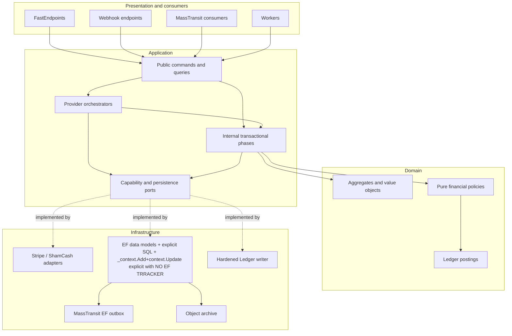

# Payments — Feature Architecture

**Status:** Implementation design, created 2026-11-18 from the approved Payments engineering review; domain model revised through 2026-11-20 against the DDD reviews. Implementation remains blocked until this document and the synchronized plan set pass a follow-up engineering review.

**Domain revision (2026-11-20):** §4 defines behavioral Domain Models independently from persistence DataModels. Refund, Dispute, and Purchase remain separate aggregate roots because their provider-driven lifecycles are independent; Q41 is an explicit cross-aggregate Domain policy evaluated from immutable facts while Infrastructure serializes the decision with the Purchase lock. Domain events remain inside Payments and are translated to the integration events defined in `transaction_flows.md` before crossing into Courses.

**Companions:** [`requirement.md`](requirement.md) owns product scope and Q39–Q58 behavior. [`database.md`](database.md) owns schema and data invariants. [`transaction_flows.md`](transaction_flows.md) owns shared workflow sequencing. [`stripe_payments_transaction_flows.md`](stripe_payments_transaction_flows.md) and [`sham_cash_payments_transaction_flows.md`](sham_cash_payments_transaction_flows.md) own provider wire contracts and deltas. Repository-root `DESIGN.md` remains the product visual design system and is not changed by this feature.

---

## 1. Architecture goals

1. Keep financial policy in a provider-neutral Domain.
2. Keep use-case sequencing and authorization in Application.
3. Keep provider SDK/HTTP, EF data models, SQL, migrations, object storage, and worker mechanics in Infrastructure.
4. Keep endpoints and consumers as input/output mapping only.
5. Make illegal provider operations uncallable by resolving capability-specific ports.
6. Make every external call recoverable through committed intent and deterministic identity.
7. Make one database function the only runtime Ledger write path.
8. Generalize Courses access once; never build a second Payments-specific enrollment pipeline.
9. Ship the approved end state in independently testable vertical slices.

---

## 2. Dependency and runtime shape



Compile-time direction is inward: Presentation → Application → Domain. Infrastructure implements Application ports and references Domain only for mapped values/contracts. Domain references no EF, MediatR, MassTransit, provider SDK, HTTP, object storage, or module facade.

### Runtime rule

Every origin calls a public Application command/query. It may not call Domain services, persistence ports, DbContext, provider adapters, or internal phase commands directly. Architecture tests enforce this.

### Domain ownership rule

Financial policy — status transitions, the Remaining Refundable and Settleable Balance formulas, posting balance, and their events — lives only in Domain (§4). An Application phase fetches facts under lock, invokes the required Domain policy and aggregate methods, and persists their outcomes via tripwired writes; it never re-implements a transition or invariant as a handler `if`. If a rule is deterministic and I/O-free, it is a Domain method or Domain service. Architecture tests fail on anemic aggregates and on business rules found in Application handlers.

Aggregate boundaries are not persistence boundaries. A Domain aggregate may be reconstituted from several EF DataModels, and several Domain aggregates may participate in one short database transaction when an approved cross-aggregate invariant requires it. DataModels mirror storage; Domain Models protect behavior. PostgreSQL constraints remain the race-safe final guard rather than a substitute for Domain policy.

---

## 3. Module layout

Keep the existing projects and add feature folders by capability, not table:

```text
Modules/Payments/
  Domain/
    Catalog/
      Aggregates/           # Product, Price
      Events/               # ProductMirrorUpdated, PriceCreated, PriceArchived
    Settings/
      Aggregates/           # AcademyPaymentSettings, ProviderConfiguration
      Events/               # AcademyPaymentSettingsUpdated, ProviderAccount/RouteConfigured
    Checkout/
      Aggregates/           # CheckoutSession (+ state)
      Events/               # CheckoutSessionCreated/Completed/Expired
      Services/             # CheckoutEligibilityPolicy
    Purchases/
      Aggregates/           # Purchase (+ state)
      Events/               # PurchasePaid, PurchasePartiallyRefunded, PurchaseFullyRefunded
      Services/             # RefundabilityPolicy
    Aftercare/
      Aggregates/           # RefundRequest, Refund, Dispute (+ states)
      Events/               # RefundRequested/Decided/Created/Succeeded/Failed, DisputeOpened/Resolved
    Finance/
      Aggregates/           # PaymentReviewCase (+ state)
      Records/              # validated factories: ProviderTransaction, Settlement, audit records
      Events/               # LedgerPostingPrepared, SettlementRecorded, UnappliedFundsReceived, PaymentReviewDecided
      Services/             # SettlementPolicy
    Ledger/
      ValueObjects/         # Money, LedgerPosting
      Services/             # LedgerPostingFactory
    Providers/
      ValueObjects/         # ProviderName, ProviderAccountRef, ProviderCurrencyRoute, PaymentMethod, ProviderTransactionIdentity
  Application/
    Catalog/
    Checkout/
    Webhooks/
    Aftercare/
    Finance/
    Reconciliation/
    Reporting/
    Ports/
  Infrastructure/
    Persistence/
      Models/
      Configurations/
      Mappers/
      Stores/
      Migrations/
    Ledger/
    Providers/Stripe/
    Providers/ShamCash/
    Webhooks/
    Archive/
    Workers/
  IntegrationEvents/
  Presentation/
    Endpoints/
    Consumers/
```

Do not create one repository/service pair per table. A store may own a coherent workflow boundary, such as checkout intent or finance review, and may update several persistence models atomically.

Within each Domain capability folder, keep each Domain Model with its behavior and put events, policies, and value objects beside it. Do not infer this shape from EF DataModels: a mapper/store may compose multiple rows into one Domain Model or persist one Domain outcome across multiple rows. No Domain project may reference EF, MediatR, MassTransit, a provider SDK, HTTP, or a module facade. No money DataModel implements `ISoftDeletable`, and the Payments `AppDbContext` does not register the `SoftDeleteInterceptor` (§7.1).

---

## 4. Domain model

Domain Models protect decisions; persistence DataModels model rows. They are deliberately separate. Infrastructure may map one DataModel to one Domain Model, compose several DataModels into one aggregate/policy snapshot, or persist one Domain outcome across several DataModels. **Financial rules live in Domain, while locking and persistence mechanics stay outside it.**

### 4.1 Aggregates

The roots below are chosen for independent lifecycle and identity, not because similarly named tables exist. Refunds and Disputes receive provider events independently from Purchase, so they remain separate roots. Q41 is intentionally cross-aggregate and is described in §4.2.

| Aggregate | Owns | Behavior (aggregate methods) | Events raised | Invariant / tripwire |
|---|---|---|---|---|
| `Product` | versioned sellable mirror state | `ApplyMirrorUpdate(sourceVersion, …)` | `ProductMirrorUpdatedDomainEvent` | applies only strictly newer `SourceVersion`; Sellable is derived, never a mutable Product flag |
| `Price` | immutable Product/currency offer | static `Create(...)`, `Archive(now)` | `PriceCreatedDomainEvent`, `PriceArchivedDomainEvent` | archive, never edit; active uniqueness is a Domain precondition plus the database partial unique index |
| `AcademyPaymentSettings` | Academy selling, commission, and refund-window policy | `UpdatePolicy(...)` | `AcademyPaymentSettingsUpdatedDomainEvent` | absent means selling disabled; valid commission/window |
| `ProviderConfiguration` | Provider Account and Provider Currency Route configuration | `ConfigureAccount(...)`, `ConfigureCurrencyRoute(...)`, `DisableCurrencyRoute(...)` | `ProviderAccountConfiguredDomainEvent`, `ProviderCurrencyRouteConfiguredDomainEvent`, `ProviderCurrencyRouteDisabledDomainEvent` | provider/environment/currency/capability coherence |
| `CheckoutSession` | one provider attempt | static `Create(...)`, `StampProviderSession(...)`, `Expire(now)`, `CompleteFromMovement(...)` | `CheckoutSessionCreatedDomainEvent`, `CheckoutSessionExpiredDomainEvent`, `CheckoutSessionCompletedDomainEvent` | locked Product/Price/Provider Currency Route; Pending → Expired/Completed and Expired → Completed for valid late money; ambiguous provider creation stays Pending |
| `Purchase` | confirmed acquisition and confirmed-reversal status | static `CreateFromCapture(...)`, `RecordConfirmedRefund(facts)`, `RecordLostDispute(facts)` | `PurchasePaidDomainEvent`, `PurchasePartiallyRefundedDomainEvent`, `PurchaseFullyRefundedDomainEvent` | born Paid; confirmed reversals drive status; it does not reserve Q41 during confirmation |
| `RefundRequest` | Student ask and Platform decision | static `Create(...)`, `Approve(decision, refundId, now)`, `Reject(admin, reason, now)` | `RefundRequestedDomainEvent`, `RefundRequestDecidedDomainEvent` | one open per Purchase; approval follows a successful Q41 policy decision and creates a pending Refund atomically |
| `Refund` | reserved then confirmed reversal | `CreateFromApprovedRequest(...)`, `CreateFromProviderMovement(...)`, `CreateFromSupportResolution(...)`, `Succeed(movement, now)`, `Fail(reason, now)` | `RefundCreatedDomainEvent`, `RefundSucceededDomainEvent`, `RefundFailedDomainEvent` | Pending reserves Q41; Pending → Succeeded/Failed; source and revoke decision are immutable |
| `Dispute` | formal provider dispute paperwork | static `OpenFromProvider(...)`, `RecordFundsWithdrawn(...)`, `RecordFundsReinstated(...)`, `ResolveWon(now)`, `ResolveLost(now)` | `DisputeOpenedDomainEvent`, `DisputeFundsWithdrawnDomainEvent`, `DisputeFundsReinstatedDomainEvent`, `DisputeResolvedDomainEvent` | Open does not imply money moved; Provider Transactions remain cash truth |
| `PaymentReviewCase` | maker/checker exceptional decision | static `Open(...)`, `Approve(checker, now)`, `Reject(checker, reason, now)`, `Resolve(movement, now)` | `PaymentReviewDecidedDomainEvent` | evidence required; checker ≠ maker; approval alone moves no money |

Domain types expose no EF navigation or public setters. Hydration uses `Reconstitute(...)` factories. A simple ladder uses guarded methods; use the Library State pattern only where it makes a genuinely complex transition matrix easier to read. Every persisted transition records its expected previous status for Infrastructure's conditional update tripwire.

### 4.2 Cross-aggregate Q41 decision

`RefundabilityPolicy` owns Q41; Application owns sequencing; Infrastructure owns locking. Approval/reservation is the only point that checks the cap:

```csharp
// Transactional approval phase — shape only.
lock Purchase row;
snapshot = store.LoadRefundabilitySnapshot(purchaseId);
decision = RefundabilityPolicy.Decide(snapshot, requestedAmount);
request.Approve(decision, refundId, now);
refund = Refund.CreateFromApprovedRequest(decision, ...); // Pending now reserves the amount
store.Persist(request, refund);
```

Confirmation does **not** recompute Q41 against the already-reserved Pending Refund. It validates the Refund/movement identity, transitions Refund to Succeeded, and passes immutable confirmed-reversal facts to Purchase so Purchase can update its status. A Failed Refund releases the reservation because it drops out of the next policy snapshot. Provider-originated and support Refunds create their missing Pending/Succeeded record through source-specific factories under the same Purchase lock.

The snapshot contains Purchase settlement gross, Pending/Succeeded Refund amounts, and dispute amount currently withdrawn or finally Lost without reinstatement. Merely opening a Dispute contributes zero. PostgreSQL triggers and unique constraints are the final concurrency guard; they do not contain a second version of the formula.

### 4.3 Domain and integration events

Domain events are private Payments facts raised by aggregate methods. Integration events are Payments-owned public contracts written through the EF outbox after all required identifiers, including the backing LedgerEntry audit reference, are known. Courses consumes only integration events.

| Area | Events |
|---|---|
| Catalog | `ProductMirrorUpdatedDomainEvent`, `PriceCreatedDomainEvent`, `PriceArchivedDomainEvent` |
| Settings | `AcademyPaymentSettingsUpdatedDomainEvent`, `ProviderAccountConfiguredDomainEvent`, `ProviderCurrencyRouteConfiguredDomainEvent`, `ProviderCurrencyRouteDisabledDomainEvent` |
| Checkout | `CheckoutSessionCreatedDomainEvent`, `CheckoutSessionCompletedDomainEvent`, `CheckoutSessionExpiredDomainEvent` |
| Purchases | `PurchasePaidDomainEvent`, `PurchasePartiallyRefundedDomainEvent`, `PurchaseFullyRefundedDomainEvent` |
| Aftercare | `RefundRequestedDomainEvent`, `RefundRequestDecidedDomainEvent`, `RefundCreatedDomainEvent`, `RefundSucceededDomainEvent`, `RefundFailedDomainEvent`, `DisputeOpenedDomainEvent`, `DisputeFundsWithdrawnDomainEvent`, `DisputeFundsReinstatedDomainEvent`, `DisputeResolvedDomainEvent` |
| Finance | `LedgerPostingPreparedDomainEvent`, `SettlementRecordedDomainEvent`, `UnappliedFundsReceivedDomainEvent`, `PaymentReviewDecidedDomainEvent` |

| Internal fact | Public integration event |
|---|---|
| Purchase paid after capture posting succeeds | `PurchaseActivatedIntegrationEvent` |
| Purchase fully refunded, succeeded flagged Refund, or lost Dispute after reversal posting succeeds | `PurchaseAccessRevocationRequestedIntegrationEvent` |

No Domain event handler calls Courses. Application translates the fact and writes the public event to the outbox in the same transaction as Domain state, Ledger posting, and audit. `LedgerPostingPreparedDomainEvent` means a balanced posting was constructed; `LedgerEntryPosted` is an audit/operational fact recorded only after `ILedgerWriter` succeeds. New Domain event constructors receive an explicit `IClock` timestamp; Payments Domain does not import MediatR directly despite Shared's existing transitive `IDomainEvent` debt.

### 4.4 Value objects and policies

Value objects exist only where a multi-field invariant needs a type; IDs stay primitive `Guid` per Q2.

| Value object | Invariant it enforces |
|---|---|
| `Money(Amount, Currency)` | amount positive/non-negative by use; ISO 4217 currency; minor-unit granularity from the currency exponent; no cross-currency arithmetic |
| `ProviderName` | immutable machine slug; only registered names constructible |
| `ProviderAccountRef` | account id + provider + environment travel together |
| `ProviderCurrencyRoute` | account + integration/settlement currencies + presentment mode + risk policy travel together |
| `PaymentMethod` | Student-facing eligible checkout method derived from a Provider Currency Route |
| `ProviderTransactionIdentity` | `(ProviderAccountId, ExternalTransactionId)` is the cash dedupe key |
| `LedgerPosting` | one header + ≥2 balanced lines, all same currency, exact typed references; constructible only through `LedgerPostingFactory` |
| `AccessSource` | shape owned by Courses; shared contracts carry `(SourceType, SourceId)` |

| Service | Inputs | Output / responsibility |
|---|---|---|
| `CheckoutEligibilityPolicy` | Product, Price, Academy settings, Provider Currency Route, enrollment/access fact | eligible `PaymentMethod` values or explicit reason |
| `RefundabilityPolicy` | Purchase gross, Pending/Succeeded Refunds, currently withdrawn/unreinstated dispute exposure | Remaining Refundable and reservation decision (Q41) |
| `SettlementPolicy` | payable balance, Pending Refunds, open-request exposure, route risk, reconciliation evidence | Settleable Balance (Q32/Q53) and rejection reasons; called again under lock in the result phase |
| `LedgerPostingFactory` | normalized movement plus stored purchase/split/review facts | balanced, minor-unit-safe `LedgerPosting` for each entry type |

These policies are deterministic and I/O-free. Time, provider reads, authorization, locks, `ILedgerWriter`, and persistence stay in Application/Infrastructure.

### 4.5 Immutable financial records

`ProviderTransaction`, `Settlement`, `LedgerEntry`, `LedgerLine`, and audit/reconciliation records are immutable validated Domain records, not mutable aggregates and not EF DataModels. Their factories validate identity shape, money granularity, and typed references. Application records success/audit events only after the corresponding Infrastructure operation succeeds. No append-only DataModel implements `ISoftDeletable`, and no generic repository is created for it.

### 4.6 Domain ↔ persistence mapping

For simple shapes, Shared's `IDataModelMapper<TDomainModel, TDataModel>` supplies `ToDomain`, `ToData`, and `ApplyChanges`. For complex workflows, a capability mapper may consume a composite persistence projection assembled from several DataModels and call one or more `Reconstitute(...)` factories. Stores own explicit Add/targeted Update instructions and tripwire SQL; mappers do not. Domain assemblies never reference EF types, and query DTOs bypass Domain (`AsNoTracking` projections, §5.4).

---

## 5. Application design

### 5.1 Command classes

- **Public local command:** `ICommand<T>, ITransactionalCommand`. The existing `TransactionalBehavior` wraps the whole handler.
- **Public provider orchestrator:** `ICommand<T>` only. It dispatches internal transactional phase commands around provider I/O.
- **Internal phase:** `ICommand<T>, ITransactionalCommand`, internal visibility where project boundaries allow, and never called by Presentation/Consumers.
- **Query:** `IQuery<T>`/repository convention used by the codebase; explicit tenant/provider/currency scope is mandatory for unfiltered money tables.

The current `TransactionalBehavior` opens a transaction for every `ITransactionalCommand`. Therefore an orchestrator that calls a provider must never implement that marker.

### 5.2 Public command catalog

Names are the implementation contract; combine request/handler/validator in the repository's established vertical-feature style.

| Capability | Public command | Transaction shape |
|---|---|---|
| Catalog | `UpsertProductMirror`, `CreatePrice`, `ArchivePrice` | local transaction |
| Settings | `UpdateAcademyPaymentSettings`, `ConfigureProviderAccount`, `ConfigureProviderCurrencyRoute` | local transaction |
| Checkout | `CreateCheckoutSession` | provider orchestrator |
| Webhook | `ReceiveProviderWebhook` | non-transactional verification entry; dispatches ingest phase |
| Webhook worker | `ProcessWebhookEvent` | orchestrates normalization/read then local domain phase |
| Session recovery | `RecoverStaleCheckoutSession` | provider orchestrator |
| Refund request | `RequestRefund`, `DecideRefundRequest` | local transaction |
| Provider refund | `IssueRefund` | provider orchestrator |
| Provider event | `ApplyNormalizedProviderEvent` | local transaction after normalization |
| Review | `OpenPaymentReview`, `DecidePaymentReview` | local transaction |
| Review resolution | `ApplyUnappliedFunds`, `ReturnUnappliedFunds`, `ReversePurchaseFromSupport` | local or provider orchestrator as movement requires |
| Settlement | `SettleAcademyPayable` | provider/manual-transfer orchestrator |
| Provider payout | `RecordProviderPayout` | local transaction after normalized movement |
| Reconciliation | `RunProviderReconciliation`, `RunInternalReconciliation` | orchestrator/read then local result phase |
| Archive | `ArchiveWebhookPayload`, `RedactWebhookPii` | object I/O around local transition phases |
| Operations | `RedriveWebhookEvent`, `RefreshProductPurchaseAnalytics` | local transaction |

The webhook endpoint passes provider name, headers, and exact raw bytes to `ReceiveProviderWebhook`. That command resolves the provider event-normalization capability, verifies the signature outside a transaction, and dispatches `IngestVerifiedProviderWebhook` only on success. Endpoint code performs request mapping only.

### 5.3 Internal phase catalog

Use phases only where an external side effect creates a real recovery boundary:

| Orchestrator | Before I/O phase | After I/O phase |
|---|---|---|
| `CreateCheckoutSession` | `EnsureCheckoutIntent` | `StampCheckoutResult` |
| `ReceiveProviderWebhook` | `IngestVerifiedProviderWebhook` | n/a; processing continues from durable outbox |
| `IssueRefund` | `EnsureRefundIntent` | `StampRefundCallResult` |
| `ReturnUnappliedFunds` | `EnsureUnappliedReturnIntent` | `ConfirmUnappliedReturn` |
| `SettleAcademyPayable` | `EnsureSettlementIntent` | `ConfirmSettlementTransfer` |
| `RunProviderReconciliation` | `StartReconciliationRun` | `ApplyReconciliationResults` |
| `ArchiveWebhookPayload` | `StartPayloadArchive` | `CompletePayloadArchive` |

Each phase is independently idempotent. “After” commands accept normalized results, not SDK response objects. Definitive rejection and ambiguous timeout are different results.

### 5.4 Public queries

- Available checkout methods for Product/Student.
- Student Purchase list/detail.
- Platform transaction list/detail.
- Academy transaction list/detail.
- Refund request/review queues.
- Payment Review Case detail.
- Provider-account/currency revenue and top Products.
- Settlement position by payable account.
- Reconciliation runs/findings and provider health.

Queries return DTOs, use no tracked Domain aggregates, and must name scope when reading unfiltered Provider/Ledger/Webhook/Audit tables. No query computes a cross-currency total.

### 5.5 Validation and authorization

FluentValidation covers shape and basic ranges. Handlers enforce trust-boundary facts under lock:

- tenant/user ownership;
- staff permission from `docs/Permissions.md`;
- Provider Account/environment/currency/capability;
- current status and allowed transition;
- maker/checker separation;
- Remaining Refundable/Unapplied/Settleable cap;
- evidence and external movement identity.

For Q41, the handler locks Purchase, loads the Refund/Dispute policy snapshot, and asks `RefundabilityPolicy` for a reservation decision. It then mutates the separate RefundRequest and Refund roots in the same transaction. Refund confirmation uses the reservation and does not run the cap against itself. Do not perform a pre-check outside the transaction and assume it remains true.

---

## 6. Application ports

### Provider capabilities

```csharp
IProviderCapabilityRegistry
ICheckoutProvider
IRefundProvider
IProviderEventNormalizer
IProviderReconciler
```

The registry resolves by immutable Provider name and required capability. Missing capability fails before creating financial intent. ShamCash never implements refund/dispute operations. Event normalization emits provider-neutral facts; a normalized fact may be ignored only through an explicit typed outcome.

### Persistence and infrastructure seams

```csharp
ICheckoutStore
IWebhookStore
IMoneyMovementStore
IFinanceReviewStore
IPaymentsReadStore
ILedgerWriter
IWebhookPayloadArchive
ICourseAccessReader
IClock
```

- Stores align with deep workflow boundaries, not tables.
- `ILedgerWriter` executes the hardened PostgreSQL posting function with targeted SQL and returns the entry ID.
- `IWebhookPayloadArchive` uploads/downloads/verifies deterministic objects; it cannot mutate the DB manifest itself.
- `ICourseAccessReader` answers checkout eligibility only. Course access mutation happens asynchronously through Courses integration contracts.
- `IClock` is used for domain/application timestamps; DB `PostedAt` remains database clock.

Do not expose `DbSet`, `IQueryable`, EF entities, provider SDK clients, or generic repositories across these ports.

---

## 7. Infrastructure design

### 7.1 Persistence models

Infrastructure defines EF data models/configurations matching [`database.md`](database.md). Domain aggregates are mapped explicitly on load/save. Append-only records may be written directly from validated Domain/Application records without pretending they are mutable aggregates.

Persistence rules:

- explicit `Add` for new records;
- targeted `ExecuteUpdate` or SQL for tripwired status transitions;
- row-count mismatch is a concurrency/domain conflict, not success;
- no correctness based on “tracked object changed”;
- no lazy loading;
- no Payments entity implements `ISoftDeletable`/`ISoftDeleteItem`, and `SoftDeleteInterceptor` is not registered on `Payments.AppDbContext` — money rows are append-only and any DELETE must fail; the scaffold's interceptor registration is removed in Slice 1;
- the scaffold namespace/folder `Persistance` is corrected to `Persistence` in Slice 1 (folder, namespace and all `using`s);
- query DTOs use `AsNoTracking`/projection;
- Ledger writes only through `ILedgerWriter` and the database function.

### 7.2 Provider adapters

`Providers/Stripe` and `Providers/ShamCash` contain clients, wire DTOs, signature verifiers, normalizers, capability implementations, and fixture contract tests. Registration declares capabilities once. Startup fails when an enabled database provider lacks a matching code registration.

Secrets are resolved from KeyVault by stored secret names. Secret values never enter tables, logs, errors, fixtures, or audit payloads.

### 7.3 Webhook and outbox

The endpoint calls `ReceiveProviderWebhook` with immutable provider route data, headers, and raw bytes. Application selects the event-normalization capability and verifies the signature; the internal ingest phase writes WebhookEvent, WebhookEventPayload, and `ProcessWebhookEvent` through the existing Payments EF outbox in one transaction. Configure `QueryDelay ≤ 5 seconds`; the current scaffold's 5 minutes must change in the financial-kernel slice.

The consumer calls `ProcessWebhookEvent`. It never calls DbContext directly. Consumer redelivery, Provider Transaction dedupe, domain uniques, and state tripwires make processing idempotent. Sweeper re-enqueues stale work.

Application translates private Domain events into the public contracts in §8 only after the required Ledger audit reference is available. The translated event, Domain state, audit row, and Ledger posting commit in one transaction; Courses receives it after commit through the EF outbox. No handler invokes a Courses command directly. The scaffold's current `QueryDelay = 5 minutes` is corrected to ≤ 5 seconds in Slice 1.

### 7.4 Ledger writer

`ILedgerWriter` serializes a `LedgerPosting` to the versioned `post_ledger_entry(jsonb)` contract and executes it inside the ambient transaction. The migration:

- owns the function under the migration role;
- sets a fixed trusted search path and schema-qualifies objects;
- revokes PUBLIC execute;
- revokes runtime direct INSERT on entry/line tables;
- grants runtime EXECUTE only;
- retains deferred balance/provider/tenant/currency/minor-unit constraints and deny-mutation triggers.

No fallback direct-insert path exists.

### 7.5 Archive and workers

Archive worker uploads by deterministic EventId-derived key, verifies read-back SHA-256, then dispatches completion. The database clears hot JSON only during the verified lifecycle transition. Reader transparently resolves hot or verified cold content.

Workers for sweeper, reconciliation, analytics, and archive call public Application commands and persist runs/findings/watermarks. They do not embed financial policy.

---

## 8. Cross-module access design

Courses owns one source-aware access capability:

```text
GrantCourseAccess(SourceType, SourceId, UserId, TenantId, TargetResourceArn, Metadata)
RevokeCourseAccess(SourceType, SourceId, UserId, TenantId, TargetResourceArn, Cause)
```

Payments never sends these commands directly. It publishes:

```text
PurchaseActivatedIntegrationEvent(..., AuditReference)
PurchaseAccessRevocationRequestedIntegrationEvent(..., CauseType, CauseId, AuditReference)
```

Courses consumers translate those Payments-owned facts into the Courses-owned commands above. Domain events remain private to Payments.

`SourceType` initially supports `AccessCode` and `Purchase`. The Courses change includes:

- replace or adapt `ProvisionAccessCodeCommand` behind the shared grant command;
- migrate `FailedProvisioningRecord.AccessCodeId` to `SourceType + SourceId`;
- migrate repository methods and unique index to `(TenantId, SourceType, SourceId)`;
- migrate revocation saga/state identity away from `AccessCodeId`;
- keep Library consumers as thin AccessCode mappings;
- add Payments consumers as thin Purchase mappings;
- preserve plan selection, Identity principal ensure, enrollment, failure parking, retry, and idempotent revoke behavior.

This is one Courses capability refactor, not a Payments copy. A migration/backfill marks existing rows `SourceType = AccessCode` and `SourceId = old AccessCodeId` before dropping/renaming the old field.

---

## 9. Failure modes

| Path | Failure | Handling | Observable outcome |
|---|---|---|---|
| Checkout create | provider accepted, app timed out | pending durable intent; retry/retrieve same key | no second charge/session |
| Webhook | process dies after ingest commit | EF outbox dispatch; sweeper repair | short delay, no lost paid access |
| Movement | two sources report same cash | Provider Transaction unique identity | loser is Duplicate; one posting |
| ShamCash | partial/late/extra/unmatched receipt | Unapplied Funds + review finding | no access; support-visible liability |
| Ledger | malformed or direct append | function/permissions/constraints reject transaction | no partial money state |
| Refund/dispute | concurrent reversal | Purchase lock + Remaining Refundable + uniques | one valid result; loser retries/conflicts |
| Review | maker is checker or evidence absent | authorization + DB CHECK | no money movement |
| Settlement | stale balance/reconciliation | exact payable lock and policy recompute | rejected before booking |
| Access | Courses cannot resolve plan/principal | source-aware failed-provisioning park | money remains valid; ops can retry |
| Archive | upload/hash/DB transition failure | retain hot payload; deterministic retry | replay remains available |
| Provider health | one provider credential/route fails | degrade affected route only | other methods and history continue |
| Provider drift | fixture passes but live contract fails | sandbox gate reports BLOCKED | no release on inferred compatibility |

---

## 10. Test architecture

Use xUnit, FluentAssertions, ASP.NET test host, and real PostgreSQL Testcontainers, matching repository conventions.

### Domain unit tests

- each aggregate's legal transitions, illegal-transition errors, expected previous status, and exact event;
- Q41 reservation at, above, and below Remaining Refundable, plus confirmation proving the Pending Refund is not counted twice;
- provider-originated and support Refund construction;
- CheckoutSession Pending/Expired → Completed late-money transitions;
- Dispute Opened vs FundsWithdrawn/FundsReinstated exposure;
- checkout eligibility matrix;
- Remaining Refundable and refund revocation decisions (Q41);
- Settleable Balance for Stripe and ShamCash policy (Q32/Q53);
- every Ledger posting shape, rounding and derived leg, plus `Money`/`LedgerPosting` invariant rejection;
- `Reconstitute` round-trips for every aggregate.

### Application tests

- orchestrator phase ordering, no transaction across provider I/O, timeout/retry/replay;
- capability absence before intent creation;
- authorization, tenant/provider/currency/environment isolation;
- maker/checker and evidence gates;
- normalized event dispatch and typed outcomes.

### PostgreSQL integration tests

- full migration up/down policy allowed by repo and schema creation;
- posting function, fixed search path, grants, PUBLIC/runtime denial, deferred balance checks, savepoints, rollback, replay, historical append denial;
- status triggers, partial uniques, minor units, typed reference sets;
- concurrent pending checkout, refund/dispute, unapplied review, and settlement races, including Open-without-withdrawal dispute exposure and Pending Refund reservation;
- archive lifecycle, hash/set-once fields, erasure procedure;
- EF outbox crash-after-ingest and duplicate processing.

### Cross-module integration tests

- Library AccessCode regression after source migration;
- Payments Purchase grant parity;
- identical UUID used once as AccessCode and once as Purchase does not collide;
- failure parking/retry by source identity;
- full/flagged refund and lost-dispute revoke exactly once;
- unflagged partial refund leaves access active.

### Provider contract tests

- deterministic signed Stripe and ShamCash fixtures run in PRs;
- fake capabilities drive all application replay/failure tests;
- secret-gated scheduled/on-demand sandbox smoke verifies live signatures, idempotency, normalization, and reconciliation;
- unavailable credentials produce a visible **BLOCKED** release gate.

### Performance and operations tests

- data-shaped 10× forecast benchmark against thresholds in `database.md` §16.6;
- archive upload/hash/restore/erasure;
- reconciliation overlap and movement disagreement;
- monthly PITR restore rehearsal with LedgerInternal reconciliation.

Architecture tests fail when Presentation/Consumers reference Infrastructure persistence/adapters, provider DTOs escape Infrastructure, an origin calls internal phases or Domain services directly, mapper/DataModel types leave Infrastructure, a Payments Domain type imports EF/MediatR/MassTransit/provider SDKs (the transitive `INotification` on Shared's `IDomainEvent` is tolerated), Domain invokes `ILedgerWriter`, a domain service performs I/O, a money DataModel implements `ISoftDeletable`, or a Ledger table gains a runtime direct-insert path. Integration tests prove `PurchasePaidDomainEvent` is translated to `PurchaseActivatedIntegrationEvent` with its Ledger audit reference and committed atomically; a separate Slice 2 test proves Courses consumes it idempotently.

---

## 11. Vertical slices and gates

### Slice 0 — Plan/design clearance

**Delivers:** synchronized requirements/database/shared/provider flows, permissions, glossary, this design.

**Gate:** follow-up engineering review has no open architecture/data-contract issue. No product implementation starts before this passes.

### Slice 1 — Financial kernel

**Delivers:** Academy/Provider configuration Domain Models, Product mirror and immutable Price lifecycle, Checkout intent model, Provider Transactions, hardened Ledger posting, webhook ingest/outbox, a provider-neutral Purchase capture path driven by fake normalized movement, Payments-owned activation/revocation integration contracts and producers, core query seams, schema/roles/triggers, and Payments test projects.

**Gate:** only kernel Domain behavior is required: configuration, catalog, Checkout eligibility/session lifecycle, Purchase capture, Provider Transaction identity, and Ledger posting. Migration/grant/function and transaction/outbox crash tests prove `PurchaseActivatedIntegrationEvent` is durable with Purchase + Ledger without requiring a Courses consumer. Scaffold corrections are applied (`SoftDeleteInterceptor` removed, `QueryDelay ≤ 5s`, `Persistence` spelling). Refundability and Settlement policies wait for their owning slices; no provider SDK is needed for kernel acceptance.

### Slice 2 — Source-aware Courses access

May run in parallel with Slice 1 after Slice 0.

**Delivers:** shared Courses grant/revoke commands, source-aware failure/saga persistence migration, Courses consumers for the Slice 1 Payments integration contracts, and Library adapter/regressions.

**Gate:** Library regression, Purchase parity, cross-source collision, retry, and idempotent revoke tests.

Slices 1 and 2 merge before provider work.

### Slice 3 — ShamCash

**Delivers:** exact hosted invoice, callback normalization, polling/reconciliation, Unapplied Funds, review apply/return, support reversal, and provider health. Settlement remains Slice 5.

**Gate:** full exact/non-exact fixture matrix, concurrency/review tests, data-shaped benchmark, secret-gated sandbox smoke. Missing sandbox access = BLOCKED.

### Slice 4 — Stripe

**Delivers:** Adaptive Pricing checkout/capture, refund requests/issuance, provider-originated refunds, disputes, payouts, reconciliation, risk holds.

**Gate:** presentment/settlement/fee truth, async refund, dispute timing, overlap/replay fixtures, benchmark, Stripe test-mode smoke. Missing account access = BLOCKED.

### Slice 5 — Operations and reporting

**Delivers:** Settlement policy and Wallet/manual-transfer settlement, settlement UI/API backing, five analytics, archive/redaction, reconciliation dashboards, monitoring/alerts, runbooks, and restore rehearsal.

**Gate:** maker/checker and stale-policy tests; archive restore/erasure; no mixed totals; benchmark thresholds; RPO/RTO rehearsal; legal/compliance release gates visible.

Each slice is independently deployable behind disabled provider routes. Schema evolution is additive; rollback disables new routes/consumers rather than deleting financial data.

---

## 12. Reuse and explicit non-goals

Reuse:

- existing Payments module projects, `TransactionalBehavior`, DbContext, and MassTransit EF outbox;
- tenant ambient context and module architecture conventions;
- Library immutable audit/analytics patterns where their invariants match;
- Courses plan selection, principal ensure, enrollment, failure parking, and revocation behavior;
- xUnit/FluentAssertions/Testcontainers stack;
- Shared `AggregateRoot`/`DomainEvent`/`IDomainEvent` and `IDataModelMapper`, plus Library's tripwire and `Reconstitute` patterns where they fit.

Do not add:

- one broad provider interface with unsupported operations;
- repository/service classes per table;
- generic “payments utilities” shared across modules;
- provider SDK types in Application/Domain;
- a second Payments-specific enrollment implementation;
- direct Ledger inserts or an EF fallback;
- process-local webhook handoff as the normal path;
- anemic aggregates — no Application handler may own a state transition, the refund/settlement cap, or a posting balance;
- soft-delete or DELETE semantics on money rows;
- subscriptions, discounts, tax, Connect, cross-currency totals, partitioning, or balance checkpoints without their separate approved trigger.

---

## 13. Review checklist

- [ ] Every Payments plan header links this architecture and ownership is non-overlapping.
- [ ] Public/internal command catalog matches `transaction_flows.md` and no provider call is transactional.
- [ ] Q39–Q58 behavior matches `requirement.md` and `database.md`.
- [ ] Posting-function grants/search path and archive lifecycle are migration-testable.
- [ ] Courses source migration has backfill, uniqueness, Library regression, and Payments parity.
- [ ] Provider capability matrix matches each provider document.
- [ ] Slice gates include deterministic fixtures, secret-gated smoke, benchmark, and operations proof.
- [ ] Domain Models and persistence DataModels remain separate; composite mappers are allowed and no table implies an aggregate boundary.
- [ ] Q41 is evaluated once at Refund reservation from a snapshot loaded under the Purchase lock; confirmation cannot count its Pending Refund twice.
- [ ] CheckoutSession supports valid late `Expired → Completed` movement and hosted-session creation never completes payment.
- [ ] `PurchasePaidDomainEvent` remains private; Application emits `PurchaseActivatedIntegrationEvent` with its Ledger audit reference through the outbox.
- [ ] Financial policies and `Money`/`LedgerPosting` live in Domain and are I/O-free; `ILedgerWriter` is called by Application, never Domain.
- [ ] Dispute opening, funds withdrawal/reinstatement, and resolution are distinct facts.
- [ ] No money entity is soft-deletable; no Payments Domain type imports MediatR/EF/MassTransit/provider SDKs.
- [ ] Scaffold corrections (soft-delete interceptor, outbox `QueryDelay`, `Persistence` spelling) are in Slice 1.
- [ ] Root `DESIGN.md` remains untouched.
