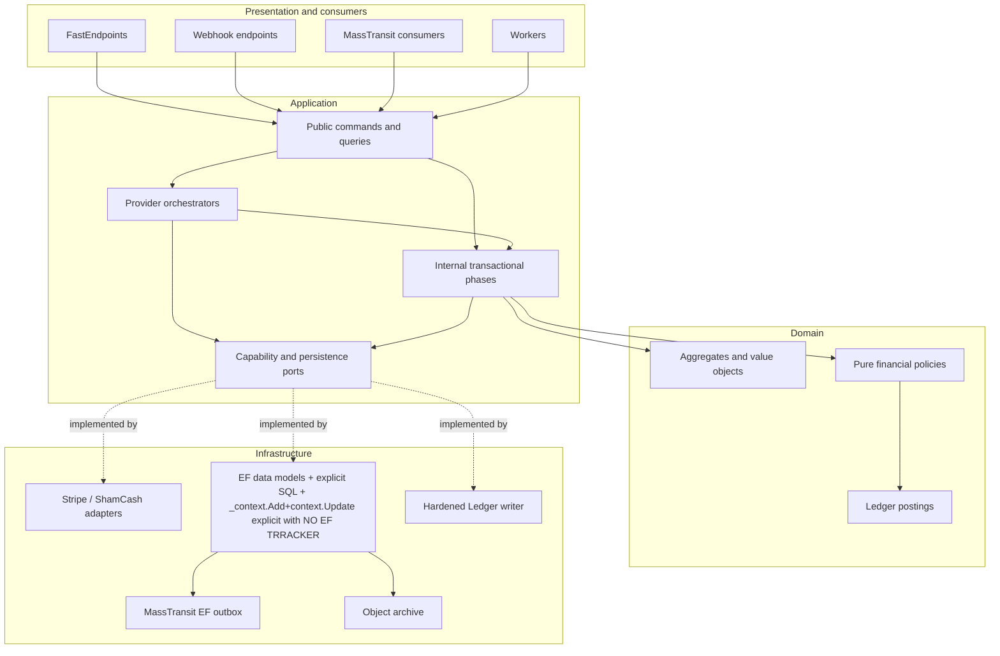

# Payments — Feature Architecture

**Status:** Implementation design, created 2026-11-18 from the approved Payments engineering review; domain model revised 2026-11-19 against the DDD code review. Implementation remains blocked until this document and the synchronized plan set pass a follow-up engineering review.

**Domain revision (2026-11-19):** §4 replaces the descriptive aggregate table with an executable DDD design — behavioral aggregates using the codebase's State pattern, an explicit domain-event taxonomy, I/O-free domain services located in Domain, multi-field value objects, `IDataModelMapper` + `Reconstitute` persistence mapping, and the DDD architecture tests in §10. The remaining review findings are recorded as enforced rules in §3, §7, §11 and §13.

**Companions:** [`requirement.md`](requirement.md) owns product scope and Q39–Q58 behavior. [`database.md`](database.md) owns schema and data invariants. [`transaction_flows.md`](transaction_flows.md) owns shared workflow sequencing. [`stripe_payments_transaction_flows.md`](stripe_payments_transaction_flows.md) and [`sham_cash_payments_transaction_flows.md`](sham_cash_payments_transaction_flows.md) own provider wire contracts and deltas. Repository-root `DESIGN.md` remains the product visual design system and is not changed by this feature.

---

## 1. Architecture goals

1. Keep financial policy in a provider-neutral Domain.
2. Keep use-case sequencing and authorization in Application.
3. Keep provider SDK/HTTP, EF data models, SQL, migrations, object storage, and worker mechanics in Infrastructure.
4. Keep endpoints and consumers as input/output mapping only.
5. Make illegal provider operations uncallable by resolving capability-specific ports.
6. Make every external call recoverable through committed intent and deterministic identity.
7. Make one database function the only runtime Ledger write path.
8. Generalize Courses access once; never build a second Payments-specific enrollment pipeline.
9. Ship the approved end state in independently testable vertical slices.

---

## 2. Dependency and runtime shape



Compile-time direction is inward: Presentation → Application → Domain. Infrastructure implements Application ports and references Domain only for mapped values/contracts. Domain references no EF, MediatR, MassTransit, provider SDK, HTTP, object storage, or module facade.

### Runtime rule

Every origin calls a public Application command/query. It may not call Domain services, persistence ports, DbContext, provider adapters, or internal phase commands directly. Architecture tests enforce this.

### Domain ownership rule

Financial policy — status transitions, the Remaining Refundable and Settleable Balance formulas, posting balance, and their events — lives only in Domain (§4). An Application phase fetches facts under lock, calls one Domain method, and persists the outcome via a tripwired write; it never re-implements a transition or an invariant as a handler `if`. If a rule is deterministic and I/O-free, it is a Domain method or Domain service. Architecture tests fail on anemic aggregates and on business rules found in Application handlers.

---

## 3. Module layout

Keep the existing projects and add feature folders by capability, not table:

```text
Modules/Payments/
  Domain/
    Catalog/
      Aggregates/           # Product, Price
      Events/               # ProductMirrorUpdated, PriceCreated, PriceArchived
    Checkout/
      Aggregates/           # CheckoutSession (+ state)
      Events/               # CheckoutSessionCreated/Completed/Expired
      Services/             # CheckoutEligibilityPolicy
    Purchases/
      Aggregates/           # Purchase (+ state)
      Events/               # PurchasePaid, PurchasePartiallyRefunded, PurchaseFullyRefunded
      Services/             # RefundabilityPolicy
    Aftercare/
      Aggregates/           # RefundRequest, Refund, Dispute (+ states)
      Events/               # RefundRequested/Decided/Created/Succeeded/Failed, DisputeOpened/Resolved
    Finance/
      Aggregates/           # PaymentReviewCase (+ state)
      Records/              # validated factories: ProviderTransaction, Settlement, audit records
      Events/               # LedgerEntryPosted, SettlementRecorded, UnappliedFundsReceived, PaymentReviewDecided
      Services/             # SettlementPolicy
    Ledger/
      ValueObjects/         # Money, LedgerPosting
      Services/             # LedgerPostingFactory
    Providers/
      ValueObjects/         # ProviderName, ProviderAccountRef, ProviderRoute, ExternalMovementIdentity
  Application/
    Catalog/
    Checkout/
    Webhooks/
    Aftercare/
    Finance/
    Reconciliation/
    Reporting/
    Ports/
  Infrastructure/
    Persistence/
      Models/
      Configurations/
      Mappers/
      Stores/
      Migrations/
    Ledger/
    Providers/Stripe/
    Providers/ShamCash/
    Webhooks/
    Archive/
    Workers/
  IntegrationEvents/
  Presentation/
    Endpoints/
    Consumers/
```

Do not create one repository/service pair per table. A store may own a coherent workflow boundary, such as checkout intent or finance review, and may update several persistence models atomically.

Within each Domain capability folder, keep the aggregate + its private state nested classes together, with `Events/`, `Services/` and `ValueObjects/` subfolders as listed — the same separation Courses uses between `Domain/Aggregates/` and `Domain/Events/`. No Domain project may reference EF, MediatR, MassTransit, a provider SDK, or a module facade. No money entity implements `ISoftDeletable`, and the Payments `AppDbContext` does not register the `SoftDeleteInterceptor` (§7.1).

---

## 4. Domain model

Domain classes model decisions; persistence classes model rows. Mapping is explicit at Infrastructure boundaries. **Financial rules live here and nowhere else.** Application phases fetch facts under lock, call one Domain method, and persist the outcome; they never re-implement a state transition, a refund cap, or a posting balance as a handler `if`. If a rule can be expressed without I/O, it is a Domain method or a Domain service.

The model follows patterns already proven in this codebase: `AccessCode`'s private `AccessCodeState` + `TransitionTo` + `ExpectedPreviousStatus` (Library), `Course`'s private collections + `IReadOnlyCollection<T>` + events raised from factory/mutation methods (Courses), Identity's I/O-free `PolicyEvaluatorService`, and Shared's `AggregateRoot`/`DomainEvent`/`IDataModelMapper`.

### 4.1 Aggregates

Every aggregate below is a behavioral `AggregateRoot` (immutable records are covered in §4.5). "Behavior" is the method set an Application phase calls. No method performs I/O, reads the clock itself, or touches persistence. Each transition sets `ExpectedPreviousStatus` for the tripwired `UPDATE … WHERE Status = expected` in Infrastructure and raises its event from inside the aggregate.

| Aggregate | Owns | Behavior (aggregate methods) | Events raised | Invariant / tripwire |
|---|---|---|---|---|
| `Product` | sellable mirror state | `UpsertMirror(sourceVersion, …)`, `MarkPurchasable()` | `ProductMirrorUpdatedDomainEvent` | applies only strictly newer `SourceVersion` |
| `Price` | immutable Product amount/currency offer | static `Create(...)`, `Archive(now)` | `PriceCreatedDomainEvent`, `PriceArchivedDomainEvent` | archive, never edit; one active Price per Product/currency |
| `CheckoutSession` | one provider attempt | static `Create(...)`, `Complete(result)`, `Expire(now)`, `MarkAmbiguous()` | `CheckoutSessionCreated/Completed/ExpiredDomainEvent` | locked Product/Price/route; Pending → Completed/Expired; ambiguous stays Pending |
| `Purchase` | confirmed acquisition and reversal ladder | static `CreateFromCapture(...)`, `ApplyRefund(refund, remaining)`, `ApplyDisputeLoss(dispute)` | `PurchasePaidDomainEvent`, `PurchasePartiallyRefundedDomainEvent`, `PurchaseFullyRefundedDomainEvent` | born Paid; Σ reversals vs `SettlementAmount` drives PartiallyRefunded/Refunded; `Amount ≤ Remaining Refundable` (Q41) checked before transition; access is external Courses state |
| `RefundRequest` | Student ask and Platform decision | static `Create(...)`, `Approve(amount, admin, refundId, now)`, `Reject(admin, reason, now)` | `RefundRequestCreatedDomainEvent`, `RefundRequestDecidedDomainEvent` | one open per Purchase; approval creates Refund; maker/decider separation; no money itself |
| `Refund` | reserved/confirmed reversal | static `CreateFromApproval(...)`, `Succeed(movement, now)`, `Fail(reason, now)` | `RefundCreatedDomainEvent`, `RefundSucceededDomainEvent`, `RefundFailedDomainEvent` | partial/full, source-aware; Pending → Succeeded/Failed; revoke decision immutable once confirmed |
| `Dispute` | formal provider dispute paperwork | static `CreateFromProvider(...)`, `ResolveWon(now)`, `ResolveLost(now)` | `DisputeOpenedDomainEvent`, `DisputeResolvedDomainEvent` | Open → Won/Lost; cash movement is separate Provider Transaction truth; `Won` drops out of the Q41 sum |
| `PaymentReviewCase` | maker/checker exceptional decision | static `Open(...)`, `Approve(checker, now)`, `Reject(checker, reason, now)`, `Resolve(movement, now)` | `PaymentReviewDecidedDomainEvent` | evidence required; checker ≠ maker; approval alone moves no money |

Child collections are private fields exposed as `IReadOnlyCollection<T>` and mutated only through the root's methods (Course pattern). Hydration uses a static `Reconstitute(...)` factory (AccessCode pattern); Domain types have no EF dependency, no lazy loading, and no public parameterless constructor.

#### State transitions and the tripwire

Each status ladder uses the `AccessCodeState` pattern: a private nested state class per status, a `TransitionTo(newState)` that records `ExpectedPreviousStatus = Status`, and virtual methods that return a domain `Error` for illegal transitions. Persistence uses that value as `UPDATE … WHERE Status = ExpectedPreviousStatus`; a zero row-count is a conflict, never success. An illegal transition is uncallable in Domain and a concurrent double-transition is impossible in the database.

```csharp
// Shape only — Purchase.ApplyRefund, following AccessCode.Redeem.
public ErrorOr<Success> ApplyRefund(Refund refund, Money remainingRefundable)
{
    if (refund.Amount > remainingRefundable)   // Q41 cap, recomputed under lock by the caller
        return Error.Validation("Purchase.RefundExceedsRemaining", ...);
    if (Status == PurchaseStatus.Refunded)
        return Error.Conflict("Purchase.AlreadyRefunded", ...);

    ExpectedPreviousStatus = Status;           // tripwire for persistence
    _totalReversed += refund.Amount;           // private field, no public setter
    Status = _totalReversed >= SettlementAmount
        ? PurchaseStatus.Refunded : PurchaseStatus.PartiallyRefunded;
    if (Status == PurchaseStatus.Refunded) RefundedAt = refund.CompletedAt;

    AddDomainEvent(Status == PurchaseStatus.Refunded
        ? new PurchaseFullyRefundedDomainEvent(Id, TenantId, ...)
        : new PurchasePartiallyRefundedDomainEvent(Id, TenantId, ...));
    return Result.Success;
}
```

`PurchasePaidDomainEvent` is the cross-module trigger: its handler writes the source-aware Courses grant through the EF outbox in the same transaction (§8). No aggregate method makes an HTTP call, publishes a message, or starts a transaction.

### 4.2 Domain events

Events are raised **from inside** aggregate/factory methods, named in past tense, and carry the ids, money, source, and occurrence time reactors need. They use Shared's `AggregateRoot`/`DomainEvent` (`IDomainEvent`). The transitive `MediatR.INotification` on Shared's `IDomainEvent` is tolerated as existing Shared debt; no Payments Domain type may import MediatR, EF, MassTransit, or provider SDKs directly (§10). New event constructors accept an explicit timestamp supplied from `IClock` by the caller — the Domain does not call `DateTime.UtcNow` (Shared's `OccuredOn` spelling is left as-is).

| Area | Events |
|---|---|
| Catalog | `ProductMirrorUpdatedDomainEvent`, `PriceCreatedDomainEvent`, `PriceArchivedDomainEvent` |
| Checkout | `CheckoutSessionCreatedDomainEvent`, `CheckoutSessionCompletedDomainEvent`, `CheckoutSessionExpiredDomainEvent` |
| Purchases | `PurchasePaidDomainEvent` **(grants access)**, `PurchasePartiallyRefundedDomainEvent`, `PurchaseFullyRefundedDomainEvent` **(revokes access)** |
| Aftercare | `RefundRequestedDomainEvent`, `RefundRequestDecidedDomainEvent`, `RefundCreatedDomainEvent`, `RefundSucceededDomainEvent` **(may revoke)**, `RefundFailedDomainEvent`, `DisputeOpenedDomainEvent`, `DisputeResolvedDomainEvent` **(Lost revokes)** |
| Finance | `LedgerEntryPostedDomainEvent`, `SettlementRecordedDomainEvent`, `UnappliedFundsReceivedDomainEvent`, `PaymentReviewDecidedDomainEvent` |

Handlers are in-process and DB-only: they write audit rows and outbox messages. They make no external calls — cross-module effects go through the outbox (§7.3). The `PurchasePaidDomainEvent` → audit + outbox path has an atomicity integration test (§10).

### 4.3 Value objects

Value objects exist only where a multi-field invariant needs a type; IDs stay primitive `Guid` per Q2.

| Value object | Invariant it enforces |
|---|---|
| `Money(Amount, Currency)` | amount positive/non-negative by use; ISO 4217 currency; minor-unit granularity from the currency exponent; no cross-currency arithmetic |
| `ProviderName` | immutable machine slug; only registered names constructible |
| `ProviderAccountRef` | account id + provider + environment travel together |
| `ProviderRoute` | account + integration/settlement currencies + presentment mode + risk policy travel together |
| `ExternalMovementIdentity` | `(ProviderAccountId, ExternalTransactionId)` is the cash dedupe key |
| `LedgerPosting` | one header + ≥2 balanced lines, all same currency, exact typed references; constructible only through `LedgerPostingFactory` |
| `AccessSource` | shape owned by Courses; shared contracts carry `(SourceType, SourceId)` |

`LedgerPosting` is a domain object, not a DTO: its factory rejects unbalanced or mixed-currency lines before serialization to `post_ledger_entry(jsonb)`.

### 4.4 Pure domain services

These are the financial policies. They live in `Domain/` (Identity's `PolicyEvaluatorService` precedent), are deterministic and I/O-free, and receive already-fetched facts. Application phases may not duplicate their decisions; an aggregate may consume one to decide its own transition.

| Service | Inputs | Output / responsibility |
|---|---|---|
| `CheckoutEligibilityPolicy` | Product, Price, Academy settings, route, enrollment/access fact | eligible methods or explicit reason |
| `RefundabilityPolicy` | Purchase gross, pending/succeeded refunds, withdrawn/lost disputes | Remaining Refundable = `SettlementAmount − Σ(Pending+Succeeded refunds) − Σ(disputes Open or Lost)` (Q41), plus the approval decision |
| `SettlementPolicy` | payable balance, pending exposure, route risk, reconciliation evidence | Settleable Balance (Q32/Q53 per-route policy, incl. the open-RefundRequest hold) and rejection reasons |
| `LedgerPostingFactory` | normalized movement plus stored purchase/split/review facts | balanced, minor-unit-safe `LedgerPosting` for each entry type |

Time, provider reads, authorization, locks, and persistence stay outside these services; the Application phase owns them.

### 4.5 Immutable financial records

`ProviderTransaction`, `Settlement`, `LedgerEntry`, `LedgerLine`, and audit/reconciliation records are not behavior-rich aggregates, but they are not raw row DTOs either. Each is created by a validated Domain factory (`ProviderTransaction.Record(identity, Money, type, …)`, `Settlement.Record(...)`) that checks the invariants it can (identity shape, money granularity, typed references) and raises the matching event when recorded. The remaining invariants are physically enforced in PostgreSQL (§7.4, `database.md`). No append-only record implements `ISoftDeletable`, and no generic repository is created for it.

### 4.6 Domain ↔ persistence mapping

`IDataModelMapper<TDomainModel, TDataModel>` (Shared) is the mapping contract: a capability's mapper turns a persistence model into a Domain `Reconstitute(...)` call, and a Domain outcome into explicit `Add`/`Update` instructions with the tripwire value. Domain assemblies never reference EF types; Infrastructure references Domain only for mapped values/contracts. Query DTOs bypass Domain entirely (`AsNoTracking` projections, §5.4).

---

## 5. Application design

### 5.1 Command classes

- **Public local command:** `ICommand<T>, ITransactionalCommand`. The existing `TransactionalBehavior` wraps the whole handler.
- **Public provider orchestrator:** `ICommand<T>` only. It dispatches internal transactional phase commands around provider I/O.
- **Internal phase:** `ICommand<T>, ITransactionalCommand`, internal visibility where project boundaries allow, and never called by Presentation/Consumers.
- **Query:** `IQuery<T>`/repository convention used by the codebase; explicit tenant/provider/currency scope is mandatory for unfiltered money tables.

The current `TransactionalBehavior` opens a transaction for every `ITransactionalCommand`. Therefore an orchestrator that calls a provider must never implement that marker.

### 5.2 Public command catalog

Names are the implementation contract; combine request/handler/validator in the repository's established vertical-feature style.

| Capability | Public command | Transaction shape |
|---|---|---|
| Catalog | `UpsertProductMirror`, `CreatePrice`, `ArchivePrice` | local transaction |
| Settings | `UpdateAcademyPaymentSettings`, `ConfigureProviderAccount`, `ConfigureProviderRoute` | local transaction |
| Checkout | `CreateCheckoutSession` | provider orchestrator |
| Webhook | `ReceiveProviderWebhook` | non-transactional verification entry; dispatches ingest phase |
| Webhook worker | `ProcessWebhookEvent` | orchestrates normalization/read then local domain phase |
| Session recovery | `RecoverStaleCheckoutSession` | provider orchestrator |
| Refund request | `RequestRefund`, `DecideRefundRequest` | local transaction |
| Provider refund | `IssueRefund` | provider orchestrator |
| Provider event | `ApplyNormalizedProviderEvent` | local transaction after normalization |
| Review | `OpenPaymentReview`, `DecidePaymentReview` | local transaction |
| Review resolution | `ApplyUnappliedFunds`, `ReturnUnappliedFunds`, `ReversePurchaseFromSupport` | local or provider orchestrator as movement requires |
| Settlement | `SettleAcademyPayable` | provider/manual-transfer orchestrator |
| Provider payout | `RecordProviderPayout` | local transaction after normalized movement |
| Reconciliation | `RunProviderReconciliation`, `RunInternalReconciliation` | orchestrator/read then local result phase |
| Archive | `ArchiveWebhookPayload`, `RedactWebhookPii` | object I/O around local transition phases |
| Operations | `RedriveWebhookEvent`, `RefreshProductDailySales` | local transaction |

The webhook endpoint passes provider name, headers, and exact raw bytes to `ReceiveProviderWebhook`. That command resolves the provider event-normalization capability, verifies the signature outside a transaction, and dispatches `IngestVerifiedProviderWebhook` only on success. Endpoint code performs request mapping only.

### 5.3 Internal phase catalog

Use phases only where an external side effect creates a real recovery boundary:

| Orchestrator | Before I/O phase | After I/O phase |
|---|---|---|
| `CreateCheckoutSession` | `EnsureCheckoutIntent` | `StampCheckoutResult` |
| `ReceiveProviderWebhook` | `IngestVerifiedProviderWebhook` | n/a; processing continues from durable outbox |
| `IssueRefund` | `EnsureRefundIntent` | `StampRefundCallResult` |
| `ReturnUnappliedFunds` | `EnsureUnappliedReturnIntent` | `ConfirmUnappliedReturn` |
| `SettleAcademyPayable` | `EnsureSettlementIntent` | `ConfirmSettlementTransfer` |
| `RunProviderReconciliation` | `StartReconciliationRun` | `ApplyReconciliationResults` |
| `ArchiveWebhookPayload` | `StartPayloadArchive` | `CompletePayloadArchive` |

Each phase is independently idempotent. “After” commands accept normalized results, not SDK response objects. Definitive rejection and ambiguous timeout are different results.

### 5.4 Public queries

- Available checkout methods for Product/Student.
- Student Purchase list/detail.
- Platform transaction list/detail.
- Academy transaction list/detail.
- Refund request/review queues.
- Payment Review Case detail.
- Provider-account/currency revenue and top Products.
- Settlement position by payable account.
- Reconciliation runs/findings and provider health.

Queries return DTOs, use no tracked Domain aggregates, and must name scope when reading unfiltered Provider/Ledger/Webhook/Audit tables. No query computes a cross-currency total.

### 5.5 Validation and authorization

FluentValidation covers shape and basic ranges. Handlers enforce trust-boundary facts under lock:

- tenant/user ownership;
- staff permission from `docs/Permissions.md`;
- Provider Account/environment/currency/capability;
- current status and allowed transition;
- maker/checker separation;
- Remaining Refundable/Unapplied/Settleable cap;
- evidence and external movement identity.

Do not perform a pre-check outside the transaction and assume it remains true.

---

## 6. Application ports

### Provider capabilities

```csharp
IProviderCapabilityRegistry
ICheckoutProvider
IRefundProvider
IProviderEventNormalizer
IProviderReconciler
```

The registry resolves by immutable Provider name and required capability. Missing capability fails before creating financial intent. ShamCash never implements refund/dispute operations. Event normalization emits provider-neutral facts; a normalized fact may be ignored only through an explicit typed outcome.

### Persistence and infrastructure seams

```csharp
ICheckoutStore
IWebhookStore
IMoneyMovementStore
IFinanceReviewStore
IPaymentsReadStore
ILedgerWriter
IWebhookPayloadArchive
ICourseAccessReader
IClock
```

- Stores align with deep workflow boundaries, not tables.
- `ILedgerWriter` executes the hardened PostgreSQL posting function with targeted SQL and returns the entry ID.
- `IWebhookPayloadArchive` uploads/downloads/verifies deterministic objects; it cannot mutate the DB manifest itself.
- `ICourseAccessReader` answers checkout eligibility only. Course access mutation happens asynchronously through Courses integration contracts.
- `IClock` is used for domain/application timestamps; DB `PostedAt` remains database clock.

Do not expose `DbSet`, `IQueryable`, EF entities, provider SDK clients, or generic repositories across these ports.

---

## 7. Infrastructure design

### 7.1 Persistence models

Infrastructure defines EF data models/configurations matching [`database.md`](database.md). Domain aggregates are mapped explicitly on load/save. Append-only records may be written directly from validated Domain/Application records without pretending they are mutable aggregates.

Persistence rules:

- explicit `Add` for new records;
- targeted `ExecuteUpdate` or SQL for tripwired status transitions;
- row-count mismatch is a concurrency/domain conflict, not success;
- no correctness based on “tracked object changed”;
- no lazy loading;
- no Payments entity implements `ISoftDeletable`/`ISoftDeleteItem`, and `SoftDeleteInterceptor` is not registered on `Payments.AppDbContext` — money rows are append-only and any DELETE must fail; the scaffold's interceptor registration is removed in Slice 1;
- the scaffold namespace/folder `Persistance` is corrected to `Persistence` in Slice 1 (folder, namespace and all `using`s);
- query DTOs use `AsNoTracking`/projection;
- Ledger writes only through `ILedgerWriter` and the database function.

### 7.2 Provider adapters

`Providers/Stripe` and `Providers/ShamCash` contain clients, wire DTOs, signature verifiers, normalizers, capability implementations, and fixture contract tests. Registration declares capabilities once. Startup fails when an enabled database provider lacks a matching code registration.

Secrets are resolved from KeyVault by stored secret names. Secret values never enter tables, logs, errors, fixtures, or audit payloads.

### 7.3 Webhook and outbox

The endpoint calls `ReceiveProviderWebhook` with immutable provider route data, headers, and raw bytes. Application selects the event-normalization capability and verifies the signature; the internal ingest phase writes WebhookEvent, WebhookEventPayload, and `ProcessWebhookEvent` through the existing Payments EF outbox in one transaction. Configure `QueryDelay ≤ 5 seconds`; the current scaffold's 5 minutes must change in the financial-kernel slice.

The consumer calls `ProcessWebhookEvent`. It never calls DbContext directly. Consumer redelivery, Provider Transaction dedupe, domain uniques, and state tripwires make processing idempotent. Sweeper re-enqueues stale work.

Domain-event handlers write only through the DbContext (audit rows, outbox messages), so `PurchasePaidDomainEvent` commits the Courses grant message in the same transaction as the Purchase transition. The scaffold's current `QueryDelay = 5 minutes` is corrected to ≤ 5 seconds in Slice 1 to match this section.

### 7.4 Ledger writer

`ILedgerWriter` serializes a `LedgerPosting` to the versioned `post_ledger_entry(jsonb)` contract and executes it inside the ambient transaction. The migration:

- owns the function under the migration role;
- sets a fixed trusted search path and schema-qualifies objects;
- revokes PUBLIC execute;
- revokes runtime direct INSERT on entry/line tables;
- grants runtime EXECUTE only;
- retains deferred balance/provider/tenant/currency/minor-unit constraints and deny-mutation triggers.

No fallback direct-insert path exists.

### 7.5 Archive and workers

Archive worker uploads by deterministic EventId-derived key, verifies read-back SHA-256, then dispatches completion. The database clears hot JSON only during the verified lifecycle transition. Reader transparently resolves hot or verified cold content.

Workers for sweeper, reconciliation, analytics, and archive call public Application commands and persist runs/findings/watermarks. They do not embed financial policy.

---

## 8. Cross-module access design

Courses owns one source-aware access capability:

```text
GrantCourseAccess(SourceType, SourceId, UserId, TenantId, TargetResourceArn, Metadata)
RevokeCourseAccess(SourceType, SourceId, UserId, TenantId, TargetResourceArn, Cause)
```

`SourceType` initially supports `AccessCode` and `Purchase`. The Courses change includes:

- replace or adapt `ProvisionAccessCodeCommand` behind the shared grant command;
- migrate `FailedProvisioningRecord.AccessCodeId` to `SourceType + SourceId`;
- migrate repository methods and unique index to `(TenantId, SourceType, SourceId)`;
- migrate revocation saga/state identity away from `AccessCodeId`;
- keep Library consumers as thin AccessCode mappings;
- add Payments consumers as thin Purchase mappings;
- preserve plan selection, Identity principal ensure, enrollment, failure parking, retry, and idempotent revoke behavior.

This is one Courses capability refactor, not a Payments copy. A migration/backfill marks existing rows `SourceType = AccessCode` and `SourceId = old AccessCodeId` before dropping/renaming the old field.

---

## 9. Failure modes

| Path | Failure | Handling | Observable outcome |
|---|---|---|---|
| Checkout create | provider accepted, app timed out | pending durable intent; retry/retrieve same key | no second charge/session |
| Webhook | process dies after ingest commit | EF outbox dispatch; sweeper repair | short delay, no lost paid access |
| Movement | two sources report same cash | Provider Transaction unique identity | loser is Duplicate; one posting |
| ShamCash | partial/late/extra/unmatched receipt | Unapplied Funds + review finding | no access; support-visible liability |
| Ledger | malformed or direct append | function/permissions/constraints reject transaction | no partial money state |
| Refund/dispute | concurrent reversal | Purchase lock + Remaining Refundable + uniques | one valid result; loser retries/conflicts |
| Review | maker is checker or evidence absent | authorization + DB CHECK | no money movement |
| Settlement | stale balance/reconciliation | exact payable lock and policy recompute | rejected before booking |
| Access | Courses cannot resolve plan/principal | source-aware failed-provisioning park | money remains valid; ops can retry |
| Archive | upload/hash/DB transition failure | retain hot payload; deterministic retry | replay remains available |
| Provider health | one provider credential/route fails | degrade affected route only | other methods and history continue |
| Provider drift | fixture passes but live contract fails | sandbox gate reports BLOCKED | no release on inferred compatibility |

---

## 10. Test architecture

Use xUnit, FluentAssertions, ASP.NET test host, and real PostgreSQL Testcontainers, matching repository conventions.

### Domain unit tests

- each aggregate's legal transitions, illegal-transition errors, `ExpectedPreviousStatus`, and the exact event raised (AccessCode-style state tests);
- `Purchase.ApplyRefund` at, above and below the Remaining Refundable cap, including the PartiallyRefunded → Refunded boundary;
- checkout eligibility matrix;
- Remaining Refundable and refund revocation decisions (Q41);
- Settleable Balance for Stripe and ShamCash policy (Q32/Q53);
- every Ledger posting shape, rounding and derived leg, plus `Money`/`LedgerPosting` invariant rejection;
- `Reconstitute` round-trips for every aggregate.

### Application tests

- orchestrator phase ordering, no transaction across provider I/O, timeout/retry/replay;
- capability absence before intent creation;
- authorization, tenant/provider/currency/environment isolation;
- maker/checker and evidence gates;
- normalized event dispatch and typed outcomes.

### PostgreSQL integration tests

- full migration up/down policy allowed by repo and schema creation;
- posting function, fixed search path, grants, PUBLIC/runtime denial, deferred balance checks, savepoints, rollback, replay, historical append denial;
- status triggers, partial uniques, minor units, typed reference sets;
- concurrent pending checkout, refund/dispute, unapplied review, and settlement races;
- archive lifecycle, hash/set-once fields, erasure procedure;
- EF outbox crash-after-ingest and duplicate processing.

### Cross-module integration tests

- Library AccessCode regression after source migration;
- Payments Purchase grant parity;
- identical UUID used once as AccessCode and once as Purchase does not collide;
- failure parking/retry by source identity;
- full/flagged refund and lost-dispute revoke exactly once;
- unflagged partial refund leaves access active.

### Provider contract tests

- deterministic signed Stripe and ShamCash fixtures run in PRs;
- fake capabilities drive all application replay/failure tests;
- secret-gated scheduled/on-demand sandbox smoke verifies live signatures, idempotency, normalization, and reconciliation;
- unavailable credentials produce a visible **BLOCKED** release gate.

### Performance and operations tests

- data-shaped 10× forecast benchmark against thresholds in `database.md` §16.6;
- archive upload/hash/restore/erasure;
- reconciliation overlap and movement disagreement;
- monthly PITR restore rehearsal with LedgerInternal reconciliation.

Architecture tests fail when Presentation/Consumers reference Infrastructure persistence/adapters, provider DTOs escape Infrastructure, an origin calls internal phases or Domain services directly, a Payments Domain type imports EF/MediatR/MassTransit/provider SDKs (the transitive `INotification` on Shared's `IDomainEvent` is tolerated), a domain event is raised outside an aggregate/factory, a domain service or event handler performs I/O, a money entity implements `ISoftDeletable`, or a Ledger table gains a runtime direct-insert path. An integration test proves `PurchasePaidDomainEvent` writes the audit row and the Courses grant outbox message atomically with the Purchase transition, under the pipeline order Validation → Transaction → UnitOfWork (event dispatch + SaveChanges) → Commit (§5.1).

---

## 11. Vertical slices and gates

### Slice 0 — Plan/design clearance

**Delivers:** synchronized requirements/database/shared/provider flows, permissions, glossary, this design.

**Gate:** follow-up engineering review has no open architecture/data-contract issue. No product implementation starts before this passes.

### Slice 1 — Financial kernel

**Delivers:** provider registry/config, Product/Price mirror, Checkout intent model, Provider Transactions, database schema/roles/triggers/posting function, webhook ingest/outbox, core query seams, Payments test projects.

**Gate:** domain unit and architecture tests green — behavioral aggregates, event taxonomy, value objects and the four policies implemented in Domain, with no anemic model shipped; migration/grant/function tests; transaction/outbox crash tests including the atomic `PurchasePaidDomainEvent` path; scaffold corrections applied (`SoftDeleteInterceptor` removed, `QueryDelay ≤ 5s`, `Persistence` spelling); no provider SDK needed for kernel acceptance.

### Slice 2 — Source-aware Courses access

May run in parallel with Slice 1 after Slice 0.

**Delivers:** shared Courses grant/revoke commands, source-aware failure/saga persistence migration, Library adapter/regressions, Payments integration contracts/consumers.

**Gate:** Library regression, Purchase parity, cross-source collision, retry, and idempotent revoke tests.

Slices 1 and 2 merge before provider work.

### Slice 3 — ShamCash

**Delivers:** exact hosted invoice, callback normalization, polling/reconciliation, Unapplied Funds, review apply/return, support reversal, Wallet settlement, provider health.

**Gate:** full exact/non-exact fixture matrix, concurrency/review tests, data-shaped benchmark, secret-gated sandbox smoke. Missing sandbox access = BLOCKED.

### Slice 4 — Stripe

**Delivers:** Adaptive Pricing checkout/capture, refund requests/issuance, provider-originated refunds, disputes, payouts, reconciliation, risk holds.

**Gate:** presentment/settlement/fee truth, async refund, dispute timing, overlap/replay fixtures, benchmark, Stripe test-mode smoke. Missing account access = BLOCKED.

### Slice 5 — Operations and reporting

**Delivers:** settlement UI/API backing, five analytics, archive/redaction, reconciliation dashboards, monitoring/alerts, runbooks, restore rehearsal.

**Gate:** maker/checker and stale-policy tests; archive restore/erasure; no mixed totals; benchmark thresholds; RPO/RTO rehearsal; legal/compliance release gates visible.

Each slice is independently deployable behind disabled provider routes. Schema evolution is additive; rollback disables new routes/consumers rather than deleting financial data.

---

## 12. Reuse and explicit non-goals

Reuse:

- existing Payments module projects, `TransactionalBehavior`, DbContext, and MassTransit EF outbox;
- tenant ambient context and module architecture conventions;
- Library immutable audit/analytics patterns where their invariants match;
- Courses plan selection, principal ensure, enrollment, failure parking, and revocation behavior;
- xUnit/FluentAssertions/Testcontainers stack;
- Shared `AggregateRoot`/`DomainEvent`/`IDomainEvent` and `IDataModelMapper`, the `AccessCode` State pattern and `Reconstitute` factory, and Identity's I/O-free domain-service placement.

Do not add:

- one broad provider interface with unsupported operations;
- repository/service classes per table;
- generic “payments utilities” shared across modules;
- provider SDK types in Application/Domain;
- a second Payments-specific enrollment implementation;
- direct Ledger inserts or an EF fallback;
- process-local webhook handoff as the normal path;
- anemic aggregates — no Application handler may own a state transition, the refund/settlement cap, or a posting balance;
- soft-delete or DELETE semantics on money rows;
- subscriptions, discounts, tax, Connect, cross-currency totals, partitioning, or balance checkpoints without their separate approved trigger.

---

## 13. Review checklist

- [ ] Every Payments plan header links this architecture and ownership is non-overlapping.
- [ ] Public/internal command catalog matches `transaction_flows.md` and no provider call is transactional.
- [ ] Q39–Q58 behavior matches `requirement.md` and `database.md`.
- [ ] Posting-function grants/search path and archive lifecycle are migration-testable.
- [ ] Courses source migration has backfill, uniqueness, Library regression, and Payments parity.
- [ ] Provider capability matrix matches each provider document.
- [ ] Slice gates include deterministic fixtures, secret-gated smoke, benchmark, and operations proof.
- [ ] Every status ladder has a State-pattern aggregate, an `ExpectedPreviousStatus` tripwire, and events raised from inside the aggregate.
- [ ] `PurchasePaidDomainEvent` is defined and its handler writes the Courses grant through the EF outbox in the same transaction.
- [ ] The four financial policies and `Money`/`LedgerPosting` live in Domain and are I/O-free; no Application handler re-implements them.
- [ ] No money entity is soft-deletable; no Payments Domain type imports MediatR/EF/MassTransit/provider SDKs.
- [ ] Scaffold corrections (soft-delete interceptor, outbox `QueryDelay`, `Persistence` spelling) are in Slice 1.
- [ ] Root `DESIGN.md` remains untouched.
