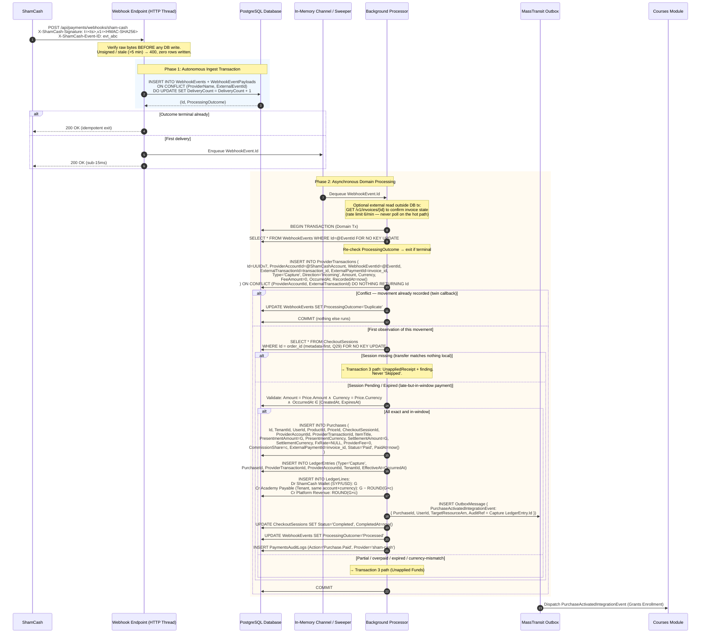
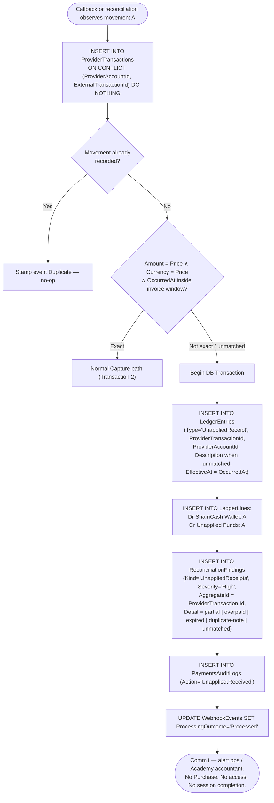
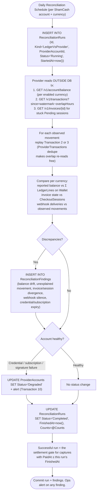
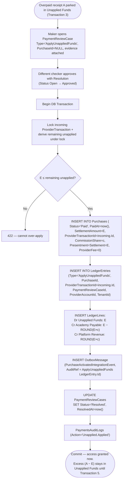
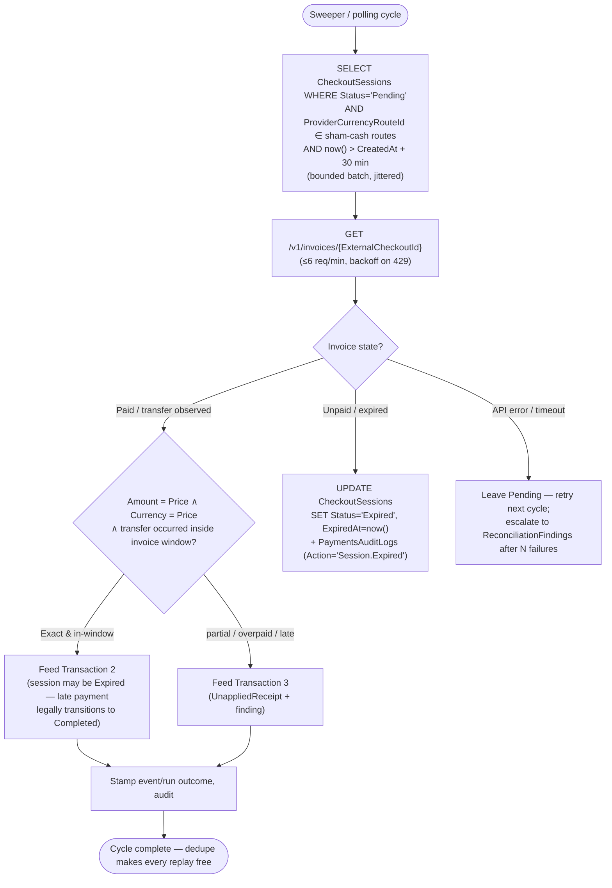
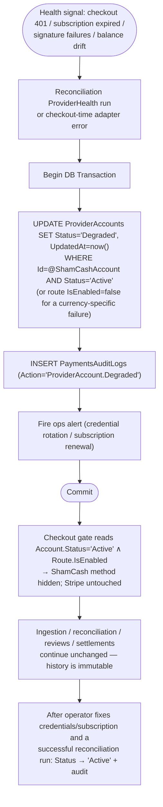

# Payments Module — ShamCash Transaction Flow Diagrams & Architectural Guide

This document provides end-to-end transaction flow diagrams, concurrency controls, double-entry ledger bookings, and idempotency guarantees for every **ShamCash-specific** transaction defined in §5 and §18 of [database.md](file:///home/azero/Desktop/AlphaZeroLearningAcademy/plans/payments/database.md). It is the provider-parallel of [stripe_payments_transaction_flows.md](file:///home/azero/Desktop/AlphaZeroLearningAcademy/plans/payments/stripe_payments_transaction_flows.md) — read that document first for the shared global mandates (lock order, two-phase ingestion, trigger architecture), which apply verbatim here.

Provider identity: `PaymentProviders.Name = 'sham-cash'` (Q42). One dedicated, Platform-owned, AlphaZero-exclusive linked account in MVP (Q43/Q56). Routes: SYP→SYP and USD→USD, `PresentmentMode = Exact` (Q45/Q48). EUR is a published capability and stays disabled until tested.

---

## 🏛️ What Changes vs. Stripe — Capability deltas

ShamCash is a **cash-transfer network with hosted invoices**, not a card PSP. Everything else in the architecture is identical; only these capabilities differ:

| Capability | Stripe | ShamCash (`sham-cash`) |
|:---|:---|:---|
| Checkout object | Hosted Checkout Session | **Hosted invoice** with a single-use payment note, 30-minute expiry |
| Customer identity | `PspCustomers`/customer objects | None — no customer mirror (Q58); the payer's account is irrelevant to the ledger |
| Fees | `PspFee` from `balance_transaction` | **Zero.** `FeeAmount` is always 0; the fee pair is omitted |
| Auto-activation | Any authorized checkout completes | **Only an exact transfer** (amount ∧ currency ∧ in-window) auto-activates (Q48) |
| Partial / overpaid / duplicate / late money | Refund machinery | **Unapplied Funds** + `PaymentReviewCase` (Q50) |
| Ordinary refunds | `POST /v1/refunds` + refund events | **None.** Student → support; reversal via maker/checker (Q51) |
| Disputes | `charge.dispute.*` family | **None.** No `Disputes` rows are ever created (Q51) |
| Payout to bank | `PspPayout` sweep + settlement from Bank | Liabilities may settle **directly from ShamCash Wallet** (Q53) |
| Settlement gate | Hold/reserve formula only | Hold/reserve (0 defaults) **+ one successful daily reconciliation** covering the capture (Q53) |
| Truth source | Webhook + balance_transaction | Signed callbacks **+ reconciliation reads** (webhook is notification, not sole truth — Q57) |

### Chart of accounts (ShamCash partition)

All accounts are provider-scoped (`LedgerAccounts.ProviderAccountId` set, per §3.8) — ShamCash/USD and Stripe/USD are different accounts even though the currency matches:

- **`ShamCash Wallet`** (Asset, Role `ProviderAsset`, per currency SYP/USD): cash held inside the linked ShamCash account.
- **`Academy Payable`** (Liability, per `TenantId + ProviderAccountId + Currency`): money owed to an Academy from ShamCash sales only.
- **`Platform Revenue`** (Income, per provider account + currency).
- **`Unapplied Funds`** (Liability, per provider account + currency): received-but-not-yet-owned money (Q50). **Never** enters Academy Payable and **never** settleable.
- **`Bank Account`** (Asset, provider-neutral): only touched from the ShamCash side when the operator manually withdraws Wallet cash (a `ProviderPayout`-shaped movement).

The deferred balance trigger (§3.9 check 8) rejects any line whose account belongs to a different `ProviderAccountId` than the entry — a capture cannot accidentally credit Stripe's payable.

### Idempotency stack (ShamCash layers, §18.7)

| # | Layer | Key | Mechanism |
|:---|:---|:---|:---|
| 1 | Invoice creation call | `CheckoutSessionId` | `Idempotency-Key` header + `order_id` |
| 2 | Delivery dedupe | `(ProviderName, ExternalEventId)` | Unique on `WebhookEvents` |
| 3 | **Cash movement dedupe** | `(ProviderAccountId, ExternalTransactionId)` | Unique on `ProviderTransactions` — the crediting authority when `/invoice` and `/transactions` callbacks both report the same transfer |
| 4 | One active attempt | `(UserId, ProductId) WHERE Status='Pending'` | Partial unique on `CheckoutSessions` |
| 5 | Domain result | `Purchase.CheckoutSessionId`, `Purchase.ProviderTransactionId` | Uniques on `Purchases` |
| 6 | Ledger effect | `(ProviderTransactionId, Type)` + business-ref partial uniques | Partial uniques on `LedgerEntries` |
| 7 | Atomicity | State + ProviderTransaction + Ledger + Outbox | One domain transaction after autonomous ingest |

---

## Transaction 1: Student: Create ShamCash Checkout (Hosted Invoice)

### Overview
- **Trigger:** Student initiates checkout and selects the ShamCash method (`POST /api/payments/checkout-sessions`, `ProviderCurrencyRouteId` chosen).
- **One Transaction Contains:** Eligibility check → active Price + route lookup → `CheckoutSessions` insert (or reuse/refresh) → **outbound invoice call outside the transaction** → `ExternalCheckoutId` stamp.
- **Invoice contract (Q48):** `hosted=true`, `order_id = CheckoutSessionId`, unpredictable never-reused `payment_note`, exact `Amount`/`Currency` = locked Price, `Idempotency-Key = CheckoutSessionId`, **30-minute expiry**. The hosted URL is returned to the caller but **never persisted**; only the invoice ID is stamped.
- **Method lock (Q46):** while this session is `Pending`, the student cannot open a Stripe attempt for the same Product.

### Flow Diagram

```mermaid
sequenceDiagram
    autonumber
    actor Student
    participant API as Payments API
    participant Enroll as Courses / Enrollment Service
    participant DB as PostgreSQL (Payments DbContext)
    participant SC as ShamCash Adapter (api.shamcash-api.com)

    Student->>API: POST /checkout-sessions { ProductId, ProviderCurrencyRouteId }
    API->>Enroll: Check Active Enrollment (Q33)
    alt Already Enrolled
        API-->>Student: 409 Conflict ("User already enrolled")
    else Eligible
        Enroll-->>API: Eligible
    end

    rect rgb(245, 245, 255)
        Note over API,DB: Pre-Transaction Validation
        API->>DB: Query Product (IsPurchasable), AcademyPaymentSettings (opted in)
        API->>DB: Query locked active Price (ProductId + Route.IntegrationCurrency)
        API->>DB: Query ProviderCurrencyRoute (IsEnabled ∧ Account.Status='Active')
        alt Route or account degraded / disabled
            API-->>Student: 409 Conflict ("Method unavailable — try another payment method")
            Note over API: Fail-closed for this method only (Q55).<br/>Stripe remains fully usable.
        end
    end

    rect rgb(240, 255, 240)
        Note over API,DB: Session Lookup / Creation
        API->>DB: SELECT * FROM CheckoutSessions<br/>WHERE UserId=@Uid AND ProductId=@Pid AND Status='Pending'
        alt Existing Pending Session Found
            alt Locked Price Archived OR Route Changed
                API->>DB: UPDATE CheckoutSessions SET Status='Expired', ExpiredAt=now()
                Note over API: Fall through to fresh session
            else Locked Price + Route still valid
                API->>SC: POST /v1/invoices (Idempotency-Key: ExistingSessionId)
                Note over SC: Provider replays the same invoice within its idempotency window
                SC-->>API: Existing invoice + hosted URL
                API-->>Student: 200 OK { PaymentUrl }
            end
        end
    end

    Note over API: Generate CheckoutSessionId = Guid.NewGuid()
    rect rgb(255, 245, 238)
        Note over API,DB: DB Insert Transaction
        API->>DB: INSERT INTO CheckoutSessions (<br/>  Id, TenantId, UserId, ProductId, PriceId,<br/>  ProviderCurrencyRouteId, Status='Pending', CreatedAt=now()<br/>)
        Note over DB: Partial unique (UserId, ProductId) WHERE Status='Pending'<br/>blocks racing double-clicks AND cross-provider races
        DB-->>API: Stored durably
    end

    API->>SC: POST /v1/invoices<br/>Idempotency-Key: CheckoutSessionId<br/>body: { hosted: true, amount: Price.Amount, currency: Price.Currency,<br/>order_id: CheckoutSessionId, payment_note: <random single-use>,<br/>expires_in_minutes: 30 }

    alt Definitive Rejection (invalid amount/currency, subscription expired, 4xx)
        SC-->>API: 4xx Terminal Rejection
        API->>DB: UPDATE CheckoutSessions SET Status='Expired', ExpiredAt=now()
        API-->>Student: 400 Bad Request (method rejected — pick another)
    else Timeout / 5xx
        Note over API: Stays Pending (Q28 ambiguity).<br/>Invoice may exist; recovery via Transaction 9 polling.
        API-->>Student: 504 Gateway Timeout (retryable)
    else Success
        SC-->>API: { data: { id: "inv_9f3...", hosted_url: "https://pay.shamcash..." } }
        API->>DB: UPDATE CheckoutSessions SET ExternalCheckoutId='inv_9f3...'
        Note over API: URL is handed to the student, never stored
        API-->>Student: 201 Created { PaymentUrl, ExpiresAt = +30 min }
    end
```

---

## Transaction 2: Callback: Exact Receipt → Purchase + Capture

### Overview
- **Trigger:** ShamCash delivers an invoice or transaction callback (or reconciliation reads the same data) reporting an incoming transfer.
- **One Transaction Contains:** Upsert `ProviderTransaction` (movement dedupe) → lock session `FOR NO KEY UPDATE` → **exact/in-window validation** → `Purchases` insert (`Paid`) → `Capture` ledger booking → `PurchaseActivatedIntegrationEvent` outbox → session `Completed` → audit row.
- **Exactness rule (Q48/Q54):** the receipt auto-activates **only** when `Amount = Price.Amount`, `Currency = Price.Currency`, **and** `OccurredAt ∈ [invoice.CreatedAt, invoice.ExpiresAt)`. Anything else is Transaction 3.
- **Crediting authority (Q49):** `/invoice` and `/transactions` callbacks may both report the same transfer under different event IDs. Only the `(ProviderAccountId, ExternalTransactionId)` unique on `ProviderTransactions` decides "seen or not"; the losing event stamps `Duplicate`.
- **Accounting split (G = gross, c = CommissionShare; F is always 0):**
  - $\text{PlatformRevenue} = \text{ROUND}(G \times c, \text{minor-unit})$, $\text{AcademyPayable} = G - \text{PlatformRevenue}$
  - **Dr** `ShamCash Wallet`: $G$ / **Cr** `Academy Payable`: $\text{AcademyPayable}$ / **Cr** `Platform Revenue`: $\text{PlatformRevenue}$
  - No fee pair — ShamCash reports no processing fee.

### Flow Diagram



> [!IMPORTANT]
> **Same-transaction replays:** a history read (Transaction 4) or a redelivered callback later replays this exact receipt. The `ProviderTransactions` unique makes it a no-op **before** any session/Purchase logic runs — the replayed event stamps `Duplicate` and returns 200. There is no second Purchase and no second Capture, ever.

---

## Transaction 3: Receipt That Is Not Exact → Unapplied Funds

### Overview
- **Trigger:** a real incoming transfer that fails the exact/in-window test: partial amount, overpaid amount, duplicate note usage, transfer after invoice expiry, currency mismatch, or an **unmatched** transfer against the dedicated account (including unrelated external money — the account is AlphaZero-exclusive, so this pages ops, Q56).
- **One Transaction Contains:** Upsert `ProviderTransaction` → `UnappliedReceipt` ledger entry (Dr Wallet / Cr Unapplied Funds) → reconciliation finding / review-lead alert → audit row.
- **Critical policy:** **no Purchase, no session completion, no access grant** (Q50). The cash is real and owned by nobody yet — it is parked in a provider-scoped liability until a human decides.
- **Ledger entry:**
  - **Dr** `ShamCash Wallet`: $A$ / **Cr** `Unapplied Funds`: $A$
  - References: `ProviderTransactionId` + `ProviderAccountId` NOT NULL; `Description` required when nothing local matches.

### Flow Diagram



> [!NOTE]
> **Why not "reject" the money?** The transfer already happened on the ShamCash network — it cannot be declined. Booking it to Unapplied Funds is the only honest state: the cash exists, the sale does not (yet). Ignoring it would make Wallet and provider-reported balances diverge silently.

---

## Transaction 4: Reconciliation Worker (ShamCash Scope)

### Overview
- **Trigger:** daily scheduled run per ProviderAccount + currency (plus on-demand).
- **One Transaction Contains:** Append `ReconciliationRuns` row → provider reads (outside DB tx) → compare → `ReconciliationFindings`.
- **ShamCash-specific checks (Q57):**
  1. **Ledger vs provider**: reported balance per enabled currency vs `Σ LedgerLines` on the Wallet account; invoice states vs local sessions; transaction history read with a **watermark + overlap window** (re-read the last N hours every run — overlap is safe because `ProviderTransactions` dedupes).
  2. **Settlement gate (Q53)**: a capture is settleable only after one *successful* daily `LedgerVsProvider` run has covered it. A webhook alone never satisfies this.
  3. **Health**: credentials valid, subscription/session active (the $2/month account), webhook lag, rate-limit behavior.
- **Kinds:** `LedgerInternal` (shared), `LedgerVsProvider`, `ProviderHealth`, `StaleSessions`, `UnappliedReceipts`, `NegativePayables`.

### Flow Diagram



---

## Transaction 5: Resolve Unapplied Receipt — Return to Student

### Overview
- **Trigger:** Academy accountant (or support) determines the parked cash must go back to the sender (partial payment unwanted, expired-note transfer, unmatched external money).
- **Two transactions, two actors (Q52):** maker opens an evidence-backed `PaymentReviewCase (Type='UnappliedReturn')`; a **different** Platform-finance checker approves; resolution performs the outbound transfer + books the ledger.
- **No email = no money:** approval alone moves nothing. Resolution requires an **outgoing `ProviderTransaction`** (Type `Transfer`/`Refund`, Direction `Outgoing`) recorded from the ShamCash transfer confirmation — the immutable movement is the evidence (Q52).
- **Ledger entry (return amount R ≤ remaining unapplied):**
  - **Dr** `Unapplied Funds`: $R$ / **Cr** `ShamCash Wallet`: $R$

### Flow Diagram

```mermaid
sequenceDiagram
    autonumber
    actor Maker as Academy Accountant / Support
    actor Checker as Platform Finance (different person)
    participant API as Payments API
    participant DB as PostgreSQL Database
    participant SC as ShamCash (manual transfer via provider app/dashboard)

    rect rgb(245, 245, 255)
        Note over Maker,DB: Phase A: Maker Opens the Case (no money moves)
        Maker->>API: POST /payment-reviews { ProviderTransactionId, Type='UnappliedReturn',<br/>EvidenceReference, ProviderSupportReference }
        API->>DB: INSERT INTO PaymentReviewCases (<br/>  Id, TenantId, ProviderAccountId, ProviderTransactionId,<br/>  Type='UnappliedReturn', Status='Open', OpenedByUserId, EvidenceReference, CreatedAt=now() )
        Note over DB: Unique (ProviderTransactionId) WHERE Status='Open'<br/>— one open case per movement
        API->>DB: INSERT PaymentsAuditLogs (Action='PaymentReview.Opened')
        API-->>Maker: 201 Created { CaseId }
    end

    rect rgb(255, 248, 240)
        Note over Checker,DB: Phase B: Checker Approves (still no money moves)
        Checker->>API: POST /payment-reviews/{id}/approve { Resolution }
        API->>DB: Verify current actor ≠ OpenedByUserId (maker/checker, Q52)
        API->>DB: UPDATE PaymentReviewCases SET Status='Approved',<br/>ApprovedByUserId=@Checker, Resolution=@Resolution<br/>WHERE Id=@CaseId AND Status='Open'
        Note over DB: Transition-only trigger: only Open → Approved | Rejected
        API->>DB: INSERT PaymentsAuditLogs (Action='PaymentReview.Approved')
        API-->>Checker: 200 OK ("Return the amount via ShamCash now")
    end

    Note over SC: Maker performs the actual outbound transfer<br/>(R = remaining unapplied amount, to the sender's account)

    rect rgb(240, 255, 240)
        Note over API,DB: Phase C: Resolution — money confirmation
        Maker->>API: POST /payment-reviews/{id}/resolve { ExternalTransactionId, Amount=R }
        API->>DB: BEGIN TRANSACTION
        API->>DB: Lock PaymentReviewCases row; verify Status='Approved'
        API->>DB: Lock the originating incoming ProviderTransaction (identity anchor)
        API->>DB: Derive remaining unapplied = Σ Cr(UT lines) − Σ Dr(UT lines) on Unapplied Funds<br/>under lock (never a cached number)
        alt R > remaining unapplied
            API-->>Maker: 422 ("Return exceeds remaining unapplied")
        end
        API->>DB: INSERT INTO ProviderTransactions (<br/>  Direction='Outgoing', Type='Transfer', ExternalTransactionId=<outgoing tx id>,<br/>  Amount=R, Currency, OccurredAt=transfer time )
        Note over DB: Unique (ProviderAccountId, ExternalTransactionId)<br/>— a re-submitted transfer confirmation is a no-op
        API->>DB: INSERT INTO LedgerEntries (Type='ReturnUnappliedFunds',<br/>  ProviderTransactionId=outgoing.Id, PaymentReviewCaseId, ProviderAccountId)
        API->>DB: INSERT LedgerLines: Dr Unapplied Funds R / Cr ShamCash Wallet R
        API->>DB: UPDATE PaymentReviewCases SET Status='Resolved', ResolvedAt=now()
        API->>DB: INSERT PaymentsAuditLogs (Action='Unapplied.Returned')
        API->>DB: COMMIT
        API-->>Maker: 200 OK
    end
```

---

## Transaction 6: Resolve Unapplied Receipt — Apply Overpayment

### Overview
- **Trigger:** the transfer was **overpaid** (or partial-then-topped-up) and the sender confirms they intended the purchase; the checker approves applying **exactly the expected amount**.
- **Ledger split:** the applied amount $E$ (= locked Price) books a normal Capture-shaped allocation **out of Unapplied Funds**; the excess stays parked until returned (Transaction 5) or a future decision.
  - **Dr** `Unapplied Funds`: $E$
  - **Cr** `Academy Payable`: $E - \text{ROUND}(E \times c)$
  - **Cr** `Platform Revenue`: $\text{ROUND}(E \times c)$
- **Result:** the `Purchase` is created **at resolution time** (not receipt time) — `ProviderTransactionId` still points at the single incoming movement, and the `ApplyUnappliedFunds` entry carries the review case. Access activation fires only now.
- **Window note:** an overpayment *inside* the invoice window that the checker approves applies the expected amount; the same overpayment after expiry is still applyable by review — expiry only blocks *automatic* activation (Q48), it does not destroy the money.

### Flow Diagram



---

## Transaction 7: Support-Confirmed Purchase Reversal (the "Refund")

### Overview
- **Trigger:** a paid student requests their money back. **Ordinary endpoints fail closed**: `RefundRequests` creation is rejected for ShamCash Purchases (Q51) and the student is directed to support.
- **Path:** support communicates with ShamCash (email/ticket → `ProviderSupportReference`), the return transfer is executed manually, and the flow below records it. This is an exceptional, full-reversal workflow — ShamCash reversals are not partial-refund ladders.
- **Reuse, not invention (§18.5):** the reversal is stored as a privileged `Refunds` row with `Source='ProviderSupport'` solely to reuse the proven RefundReversal/status/revocation pipeline. It requires `PaymentReviewCaseId` (Type `ProviderReversal`) and the outgoing `ProviderTransaction` — the email is never the money evidence.
- **Ledger entry (full amount $G$; no fee ever returns):**
  - **Dr** `Academy Payable`: $G - \text{ROUND}(G \times c)$
  - **Dr** `Platform Revenue`: $\text{ROUND}(G \times c)$
  - **Cr** `ShamCash Wallet`: $G$
- **Effect:** Purchase ladder completes to `Refunded` and the revocation outbox fires.

### Flow Diagram

```mermaid
sequenceDiagram
    autonumber
    actor Student
    actor Maker as Academy Accountant / Support
    actor Checker as Platform Finance (different person)
    participant API as Payments API
    participant DB as PostgreSQL Database
    participant Outbox as MassTransit Outbox
    participant Courses as Courses Module

    Student->>API: POST /refund-requests { PurchaseId }
    API->>DB: Provider capability gate (Q51)
    API-->>Student: 409 Conflict ("ShamCash purchases are refunded via support — contact support@…")

    rect rgb(245, 245, 255)
        Note over Maker,DB: Maker opens the reversal case
        Maker->>API: POST /payment-reviews { PurchaseId, Type='ProviderReversal',<br/>ProviderSupportReference='ticket-4471', EvidenceReference }
        API->>DB: INSERT PaymentReviewCases (Status='Open', OpenedByUserId)
        API->>DB: INSERT PaymentsAuditLogs (Action='PaymentReview.Opened')
    end

    rect rgb(255, 248, 240)
        Note over Checker,DB: Checker approves — still zero money movement
        Checker->>API: POST /payment-reviews/{id}/approve
        API->>DB: Verify actor ≠ maker; UPDATE Status='Approved'
        Note over DB: Approval alone never moves money (Q52)
    end

    Note over Maker: Support executes the return transfer<br/>in the ShamCash app; captures tx reference

    rect rgb(240, 255, 240)
        Note over API,DB: Resolution — the money fact
        Maker->>API: POST /payment-reviews/{id}/resolve { OutgoingTransactionId }
        API->>DB: BEGIN TRANSACTION
        API->>DB: Lock case (Approved) + Purchases row FOR NO KEY UPDATE
        API->>DB: INSERT INTO ProviderTransactions (<br/>  Direction='Outgoing', Type='Refund', ExternalTransactionId=<tx>,<br/>  ExternalPaymentId=Purchase.ExternalPaymentId, Amount=G, FeeAmount=0 )
        Note over DB: Unique (ProviderAccountId, ExternalTransactionId) — replay-safe
        API->>DB: INSERT INTO Refunds (<br/>  Id, PurchaseId, ProviderAccountId, ProviderTransactionId,<br/>  PaymentReviewCaseId, Source='ProviderSupport', Status='Succeeded',<br/>  Amount=G, Currency, RevokeAccess=TRUE, ExternalRefundId=<tx or evidence ref>,<br/>  RequestedByUserId=NULL, CompletedAt=now() )
        API->>DB: INSERT INTO LedgerEntries (Type='RefundReversal', RefundId, PurchaseId,<br/>  ProviderTransactionId, ProviderAccountId, TenantId)
        API->>DB: INSERT LedgerLines:<br/>  Dr Academy Payable: G − ROUND(G×c)<br/>  Dr Platform Revenue: ROUND(G×c)<br/>  Cr ShamCash Wallet: G
        API->>DB: UPDATE Purchases SET Status='Refunded', RefundedAt=now()<br/>WHERE Id=@PurchaseId AND Status IN ('Paid','PartiallyRefunded')
        API->>Outbox: INSERT OutboxMessage (<br/>  PurchaseRefundedIntegrationEvent:<br/>  { PurchaseId, UserId, RefundId, DisputeId=NULL, AuditRef = RefundReversal.Id })
        API->>DB: UPDATE PaymentReviewCases SET Status='Resolved', ResolvedAt=now()
        API->>DB: INSERT PaymentsAuditLogs (Action='Refund.Issued', Source='ProviderSupport')
        API->>DB: COMMIT
    end

    Outbox->>Courses: Revoke Enrollment Access
```

---

## Transaction 8: Settlement — Academy Payout from ShamCash Wallet

### Overview
- **Trigger:** Platform finance pays an Academy its settleable balance, transferred **directly from the ShamCash Wallet** (Bank is not involved in MVP — Q53).
- **One Transaction Contains:** Settlement-type `PaymentReviewCase` (maker/checker) → lock payable `FOR NO KEY UPDATE` → Settleable Balance computation → `Settlements` insert + `Settlement` entry → audit.
- **ShamCash risk policy (Q53):** `ShortHoldDays = 0`, `ReserveRate = 0`, `DisputeHoldDays = 0` — no dispute/refund exposure exists. The **only** gate is the daily reconciliation: every capture being settled must be covered by one successful `LedgerVsProvider` run with `FinishedAt ≥ Purchase.PaidAt`.
- **Settleable Balance (ShamCash form):**
  $$\text{Settleable} = \text{Payable Ledger Balance} - \Sigma(\text{captures not yet covered by a successful daily reconciliation})$$
  Unapplied Funds are structurally excluded (separate liability accounts — they never touch Academy Payable).
- **Ledger entry:** **Dr** `Academy Payable`: $\text{Amount}$ / **Cr** `ShamCash Wallet`: $\text{Amount}$

### Flow Diagram

```mermaid
sequenceDiagram
    autonumber
    actor Maker as Platform Finance (maker)
    actor Checker as Platform Finance (checker)
    participant API as Payments API
    participant DB as PostgreSQL Database
    participant SC as ShamCash Wallet (manual transfer)

    rect rgb(245, 245, 255)
        Note over Maker,DB: Phase A: Maker requests settlement
        Maker->>API: POST /payment-reviews { TenantId, PayableAccountId,<br/>Type='Settlement', Amount, DestinationSnapshot, EvidenceReference }
        API->>DB: INSERT PaymentReviewCases (Status='Open')
        Note over DB: Unique (PayableAccountId) WHERE Type='Settlement'<br/>AND Status IN ('Open','Approved') — one in-flight per payable
        API-->>Maker: 201 Created
    end

    Note over SC: Checker verifies the capture set is reconciliation-covered,<br/>then performs the outbound Wallet→Academy transfer.<br/>Destination = reviewed snapshot (owner name/account), never free-text at record time.

    rect rgb(255, 248, 240)
        Note over Checker,DB: Phase B: Checker resolves after confirmed transfer
        Checker->>API: POST /payment-reviews/{id}/resolve { ExternalReference, OutgoingTransactionId }
        API->>DB: BEGIN TRANSACTION
        API->>DB: Lock case → Status='Approved' required; actor ≠ maker
        API->>DB: SELECT * FROM LedgerAccounts WHERE Id=@PayableAccountId FOR NO KEY UPDATE
        Note over DB: Serializes settlements vs reversals;<br/>concurrent captures pass (FOR NO KEY UPDATE)
        API->>DB: Compute Settleable Balance for THIS account:<br/>ledger balance − captures lacking a covering successful daily run
        alt Amount > Settleable
            API-->>Checker: 422 ("exceeds settleable balance")
        end
        API->>DB: INSERT INTO ProviderTransactions (<br/>  Direction='Outgoing', Type='Transfer', ExternalTransactionId, Amount )
        API->>DB: INSERT INTO Settlements (<br/>  Id, TenantId, ProviderAccountId, PaymentReviewCaseId, PayableAccountId,<br/>  SourceAccountId=WalletAccountId, ProviderTransactionId, Amount, Currency,<br/>  RecordedByUserId=@maker, ApprovedByUserId=@checker,<br/>  ExternalReference, DestinationSnapshot, EvidenceReference, RecordedAt=now() )
        Note over DB: Unique PaymentReviewCaseId + unique (SourceAccountId, ExternalReference)<br/>CHECK (RecordedByUserId ≠ ApprovedByUserId)
        API->>DB: INSERT LedgerEntries (Type='Settlement', SettlementId, ProviderAccountId, TenantId)
        API->>DB: INSERT LedgerLines: Dr Academy Payable Amount / Cr ShamCash Wallet Amount
        API->>DB: UPDATE PaymentReviewCases SET Status='Resolved', ResolvedAt=now()
        API->>DB: INSERT PaymentsAuditLogs (Action='Settlement.Recorded')
        API->>DB: COMMIT
        API-->>Checker: 201 Created { SettlementId, Remaining Settleable }
    end
```

> [!NOTE]
> If the operator instead moves Wallet cash to the bank first, that leg is recorded exactly like Stripe's Transaction 11 (`ProviderPayout`): **Dr** `Bank Account` / **Cr** `ShamCash Wallet`, `TenantId = NULL`, keyed by the outgoing `ProviderTransaction`. Settlements then credit `Bank Account` as `SourceAccountId`.

---

## Transaction 9: Recovery — Invoice Status Polling (Stuck Sessions)

### Overview
- **Trigger:** webhooks are notification, not sole truth (Q57). A session stuck `Pending` past its 30-minute invoice window, or a webhook-lag alert, is polled: `GET /v1/invoices/{id}`.
- **Rate limit discipline:** ShamCash allows ~6 requests/minute — polling is bounded, jittered, and never on the HTTP ingest path.
- **Semantics:** `payment_result ∈ {partial, exact, overpaid, received}`; the invoice closes on the **first matching transfer even when partial**. The observed transfer is then processed through Transaction 2 (exact) or Transaction 3 (everything else) — the polling path creates **no new booking logic**, it only feeds the same deduped pipeline.
- **Outcome:** a transfer occurring inside `[CreatedAt, ExpiresAt)` may still complete the session even if observed late; a transfer occurring after expiry is Unapplied Funds (Q48). A genuinely unpaid invoice → session `Expired`.

### Flow Diagram



---

## Transaction 10: Provider Health Failure (Fail-Closed Gate)

### Overview
- **Trigger:** invalid/rotated credentials, expired ShamCash subscription/session, signature-verification failure spike, or balance drift → detected at checkout time or by reconciliation.
- **One Transaction Contains:** `ProviderAccounts.Status` / route `IsEnabled` transition + alert. **No data is deleted, no ingestion stops** (Q55/Q61).
- **Effect matrix:**
  - New ShamCash sessions → rejected with "method unavailable" (Stripe unaffected).
  - Existing `Pending` sessions → recoverable only via Transaction 9 polling (webhooks may also be dead).
  - Callback ingestion, reconciliation, review cases, settlements, history → **all continue**.

### Flow Diagram



---

## Shared Transactions (identical to the Stripe document)

These transactions are provider-neutral and run exactly as specified in [stripe_payments_transaction_flows.md](file:///home/azero/Desktop/AlphaZeroLearningAcademy/plans/payments/stripe_payments_transaction_flows.md) — no ShamCash variant exists:

| # | Transaction | ShamCash notes |
|:---|:---|:---|
| 12 | Courses mirror upsert | Identical (`Products` is provider-agnostic) |
| 13 | Price create/archive | Identical; the Price's currency decides which routes can serve it (Q45) |
| 14 | Settings change | Identical upsert; **no** per-tenant payable is created here — payables are ensured per `(Tenant, ProviderAccount, Currency)` at first eligible route use (§3.8) |
| 15 | `ProductDailySales` rebuild | Same worker; grain adds `ProviderAccountId` + `SettlementCurrency` (Q54); ShamCash revenue aggregates only in SYP/USD partitions |
| 16 | Sweeper re-drive | Same worker; also drives Transaction 9 polling for ShamCash |
| 17 | Reconciliation (internal kinds) | `LedgerInternal`, `MirrorVsCourses`, `StaleSessions`, `NegativePayables` identical; ShamCash-specific kinds in Transaction 4 |
| — | Ordinary refunds / disputes / `RefundRequests` | **Never run for ShamCash** — capability gate rejects (Q51); replaced by Transactions 5–7 |

---

## ⚖️ Ledger Entries Summary — ShamCash T-Account Reference

| Transaction & Entry Type | Debits (Dr) | Credits (Cr) | Reference Constraints |
|:---|:---|:---|:---|
| **Capture** (Tx 2, exact receipt) | **ShamCash Wallet** ($G$) | **Academy Payable** ($G - \text{ROUND}(G \times c)$)<br/>**Platform Revenue** ($\text{ROUND}(G \times c)$) | `PurchaseId` + `ProviderTransactionId` + `ProviderAccountId` NOT NULL. Fee pair never exists (no fees). Partial uniques: `(PurchaseId) WHERE Type IN ('Capture','ApplyUnappliedFunds')`, `(ProviderTransactionId, Type)`. |
| **UnappliedReceipt** (Tx 3) | **ShamCash Wallet** ($A$) | **Unapplied Funds** ($A$) | `ProviderTransactionId` + `ProviderAccountId` NOT NULL; `Description` required when unmatched. No Purchase/access exists. |
| **ApplyUnappliedFunds** (Tx 6) | **Unapplied Funds** ($E$) | **Academy Payable** ($E - \text{ROUND}(E \times c)$)<br/>**Platform Revenue** ($\text{ROUND}(E \times c)$) | Requires approved `PaymentReviewCase`; `PurchaseId` + incoming `ProviderTransactionId`; E ≤ remaining unapplied under lock. Creates the Purchase + activation outbox. |
| **ReturnUnappliedFunds** (Tx 5) | **Unapplied Funds** ($R$) | **ShamCash Wallet** ($R$) | Requires approved case + outgoing `ProviderTransaction` (movement = evidence); R ≤ remaining unapplied under lock. |
| **RefundReversal** (Tx 7, support reversal) | **Academy Payable** ($G - \text{ROUND}(G \times c)$)<br/>**Platform Revenue** ($\text{ROUND}(G \times c)$) | **ShamCash Wallet** ($G$) | Privileged `Refunds(Source='ProviderSupport')` + `PaymentReviewCase(Type='ProviderReversal')` + outgoing `ProviderTransaction`. Full reversal only; always revokes. No fee line. |
| **Settlement** (Tx 8) | **Academy Payable** ($\text{Amount}$) | **ShamCash Wallet** ($\text{Amount}$) | `SettlementId` NOT NULL; requires resolved `PaymentReviewCase(Type='Settlement')`; maker ≠ checker; unique `(SourceAccountId, ExternalReference)`; blocked until daily reconciliation covers the captures. |
| **ProviderPayout** (Wallet → Bank, optional) | **Bank Account** ($\text{Amount}$) | **ShamCash Wallet** ($\text{Amount}$) | `TenantId = NULL`; outgoing `ProviderTransaction` unique; semantic-entry partial unique. |

**Never possible for `sham-cash`:** `DisputeLoss` / `DisputeWon` entries (no disputes, Q51), fee-bearing lines (no fees), ordinary `RefundRequests` (endpoint rejects), cross-provider lines (balance-trigger check 8 rejects them even when currencies match), and Unapplied Funds entering any settleable balance.

---

## ✅ Acceptance checklist (per §18.8, flow-verified)

- [ ] Exact invoice creates exactly one `ProviderTransaction`, one `Purchase`, one `Capture`, one access grant under callback + history + polling replay.
- [ ] `/invoice` and `/transactions` callbacks reporting the same `transaction_id` credit it once (`Duplicate` on the loser).
- [ ] Partial / overpaid / duplicate-note / after-expiry / currency-mismatch / unmatched receipt → `UnappliedReceipt`, zero Purchases, Wallet ↔ Unapplied Funds balanced.
- [ ] Unsigned, stale-timestamp, or replayed-without-signature deliveries receive 400 and write zero rows.
- [ ] Apply/return never exceeds the movement's remaining unapplied balance (lock + SUM under lock).
- [ ] Maker = checker rejected in DB for review cases and settlements.
- [ ] Settlement refused until a successful daily `LedgerVsProvider` run covers every settled capture.
- [ ] Degraded account blocks new ShamCash sessions only; Stripe sessions, ingestion, reconciliation, and history unaffected.
- [ ] A Stripe capture and a ShamCash capture using identical external ID text never collide (provider-scoped uniques).
- [ ] Analytics SYP and USD partitions never sum together.
