# Payments Module — Complete Transaction Flow Diagrams & Architectural Guide

This document provides end-to-end transaction flow diagrams, concurrency controls, double-entry ledger bookings, and idempotency guarantees for each transaction defined in §5 of [database.md](file:///home/azero/Desktop/AlphaZeroLearningAcademy/plans/payments/database.md).

---

## 🏛️ System Architecture & Global Concurrency Mandates

Before analyzing individual transactions, the system enforces three universal architectural patterns across all database operations:

### 1. Global Lock Order Hierarchy
To prevent deadlocks between capture webhooks, refunds, disputes, and settlements, all transactions acquire locks in strict descending hierarchy using `SELECT ... FOR NO KEY UPDATE`:

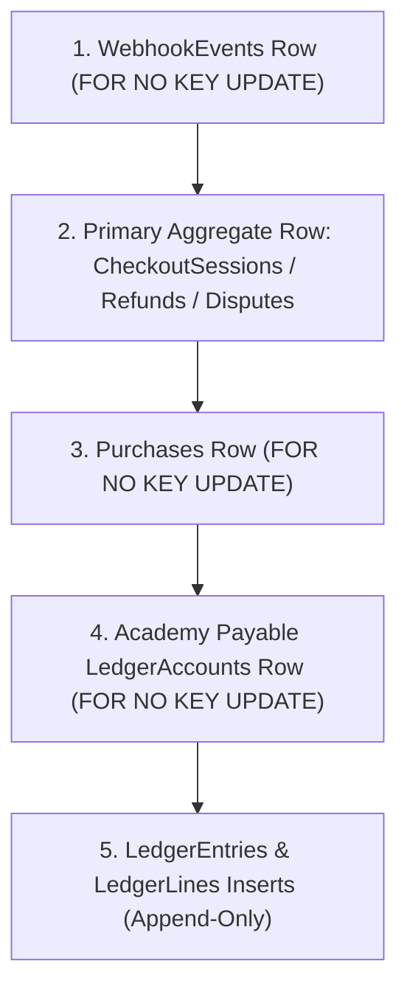

> [!IMPORTANT]
> `FOR NO KEY UPDATE` is required instead of `FOR UPDATE`. When `LedgerLines` are inserted with a foreign key referencing `LedgerAccounts(Id)`, PostgreSQL takes a `FOR KEY SHARE` lock on the account row. A plain `FOR UPDATE` lock conflicts with `FOR KEY SHARE`, causing concurrent capture insertions to deadlock or stall behind settlements. `FOR NO KEY UPDATE` serializes balance mutations while allowing concurrent capture FK checks to pass freely.

### 2. Two-Phase Webhook Ingestion
All webhook processing is decoupled into an ultra-fast HTTP ingestion phase and an asynchronous background processing phase:

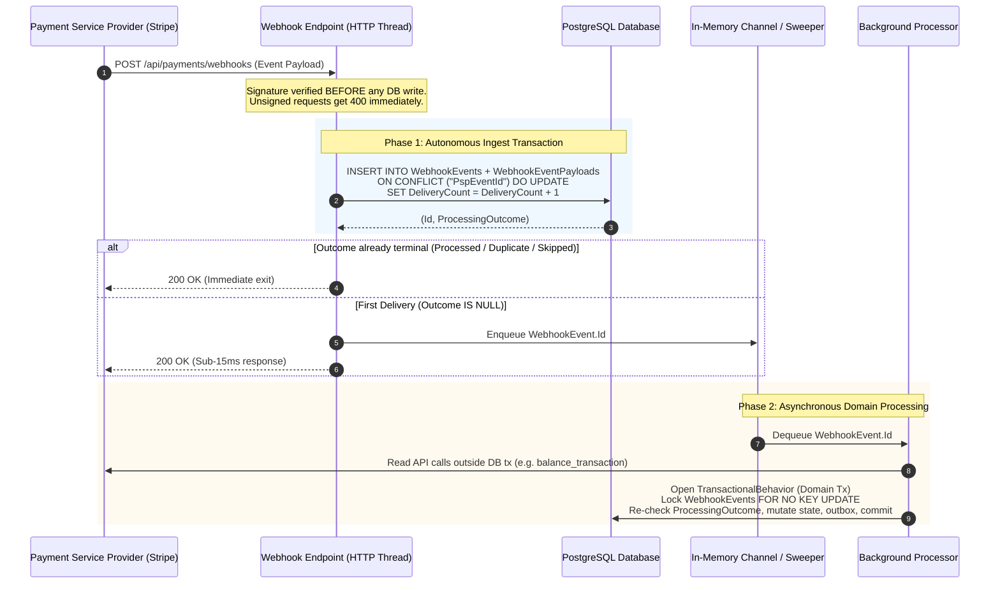

### 3. Chart of Accounts (Structural vs. Per-Academy)
- **`PSP Clearing`** (Asset): Cash collected and held by the PSP pending settlement.
- **`Platform Revenue`** (Income): AlphaZero platform commission (`CommissionShare`).
- **`PSP Fees`** (Expense): Direct processing and dispute fees deducted by the PSP.
- **`Bank Account`** (Asset): Platform physical bank account for payouts/settlements.
- **`PSP Suspense`** (Liability): Temporary holding account for unmatched captures.
- **`Academy Payable`** (Liability): One account per Academy (`TenantId`), tracking money owed to the Academy.

---

## Transaction 1: Student: Create Checkout Session

### Overview
- **Trigger:** Student initiates checkout (`POST /api/payments/checkout-sessions`).
- **One Transaction Contains:** Business eligibility check $\rightarrow$ `CheckoutSessions` insert (or reuse/refresh).
- **Idempotency & Concurrency:** Partial unique `(UserId, ProductId) WHERE Status = 'Pending'`. Deterministic `CheckoutSessionId` sent as PSP idempotency key.

### Flow Diagram

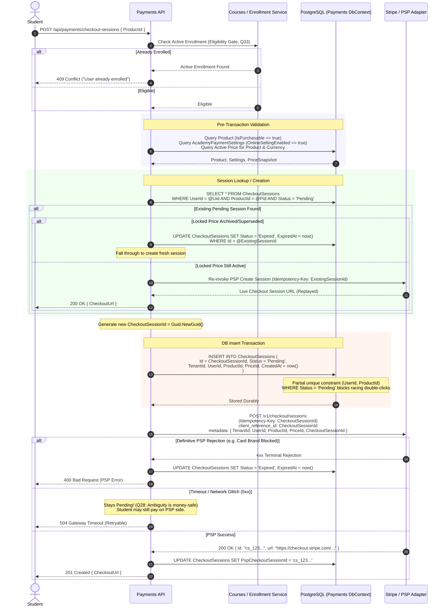

---

## Transaction 2: Webhook: `checkout.session.completed`

### Overview
- **Trigger:** PSP webhook notifying successful student payment.
- **One Transaction Contains:** Lock session `FOR NO KEY UPDATE` $\rightarrow$ Metadata-first resolution $\rightarrow$ Missing session $\Rightarrow$ `UnmatchedCapture` to `PSP Suspense` $\rightarrow$ `PspCustomers` ensure $\rightarrow$ `Purchases` insert (`Paid`) $\rightarrow$ Double-entry `Capture` booking $\rightarrow$ Outbox `PurchaseActivatedIntegrationEvent` $\rightarrow$ Session `Completed` $\rightarrow$ Audit row.
- **Accounting Split ($G$ = Gross, $c$ = Commission share, $F$ = Fee):**
  - $\text{PlatformRevenue} = \text{ROUND}(G \times c, \text{minor-unit})$
  - $\text{AcademyPayable} = G - \text{PlatformRevenue}$ (derived leg)
  - **Dr** `PSP Clearing`: $G$
  - **Cr** `Academy Payable` (Tenant): $\text{AcademyPayable}$
  - **Cr** `Platform Revenue`: $\text{PlatformRevenue}$
  - *(When fee $F > 0$)*: **Dr** `PSP Fees`: $F$ / **Cr** `PSP Clearing`: $F$

### Flow Diagram

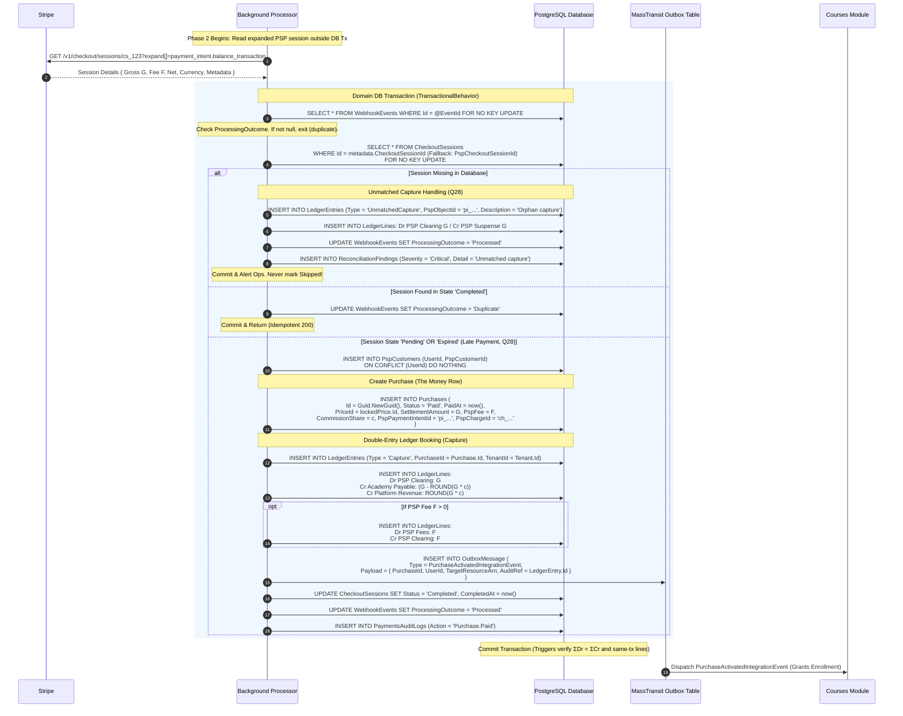

---

## Transaction 3: Webhook: `checkout.session.expired`

### Overview
- **Trigger:** PSP sends `checkout.session.expired` after checkout window closes (e.g. 24 hours).
- **One Transaction Contains:** Ingest row $\rightarrow$ Mark session `Expired` $\rightarrow$ Audit row.
- **Guarantees:** Late payment safety (Q28): an expired session can legally transition to `Completed` if a racing capture occurs.

### Flow Diagram

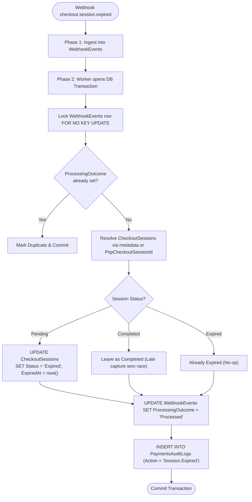

---

## Transaction 4: Platform Admin: Issue Refund

### Overview
- **Trigger:** Platform admin initiates a partial or full refund (`POST /api/payments/refunds`).
- **One Transaction Contains:** Lock `Purchases` row `FOR NO KEY UPDATE` $\rightarrow$ Open-dispute guard $\rightarrow$ Remaining Refundable calculation $\rightarrow$ Insert `Refunds` (`Pending`) $\rightarrow$ Audit row $\rightarrow$ Outbound PSP call outside transaction.
- **Remaining Refundable Formula (Q41):**
  $$\text{Remaining} = \text{Purchase.SettlementAmount} - \sum(\text{Pending} + \text{Succeeded Refunds}) - \sum(\text{Disputes Withdrawn [Open] or Lost})$$

### Flow Diagram

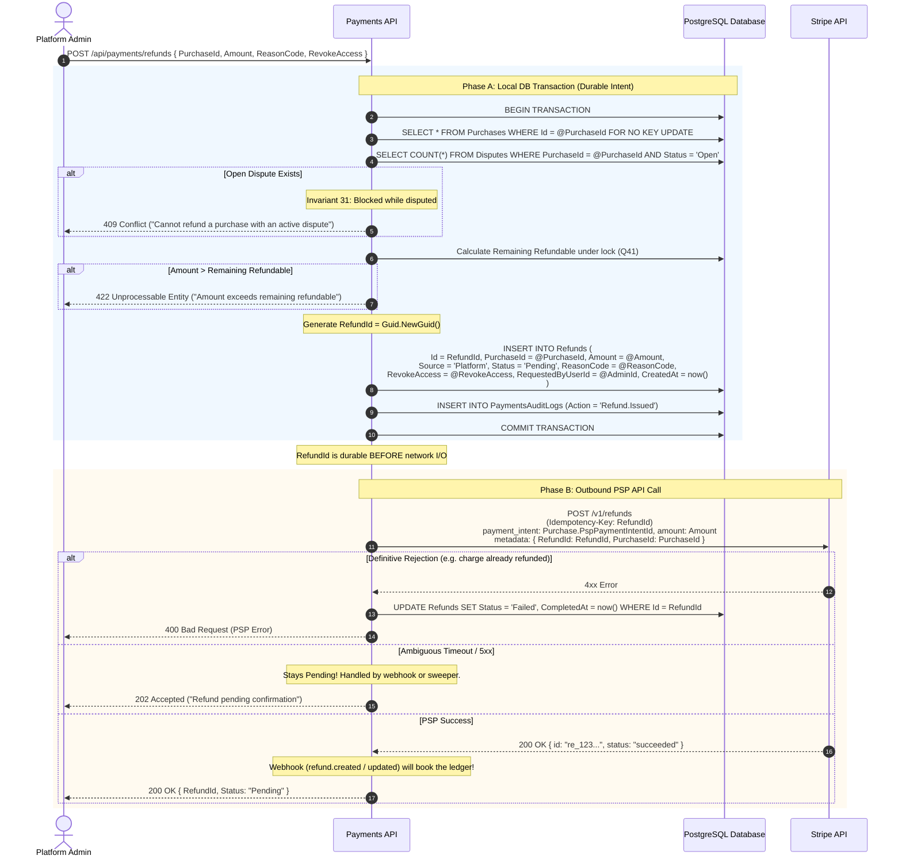

---

## Transaction 5: Webhook: Refund Family (`refund.created` / `updated` / `failed`)

### Overview
- **Trigger:** Webhook from PSP regarding refund lifecycle.
- **One Transaction Contains:** Ingest $\rightarrow$ Resolve Purchase $\rightarrow$ Unknown refund $\Rightarrow$ Insert `Refunds` (`Source = 'Psp'`) $\rightarrow$ Transition `Pending → Succeeded` $\rightarrow$ Recompute Purchase status ladder $\rightarrow$ Pro-rata `RefundReversal` ledger booking $\rightarrow$ Outbox revocation (if full refund or `RevokeAccess = true`) $\rightarrow$ Audit row.
- **Reversal Ledger Entries:**
  - $\text{CommissionLeg} = \text{ROUND}(\text{refund.Amount} \times \text{Purchase.CommissionShare}, \text{minor-unit})$
  - $\text{AcademyLeg} = \text{refund.Amount} - \text{CommissionLeg}$
  - **Dr** `Academy Payable` (Tenant): $\text{AcademyLeg}$
  - **Dr** `Platform Revenue`: $\text{CommissionLeg}$
  - **Cr** `PSP Clearing`: $\text{refund.Amount} - \text{PspFeeRefunded}$
  - *(When fee refunded $> 0$)*: **Cr** `PSP Fees`: $\text{PspFeeRefunded}$

### Flow Diagram

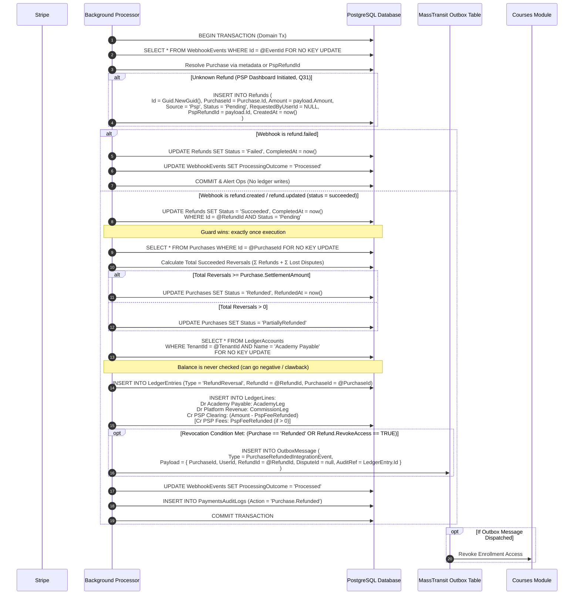

---

## Transaction 6: Webhook: `charge.dispute.created`

### Overview
- **Trigger:** Webhook from PSP indicating a dispute has been opened by the cardholder.
- **One Transaction Contains:** Ingest row $\rightarrow$ Resolve Purchase via charge/PaymentIntent $\rightarrow$ Insert `Disputes` row (`Status = 'Open'`) $\rightarrow$ Audit row.
- **Critical Policy (Q36):** **NO LEDGER WRITE**. Funds are not moved at creation; physical withdrawal is reported via `funds_withdrawn`.

### Flow Diagram

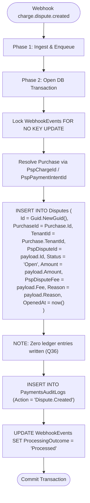

---

## Transaction 7: Webhook: `charge.dispute.funds_withdrawn`

### Overview
- **Trigger:** PSP withdraws the disputed amount plus chargeback fee from platform PSP balance.
- **One Transaction Contains:** Ingest row $\rightarrow$ `DisputeLoss` entry booked **immediately and unconditionally** $\rightarrow$ Payable locked $\rightarrow$ Audit row.
- **Clawback Rule:** Books even if the Purchase was already `Refunded` (Academy Payable goes negative, documented clawback).
- **Ledger Entries:**
  - $\text{PlatformLeg} = \text{ROUND}(\text{dispute.Amount} \times \text{CommissionShare}, \text{minor-unit})$
  - $\text{AcademyLeg} = \text{dispute.Amount} - \text{PlatformLeg}$
  - **Dr** `Academy Payable` (Tenant): $\text{AcademyLeg}$
  - **Dr** `Platform Revenue`: $\text{PlatformLeg}$
  - **Dr** `PSP Fees`: $\text{PspDisputeFee}$
  - **Cr** `PSP Clearing`: $\text{dispute.Amount} + \text{PspDisputeFee}$

### Flow Diagram

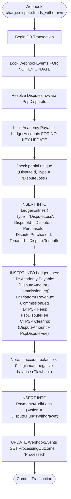

---

## Transaction 8: Webhook: `charge.dispute.funds_reinstated` (Won)

### Overview
- **Trigger:** Bank rules in platform's favor; funds returned to PSP balance.
- **One Transaction Contains:** Ingest $\rightarrow$ `DisputeWon` entry $\rightarrow$ Restores pro-rata allocations $\rightarrow$ Audit row.
- **Fee Rule:** The dispute fee is retained by the PSP and stays expensed.
- **Ledger Entries:**
  - **Dr** `PSP Clearing`: $\text{dispute.Amount}$
  - **Cr** `Academy Payable` (Tenant): $\text{AcademyLeg}$
  - **Cr** `Platform Revenue`: $\text{PlatformLeg}$

### Flow Diagram

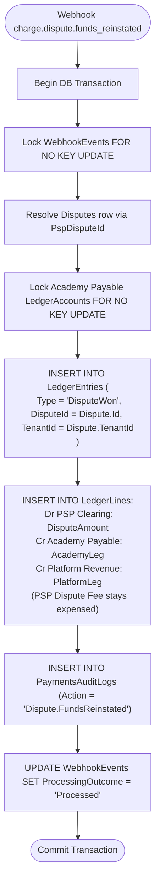

---

## Transaction 9: Webhook: `charge.dispute.closed`

### Overview
- **Trigger:** PSP notifies dispute case is officially closed (`Won` or `Lost`).
- **One Transaction Contains:** Ingest row $\rightarrow$ `Disputes` tripwire update (`Won`/`Lost`) $\rightarrow$ If `Lost`: recompute Purchase status ladder $\rightarrow$ Outbox `PurchaseRefundedIntegrationEvent` $\rightarrow$ Audit row.
- **Critical Policy:** **NO MONEY MOVEMENT AT CLOSE** (cash was moved at `funds_withdrawn` / `funds_reinstated`). **ANY** lost dispute revokes course enrollment access immediately.

### Flow Diagram

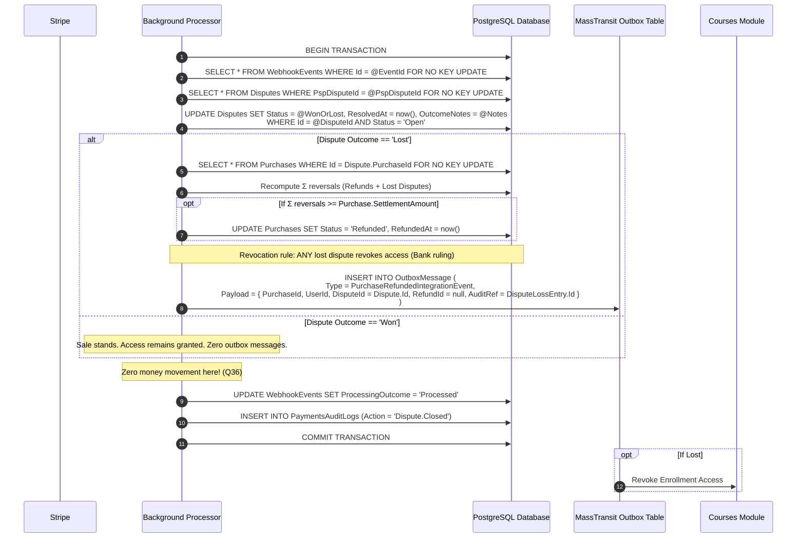

---

## Transaction 10: Platform Admin: Record Settlement

### Overview
- **Trigger:** Platform admin executes payout to an Academy (`POST /api/payments/settlements`).
- **One Transaction Contains:** Lock Academy Payable row `FOR NO KEY UPDATE` $\rightarrow$ Compute Settleable Balance $\rightarrow$ Amount guard $\rightarrow$ `Settlements` insert $\rightarrow$ `Settlement` ledger entry + 2 lines $\rightarrow$ Audit row.
- **Two-Tier Settleable Balance Formula (Q32, Q41):**
  $$\begin{aligned}
  \text{Settleable Balance} &= \text{Ledger Balance } (\Sigma\text{Cr} - \Sigma\text{Dr}) \\
  &- \Sigma\text{ Live Refunds (Pending)} \\
  &- 100\% \text{ of Academy legs for captures inside Short Hold window } (\le \text{ShortHoldDays, def 14d}) \\
  &- \text{ReserveRate (def 10\%)} \times \text{Academy legs in rolling dispute window } (14\text{d} \dots 120\text{d}) \\
  &- \Sigma\text{ remaining Academy legs for Purchases with open RefundRequests}
  \end{aligned}$$
- **Ledger Entries:**
  - **Dr** `Academy Payable` (Tenant): $\text{Amount}$
  - **Cr** `Bank Account` (Platform Asset): $\text{Amount}$

### Flow Diagram

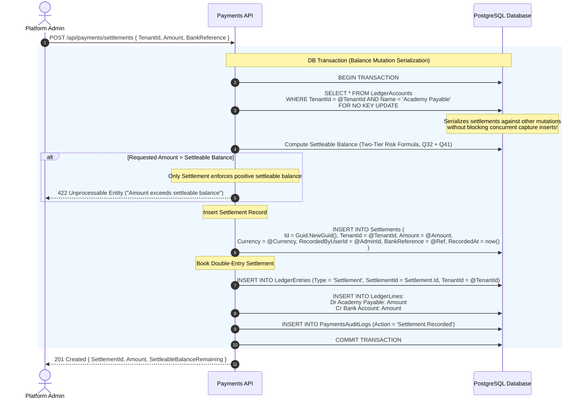

---

## Transaction 11: Ops: Record PSP Payout (Manual)

### Overview
- **Trigger:** Ops operator records regular PSP sweep from Stripe to platform bank account (`POST /api/payments/psp-payouts`).
- **One Transaction Contains:** `PspPayout` entry + 2 lines $\rightarrow$ Audit row.
- **Idempotency:** Partial unique `(PspObjectId) WHERE Type = 'PspPayout'` stops double-recording.
- **Ledger Entries:**
  - **Dr** `Bank Account`: $\text{Amount}$
  - **Cr** `PSP Clearing`: $\text{Amount}$
  - *(TenantId = NULL, platform-level transaction)*

### Flow Diagram

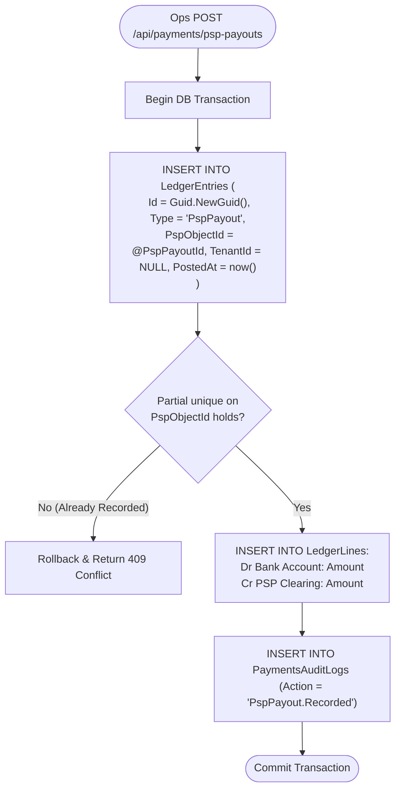

---

## Transaction 12: Courses Event Consumer: Mirror Upsert

### Overview
- **Trigger:** MassTransit consumer receives Courses catalog event (`CoursePublished`, `CourseUnpublished`, etc.).
- **One Transaction Contains:** Version-conditional upsert into `Products` $\rightarrow$ Audit row.
- **Idempotency & Ordering:** Keyed by `(TenantId, ItemType, ItemId)`. Updates only when `SourceVersion` is newer: out-of-order events become safe no-ops.

### Flow Diagram

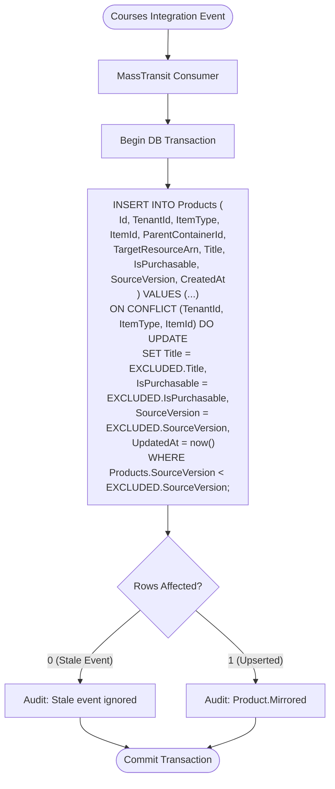

---

## Transaction 13: Academy Admin: Create/Archive Price

### Overview
- **Trigger:** Academy admin updates price for a course plan (`POST /api/payments/products/{id}/prices`).
- **One Transaction Contains:** Archive superseded price $\rightarrow$ Insert new active price $\rightarrow$ Minor-unit scale trigger $\rightarrow$ Audit row.
- **Guarantees:** Handled atomically in a single transaction. Partial unique `(ProductId, Currency) WHERE IsActive = TRUE` ensures exactly one active offer.

### Flow Diagram

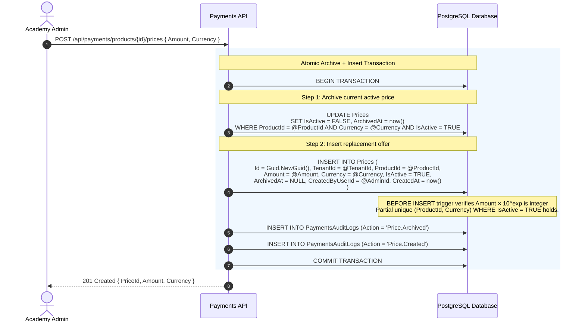

---

## Transaction 14: Platform Admin: Settings Change

### Overview
- **Trigger:** Platform admin opts-in Academy and configures commission share (`PUT /api/payments/settings/{tenantId}`).
- **One Transaction Contains:** Upsert `AcademyPaymentSettings` (explicit `CommissionShare`) $\rightarrow$ Deterministically ensure `Academy Payable` account exists $\rightarrow$ Audit row.
- **Guarantees:** Absent settings row = selling disabled. Account creation uses `ON CONFLICT DO NOTHING` to prevent race collisions.

### Flow Diagram

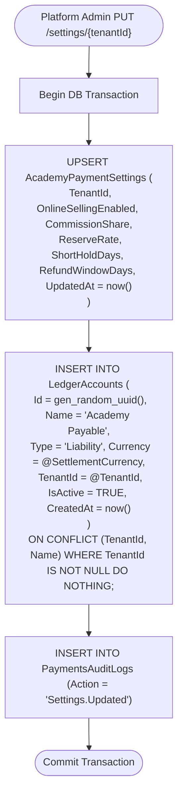

---

## Transaction 15: Refresh Worker: `ProductDailySales` Rebuild

### Overview
- **Trigger:** Scheduled analytics projection worker.
- **One Transaction Contains:** Atomic Delete + Insert of a single `(TenantId, Day)` slice.
- **Guarantees:** Readers never see partial metrics. Bucketed in UTC: `("PaidAt" AT TIME ZONE 'UTC')::date`.

### Flow Diagram

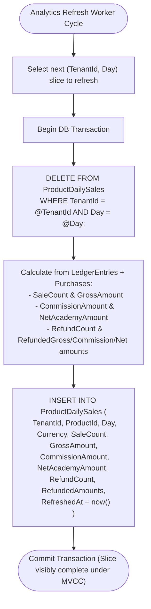

---

## Transaction 16: Sweeper Worker: Stuck Webhook Re-Drive

### Overview
- **Trigger:** Scheduled sweeper cron for stalled or failed webhooks.
- **One Transaction Contains:** Scan non-terminal webhooks older than threshold $\rightarrow$ Re-drive through domain processor $\rightarrow$ Escalate persistent failures.
- **Guarantees:** State machine guards and row locks ensure re-drives are completely safe and idempotent.

### Flow Diagram

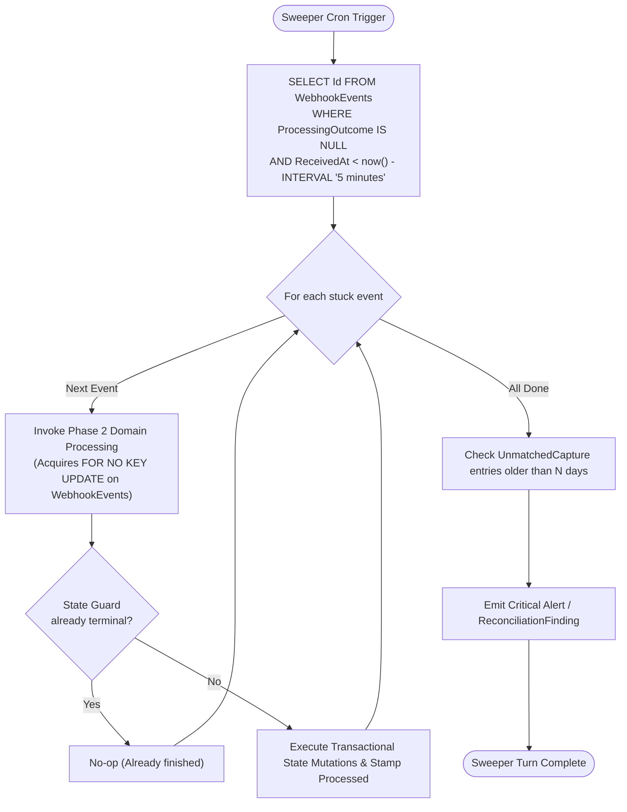

---

## Transaction 17: Reconciliation Worker

### Overview
- **Trigger:** Automated reconciliation cron (`ReconciliationWorker`).
- **One Transaction Contains:** Append row to `ReconciliationRuns` $\rightarrow$ Run audit checks $\rightarrow$ Insert any issues into `ReconciliationFindings`.
- **Kinds:** `LedgerInternal`, `LedgerVsPsp`, `MirrorVsCourses`, `StaleSessions`, `UnmatchedCaptures`, `NegativePayables`.

### Flow Diagram

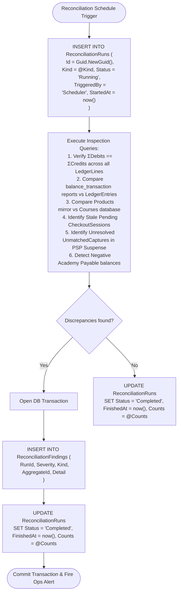

---

## Bonus: Transactions 18 & 19 (Refund Requests Workflow, Q39)

For total completeness with §5 and amendment Q39, here are the student-initiated refund request flows:

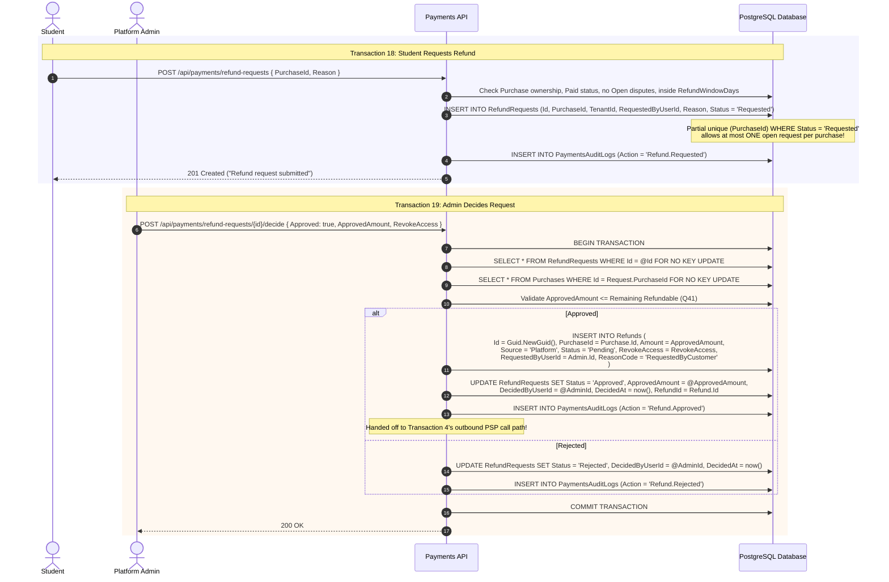

---

## ⚖️ Ledger Entries Summary & T-Accounts Reference

| Transaction & Entry Type | Debits (Dr) | Credits (Cr) | Reference Constraints |
|:---|:---|:---|:---|
| **Capture** (Tx 2) | **PSP Clearing** ($G$) **PSP Fees** ($F$, if $F > 0$) | **Academy Payable** ($G - \text{ROUND}(G \times c)$) **Platform Revenue** ($\text{ROUND}(G \times c)$) **PSP Clearing** ($F$, if $F > 0$) | `PurchaseId` NOT NULL, others NULL. Partial unique on `PurchaseId`. |
| **RefundReversal** (Tx 5) | **Academy Payable** ($\text{Amount} - \text{CommissionLeg}$) **Platform Revenue** ($\text{CommissionLeg}$) | **PSP Clearing** ($\text{Amount} - \text{PspFeeRefunded}$) **PSP Fees** ($\text{PspFeeRefunded}$, if $>0$) | `RefundId` & `PurchaseId` NOT NULL. Partial unique on `RefundId`. |
| **DisputeLoss** (Tx 7) | **Academy Payable** ($\text{DisputeAmount} - \text{PlatformLeg}$) **Platform Revenue** ($\text{PlatformLeg}$) **PSP Fees** ($\text{PspDisputeFee}$) | **PSP Clearing** ($\text{DisputeAmount} + \text{PspDisputeFee}$) | `DisputeId` & `PurchaseId` NOT NULL. Partial unique `(DisputeId, Type)`. |
| **DisputeWon** (Tx 8) | **PSP Clearing** ($\text{DisputeAmount}$) | **Academy Payable** ($\text{AcademyLeg}$) **Platform Revenue** ($\text{PlatformLeg}$) | `DisputeId` NOT NULL. Partial unique `(DisputeId, Type)`. |
| **Settlement** (Tx 10) | **Academy Payable** ($\text{Amount}$) | **Bank Account** ($\text{Amount}$) | `SettlementId` NOT NULL. Partial unique on `SettlementId`. |
| **PspPayout** (Tx 11) | **Bank Account** ($\text{Amount}$) | **PSP Clearing** ($\text{Amount}$) | `PspObjectId` NOT NULL, `TenantId` NULL. Partial unique on `PspObjectId`. |
| **UnmatchedCapture** (Tx 2 fallback) | **PSP Clearing** ($G$) | **PSP Suspense** ($G$) | `PspObjectId` & `Description` NOT NULL. |
