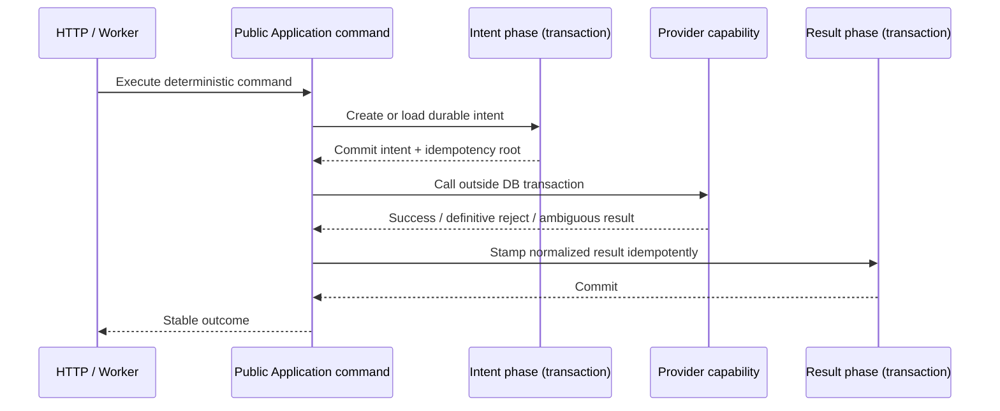
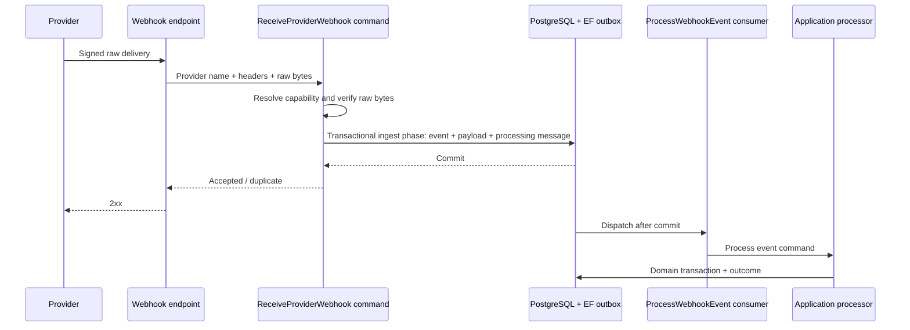

# Payments — Provider-Neutral Transaction Flows

**Status:** Canonical shared workflow source, synchronized 2026-11-18 with Q39–Q58 and the approved engineering review.

**Document ownership:** [`requirement.md`](requirement.md) owns product behavior. [`database.md`](database.md) owns schema and invariants. This file owns shared application sequencing, locks, transactions, outbox use, and Ledger effects. Provider documents own only capabilities, wire contracts, event normalization, and provider-specific deltas. [`design.md`](design.md) owns layer boundaries and implementation slices.

---

## 1. Rules every flow follows

1. Every HTTP, webhook, bus, or worker origin calls a public Application command/query.
2. A local-only money workflow is one `ITransactionalCommand`.
3. A provider workflow is one public non-transactional orchestrator `ICommand` with idempotent internal `ITransactionalCommand` phases before and after provider I/O.
4. No provider call runs under a database transaction or row lock.
5. Provider adapters normalize wire data into provider-neutral facts. Provider JSON and SDK objects never enter Domain.
6. Provider delivery identity and money-movement identity are independent:
   - delivery: (`ProviderName`, `ExternalEventId`)
   - movement: (`ProviderAccountId`, `ExternalTransactionId`)
7. One hardened Ledger posting function inserts the entry and all lines. Runtime roles cannot insert either table directly.
8. State, normalized movement, Ledger posting, audit, and outgoing integration event commit atomically where a flow says “domain transaction.”
9. Payments uses its MassTransit EF outbox for both internal webhook processing and external integration events. The sweeper repairs stalled work; it is not the normal handoff.
10. Correctness uses explicit SQL/add/update operations and database constraints, not EF ChangeTracker state.

### Global lock order

When a flow needs several locks, acquire them in this order:

1. `WebhookEvents`
2. named aggregate (`CheckoutSessions`, `Refunds`, `Disputes`, `RefundRequests`, `PaymentReviewCases`)
3. `Purchases`
4. exact Academy payable `LedgerAccounts` row
5. Ledger posting function

Use `FOR NO KEY UPDATE` unless [`database.md`](database.md) specifies otherwise. Provider I/O happens before or after, never while these locks are held.

---

## 2. Standard provider-call shape

- **Success:** stamp provider identity/result; later webhook/reconciliation may confirm movement.
- **Definitive rejection:** transition the intent to its allowed terminal failure state.
- **Timeout/ambiguous result:** retain pending intent. Retry or poll with the same idempotency root.
- **Replay:** each phase returns the existing result when its deterministic identity already exists.

Origins may not call internal phase commands directly. Architecture tests enforce this rule.

---

## 3. Checkout

### 3.1 Create hosted checkout

1. Authorize authenticated Student and tenant.
2. Resolve Product and reject if not purchasable or the Student already has active access.
3. Resolve active immutable Price, Academy opt-in, and compatible active Provider Currency Routes.
4. Student chooses an available method when more than one route qualifies.
5. Intent transaction inserts or reuses the one pending Checkout Session for `(UserId, ProductId)`, locking `PriceId` and `ProviderCurrencyRouteId`.
6. Resolve the provider's checkout capability before any provider call.
7. Create the hosted checkout outside the transaction using `CheckoutSessionId` as idempotency key.
8. Result transaction stamps the external checkout ID and non-secret provider metadata. Hosted URLs are returned but not persisted.

If the provider is disabled or lacks checkout capability, fail before creating a new provider intent. A timeout leaves the session pending and retryable; method switching waits for completion or expiry.

### 3.2 Confirm exact payment

After delivery ingest or reconciliation yields a normalized incoming movement:

1. Insert/reuse the immutable Provider Transaction.
2. Lock the Checkout Session and resolve by domain ID first, external ID second.
3. Validate provider account/environment, locked Price/route, amount/currency rules, and provider-specific time window.
4. If exact and eligible, create one Purchase linked to the session and movement.
5. Build the capture posting from the stored settlement gross, fee, and Commission Share.
6. Call the Ledger posting function.
7. Mark the session completed; append audit.
8. Publish `PurchaseActivatedIntegrationEvent` through the EF outbox.

The unique session and Provider Transaction references make callback, poll, reconciliation, and duplicate-delivery races converge on one result.

### 3.3 Non-exact incoming money

If real money cannot satisfy exact Purchase rules:

1. Insert/reuse the Provider Transaction.
2. Post `UnappliedReceipt`: Dr Provider Asset / Cr Unapplied Funds.
3. Append audit and a reconciliation finding; optionally open the provider-defined review queue.
4. Do not create a Purchase, complete access, or credit Academy Payable.

This path covers partial, overpaid, duplicate, after-window, unmatched, or otherwise non-attributable money. Provider docs define which conditions can occur.

---

## 4. Webhook ingest and processing

### Ingest transaction

- The public receive command resolves the provider event-normalization capability and rejects invalid signatures without dispatching the ingest transaction.
- Insert or count delivery on (`ProviderName`, `ExternalEventId`).
- Store hot payload plus archive lifecycle fields.
- Enqueue internal `ProcessWebhookEvent(EventId)` in the Payments EF outbox.
- Return 2xx only after commit. Duplicate verified delivery returns 2xx without a second processing intent.

### Processing

- Fetch or normalize any required provider data outside the domain transaction.
- Lock/re-read the event and stop on terminal success/duplicate outcomes.
- Apply the relevant workflow in a short domain transaction.
- Mark `Processed`, `Duplicate`, `Skipped`, or `Failed` with explicit reason.
- Processing-message redelivery is safe. A sweeper re-enqueues stale non-terminal/failed rows and alerts on age/rate thresholds.

---

## 5. Refunds

### 5.1 Student requests a refund

1. Check the Purchase belongs to the Student and tenant.
2. Resolve refund capability. Unsupported providers return a support-path response before any write.
3. Check Academy refund window, open dispute, and Remaining Refundable.
4. Insert one open Refund Request per Purchase plus audit. No Ledger or provider call occurs.

### 5.2 Platform decides a request

1. Lock Refund Request, then Purchase.
2. Recompute Remaining Refundable:

   `SettlementAmount − Σ(Pending + Succeeded refunds) − Σ(dispute exposure currently withdrawn and not reinstated, including final Lost exposure)`

   Merely opening a Dispute contributes zero. The policy consumes normalized exposure facts, not `Dispute.Status` alone.

3. Reject: transition request and append audit; no money write.
4. Approve: validate amount, reason, and `RevokeAccess`; atomically insert pending Refund and transition the request to approved.
5. Dispatch the public refund orchestrator after commit.

### 5.3 Issue or retry provider refund

1. Intent phase locks Purchase and Refund, confirms provider capability, no open dispute, and cap already reserved by the pending Refund.
2. Provider call runs outside the transaction with `RefundId` as idempotency key.
3. Result phase stamps external refund identity on definitive acceptance/rejection.
4. Timeout remains pending. Webhook/reconciliation confirms the actual movement.

### 5.4 Confirm refund movement

1. Insert/reuse outgoing/refund Provider Transaction.
2. Lock Refund and Purchase.
3. Transition Refund to succeeded and post `RefundReversal` using actual provider settlement movement.
4. Move Purchase along `Paid → PartiallyRefunded → Refunded` from total confirmed reversals.
5. Publish source-aware revocation when the Purchase reaches fully refunded or this refund has `RevokeAccess = true`.
6. Append audit and commit atomically.

Provider-originated refunds create the missing Refund row with `Source = Provider`, then follow the same confirmation path. A definitive failed event transitions only a pending Refund and writes no Ledger entry.

---

## 6. Disputes

These flows run only for a provider with normalized dispute capability.

1. **Opened:** insert/reuse Dispute in `Open`; no Ledger write.
2. **Funds withdrawn:** insert Provider Transaction; post `DisputeLoss` immediately. Negative Academy Payable is legal and creates a reconciliation finding.
3. **Funds reinstated:** insert Provider Transaction; post `DisputeWon` restoring the applicable split. Retained fees remain expensed.
4. **Closed:** transition paperwork to `Won` or `Lost`; no cash entry. Lost outcome publishes source-aware access revocation exactly once.

Provider movement time, not dispute close time, controls accounting.

---

## 7. Unapplied Funds review

### 7.1 Open and approve

1. Academy operator opens a `PaymentReviewCase` with provider movement, reason, and immutable evidence reference.
2. A different Platform-finance actor checks tenant/provider/currency, remaining unapplied balance, and evidence.
3. Same-actor approval is rejected in the database and Application.

Approval alone never moves money.

### 7.2 Apply expected amount

1. Lock case, incoming Provider Transaction, and target Checkout Session.
2. Derive remaining unapplied balance from Ledger entries; never trust a mutable counter.
3. Validate expected amount/currency and Purchase eligibility.
4. Create Purchase and post `ApplyUnappliedFunds`: Dr Unapplied Funds / Cr Academy Payable + Cr Platform Revenue.
5. Publish activation and resolve the case. Excess stays unapplied.

### 7.3 Return unapplied money

1. Provider transfer happens outside a DB transaction after approved durable intent.
2. Result phase inserts the outgoing Provider Transaction.
3. Lock the incoming movement and derive remaining unapplied amount.
4. Post `ReturnUnappliedFunds`: Dr Unapplied Funds / Cr Provider Asset.
5. Resolve case and append audit.

### 7.4 Exceptional purchase reversal

For providers without ordinary refund capability, an approved support case plus confirmed outgoing/reversal Provider Transaction creates a succeeded `Refund(Source = ProviderSupport)`, then follows the shared Refund reversal/status/revocation path. Email or approval without movement evidence is insufficient.

---

## 8. Settlements and provider payouts

### 8.1 Academy Settlement

1. Maker opens a Settlement review case with exact Academy, Provider Account, currency, destination snapshot, amount, and evidence.
2. Different checker validates provider policy and approves durable transfer intent.
3. Transfer occurs outside a database transaction.
4. Result phase records movement evidence, locks the exact Academy payable, and recomputes Settleable Balance.
5. Reject if amount exceeds Settleable Balance, account/currency differs, reconciliation is stale, or evidence/external reference was reused.
6. Insert Settlement and post Dr Academy Payable / Cr same-currency source account atomically.

Stripe policy includes hold/reserve/open-refund exposure. ShamCash requires successful daily reconciliation covering captures and otherwise has no rolling reserve. Unapplied Funds is never settleable.

### 8.2 Provider payout

Normalize the provider movement, then post Dr provider-neutral Bank / Cr Provider Asset. It changes where Platform cash sits; it does not settle an Academy liability.

---

## 9. Access integration

Payments publishes its own integration facts. Courses consumers map them into shared source-aware Application commands.

### Activation event

`PurchaseActivatedIntegrationEvent(EventId, TenantId, PurchaseId, UserId, TargetResourceArn, Metadata, AuditReference)`

Courses invokes `GrantCourseAccess(SourceType = Purchase, SourceId = PurchaseId, ...)`. Library invokes the same command with `SourceType = AccessCode`. Failure parking, logs, and uniqueness use `(TenantId, SourceType, SourceId)`.

### Revocation event

`PurchaseAccessRevocationRequestedIntegrationEvent(EventId, TenantId, PurchaseId, UserId, TargetResourceArn, CauseType, CauseId, AuditReference)`

`CauseType` is `Refund` or `Dispute`; exactly one `CauseId` is supplied. Courses invokes `RevokeCourseAccess(SourceType = Purchase, SourceId = PurchaseId, ...)`. Deactivating already-inactive access is a successful no-op.

Purchase IDs never occupy fields named `AccessCodeId`.

---

## 10. Configuration, mirrors, analytics, and operations

| Flow | Transaction and idempotency |
|---|---|
| Product mirror | Conditional upsert by `(ItemType, ItemId)` only when `SourceVersion` is newer; audit in same transaction. |
| Price change | Archive current and insert replacement in one transaction; partial unique allows one active Product/currency Price. |
| Academy settings | Upsert one row per tenant; absent row means checkout disabled. |
| Provider route activation | Validate adapter/capability/environment; ensure structural Ledger accounts before enabling. |
| Analytics refresh | Rebuild one `(Tenant, ProviderAccount, settlement currency, day)` slice transactionally. Projection is never decision truth. |
| Reconciliation | Persist run, counts, and findings. Provider docs own reads; this file owns durable output and gates. |
| Provider health | Mark only affected account/route degraded or disabled; keep ingest/reconciliation/history active. |
| Payload archive | Upload by deterministic object key, verify hash, then transition manifest and clear hot JSON. Retry leaves hot JSON intact. |

---

## 11. Failure and replay matrix

| Failure | Durable state | Retry behavior | Required proof |
|---|---|---|---|
| Provider accepted request; API timed out | pending intent with deterministic key | same key or provider poll | no duplicate external action |
| Process dies after webhook ingest commit | event + payload + outbox message | EF outbox dispatches; sweeper repairs stale rows | crash-after-commit integration test |
| Duplicate delivery with different event ID for same cash | second delivery, same movement identity | movement insert loses unique race and becomes duplicate | callback/history overlap test |
| Concurrent refunds/dispute | Purchase lock + cap | loser observes updated reversal state | PostgreSQL concurrency test |
| Invalid Ledger posting | no entry/lines commit | correct input and retry | function/grant/constraint tests |
| Provider disabled | existing records unchanged | new checkout waits for recovery | provider-isolation test |
| Archive upload succeeds, DB transition fails | hot JSON + deterministic cold object | verify existing hash and retry transition | archive idempotency test |
| Access consumer redelivery | source-aware grant/revoke state | successful no-op after first effect | Library/Payments parity test |

---

## 12. Provider document boundary

Provider documents may define:

- endpoint names, headers, signatures, idempotency fields, and wire payload fields;
- provider capabilities and unsupported operations;
- mapping from provider events/reads into normalized facts;
- provider-specific exactness, timing, fee, presentment, polling, and reconciliation rules;
- delta diagrams that do not repeat the shared transactions above.

They must not redefine:

- lock order, transaction boundaries, outbox semantics, Ledger invariants, shared refund/review/settlement sequencing, access commands, analytics grain, or archive lifecycle;
- database table shapes, grants, triggers, or account partition rules;
- shared failure/replay semantics.

When provider wire behavior conflicts with shared/domain invariants, the provider adapter normalizes or rejects it; it does not change the shared invariant silently.
